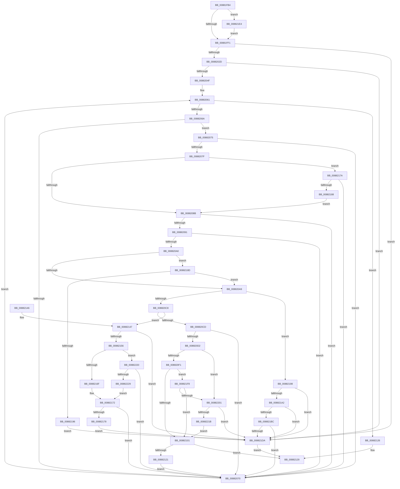

# MiCheckSecuredVad

- RVA: `0x00881FB4`–`0x00882231` (길이 `637` bytes)
- VA: `0x0000000140881FB4`
- 실행 섹션: `PAGE`
- PDB 이름 있음: `예`; PDB Function 태그: `아니요`
- unwind 정보 RVA: `0x0007C614`
- 디코드: `170`개 명령, `637/637` bytes 표시
- 미해석 바이트: `0` (있으면 어셈블리에 `.byte`로 보존)

> 이 문서는 커널 이미지의 기계어와 PDB 기호를 분석해 생성했습니다. 4번과 5번은 함수 원형과 자료형을 바이너리 사용 방식에서 추정한 C 해석이며 원본 소스 복구 결과는 아닙니다.

## 1. Dependencies

- 직접 호출 지점: **2**; 고유 호출 대상: **2**
- 직접 호출자로 확인된 함수: **10**
- RIP 상대 이미지 참조: **2**

### Outgoing calls
- `0x00882115` → [MiComparePteProtections](../../text/44/MiComparePteProtections_function_0044F4FC.md) (function, `0x0044F4FC`)
- `0x008821E7` → [MiGetVadPageSize](../../text/42/MiGetVadPageSize_function_0042F0E0.md) (function, `0x0042F0E0`)

### Direct callers
- [MiFindPlaceholderVadToReplace](../../text/2A/MiFindPlaceholderVadToReplace_function_002A7280.md) at `0x002A7390`
- [MiResetVirtualMemory](../../text/44/MiResetVirtualMemory_function_004486F0.md) at `0x0044881A`
- [MiFreeVirtualMemory](MiFreeVirtualMemory_function_00880268.md) at `0x008806AC`
- [MmProtectVirtualMemory](MmProtectVirtualMemory_function_00881050.md) at `0x00881543`
- [MmProtectVirtualMemory](MmProtectVirtualMemory_function_00881050.md) at `0x008817F7`
- [MiCommitFileBackedSection](MiCommitFileBackedSection_function_00882238.md) at `0x008824D6`
- [MiAllocateVirtualMemory](MiAllocateVirtualMemory_function_00883B40.md) at `0x00883F81`
- [MiAllocateVirtualMemory](MiAllocateVirtualMemory_function_00883B40.md) at `0x008840A9`
- [MiAllocateVirtualMemory](MiAllocateVirtualMemory_function_00883B40.md) at `0x0088436B`
- [MiUnmapViewOfSection](MiUnmapViewOfSection_function_0088A4C4.md) at `0x0088A698`
- [MmSecureVirtualMemoryAgainstWrites](../89/MmSecureVirtualMemoryAgainstWrites_function_00890164.md) at `0x0089035F`
- [sub_00B18C90](../B1/Unknown_function_00B18C90.md) at `0x00B18CD5`
- [sub_00B41C12](../B4/Unknown_function_00B41C12.md) at `0x00B41C86`

### Static image references
- `0x008820F1` → RVA `0x00E2DB78` (`.data`; read)
- `0x00882159` → RVA `0x00011060` (`.rdata`; read)

## 2. Other-region calls and transfers

- 다른 실행 섹션으로 향하는 call: **2**
  - `0x00882115` → [MiComparePteProtections](../../text/44/MiComparePteProtections_function_0044F4FC.md) (`PAGE` → `.text`)
  - `0x008821E7` → [MiGetVadPageSize](../../text/42/MiGetVadPageSize_function_0042F0E0.md) (`PAGE` → `.text`)
- 별도 외부 분기/꼬리 이동을 확인하지 못했습니다.

## 3. Assembly (complete function range)

```asm
00881FB4  48 89 5C 24 08                  mov qword ptr [rsp + 8], rbx
00881FB9  48 89 6C 24 10                  mov qword ptr [rsp + 0x10], rbp
00881FBE  48 89 74 24 18                  mov qword ptr [rsp + 0x18], rsi
00881FC3  57                              push rdi
00881FC4  41 54                           push r12
00881FC6  41 55                           push r13
00881FC8  41 56                           push r14
00881FCA  41 57                           push r15
00881FCC  48 83 EC 30                     sub rsp, 0x30
00881FD0  8B 41 30                        mov eax, dword ptr [rcx + 0x30]
00881FD3  48 8B D9                        mov rbx, rcx
00881FD6  B9 00 00 A0 00                  mov ecx, 0xa00000
00881FDB  41 8B F1                        mov esi, r9d
00881FDE  23 C1                           and eax, ecx
00881FE0  4C 8B F2                        mov r14, rdx
00881FE3  41 BA 00 10 00 00               mov r10d, 0x1000
00881FE9  3B C1                           cmp eax, ecx
00881FEB  0F 84 F3 01 00 00               je 0x1408821e4
00881FF1  8B 43 18                        mov eax, dword ptr [rbx + 0x18]
00881FF4  4D 8D 68 FF                     lea r13, [r8 - 1]
00881FF8  4D 03 EE                        add r13, r14
00881FFB  49 8D 4A FF                     lea rcx, [r10 - 1]
00881FFF  48 F7 D1                        not rcx
00882002  45 33 C9                        xor r9d, r9d
00882005  4C 8B E1                        mov r12, rcx
00882008  4D 23 E6                        and r12, r14
0088200B  4B 8D 2C 2A                     lea rbp, [r10 + r13]
0088200F  48 23 E9                        and rbp, rcx
00882012  0F B6 4B 20                     movzx ecx, byte ptr [rbx + 0x20]
00882016  48 C1 E1 20                     shl rcx, 0x20
0088201A  48 FF CD                        dec rbp
0088201D  48 0B C8                        or rcx, rax
00882020  48 C1 E1 0C                     shl rcx, 0xc
00882024  4C 3B E1                        cmp r12, rcx
00882027  0F 82 AD 01 00 00               jb 0x1408821da
0088202D  0F B6 4B 21                     movzx ecx, byte ptr [rbx + 0x21]
00882031  8B 43 1C                        mov eax, dword ptr [rbx + 0x1c]
00882034  48 C1 E1 20                     shl rcx, 0x20
00882038  48 0B C8                        or rcx, rax
0088203B  48 C1 E1 0C                     shl rcx, 0xc
0088203F  48 81 C9 FF 0F 00 00            or rcx, 0xfff
00882046  48 3B E9                        cmp rbp, rcx
00882049  0F 87 8B 01 00 00               ja 0x1408821da
0088204F  48 8B 7B 38                     mov rdi, qword ptr [rbx + 0x38]
00882053  83 FE 55                        cmp esi, 0x55
00882056  1B C0                           sbb eax, eax
00882058  23 C6                           and eax, esi
0088205A  44 8B F8                        mov r15d, eax
0088205D  48 83 E7 F0                     and rdi, 0xfffffffffffffff0
00882061  48 85 FF                        test rdi, rdi
00882064  0F 84 BC 00 00 00               je 0x140882126
0088206A  83 7F 50 02                     cmp dword ptr [rdi + 0x50], 2
0088206E  74 05                           je 0x140882075
00882070  48 8B 3F                        mov rdi, qword ptr [rdi]
00882073  EB EC                           jmp 0x140882061
00882075  48 3B BC 24 88 00 00 00         cmp rdi, qword ptr [rsp + 0x88]
0088207D  74 F1                           je 0x140882070
0088207F  8B 57 08                        mov edx, dword ptr [rdi + 8]
00882082  F6 C2 40                        test dl, 0x40
00882085  0F 85 EF 00 00 00               jne 0x14088217a
0088208B  4C 3B 67 10                     cmp r12, qword ptr [rdi + 0x10]
0088208F  77 DF                           ja 0x140882070
00882091  48 8B 47 08                     mov rax, qword ptr [rdi + 8]
00882095  48 25 00 F0 FF FF               and rax, 0xfffffffffffff000
0088209B  48 3B E8                        cmp rbp, rax
0088209E  72 D0                           jb 0x140882070
008820A0  83 FE 55                        cmp esi, 0x55
008820A3  0F 83 E4 00 00 00               jae 0x14088218d
008820A9  8B 43 30                        mov eax, dword ptr [rbx + 0x30]
008820AC  25 00 00 20 14                  and eax, 0x14200000
008820B1  3D 00 00 20 10                  cmp eax, 0x10200000
008820B6  0F 94 C1                        sete cl
008820B9  0F BA E2 08                     bt edx, 8
008820BD  0F 92 C0                        setb al
008820C0  84 C8                           test al, cl
008820C2  0F 85 D0 00 00 00               jne 0x140882198
008820C8  F6 C2 04                        test dl, 4
008820CB  74 7A                           je 0x140882147
008820CD  83 FE 55                        cmp esi, 0x55
008820D0  73 9E                           jae 0x140882070
008820D2  0F B6 4B 20                     movzx ecx, byte ptr [rbx + 0x20]
008820D6  8B 43 18                        mov eax, dword ptr [rbx + 0x18]
008820D9  48 C1 E1 20                     shl rcx, 0x20
008820DD  48 0B C8                        or rcx, rax
008820E0  48 C1 E1 0C                     shl rcx, 0xc
008820E4  48 81 F9 00 00 FE 7F            cmp rcx, 0x7ffe0000
008820EB  0F 84 10 01 00 00               je 0x140882201
008820F1  48 8B 05 80 BA 5A 00            mov rax, qword ptr [rip + 0x5aba80]
008820F8  48 3B C8                        cmp rcx, rax
008820FB  0F 84 F7 00 00 00               je 0x1408821f8
00882101  44 8B CE                        mov r9d, esi
00882104  C7 44 24 20 01 00 00 00         mov dword ptr [rsp + 0x20], 1
0088210C  4D 8B C5                        mov r8, r13
0088210F  49 8B D6                        mov rdx, r14
00882112  48 8B CB                        mov rcx, rbx
00882115  E8 E2 D3 BC FF                  call 0x14044f4fc
0088211A  44 8B C8                        mov r9d, eax
0088211D  85 C0                           test eax, eax
0088211F  78 08                           js 0x140882129
00882121  E9 4A FF FF FF                  jmp 0x140882070
00882126  41 8B C1                        mov eax, r9d
00882129  48 8B 5C 24 60                  mov rbx, qword ptr [rsp + 0x60]
0088212E  48 8B 6C 24 68                  mov rbp, qword ptr [rsp + 0x68]
00882133  48 8B 74 24 70                  mov rsi, qword ptr [rsp + 0x70]
00882138  48 83 C4 30                     add rsp, 0x30
0088213C  41 5F                           pop r15
0088213E  41 5E                           pop r14
00882140  41 5D                           pop r13
00882142  41 5C                           pop r12
00882144  5F                              pop rdi
00882145  C3                              ret
00882146  CC                              int3
00882147  41 8B C7                        mov eax, r15d
0088214A  83 E0 F8                        and eax, 0xfffffff8
0088214D  83 F8 10                        cmp eax, 0x10
00882150  0F 84 84 00 00 00               je 0x1408821da
00882156  49 8B C7                        mov rax, r15
00882159  48 8D 0D 00 EF 78 FF            lea rcx, [rip - 0x871100]
00882160  83 E0 07                        and eax, 7
00882163  8A 0C 08                        mov cl, byte ptr [rax + rcx]
00882166  F6 C2 01                        test dl, 1
00882169  0F 84 B1 00 00 00               je 0x140882220
0088216F  80 F9 0A                        cmp cl, 0xa
00882172  0F 8D F8 FE FF FF               jge 0x140882070
00882178  EB 60                           jmp 0x1408821da
0088217A  80 BC 24 80 00 00 00 01         cmp byte ptr [rsp + 0x80], 1
00882182  0F 85 E8 FE FF FF               jne 0x140882070
00882188  E9 FE FE FF FF                  jmp 0x14088208b
0088218D  F6 C2 08                        test dl, 8
00882190  0F 84 13 FF FF FF               je 0x1408820a9
00882196  EB 42                           jmp 0x1408821da
00882198  8B C6                           mov eax, esi
0088219A  83 C8 10                        or eax, 0x10
0088219D  83 F8 11                        cmp eax, 0x11
008821A0  75 38                           jne 0x1408821da
008821A2  8B 43 18                        mov eax, dword ptr [rbx + 0x18]
008821A5  0F B6 4B 20                     movzx ecx, byte ptr [rbx + 0x20]
008821A9  48 C1 E1 20                     shl rcx, 0x20
008821AD  48 0B C8                        or rcx, rax
008821B0  49 8B C6                        mov rax, r14
008821B3  48 C1 E8 0C                     shr rax, 0xc
008821B7  48 3B C8                        cmp rcx, rax
008821BA  74 1E                           je 0x1408821da
008821BC  8B 43 1C                        mov eax, dword ptr [rbx + 0x1c]
008821BF  0F B6 4B 21                     movzx ecx, byte ptr [rbx + 0x21]
008821C3  48 C1 E1 20                     shl rcx, 0x20
008821C7  48 0B C8                        or rcx, rax
008821CA  49 8B C5                        mov rax, r13
008821CD  48 C1 E8 0C                     shr rax, 0xc
008821D1  48 3B C8                        cmp rcx, rax
008821D4  0F 85 96 FE FF FF               jne 0x140882070
008821DA  B8 45 00 00 C0                  mov eax, 0xc0000045
008821DF  E9 45 FF FF FF                  jmp 0x140882129
008821E4  48 8B CB                        mov rcx, rbx
008821E7  E8 F4 CE BA FF                  call 0x14042f0e0
008821EC  4C 8B D0                        mov r10, rax
008821EF  49 C1 E2 0C                     shl r10, 0xc
008821F3  E9 F9 FD FF FF                  jmp 0x140881ff1
008821F8  48 85 C0                        test rax, rax
008821FB  0F 84 00 FF FF FF               je 0x140882101
00882201  65 48 8B 04 25 88 01 00 00      mov rax, qword ptr gs:[0x188]
0088220A  48 8B 88 B8 00 00 00            mov rcx, qword ptr [rax + 0xb8]
00882211  8B 81 FC 05 00 00               mov eax, dword ptr [rcx + 0x5fc]
00882217  A8 01                           test al, 1
00882219  74 BF                           je 0x1408821da
0088221B  E9 E1 FE FF FF                  jmp 0x140882101
00882220  F6 C2 02                        test dl, 2
00882223  0F 84 47 FE FF FF               je 0x140882070
00882229  80 F9 0B                        cmp cl, 0xb
0088222C  E9 41 FF FF FF                  jmp 0x140882172
```

## 4. C-style interpretation (structured pseudocode)

```c
__int64 __fastcall MiCheckSecuredVad(__int64 a1, __int64 a2, __int64 a3, int a4, unsigned __int8 a5, __int64 a6)
{
    __int64 result;
    __int64 v_r10;
    __int64 v_r12;
    __int64 v_r13;
    __int64 v_rbp;
    __int64 v_rdi;
    __int64 v_rsp;
    unsigned int v_stack_m38;
    unsigned __int64 v_stack_p10;
    unsigned __int64 v_stack_p18;
    unsigned __int64 v_stack_p8;

    v_stack_p8 = v_rbx;
    v_stack_p10 = v_rbp;
    v_stack_p18 = v_rsi;
    v_rsp = (v_rsp) - (48);
    result = (unsigned int)(((unsigned int)(*(unsigned int *)(a1 + 48))) & ((unsigned int)((unsigned int)(0xA00000ULL))));
    if (((unsigned int)(result)) == ((unsigned int)((unsigned int)(0xA00000ULL)))) goto loc_008821E4;
loc_00881FF1:
    v_r13 = (a3 - 1) + (a2);
    a1 = ~((unsigned int)(0x1000ULL) - 1);
    a4 = 0;
    v_r12 = (a1) & (a2);
    v_rbp = ((unsigned int)(0x1000ULL) + v_r13 * 1) & (a1);
    a1 = (*(unsigned __int8 *)(a1 + 32)) << (32);
    v_rbp = (v_rbp) - 1;
    a1 = (a1) | ((unsigned int)(*(unsigned int *)(a1 + 24)));
    a1 = (a1) << (12);
    if (v_r12 < a1) goto loc_008821DA;
    a1 = (*(unsigned __int8 *)(a1 + 33)) << (32);
    a1 = (a1) | ((unsigned int)(*(unsigned int *)(a1 + 28)));
    a1 = (a1) << (12);
    a1 = (a1) | (0xFFFULL);
    if (v_rbp > a1) goto loc_008821DA;
    result = (unsigned int)(((unsigned int)(*(unsigned int *)(a1 + 28))) & ((unsigned int)((unsigned int)(a4))));
    v_rdi = (*(unsigned __int64 *)(a1 + 56)) & (-16);
loc_00882061:
    if (v_rdi == 0) goto loc_00882126;
    if ((*(unsigned int *)(v_rdi + 80)) == 2) goto loc_00882075;
loc_00882070:
    goto loc_00882061;
loc_00882075:
    if ((*(unsigned __int64 *)(v_rdi)) == a6) goto loc_00882070;
    if ((((unsigned __int8)((unsigned int)(*(unsigned int *)(*(unsigned __int64 *)(v_rdi) + 8)))) & (64)) != 0) goto loc_0088217A;
loc_0088208B:
    if (v_r12 > (*(unsigned __int64 *)(*(unsigned __int64 *)(v_rdi) + 16))) goto loc_00882070;
    result = (*(unsigned __int64 *)(*(unsigned __int64 *)(v_rdi) + 8)) & (0xFFFFFFFFFFFFF000ULL);
    if (v_rbp < result) goto loc_00882070;
    if (((unsigned int)((unsigned int)(a4))) >= 85) goto loc_0088218D;
loc_008820A9:
    result = (unsigned int)(((unsigned int)(*(unsigned int *)(a1 + 48))) & (0x14200000ULL));
    a1 = (((unsigned int)(result)) == 0x10200000ULL) ? 1 : 0;
    result = (((unsigned int)(result)) < 0x10200000ULL) ? 1 : 0;
    if ((((unsigned __int8)(result)) & ((unsigned __int8)(a1))) != 0) goto loc_00882198;
    if ((((unsigned __int8)((unsigned int)(*(unsigned int *)(*(unsigned __int64 *)(v_rdi) + 8)))) & (4)) == 0) goto loc_00882147;
    if (((unsigned int)((unsigned int)(a4))) >= 85) goto loc_00882070;
    a1 = (*(unsigned __int8 *)(a1 + 32)) << (32);
    a1 = (a1) | ((unsigned int)(*(unsigned int *)(a1 + 24)));
    a1 = (a1) << (12);
    if (a1 == 0x7FFE0000ULL) goto loc_00882201;
    if (a1 == (*(unsigned __int64 *)(v_rip + 5945984))) goto loc_008821F8;
loc_00882101:
    v_stack_m38 = 1;
    result = MiComparePteProtections(a1, a2, v_r13, (unsigned int)((unsigned int)((unsigned int)(a4))));
    if (sign_flag) goto loc_00882129;
    goto loc_00882070;
loc_00882126:
loc_00882129:
    v_rsp = (v_rsp) + (48);
    return (unsigned int)((unsigned int)((unsigned int)((unsigned int)(result))));
loc_00882147:
    result = (unsigned int)(((unsigned int)((unsigned int)((unsigned int)((unsigned int)(result))))) & (0xFFFFFFF8ULL));
    if (((unsigned int)(result)) == 16) goto loc_008821DA;
    result = (unsigned int)(((unsigned int)((unsigned int)(result))) & (7));
    if ((((unsigned __int8)(a2)) & (1)) == 0) goto loc_00882220;
loc_00882172:
    if (((unsigned __int8)(*(unsigned __int8 *)(result + v_rip - 8851712 * 1))) >= 10) goto loc_00882070;
    goto loc_008821DA;
loc_0088217A:
    if (a5 != 1) goto loc_00882070;
    goto loc_0088208B;
loc_0088218D:
    if ((((unsigned __int8)(a2)) & (8)) == 0) goto loc_008820A9;
    goto loc_008821DA;
loc_00882198:
    result = (unsigned int)(((unsigned int)((unsigned int)(v_stack_p18))) | (16));
    if (((unsigned int)(result)) != 17) goto loc_008821DA;
    a1 = (*(unsigned __int8 *)(v_stack_p8 + 32)) << (32);
    a1 = (a1) | ((unsigned int)(*(unsigned int *)(v_stack_p8 + 24)));
    result = (a2) >> (12);
    if (a1 == result) goto loc_008821DA;
    a1 = (*(unsigned __int8 *)(v_stack_p8 + 33)) << (32);
    a1 = (a1) | ((unsigned int)(*(unsigned int *)(v_stack_p8 + 28)));
    result = (v_r13) >> (12);
    if (a1 != result) goto loc_00882070;
loc_008821DA:
    goto loc_00882129;
loc_008821E4:
    result = MiGetVadPageSize(v_stack_p8, a2, v_r13, (unsigned int)((unsigned int)(result)));
    v_r10 = (result) << (12);
    goto loc_00881FF1;
loc_008821F8:
    if (result == 0) goto loc_00882101;
loc_00882201:
    if ((((unsigned __int8)((unsigned int)(*(unsigned int *)(*(unsigned __int64 *)(*(unsigned __int64 *)(gs_base + (0 + 392)) + 184) + 1532)))) & (1)) == 0) goto loc_008821DA;
    goto loc_00882101;
loc_00882220:
    if ((((unsigned __int8)(a2)) & (2)) == 0) goto loc_00882070;
    goto loc_00882172;
}
```

## 5. (Beta) C Style

```c
int64_t MiCheckSecuredVad(void *Arg1, int64_t Arg2, int64_t Arg3, int32_t Arg4, uint8_t Arg5, int64_t Arg6)
{
    uint8_t *arg1 = (uint8_t *)Arg1;

    int64_t result;
    int64_t local_r10;
    int64_t local_r12;
    int64_t local_r13;
    int64_t local_rbp;
    int64_t local_rdi;
    int64_t local_rsp;
    uint32_t v_stack_m38;
    uint64_t v_stack_p10;
    uint64_t v_stack_p18;
    uint64_t v_stack_p8;

    v_stack_p8 = local_rbx;
    v_stack_p10 = local_rbp;
    v_stack_p18 = local_rsi;
    local_rsp = (local_rsp) - (48);
    result = (uint32_t)(((uint32_t)(*(uint32_t *)(arg1 + 0x30))) & ((uint32_t)((uint32_t)(0xA00000ULL))));
    if (((uint32_t)(result)) == ((uint32_t)((uint32_t)(0xA00000ULL)))) goto loc_008821E4;
loc_00881FF1:
    local_r13 = (Arg3 - 1) + (Arg2);
    Arg1 = ~((uint32_t)(0x1000ULL) - 1);
    Arg4 = 0;
    local_r12 = (Arg1) & (Arg2);
    local_rbp = ((uint32_t)(0x1000ULL) + local_r13 * 1) & (Arg1);
    Arg1 = (*(uint8_t *)(arg1 + 0x20)) << (32);
    local_rbp = (local_rbp) - 1;
    Arg1 = (Arg1) | ((uint32_t)(*(uint32_t *)(arg1 + 0x18)));
    Arg1 = (Arg1) << (12);
    if (local_r12 < Arg1) goto loc_008821DA;
    Arg1 = (*(uint8_t *)(arg1 + 0x21)) << (32);
    Arg1 = (Arg1) | ((uint32_t)(*(uint32_t *)(arg1 + 0x1C)));
    Arg1 = (Arg1) << (12);
    Arg1 = (Arg1) | (0xFFFULL);
    if (local_rbp > Arg1) goto loc_008821DA;
    result = (uint32_t)(((uint32_t)(*(uint32_t *)(arg1 + 0x1C))) & ((uint32_t)((uint32_t)(Arg4))));
    local_rdi = (*(uint64_t *)(arg1 + 0x38)) & (-16);
loc_00882061:
    if (local_rdi == 0) goto loc_00882126;
    if ((*(uint32_t *)(local_rdi + 0x50)) == 2) goto loc_00882075;
loc_00882070:
    goto loc_00882061;
loc_00882075:
    if ((*(uint64_t *)(local_rdi)) == Arg6) goto loc_00882070;
    if ((((uint8_t)((uint32_t)(*(uint32_t *)(*(uint64_t *)(local_rdi) + 0x8)))) & (64)) != 0) goto loc_0088217A;
loc_0088208B:
    if (local_r12 > (*(uint64_t *)(*(uint64_t *)(local_rdi) + 0x10))) goto loc_00882070;
    result = (*(uint64_t *)(*(uint64_t *)(local_rdi) + 0x8)) & (0xFFFFFFFFFFFFF000ULL);
    if (local_rbp < result) goto loc_00882070;
    if (((uint32_t)((uint32_t)(Arg4))) >= 85) goto loc_0088218D;
loc_008820A9:
    result = (uint32_t)(((uint32_t)(*(uint32_t *)(arg1 + 0x30))) & (0x14200000ULL));
    Arg1 = (((uint32_t)(result)) == 0x10200000ULL) ? 1 : 0;
    result = (((uint32_t)(result)) < 0x10200000ULL) ? 1 : 0;
    if ((((uint8_t)(result)) & ((uint8_t)(Arg1))) != 0) goto loc_00882198;
    if ((((uint8_t)((uint32_t)(*(uint32_t *)(*(uint64_t *)(local_rdi) + 0x8)))) & (4)) == 0) goto loc_00882147;
    if (((uint32_t)((uint32_t)(Arg4))) >= 85) goto loc_00882070;
    Arg1 = (*(uint8_t *)(arg1 + 0x20)) << (32);
    Arg1 = (Arg1) | ((uint32_t)(*(uint32_t *)(arg1 + 0x18)));
    Arg1 = (Arg1) << (12);
    if (Arg1 == 0x7FFE0000ULL) goto loc_00882201;
    if (Arg1 == (*(uint64_t *)(v_rip + 0x5ABA80))) goto loc_008821F8;
loc_00882101:
    v_stack_m38 = 1;
    result = MiComparePteProtections(Arg1, Arg2, local_r13, (uint32_t)((uint32_t)((uint32_t)(Arg4))));
    if (sign_flag) goto loc_00882129;
    goto loc_00882070;
loc_00882126:
loc_00882129:
    local_rsp = (local_rsp) + (48);
    return (uint32_t)((uint32_t)((uint32_t)((uint32_t)(result))));
loc_00882147:
    result = (uint32_t)(((uint32_t)((uint32_t)((uint32_t)((uint32_t)(result))))) & (0xFFFFFFF8ULL));
    if (((uint32_t)(result)) == 16) goto loc_008821DA;
    result = (uint32_t)(((uint32_t)((uint32_t)(result))) & (7));
    if ((((uint8_t)(Arg2)) & (1)) == 0) goto loc_00882220;
loc_00882172:
    if (((uint8_t)(*(uint8_t *)(result + v_rip - 0x871100 * 1))) >= 10) goto loc_00882070;
    goto loc_008821DA;
loc_0088217A:
    if (Arg5 != 1) goto loc_00882070;
    goto loc_0088208B;
loc_0088218D:
    if ((((uint8_t)(Arg2)) & (8)) == 0) goto loc_008820A9;
    goto loc_008821DA;
loc_00882198:
    result = (uint32_t)(((uint32_t)((uint32_t)(v_stack_p18))) | (16));
    if (((uint32_t)(result)) != 17) goto loc_008821DA;
    Arg1 = (*(uint8_t *)(v_stack_p8 + 0x20)) << (32);
    Arg1 = (Arg1) | ((uint32_t)(*(uint32_t *)(v_stack_p8 + 0x18)));
    result = (Arg2) >> (12);
    if (Arg1 == result) goto loc_008821DA;
    Arg1 = (*(uint8_t *)(v_stack_p8 + 0x21)) << (32);
    Arg1 = (Arg1) | ((uint32_t)(*(uint32_t *)(v_stack_p8 + 0x1C)));
    result = (local_r13) >> (12);
    if (Arg1 != result) goto loc_00882070;
loc_008821DA:
    goto loc_00882129;
loc_008821E4:
    result = MiGetVadPageSize(v_stack_p8, Arg2, local_r13, (uint32_t)((uint32_t)(result)));
    local_r10 = (result) << (12);
    goto loc_00881FF1;
loc_008821F8:
    if (result == 0) goto loc_00882101;
loc_00882201:
    if ((((uint8_t)((uint32_t)(*(uint32_t *)(*(uint64_t *)(*(uint64_t *)(gs_base + (0 + 0x188)) + 0xB8) + 0x5FC)))) & (1)) == 0) goto loc_008821DA;
    goto loc_00882101;
loc_00882220:
    if ((((uint8_t)(Arg2)) & (2)) == 0) goto loc_00882070;
    goto loc_00882172;
}
```

### 관측된 메모리 오프셋

구조체 형식이 확인되지 않은 접근은 인자 기준의 오프셋으로만 기록했습니다.

| 기준 인자 | 오프셋 표현 | 폭 (bit) | 접근 |
|---|---:|---:|---|
| `Arg1` | `+ 0x18` | `32` | `R` |
| `Arg1` | `+ 0x1C` | `32` | `R` |
| `Arg1` | `+ 0x20` | `8` | `R` |
| `Arg1` | `+ 0x21` | `8` | `R` |
| `Arg1` | `+ 0x30` | `32` | `R` |
| `Arg1` | `+ 0x38` | `64` | `R` |

## 6. Execution-region graph

[열기: 2D/3D 그래프와 함수 탐색 컨트롤 패널](../../../control-panel.html?section=page&rva=0x00881FB4&view=graph)

- 2D 그래프는 위에서 아래로 흐르고, 3D 그래프는 빈 공간을 드래그해 회전합니다. Shift+드래그는 이동, 휠은 확대·축소, 함수 노드 선택은 대상 보고서 이동입니다.

### Static fallback


