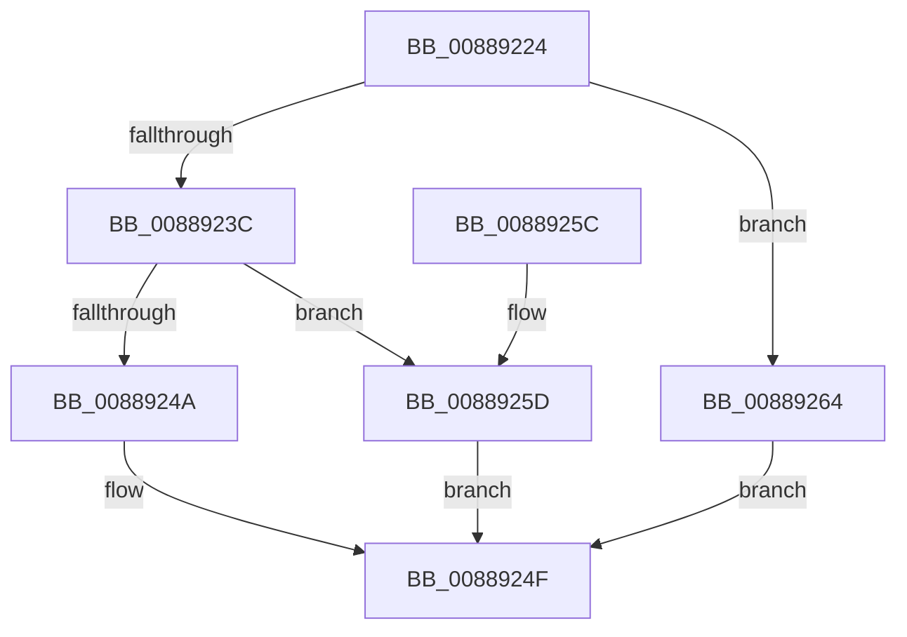

# MiCleanVad

- RVA: `0x00889224`–`0x00889278` (길이 `84` bytes)
- VA: `0x0000000140889224`
- 실행 섹션: `PAGE`
- PDB 이름 있음: `예`; PDB Function 태그: `아니요`
- unwind 정보 RVA: `0x0007CED0`
- 디코드: `26`개 명령, `84/84` bytes 표시
- 미해석 바이트: `0` (있으면 어셈블리에 `.byte`로 보존)

> 이 문서는 커널 이미지의 기계어와 PDB 기호를 분석해 생성했습니다. 4번과 5번은 함수 원형과 자료형을 바이너리 사용 방식에서 추정한 C 해석이며 원본 소스 복구 결과는 아닙니다.

## 1. Dependencies

- 직접 호출 지점: **5**; 고유 호출 대상: **5**
- 직접 호출자로 확인된 함수: **1**
- RIP 상대 이미지 참조: **0**

### Outgoing calls
- `0x00889233` → [MiVadDeleted](../../text/43/MiVadDeleted_function_00431350.md) (function, `0x00431350`)
- `0x0088924A` → [MiUnmapVad](MiUnmapVad_function_00889280.md) (function, `0x00889280`)
- `0x0088925D` → [MiDeleteVad](MiDeleteVad_function_00888C80.md) (function, `0x00888C80`)
- `0x00889264` → [MiWaitForVadDeletion](../../text/31/MiWaitForVadDeletion_function_00316F1C.md) (function, `0x00316F1C`)
- `0x0088926C` → [MiUnlockAndDereferenceVad](../../text/31/MiUnlockAndDereferenceVad_function_00316E60.md) (function, `0x00316E60`)

### Direct callers
- [MmCleanProcessAddressSpace](../A1/MmCleanProcessAddressSpace_function_00A17EC0.md) at `0x00A17FB6`
- [MmCleanProcessAddressSpace](../A1/MmCleanProcessAddressSpace_function_00A17EC0.md) at `0x00A18119`

### Static image references
- 디코드된 RIP-relative 메모리 참조가 없습니다.

## 2. Other-region calls and transfers

- 다른 실행 섹션으로 향하는 call: **3**
  - `0x00889233` → [MiVadDeleted](../../text/43/MiVadDeleted_function_00431350.md) (`PAGE` → `.text`)
  - `0x00889264` → [MiWaitForVadDeletion](../../text/31/MiWaitForVadDeletion_function_00316F1C.md) (`PAGE` → `.text`)
  - `0x0088926C` → [MiUnlockAndDereferenceVad](../../text/31/MiUnlockAndDereferenceVad_function_00316E60.md) (`PAGE` → `.text`)
- 별도 외부 분기/꼬리 이동을 확인하지 못했습니다.

## 3. Assembly (complete function range)

```asm
00889224  48 89 5C 24 08                  mov qword ptr [rsp + 8], rbx
00889229  57                              push rdi
0088922A  48 83 EC 20                     sub rsp, 0x20
0088922E  48 8B D9                        mov rbx, rcx
00889231  33 FF                           xor edi, edi
00889233  E8 18 81 BA FF                  call 0x140431350
00889238  85 C0                           test eax, eax
0088923A  75 28                           jne 0x140889264
0088923C  45 33 C0                        xor r8d, r8d
0088923F  33 D2                           xor edx, edx
00889241  F7 41 30 00 00 20 00            test dword ptr [rcx + 0x30], 0x200000
00889248  75 13                           jne 0x14088925d
0088924A  E8 31 00 00 00                  call 0x140889280
0088924F  48 8B 5C 24 30                  mov rbx, qword ptr [rsp + 0x30]
00889254  8B C7                           mov eax, edi
00889256  48 83 C4 20                     add rsp, 0x20
0088925A  5F                              pop rdi
0088925B  C3                              ret
0088925C  CC                              int3
0088925D  E8 1E FA FF FF                  call 0x140888c80
00889262  EB EB                           jmp 0x14088924f
00889264  E8 B3 DC A8 FF                  call 0x140316f1c
00889269  48 8B CB                        mov rcx, rbx
0088926C  E8 EF DB A8 FF                  call 0x140316e60
00889271  BF 01 00 00 00                  mov edi, 1
00889276  EB D7                           jmp 0x14088924f
```

## 4. C-style interpretation (structured pseudocode)

```c
__int64 __fastcall MiCleanVad(__int64 a1, int a2, int a3)
{
    __int64 result;
    __int64 v_rdi;
    __int64 v_rsp;
    unsigned __int64 v_stack_p8;

    v_stack_p8 = v_rbx;
    v_rsp = (v_rsp) - (32);
    v_rdi = 0;
    result = MiVadDeleted(a1, a2, a3, a4);
    if ((unsigned int)(result) != 0) goto loc_00889264;
    a3 = 0;
    a2 = 0;
    if (((*(unsigned int *)(a1 + 48)) & (0x200000ULL)) != 0) goto loc_0088925D;
    result = MiUnmapVad(a1, a2, a3, a4);
loc_0088924F:
    v_rsp = (v_rsp) + (32);
    return 0;
loc_0088925D:
    result = MiDeleteVad(a1, a2, a3, a4);
    goto loc_0088924F;
loc_00889264:
    result = MiWaitForVadDeletion(a1, a2, a3, a4);
    result = MiUnlockAndDereferenceVad(v_stack_p8, a2, a3, a4);
    goto loc_0088924F;
}
```

## 5. (Beta) C Style

```c
int64_t MiCleanVad(int64_t Arg1, int32_t Arg2, int32_t Arg3)
{
    int64_t result;
    int64_t local_rdi;
    int64_t local_rsp;
    uint64_t v_stack_p8;

    v_stack_p8 = local_rbx;
    local_rsp = (local_rsp) - (32);
    local_rdi = 0;
    result = MiVadDeleted(Arg1, Arg2, Arg3, a4);
    if ((uint32_t)(result) != 0) goto loc_00889264;
    Arg3 = 0;
    Arg2 = 0;
    if (((*(uint32_t *)(Arg1 + 0x30)) & (0x200000ULL)) != 0) goto loc_0088925D;
    result = MiUnmapVad(Arg1, Arg2, Arg3, a4);
loc_0088924F:
    local_rsp = (local_rsp) + (32);
    return 0;
loc_0088925D:
    result = MiDeleteVad(Arg1, Arg2, Arg3, a4);
    goto loc_0088924F;
loc_00889264:
    result = MiWaitForVadDeletion(Arg1, Arg2, Arg3, a4);
    result = MiUnlockAndDereferenceVad(v_stack_p8, Arg2, Arg3, a4);
    goto loc_0088924F;
}
```

## 6. Execution-region graph

[열기: 2D/3D 그래프와 함수 탐색 컨트롤 패널](../../../control-panel.html?section=page&rva=0x00889224&view=graph)

- 2D 그래프는 위에서 아래로 흐르고, 3D 그래프는 빈 공간을 드래그해 회전합니다. Shift+드래그는 이동, 휠은 확대·축소, 함수 노드 선택은 대상 보고서 이동입니다.

### Static fallback


