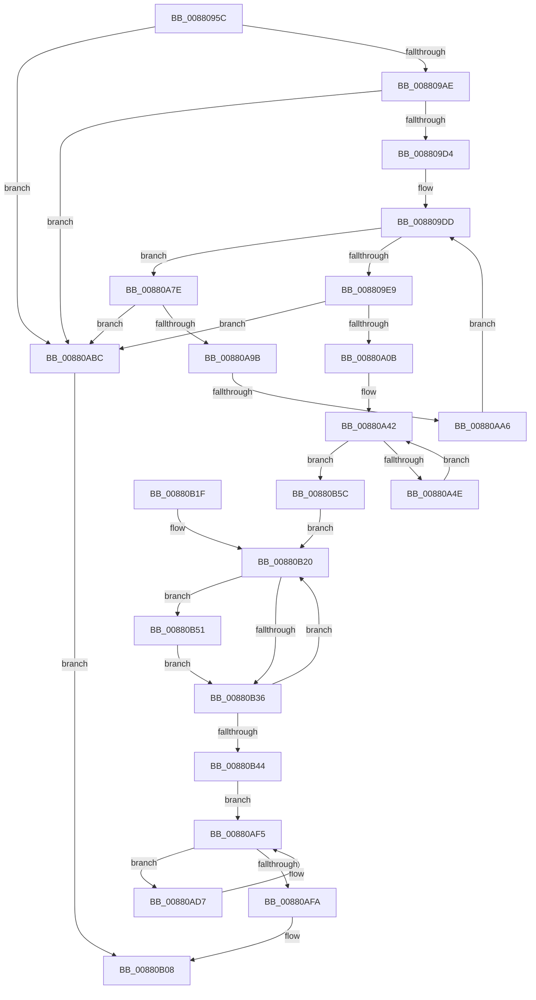

# MiCoalescePlaceholderAllocations

- RVA: `0x0088095C`–`0x00880B91` (길이 `565` bytes)
- VA: `0x000000014088095C`
- 실행 섹션: `PAGE`
- PDB 이름 있음: `예`; PDB Function 태그: `예`
- unwind 정보 RVA: `0x000759B8`
- 디코드: `156`개 명령, `565/565` bytes 표시
- 미해석 바이트: `0` (있으면 어셈블리에 `.byte`로 보존)

> 이 문서는 커널 이미지의 기계어와 PDB 기호를 분석해 생성했습니다. 4번과 5번은 함수 원형과 자료형을 바이너리 사용 방식에서 추정한 C 해석이며 원본 소스 복구 결과는 아닙니다.

## 1. Dependencies

- 직접 호출 지점: **20**; 고유 호출 대상: **14**
- 직접 호출자로 확인된 함수: **1**
- RIP 상대 이미지 참조: **0**

### Outgoing calls
- `0x0088099C` → [MiLockVadRange](../87/MiLockVadRange_function_0087F670.md) (function, `0x0087F670`)
- `0x008809B1` → [MiLocateAddress](../../text/31/MiLocateAddress_function_003168D0.md) (function, `0x003168D0`)
- `0x00880A0E` → [MiGetNextVad](../../text/29/MiGetNextVad_function_00297224.md) (function, `0x00297224`)
- `0x00880A19` → [MiGetNextVad](../../text/29/MiGetNextVad_function_00297224.md) (function, `0x00297224`)
- `0x00880A24` → [MiReferenceVad](../../text/29/MiReferenceVad_function_00295890.md) (function, `0x00295890`)
- `0x00880A31` → [MiRemoveVad](../../text/29/MiRemoveVad_function_00295C78.md) (function, `0x00295C78`)
- `0x00880A39` → [MiSetVadDeleted](../../text/29/MiSetVadDeleted_function_00296E00.md) (function, `0x00296E00`)
- `0x00880A54` → [MiGetNextVad](../../text/29/MiGetNextVad_function_00297224.md) (function, `0x00297224`)
- `0x00880A5F` → [MiReferenceVad](../../text/29/MiReferenceVad_function_00295890.md) (function, `0x00295890`)
- `0x00880A6C` → [MiRemoveVad](../../text/29/MiRemoveVad_function_00295C78.md) (function, `0x00295C78`)
- `0x00880A74` → [MiSetVadDeleted](../../text/29/MiSetVadDeleted_function_00296E00.md) (function, `0x00296E00`)
- `0x00880AAC` → [MiGetNextVad](../../text/29/MiGetNextVad_function_00297224.md) (function, `0x00297224`)
- `0x00880AD0` → [MiUnlockVadRange](../87/MiUnlockVadRange_function_0087F590.md) (function, `0x0087F590`)
- `0x00880AE3` → [MiLockVad](../../text/29/MiLockVad_function_00295810.md) (function, `0x00295810`)
- `0x00880AF0` → [MiDeleteVad](MiDeleteVad_function_00888C80.md) (function, `0x00888C80`)
- `0x00880B01` → [MiDecrementVadsBeingDeleted](../../text/34/MiDecrementVadsBeingDeleted_function_00341010.md) (function, `0x00341010`)
- `0x00880B3A` → [KeAbPostRelease](../../text/2E/KeAbPostRelease_function_002E1600.md) (function, `0x002E1600`)
- `0x00880B4A` → [MiUnlockVad](../../text/2A/MiUnlockVad_function_002A59C8.md) (function, `0x002A59C8`)
- `0x00880B55` → [ExfTryToWakePushLock](../../text/26/ExfTryToWakePushLock_function_00265DD0.md) (function, `0x00265DD0`)
- `0x00880B87` → [UNLOCK_ADDRESS_SPACE](../../text/2A/UNLOCK_ADDRESS_SPACE_function_002A4844.md) (function, `0x002A4844`)

### Direct callers
- [sub_00880151](Unknown_function_00880151.md) at `0x0088015F`

### Static image references
- 디코드된 RIP-relative 메모리 참조가 없습니다.

## 2. Other-region calls and transfers

- 다른 실행 섹션으로 향하는 call: **17**
  - `0x008809B1` → [MiLocateAddress](../../text/31/MiLocateAddress_function_003168D0.md) (`PAGE` → `.text`)
  - `0x00880A0E` → [MiGetNextVad](../../text/29/MiGetNextVad_function_00297224.md) (`PAGE` → `.text`)
  - `0x00880A19` → [MiGetNextVad](../../text/29/MiGetNextVad_function_00297224.md) (`PAGE` → `.text`)
  - `0x00880A24` → [MiReferenceVad](../../text/29/MiReferenceVad_function_00295890.md) (`PAGE` → `.text`)
  - `0x00880A31` → [MiRemoveVad](../../text/29/MiRemoveVad_function_00295C78.md) (`PAGE` → `.text`)
  - `0x00880A39` → [MiSetVadDeleted](../../text/29/MiSetVadDeleted_function_00296E00.md) (`PAGE` → `.text`)
  - `0x00880A54` → [MiGetNextVad](../../text/29/MiGetNextVad_function_00297224.md) (`PAGE` → `.text`)
  - `0x00880A5F` → [MiReferenceVad](../../text/29/MiReferenceVad_function_00295890.md) (`PAGE` → `.text`)
  - `0x00880A6C` → [MiRemoveVad](../../text/29/MiRemoveVad_function_00295C78.md) (`PAGE` → `.text`)
  - `0x00880A74` → [MiSetVadDeleted](../../text/29/MiSetVadDeleted_function_00296E00.md) (`PAGE` → `.text`)
  - `0x00880AAC` → [MiGetNextVad](../../text/29/MiGetNextVad_function_00297224.md) (`PAGE` → `.text`)
  - `0x00880AE3` → [MiLockVad](../../text/29/MiLockVad_function_00295810.md) (`PAGE` → `.text`)
  - `0x00880B01` → [MiDecrementVadsBeingDeleted](../../text/34/MiDecrementVadsBeingDeleted_function_00341010.md) (`PAGE` → `.text`)
  - `0x00880B3A` → [KeAbPostRelease](../../text/2E/KeAbPostRelease_function_002E1600.md) (`PAGE` → `.text`)
  - `0x00880B4A` → [MiUnlockVad](../../text/2A/MiUnlockVad_function_002A59C8.md) (`PAGE` → `.text`)
  - `0x00880B55` → [ExfTryToWakePushLock](../../text/26/ExfTryToWakePushLock_function_00265DD0.md) (`PAGE` → `.text`)
  - `0x00880B87` → [UNLOCK_ADDRESS_SPACE](../../text/2A/UNLOCK_ADDRESS_SPACE_function_002A4844.md) (`PAGE` → `.text`)
- call이 아닌 외부 분기/꼬리 이동: **1**
  - `0x00880AA0` → [sub_00B18C90](../B1/Unknown_function_00B18C90.md) (`tail-transfer`)

## 3. Assembly (complete function range)

```asm
0088095C  48 89 5C 24 08                  mov qword ptr [rsp + 8], rbx
00880961  44 88 4C 24 20                  mov byte ptr [rsp + 0x20], r9b
00880966  55                              push rbp
00880967  56                              push rsi
00880968  57                              push rdi
00880969  41 54                           push r12
0088096B  41 55                           push r13
0088096D  41 56                           push r14
0088096F  41 57                           push r15
00880971  48 83 EC 30                     sub rsp, 0x30
00880975  65 48 8B 04 25 88 01 00 00      mov rax, qword ptr gs:[0x188]
0088097E  49 8B E8                        mov rbp, r8
00880981  49 81 E0 00 F0 FF FF            and r8, 0xfffffffffffff000
00880988  48 89 84 24 80 00 00 00         mov qword ptr [rsp + 0x80], rax
00880990  41 B9 01 00 00 00               mov r9d, 1
00880996  4C 8B F2                        mov r14, rdx
00880999  4C 8B E9                        mov r13, rcx
0088099C  E8 CF EC FF FF                  call 0x14087f670
008809A1  4C 8B E0                        mov r12, rax
008809A4  48 83 F8 02                     cmp rax, 2
008809A8  0F 82 0E 01 00 00               jb 0x140880abc
008809AE  49 8B CE                        mov rcx, r14
008809B1  E8 1A 5F A9 FF                  call 0x1403168d0
008809B6  48 8B F0                        mov rsi, rax
008809B9  0F B6 50 20                     movzx edx, byte ptr [rax + 0x20]
008809BD  8B 48 18                        mov ecx, dword ptr [rax + 0x18]
008809C0  48 C1 E2 20                     shl rdx, 0x20
008809C4  48 0B D1                        or rdx, rcx
008809C7  48 C1 E2 0C                     shl rdx, 0xc
008809CB  49 3B D6                        cmp rdx, r14
008809CE  0F 85 E8 00 00 00               jne 0x140880abc
008809D4  48 8B F8                        mov rdi, rax
008809D7  48 8B D8                        mov rbx, rax
008809DA  45 33 FF                        xor r15d, r15d
008809DD  41 8B C7                        mov eax, r15d
008809E0  49 3B C4                        cmp rax, r12
008809E3  0F 82 95 00 00 00               jb 0x140880a7e
008809E9  0F B6 4B 21                     movzx ecx, byte ptr [rbx + 0x21]
008809ED  8B 43 1C                        mov eax, dword ptr [rbx + 0x1c]
008809F0  48 C1 E1 20                     shl rcx, 0x20
008809F4  48 0B C8                        or rcx, rax
008809F7  48 C1 E1 0C                     shl rcx, 0xc
008809FB  48 81 C9 FF 0F 00 00            or rcx, 0xfff
00880A02  48 3B CD                        cmp rcx, rbp
00880A05  0F 85 B1 00 00 00               jne 0x140880abc
00880A0B  48 8B CE                        mov rcx, rsi
00880A0E  E8 11 68 A1 FF                  call 0x140297224
00880A13  48 8B C8                        mov rcx, rax
00880A16  48 8B F8                        mov rdi, rax
00880A19  E8 06 68 A1 FF                  call 0x140297224
00880A1E  48 8B CF                        mov rcx, rdi
00880A21  4C 8B F0                        mov r14, rax
00880A24  E8 67 4E A1 FF                  call 0x140295890
00880A29  48 8B CF                        mov rcx, rdi
00880A2C  45 33 C0                        xor r8d, r8d
00880A2F  33 D2                           xor edx, edx
00880A31  E8 42 52 A1 FF                  call 0x140295c78
00880A36  48 8B CF                        mov rcx, rdi
00880A39  E8 C2 63 A1 FF                  call 0x140296e00
00880A3E  48 83 27 00                     and qword ptr [rdi], 0
00880A42  4C 8B FF                        mov r15, rdi
00880A45  48 3B FB                        cmp rdi, rbx
00880A48  0F 84 0E 01 00 00               je 0x140880b5c
00880A4E  49 8B CE                        mov rcx, r14
00880A51  49 8B FE                        mov rdi, r14
00880A54  E8 CB 67 A1 FF                  call 0x140297224
00880A59  48 8B CF                        mov rcx, rdi
00880A5C  4C 8B F0                        mov r14, rax
00880A5F  E8 2C 4E A1 FF                  call 0x140295890
00880A64  48 8B CF                        mov rcx, rdi
00880A67  45 33 C0                        xor r8d, r8d
00880A6A  33 D2                           xor edx, edx
00880A6C  E8 07 52 A1 FF                  call 0x140295c78
00880A71  48 8B CF                        mov rcx, rdi
00880A74  E8 87 63 A1 FF                  call 0x140296e00
00880A79  4C 89 3F                        mov qword ptr [rdi], r15
00880A7C  EB C4                           jmp 0x140880a42
00880A7E  8B 4F 34                        mov ecx, dword ptr [rdi + 0x34]
00880A81  48 B8 FD FF FF FF 07 00 00 00   movabs rax, 0x7fffffffd
00880A8B  0F B6 57 22                     movzx edx, byte ptr [rdi + 0x22]
00880A8F  48 C1 E2 20                     shl rdx, 0x20
00880A93  48 0B D1                        or rdx, rcx
00880A96  48 3B D0                        cmp rdx, rax
00880A99  75 21                           jne 0x140880abc
00880A9B  8B 47 30                        mov eax, dword ptr [rdi + 0x30]
00880A9E  A8 08                           test al, 8
00880AA0  0F 85 EA 81 29 00               jne 0x140b18c90
00880AA6  48 8B CF                        mov rcx, rdi
00880AA9  48 8B DF                        mov rbx, rdi
00880AAC  E8 73 67 A1 FF                  call 0x140297224
00880AB1  48 8B F8                        mov rdi, rax
00880AB4  41 FF C7                        inc r15d
00880AB7  E9 21 FF FF FF                  jmp 0x1408809dd
00880ABC  BB 18 00 00 C0                  mov ebx, 0xc0000018
00880AC1  41 B9 01 00 00 00               mov r9d, 1
00880AC7  4D 8B C4                        mov r8, r12
00880ACA  49 8B D6                        mov rdx, r14
00880ACD  49 8B CD                        mov rcx, r13
00880AD0  E8 BB EA FF FF                  call 0x14087f590
00880AD5  EB 31                           jmp 0x140880b08
00880AD7  48 8B DF                        mov rbx, rdi
00880ADA  49 8B CF                        mov rcx, r15
00880ADD  48 8B 3F                        mov rdi, qword ptr [rdi]
00880AE0  48 8B D3                        mov rdx, rbx
00880AE3  E8 28 4D A1 FF                  call 0x140295810
00880AE8  45 33 C0                        xor r8d, r8d
00880AEB  33 D2                           xor edx, edx
00880AED  48 8B CB                        mov rcx, rbx
00880AF0  E8 8B 81 00 00                  call 0x140888c80
00880AF5  48 85 FF                        test rdi, rdi
00880AF8  75 DD                           jne 0x140880ad7
00880AFA  48 8D 8D 00 03 00 00            lea rcx, [rbp + 0x300]
00880B01  E8 0A 05 AC FF                  call 0x140341010
00880B06  33 DB                           xor ebx, ebx
00880B08  8B C3                           mov eax, ebx
00880B0A  48 8B 5C 24 70                  mov rbx, qword ptr [rsp + 0x70]
00880B0F  48 83 C4 30                     add rsp, 0x30
00880B13  41 5F                           pop r15
00880B15  41 5E                           pop r14
00880B17  41 5D                           pop r13
00880B19  41 5C                           pop r12
00880B1B  5F                              pop rdi
00880B1C  5E                              pop rsi
00880B1D  5D                              pop rbp
00880B1E  C3                              ret
00880B1F  CC                              int3
00880B20  49 8D 1E                        lea rbx, [r14]
00880B23  48 83 C8 FF                     or rax, 0xffffffffffffffff
00880B27  4D 8B 36                        mov r14, qword ptr [r14]
00880B2A  F0 48 0F C1 43 28               lock xadd qword ptr [rbx + 0x28], rax
00880B30  24 06                           and al, 6
00880B32  3C 02                           cmp al, 2
00880B34  74 1B                           je 0x140880b51
00880B36  48 8D 4B 28                     lea rcx, [rbx + 0x28]
00880B3A  E8 C1 0A A6 FF                  call 0x1402e1600
00880B3F  4D 85 F6                        test r14, r14
00880B42  75 DC                           jne 0x140880b20
00880B44  48 8B D6                        mov rdx, rsi
00880B47  49 8B CF                        mov rcx, r15
00880B4A  E8 79 4E A2 FF                  call 0x1402a59c8
00880B4F  EB A4                           jmp 0x140880af5
00880B51  48 8D 4B 28                     lea rcx, [rbx + 0x28]
00880B55  E8 76 52 9E FF                  call 0x140265dd0
00880B5A  EB DA                           jmp 0x140880b36
00880B5C  48 C1 ED 0C                     shr rbp, 0xc
00880B60  89 6E 1C                        mov dword ptr [rsi + 0x1c], ebp
00880B63  48 C1 ED 20                     shr rbp, 0x20
00880B67  40 88 6E 21                     mov byte ptr [rsi + 0x21], bpl
00880B6B  49 8B AD 10 04 00 00            mov rbp, qword ptr [r13 + 0x410]
00880B72  F0 FF 85 E8 03 00 00            lock inc dword ptr [rbp + 0x3e8]
00880B79  4C 8B BC 24 80 00 00 00         mov r15, qword ptr [rsp + 0x80]
00880B81  49 8B D5                        mov rdx, r13
00880B84  49 8B CF                        mov rcx, r15
00880B87  E8 B8 3C A2 FF                  call 0x1402a4844
00880B8C  4C 8B F7                        mov r14, rdi
00880B8F  EB 8F                           jmp 0x140880b20
```

## 4. C-style interpretation (structured pseudocode)

```c
__int64 __fastcall MiCoalescePlaceholderAllocations(__int64 a1, __int64 a2, __int64 a3, unsigned __int8 a4)
{
    __int64 result;
    __int64 v_r15;
    __int64 v_rbp;
    __int64 v_rbx;
    __int64 v_rsp;
    unsigned __int64 v_stack_p18;
    unsigned __int8 v_stack_p20;
    unsigned __int64 v_stack_p8;
    unsigned __int64 v_stack_p80;

    v_stack_p8 = v_rbx;
    v_stack_p20 = a4;
    v_rsp = (v_rsp) - (48);
    a3 = (a3) & (0xFFFFFFFFFFFFF000ULL);
    v_stack_p18 = *(unsigned __int64 *)(gs_base + (0 + 392));
    result = MiLockVadRange(a1, a2, a3, 1);
    if (result < 2) goto loc_00880ABC;
    result = MiLocateAddress(a2, a2, a3, 1);
    a2 = (*(unsigned __int8 *)(result + 32)) << (32);
    a2 = (a2) | ((unsigned int)(*(unsigned int *)(result + 24)));
    a2 = (a2) << (12);
    if (a2 != a2) goto loc_00880ABC;
    v_r15 = 0;
loc_008809DD:
    if (0 < result) goto loc_00880A7E;
    a1 = (*(unsigned __int8 *)(result + 33)) << (32);
    a1 = (a1) | ((unsigned int)(*(unsigned int *)(result + 28)));
    a1 = (a1) << (12);
    a1 = (a1) | (0xFFFULL);
    if (a1 != a3) goto loc_00880ABC;
    result = MiGetNextVad(result, a2, a3, 1);
    result = MiGetNextVad(result, a2, a3, 1);
    result = MiReferenceVad(result, a2, a3, 1);
    a3 = 0;
    a2 = 0;
    result = MiRemoveVad(result, a2, a3, 1);
    result = MiSetVadDeleted(result, a2, a3, 1);
loc_00880A42:
    if (result == result) goto loc_00880B5C;
    result = MiGetNextVad(result, a2, a3, 1);
    result = MiReferenceVad(result, a2, a3, 1);
    a3 = 0;
    a2 = 0;
    result = MiRemoveVad(result, a2, a3, 1);
    result = MiSetVadDeleted(result, a2, a3, 1);
    *(unsigned __int64 *)(result) = result;
    goto loc_00880A42;
loc_00880A7E:
    a2 = (*(unsigned __int8 *)(result + 34)) << (32);
    a2 = (a2) | ((unsigned int)(*(unsigned int *)(result + 52)));
    if (a2 != result) goto loc_00880ABC;
    result = MiGetNextVad(result, a2, a3, 1);
    v_r15 = (unsigned int)((result) + 1);
    goto loc_008809DD;
loc_00880ABC:
    result = MiUnlockVadRange(a1, result, result, 1);
    goto loc_00880B08;
loc_00880AD7:
    result = MiLockVad(v_r15, result, result, 1);
    a3 = 0;
    a2 = 0;
    result = MiDeleteVad(result, a2, a3, 1);
loc_00880AF5:
    if (*(unsigned __int64 *)(result) != 0) goto loc_00880AD7;
    result = MiDecrementVadsBeingDeleted(a3 + 768, a2, a3, 1);
    v_rbx = 0;
loc_00880B08:
    v_rsp = (v_rsp) + (48);
    return 0;
loc_00880B20:
    result = (0) | (-1);
    result = (unsigned __int8)((result) & (6));
    if (((unsigned __int8)(result)) == 2) goto loc_00880B51;
loc_00880B36:
    result = KeAbPostRelease(result + 40, a2, a3, 1);
    if (*(unsigned __int64 *)(result) != 0) goto loc_00880B20;
    result = MiUnlockVad(v_r15, result, a3, 1);
    goto loc_00880AF5;
loc_00880B51:
    result = ExfTryToWakePushLock(result + 40, result, a3, 1);
    goto loc_00880B36;
loc_00880B5C:
    v_rbp = (a3) >> (12);
    *(unsigned int *)(result + 28) = (unsigned int)(v_rbp);
    v_rbp = (v_rbp) >> (32);
    *(unsigned __int8 *)(result + 33) = (unsigned __int8)(v_rbp);
    result = UNLOCK_ADDRESS_SPACE(v_stack_p80, a1, a3, 1);
    goto loc_00880B20;
}
```

## 5. (Beta) C Style

```c
int64_t MiCoalescePlaceholderAllocations(void *Arg1, int64_t Arg2, int64_t Arg3, uint8_t Arg4)
{
    uint8_t *arg1 = (uint8_t *)Arg1;

    int64_t result;
    int64_t local_r15;
    int64_t local_rbp;
    int64_t local_rbx;
    int64_t local_rsp;
    uint64_t v_stack_p18;
    uint8_t v_stack_p20;
    uint64_t v_stack_p8;
    uint64_t v_stack_p80;

    v_stack_p8 = local_rbx;
    v_stack_p20 = Arg4;
    local_rsp = (local_rsp) - (48);
    Arg3 = (Arg3) & (0xFFFFFFFFFFFFF000ULL);
    v_stack_p18 = *(uint64_t *)(gs_base + (0 + 0x188));
    result = MiLockVadRange(Arg1, Arg2, Arg3, 1);
    if (result < 2) goto loc_00880ABC;
    result = MiLocateAddress(Arg2, Arg2, Arg3, 1);
    Arg2 = (*(uint8_t *)(result + 0x20)) << (32);
    Arg2 = (Arg2) | ((uint32_t)(*(uint32_t *)(result + 0x18)));
    Arg2 = (Arg2) << (12);
    if (Arg2 != Arg2) goto loc_00880ABC;
    local_r15 = 0;
loc_008809DD:
    if (0 < result) goto loc_00880A7E;
    Arg1 = (*(uint8_t *)(result + 0x21)) << (32);
    Arg1 = (Arg1) | ((uint32_t)(*(uint32_t *)(result + 0x1C)));
    Arg1 = (Arg1) << (12);
    Arg1 = (Arg1) | (0xFFFULL);
    if (Arg1 != Arg3) goto loc_00880ABC;
    result = MiGetNextVad(result, Arg2, Arg3, 1);
    result = MiGetNextVad(result, Arg2, Arg3, 1);
    result = MiReferenceVad(result, Arg2, Arg3, 1);
    Arg3 = 0;
    Arg2 = 0;
    result = MiRemoveVad(result, Arg2, Arg3, 1);
    result = MiSetVadDeleted(result, Arg2, Arg3, 1);
loc_00880A42:
    if (result == result) goto loc_00880B5C;
    result = MiGetNextVad(result, Arg2, Arg3, 1);
    result = MiReferenceVad(result, Arg2, Arg3, 1);
    Arg3 = 0;
    Arg2 = 0;
    result = MiRemoveVad(result, Arg2, Arg3, 1);
    result = MiSetVadDeleted(result, Arg2, Arg3, 1);
    *(uint64_t *)(result) = result;
    goto loc_00880A42;
loc_00880A7E:
    Arg2 = (*(uint8_t *)(result + 0x22)) << (32);
    Arg2 = (Arg2) | ((uint32_t)(*(uint32_t *)(result + 0x34)));
    if (Arg2 != result) goto loc_00880ABC;
    result = MiGetNextVad(result, Arg2, Arg3, 1);
    local_r15 = (uint32_t)((result) + 1);
    goto loc_008809DD;
loc_00880ABC:
    result = MiUnlockVadRange(Arg1, result, result, 1);
    goto loc_00880B08;
loc_00880AD7:
    result = MiLockVad(local_r15, result, result, 1);
    Arg3 = 0;
    Arg2 = 0;
    result = MiDeleteVad(result, Arg2, Arg3, 1);
loc_00880AF5:
    if (*(uint64_t *)(result) != 0) goto loc_00880AD7;
    result = MiDecrementVadsBeingDeleted(Arg3 + 768, Arg2, Arg3, 1);
    local_rbx = 0;
loc_00880B08:
    local_rsp = (local_rsp) + (48);
    return 0;
loc_00880B20:
    result = (0) | (-1);
    result = (uint8_t)((result) & (6));
    if (((uint8_t)(result)) == 2) goto loc_00880B51;
loc_00880B36:
    result = KeAbPostRelease(result + 40, Arg2, Arg3, 1);
    if (*(uint64_t *)(result) != 0) goto loc_00880B20;
    result = MiUnlockVad(local_r15, result, Arg3, 1);
    goto loc_00880AF5;
loc_00880B51:
    result = ExfTryToWakePushLock(result + 40, result, Arg3, 1);
    goto loc_00880B36;
loc_00880B5C:
    local_rbp = (Arg3) >> (12);
    *(uint32_t *)(result + 0x1C) = (uint32_t)(local_rbp);
    local_rbp = (local_rbp) >> (32);
    *(uint8_t *)(result + 0x21) = (uint8_t)(local_rbp);
    result = UNLOCK_ADDRESS_SPACE(v_stack_p80, Arg1, Arg3, 1);
    goto loc_00880B20;
}
```

### 관측된 메모리 오프셋

구조체 형식이 확인되지 않은 접근은 인자 기준의 오프셋으로만 기록했습니다.

| 기준 인자 | 오프셋 표현 | 폭 (bit) | 접근 |
|---|---:|---:|---|
| `Arg1` | `+ 0x410` | `64` | `R` |

## 6. Execution-region graph

[열기: 2D/3D 그래프와 함수 탐색 컨트롤 패널](../../../control-panel.html?section=page&rva=0x0088095C&view=graph)

- 2D 그래프는 위에서 아래로 흐르고, 3D 그래프는 빈 공간을 드래그해 회전합니다. Shift+드래그는 이동, 휠은 확대·축소, 함수 노드 선택은 대상 보고서 이동입니다.

### Static fallback


