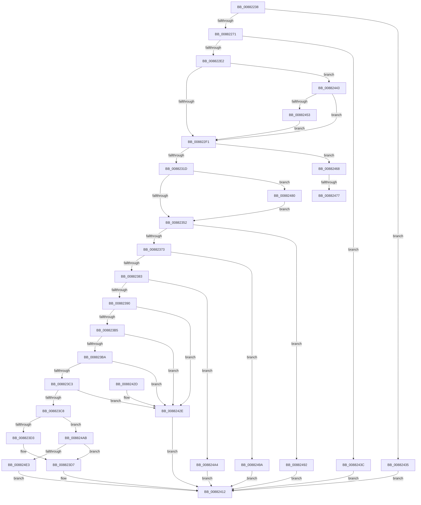

# MiCommitFileBackedSection

- RVA: `0x00882238`–`0x008824E8` (길이 `688` bytes)
- VA: `0x0000000140882238`
- 실행 섹션: `PAGE`
- PDB 이름 있음: `예`; PDB Function 태그: `예`
- unwind 정보 RVA: `0x0007C634`
- 디코드: `186`개 명령, `688/688` bytes 표시
- 미해석 바이트: `0` (있으면 어셈블리에 `.byte`로 보존)

> 이 문서는 커널 이미지의 기계어와 PDB 기호를 분석해 생성했습니다. 4번과 5번은 함수 원형과 자료형을 바이너리 사용 방식에서 추정한 C 해석이며 원본 소스 복구 결과는 아닙니다.

## 1. Dependencies

- 직접 호출 지점: **13**; 고유 호출 대상: **13**
- 직접 호출자로 확인된 함수: **1**
- RIP 상대 이미지 참조: **0**

### Outgoing calls
- `0x0088229E` → [MiStartingOffset](../../text/34/MiStartingOffset_function_003482E0.md) (function, `0x003482E0`)
- `0x008822D5` → [MiFlushAcquire](../../text/49/MiFlushAcquire_function_00495B70.md) (function, `0x00495B70`)
- `0x00882300` → [MiUnlockVad](../../text/2A/MiUnlockVad_function_002A59C8.md) (function, `0x002A59C8`)
- `0x0088230F` → [memset](../../text/6C/memset_function_006C6C40.md) (function, `0x006C6C40`)
- `0x00882341` → [MmExtendSection](../98/MmExtendSection_function_00982C38.md) (function, `0x00982C38`)
- `0x00882358` → [MiLockVad](../../text/29/MiLockVad_function_00295810.md) (function, `0x00295810`)
- `0x00882365` → [MiFlushRelease](../../text/29/MiFlushRelease_function_002982C0.md) (function, `0x002982C0`)
- `0x00882376` → [MiVadDeleted](../../text/43/MiVadDeleted_function_00431350.md) (function, `0x00431350`)
- `0x00882406` → [MiSetProtectionOnSection](../../text/2C/MiSetProtectionOnSection_function_002C3770.md) (function, `0x002C3770`)
- `0x0088245E` → [ObfReferenceObjectWithTag](../../text/21/ObfReferenceObjectWithTag_function_00210710.md) (function, `0x00210710`)
- `0x00882488` → [ObfDereferenceObjectWithTag](../../text/2F/ObfDereferenceObjectWithTag_function_002F78E0.md) (function, `0x002F78E0`)
- `0x008824AF` → [MiMakeProtectionMask](../../text/32/MiMakeProtectionMask_function_00329480.md) (function, `0x00329480`)
- `0x008824D6` → [MiCheckSecuredVad](MiCheckSecuredVad_function_00881FB4.md) (function, `0x00881FB4`)

### Direct callers
- [MiAllocateVirtualMemory](MiAllocateVirtualMemory_function_00883B40.md) at `0x00883FBB`

### Static image references
- 디코드된 RIP-relative 메모리 참조가 없습니다.

## 2. Other-region calls and transfers

- 다른 실행 섹션으로 향하는 call: **11**
  - `0x0088229E` → [MiStartingOffset](../../text/34/MiStartingOffset_function_003482E0.md) (`PAGE` → `.text`)
  - `0x008822D5` → [MiFlushAcquire](../../text/49/MiFlushAcquire_function_00495B70.md) (`PAGE` → `.text`)
  - `0x00882300` → [MiUnlockVad](../../text/2A/MiUnlockVad_function_002A59C8.md) (`PAGE` → `.text`)
  - `0x0088230F` → [memset](../../text/6C/memset_function_006C6C40.md) (`PAGE` → `.text`)
  - `0x00882358` → [MiLockVad](../../text/29/MiLockVad_function_00295810.md) (`PAGE` → `.text`)
  - `0x00882365` → [MiFlushRelease](../../text/29/MiFlushRelease_function_002982C0.md) (`PAGE` → `.text`)
  - `0x00882376` → [MiVadDeleted](../../text/43/MiVadDeleted_function_00431350.md) (`PAGE` → `.text`)
  - `0x00882406` → [MiSetProtectionOnSection](../../text/2C/MiSetProtectionOnSection_function_002C3770.md) (`PAGE` → `.text`)
  - `0x0088245E` → [ObfReferenceObjectWithTag](../../text/21/ObfReferenceObjectWithTag_function_00210710.md) (`PAGE` → `.text`)
  - `0x00882488` → [ObfDereferenceObjectWithTag](../../text/2F/ObfDereferenceObjectWithTag_function_002F78E0.md) (`PAGE` → `.text`)
  - `0x008824AF` → [MiMakeProtectionMask](../../text/32/MiMakeProtectionMask_function_00329480.md) (`PAGE` → `.text`)
- call이 아닌 외부 분기/꼬리 이동: **2**
  - `0x00882471` → [sub_00B18D56](../B1/Unknown_function_00B18D56.md) (`tail-transfer`)
  - `0x0088247B` → [sub_00B18D56 + 0x4](../B1/Unknown_function_00B18D56.md) (`tail-transfer`)

## 3. Assembly (complete function range)

```asm
00882238  48 89 5C 24 08                  mov qword ptr [rsp + 8], rbx
0088223D  4C 89 44 24 18                  mov qword ptr [rsp + 0x18], r8
00882242  55                              push rbp
00882243  56                              push rsi
00882244  57                              push rdi
00882245  41 54                           push r12
00882247  41 55                           push r13
00882249  41 56                           push r14
0088224B  41 57                           push r15
0088224D  48 8D 6C 24 D9                  lea rbp, [rsp - 0x27]
00882252  48 81 EC B0 00 00 00            sub rsp, 0xb0
00882259  48 8B 42 78                     mov rax, qword ptr [rdx + 0x78]
0088225D  33 DB                           xor ebx, ebx
0088225F  89 5D 7F                        mov dword ptr [rbp + 0x7f], ebx
00882262  48 8B FA                        mov rdi, rdx
00882265  4C 8B F1                        mov r14, rcx
00882268  48 85 C0                        test rax, rax
0088226B  0F 89 C4 01 00 00               jns 0x140882435
00882271  48 8B 01                        mov rax, qword ptr [rcx]
00882274  45 33 C0                        xor r8d, r8d
00882277  48 8B 71 08                     mov rsi, qword ptr [rcx + 8]
0088227B  48 8B 52 50                     mov rdx, qword ptr [rdx + 0x50]
0088227F  48 8B 4F 48                     mov rcx, qword ptr [rdi + 0x48]
00882283  48 89 45 B7                     mov qword ptr [rbp - 0x49], rax
00882287  48 C1 E8 0C                     shr rax, 0xc
0088228B  48 89 45 C7                     mov qword ptr [rbp - 0x39], rax
0088228F  48 8B C6                        mov rax, rsi
00882292  48 C1 E8 0C                     shr rax, 0xc
00882296  48 89 45 CF                     mov qword ptr [rbp - 0x31], rax
0088229A  48 89 75 D7                     mov qword ptr [rbp - 0x29], rsi
0088229E  E8 3D 60 AC FF                  call 0x1403482e0
008822A3  0F B6 4F 20                     movzx ecx, byte ptr [rdi + 0x20]
008822A7  48 8B D0                        mov rdx, rax
008822AA  8B 47 18                        mov eax, dword ptr [rdi + 0x18]
008822AD  45 33 C0                        xor r8d, r8d
008822B0  48 C1 E1 20                     shl rcx, 0x20
008822B4  48 0B C8                        or rcx, rax
008822B7  48 8D 46 01                     lea rax, [rsi + 1]
008822BB  48 C1 E1 0C                     shl rcx, 0xc
008822BF  48 2B D1                        sub rdx, rcx
008822C2  48 03 C2                        add rax, rdx
008822C5  33 D2                           xor edx, edx
008822C7  48 89 45 BF                     mov qword ptr [rbp - 0x41], rax
008822CB  48 8B 47 48                     mov rax, qword ptr [rdi + 0x48]
008822CF  4C 8B 28                        mov r13, qword ptr [rax]
008822D2  49 8B CD                        mov rcx, r13
008822D5  E8 96 38 C1 FF                  call 0x140495b70
008822DA  85 C0                           test eax, eax
008822DC  0F 84 5A 01 00 00               je 0x14088243c
008822E2  F7 47 30 00 00 20 00            test dword ptr [rdi + 0x30], 0x200000
008822E9  8B F3                           mov esi, ebx
008822EB  0F 84 52 01 00 00               je 0x140882443
008822F1  65 4C 8B 24 25 88 01 00 00      mov r12, qword ptr gs:[0x188]
008822FA  48 8B D7                        mov rdx, rdi
008822FD  49 8B CC                        mov rcx, r12
00882300  E8 C3 36 A2 FF                  call 0x1402a59c8
00882305  33 D2                           xor edx, edx
00882307  48 8D 4D E7                     lea rcx, [rbp - 0x19]
0088230B  44 8D 42 40                     lea r8d, [rdx + 0x40]
0088230F  E8 2C 49 E4 FF                  call 0x1406c6c40
00882314  48 85 F6                        test rsi, rsi
00882317  0F 85 4B 01 00 00               jne 0x140882468
0088231D  4C 89 6D 0F                     mov qword ptr [rbp + 0xf], r13
00882321  41 8B 45 38                     mov eax, dword ptr [r13 + 0x38]
00882325  48 8D 55 BF                     lea rdx, [rbp - 0x41]
00882329  89 45 1F                        mov dword ptr [rbp + 0x1f], eax
0088232C  48 8D 4D E7                     lea rcx, [rbp - 0x19]
00882330  8B 45 23                        mov eax, dword ptr [rbp + 0x23]
00882333  45 33 C0                        xor r8d, r8d
00882336  25 04 F0 FF FF                  and eax, 0xfffff004
0088233B  83 C8 04                        or eax, 4
0088233E  89 45 23                        mov dword ptr [rbp + 0x23], eax
00882341  E8 F2 08 10 00                  call 0x140982c38
00882346  44 8B F8                        mov r15d, eax
00882349  48 85 F6                        test rsi, rsi
0088234C  0F 85 2E 01 00 00               jne 0x140882480
00882352  48 8B D7                        mov rdx, rdi
00882355  49 8B CC                        mov rcx, r12
00882358  E8 B3 34 A1 FF                  call 0x140295810
0088235D  45 33 C0                        xor r8d, r8d
00882360  33 D2                           xor edx, edx
00882362  49 8B CD                        mov rcx, r13
00882365  E8 56 5F A1 FF                  call 0x1402982c0
0088236A  45 85 FF                        test r15d, r15d
0088236D  0F 88 1F 01 00 00               js 0x140882492
00882373  48 8B CF                        mov rcx, rdi
00882376  E8 D5 EF BA FF                  call 0x140431350
0088237B  85 C0                           test eax, eax
0088237D  0F 85 17 01 00 00               jne 0x14088249a
00882383  48 8B 47 78                     mov rax, qword ptr [rdi + 0x78]
00882387  48 85 C0                        test rax, rax
0088238A  0F 89 14 01 00 00               jns 0x1408824a4
00882390  8B 47 18                        mov eax, dword ptr [rdi + 0x18]
00882393  0F B6 57 20                     movzx edx, byte ptr [rdi + 0x20]
00882397  0F B6 4F 21                     movzx ecx, byte ptr [rdi + 0x21]
0088239B  48 C1 E2 20                     shl rdx, 0x20
0088239F  48 0B D0                        or rdx, rax
008823A2  48 C1 E1 20                     shl rcx, 0x20
008823A6  8B 47 1C                        mov eax, dword ptr [rdi + 0x1c]
008823A9  48 0B C8                        or rcx, rax
008823AC  48 8B 45 C7                     mov rax, qword ptr [rbp - 0x39]
008823B0  48 3B C2                        cmp rax, rdx
008823B3  72 79                           jb 0x14088242e
008823B5  48 3B C1                        cmp rax, rcx
008823B8  77 74                           ja 0x14088242e
008823BA  48 8B 45 CF                     mov rax, qword ptr [rbp - 0x31]
008823BE  48 3B C1                        cmp rax, rcx
008823C1  77 6B                           ja 0x14088242e
008823C3  48 3B C2                        cmp rax, rdx
008823C6  72 66                           jb 0x14088242e
008823C8  8B 47 30                        mov eax, dword ptr [rdi + 0x30]
008823CB  A8 08                           test al, 8
008823CD  0F 85 D8 00 00 00               jne 0x1408824ab
008823D3  48 8B 75 B7                     mov rsi, qword ptr [rbp - 0x49]
008823D7  41 8B 4E 2C                     mov ecx, dword ptr [r14 + 0x2c]
008823DB  48 8D 45 6F                     lea rax, [rbp + 0x6f]
008823DF  4C 8B 4D D7                     mov r9, qword ptr [rbp - 0x29]
008823E3  4C 8B C6                        mov r8, rsi
008823E6  48 89 44 24 38                  mov qword ptr [rsp + 0x38], rax
008823EB  48 8B D7                        mov rdx, rdi
008823EE  48 8D 45 7F                     lea rax, [rbp + 0x7f]
008823F2  89 5D 6F                        mov dword ptr [rbp + 0x6f], ebx
008823F5  48 89 44 24 30                  mov qword ptr [rsp + 0x30], rax
008823FA  89 5C 24 28                     mov dword ptr [rsp + 0x28], ebx
008823FE  89 4C 24 20                     mov dword ptr [rsp + 0x20], ecx
00882402  49 8B 4E 58                     mov rcx, qword ptr [r14 + 0x58]
00882406  E8 65 13 A4 FF                  call 0x1402c3770
0088240B  85 C0                           test eax, eax
0088240D  0F 48 D8                        cmovs ebx, eax
00882410  8B C3                           mov eax, ebx
00882412  48 8B 9C 24 F0 00 00 00         mov rbx, qword ptr [rsp + 0xf0]
0088241A  48 81 C4 B0 00 00 00            add rsp, 0xb0
00882421  41 5F                           pop r15
00882423  41 5E                           pop r14
00882425  41 5D                           pop r13
00882427  41 5C                           pop r12
00882429  5F                              pop rdi
0088242A  5E                              pop rsi
0088242B  5D                              pop rbp
0088242C  C3                              ret
0088242D  CC                              int3
0088242E  B8 18 00 00 C0                  mov eax, 0xc0000018
00882433  EB DD                           jmp 0x140882412
00882435  B8 21 00 00 C0                  mov eax, 0xc0000021
0088243A  EB D6                           jmp 0x140882412
0088243C  B8 9A 00 00 C0                  mov eax, 0xc000009a
00882441  EB CF                           jmp 0x140882412
00882443  48 8B 87 80 00 00 00            mov rax, qword ptr [rdi + 0x80]
0088244A  48 85 C0                        test rax, rax
0088244D  0F 84 9E FE FF FF               je 0x1408822f1
00882453  BA 4D 6D 56 6D                  mov edx, 0x6d566d4d
00882458  48 8B C8                        mov rcx, rax
0088245B  48 8B F0                        mov rsi, rax
0088245E  E8 AD E2 98 FF                  call 0x140210710
00882463  E9 89 FE FF FF                  jmp 0x1408822f1
00882468  41 8B 45 38                     mov eax, dword ptr [r13 + 0x38]
0088246C  A8 20                           test al, 0x20
0088246E  48 8B C6                        mov rax, rsi
00882471  0F 84 DF 68 29 00               je 0x140b18d56
00882477  48 83 C8 01                     or rax, 1
0088247B  E9 DA 68 29 00                  jmp 0x140b18d5a
00882480  BA 4D 6D 56 6D                  mov edx, 0x6d566d4d
00882485  48 8B CE                        mov rcx, rsi
00882488  E8 53 54 A7 FF                  call 0x1402f78e0
0088248D  E9 C0 FE FF FF                  jmp 0x140882352
00882492  41 8B C7                        mov eax, r15d
00882495  E9 78 FF FF FF                  jmp 0x140882412
0088249A  B8 A0 00 00 C0                  mov eax, 0xc00000a0
0088249F  E9 6E FF FF FF                  jmp 0x140882412
008824A4  33 C0                           xor eax, eax
008824A6  E9 67 FF FF FF                  jmp 0x140882412
008824AB  41 8B 4E 2C                     mov ecx, dword ptr [r14 + 0x2c]
008824AF  E8 CC 6F AA FF                  call 0x140329480
008824B4  48 8B 75 B7                     mov rsi, qword ptr [rbp - 0x49]
008824B8  44 8B C8                        mov r9d, eax
008824BB  48 8B 45 77                     mov rax, qword ptr [rbp + 0x77]
008824BF  48 8B D6                        mov rdx, rsi
008824C2  4D 8B 46 18                     mov r8, qword ptr [r14 + 0x18]
008824C6  48 8B CF                        mov rcx, rdi
008824C9  48 89 44 24 28                  mov qword ptr [rsp + 0x28], rax
008824CE  41 8A 46 39                     mov al, byte ptr [r14 + 0x39]
008824D2  88 44 24 20                     mov byte ptr [rsp + 0x20], al
008824D6  E8 D9 FA FF FF                  call 0x140881fb4
008824DB  85 C0                           test eax, eax
008824DD  0F 89 F4 FE FF FF               jns 0x1408823d7
008824E3  E9 2A FF FF FF                  jmp 0x140882412
```

## 4. C-style interpretation (structured pseudocode)

```c
__int64 __fastcall MiCommitFileBackedSection(__int64 a1, __int64 a2, __int64 a3)
{
    __int64 result;
    __int64 v_rbx;
    __int64 v_rsp;
    unsigned int v_stack_m3C;
    unsigned int v_stack_m40;
    unsigned __int64 v_stack_m50;
    unsigned __int64 v_stack_m5F;
    unsigned __int64 v_stack_m78;
    unsigned __int64 v_stack_m88;
    unsigned __int64 v_stack_m90;
    unsigned __int64 v_stack_m98;
    unsigned __int64 v_stack_mA0;
    unsigned __int64 v_stack_mA8;
    unsigned __int64 v_stack_mB0;
    unsigned __int64 v_stack_mB8;
    unsigned int v_stack_mC0;
    unsigned int v_stack_mC8;
    unsigned __int64 v_stack_p10;
    unsigned __int64 v_stack_p18;
    unsigned int v_stack_p20;
    unsigned __int64 v_stack_p28;
    unsigned __int64 v_stack_p8;

    v_stack_p8 = v_rbx;
    v_stack_p18 = a3;
    v_rsp = (v_rsp) - (176);
    v_rbx = 0;
    v_stack_p20 = 0;
    if (!sign_flag) goto loc_00882435;
    a3 = 0;
    v_stack_mA8 = *(unsigned __int64 *)(a1);
    result = (*(unsigned __int64 *)(a1)) >> (12);
    v_stack_m98 = result;
    result = (*(unsigned __int64 *)(a1 + 8)) >> (12);
    v_stack_m90 = result;
    v_stack_m88 = *(unsigned __int64 *)(a1 + 8);
    result = MiStartingOffset(*(unsigned __int64 *)(a2 + 72), *(unsigned __int64 *)(a2 + 80), a3, a4);
    a3 = 0;
    a1 = (*(unsigned __int8 *)(a2 + 32)) << (32);
    a1 = (a1) | ((unsigned int)(*(unsigned int *)(a2 + 24)));
    a1 = (a1) << (12);
    a2 = (result) - (a1);
    result = (*(unsigned __int64 *)(a1 + 8) + 1) + (a2);
    a2 = 0;
    v_stack_mA0 = result;
    result = MiFlushAcquire(*(unsigned __int64 *)(*(unsigned __int64 *)(a2 + 72)), a2, a3, a4);
    if ((unsigned int)(result) == 0) goto loc_0088243C;
    if (((*(unsigned int *)(a2 + 48)) & (0x200000ULL)) == 0) goto loc_00882443;
loc_008822F1:
    result = MiUnlockVad(*(unsigned __int64 *)(gs_base + (0 + 392)), 0, a3, a4);
    a2 = 0;
    result = memset(v_stack_m78, a2, a2 + 64, a4);
    if (0 != 0) goto loc_00882468;
    v_stack_m50 = *(unsigned __int64 *)(*(unsigned __int64 *)(a2 + 72));
    v_stack_m40 = (unsigned int)((unsigned int)(*(unsigned int *)(*(unsigned __int64 *)(*(unsigned __int64 *)(a2 + 72)) + 56)));
    a3 = 0;
    result = (unsigned int)(((unsigned int)(v_stack_m3C)) & (0xFFFFF004ULL));
    result = (unsigned int)((result) | (4));
    v_stack_m3C = (unsigned int)(result);
    result = MmExtendSection(v_stack_m78, v_stack_mA0, a3, a4);
    if (0 != 0) goto loc_00882480;
loc_00882352:
    result = MiLockVad(*(unsigned __int64 *)(gs_base + (0 + 392)), 0, a3, a4);
    a3 = 0;
    a2 = 0;
    result = MiFlushRelease(*(unsigned __int64 *)(*(unsigned __int64 *)(a2 + 72)), a2, a3, a4);
    if (sign_flag) goto loc_00882492;
    result = MiVadDeleted(0, a2, a3, a4);
    if ((unsigned int)(result) != 0) goto loc_0088249A;
    if (!sign_flag) goto loc_008824A4;
    a2 = (*(unsigned __int8 *)(a2 + 32)) << (32);
    a2 = (a2) | ((unsigned int)(*(unsigned int *)(a2 + 24)));
    a1 = (*(unsigned __int8 *)(a2 + 33)) << (32);
    a1 = (a1) | ((unsigned int)(*(unsigned int *)(a2 + 28)));
    if (v_stack_m98 < a2) goto loc_0088242E;
    if (v_stack_m98 > a1) goto loc_0088242E;
    if (v_stack_m90 > a1) goto loc_0088242E;
    if (v_stack_m90 < a2) goto loc_0088242E;
    if ((((unsigned __int8)((unsigned int)(*(unsigned int *)(a2 + 48)))) & (8)) != 0) goto loc_008824AB;
loc_008823D7:
    v_stack_mB0 = v_stack_p10;
    v_stack_p10 = 0;
    v_stack_mB8 = v_stack_p20;
    v_stack_mC0 = 0;
    v_stack_mC8 = (unsigned int)((unsigned int)(*(unsigned int *)(a1 + 44)));
    result = MiSetProtectionOnSection(*(unsigned __int64 *)(a1 + 88), a2, v_stack_mA8, v_stack_m88);
    if (sign_flag) { v_rbx = (unsigned int)(result); }
loc_00882412:
    v_rsp = (v_rsp) + (176);
    return (unsigned int)((unsigned int)(v_rbx));
loc_0088242E:
    goto loc_00882412;
loc_00882435:
    goto loc_00882412;
loc_0088243C:
    goto loc_00882412;
loc_00882443:
    if (*(unsigned __int64 *)(a2 + 128) == 0) goto loc_008822F1;
    result = ObfReferenceObjectWithTag(*(unsigned __int64 *)(a2 + 128), (unsigned int)(0x6D566D4DULL), v_stack_mA8, v_stack_m88);
    goto loc_008822F1;
loc_00882468:
    result = (*(unsigned __int64 *)(a2 + 128)) | (1);
loc_00882480:
    result = ObfDereferenceObjectWithTag(*(unsigned __int64 *)(a2 + 128), (unsigned int)(0x6D566D4DULL), v_stack_mA8, v_stack_m88);
    goto loc_00882352;
loc_00882492:
    goto loc_00882412;
loc_0088249A:
    goto loc_00882412;
loc_008824A4:
    result = 0;
    goto loc_00882412;
loc_008824AB:
    result = MiMakeProtectionMask((unsigned int)(*(unsigned int *)(a1 + 44)), (unsigned int)(0x6D566D4DULL), v_stack_mA8, v_stack_m88);
    v_stack_p28 = v_stack_p18;
    v_stack_p20 = (unsigned __int8)(*(unsigned __int8 *)(a1 + 57));
    result = MiCheckSecuredVad(a2, v_stack_mA8, *(unsigned __int64 *)(a1 + 24), (unsigned int)((unsigned int)(result)));
    if (!sign_flag) goto loc_008823D7;
    goto loc_00882412;
}
```

## 5. (Beta) C Style

```c
int64_t MiCommitFileBackedSection(void *Arg1, void *Arg2, int64_t Arg3)
{
    uint8_t *arg1 = (uint8_t *)Arg1;
    uint8_t *arg2 = (uint8_t *)Arg2;

    int64_t result;
    int64_t local_rbx;
    int64_t local_rsp;
    uint32_t v_stack_m3C;
    uint32_t v_stack_m40;
    uint64_t v_stack_m50;
    uint64_t v_stack_m5F;
    uint64_t v_stack_m78;
    uint64_t v_stack_m88;
    uint64_t v_stack_m90;
    uint64_t v_stack_m98;
    uint64_t v_stack_mA0;
    uint64_t v_stack_mA8;
    uint64_t v_stack_mB0;
    uint64_t v_stack_mB8;
    uint32_t v_stack_mC0;
    uint32_t v_stack_mC8;
    uint64_t v_stack_p10;
    uint64_t v_stack_p18;
    uint32_t v_stack_p20;
    uint64_t v_stack_p28;
    uint64_t v_stack_p8;

    v_stack_p8 = local_rbx;
    v_stack_p18 = Arg3;
    local_rsp = (local_rsp) - (176);
    local_rbx = 0;
    v_stack_p20 = 0;
    if (!sign_flag) goto loc_00882435;
    Arg3 = 0;
    v_stack_mA8 = *(uint64_t *)(arg1);
    result = (*(uint64_t *)(arg1)) >> (12);
    v_stack_m98 = result;
    result = (*(uint64_t *)(arg1 + 0x8)) >> (12);
    v_stack_m90 = result;
    v_stack_m88 = *(uint64_t *)(arg1 + 0x8);
    result = MiStartingOffset(*(uint64_t *)(arg2 + 0x48), *(uint64_t *)(arg2 + 0x50), Arg3, a4);
    Arg3 = 0;
    Arg1 = (*(uint8_t *)(arg2 + 0x20)) << (32);
    Arg1 = (Arg1) | ((uint32_t)(*(uint32_t *)(arg2 + 0x18)));
    Arg1 = (Arg1) << (12);
    Arg2 = (result) - (Arg1);
    result = (*(uint64_t *)(arg1 + 0x8) + 1) + (Arg2);
    Arg2 = 0;
    v_stack_mA0 = result;
    result = MiFlushAcquire(*(uint64_t *)(*(uint64_t *)(arg2 + 0x48)), Arg2, Arg3, a4);
    if ((uint32_t)(result) == 0) goto loc_0088243C;
    if (((*(uint32_t *)(arg2 + 0x30)) & (0x200000ULL)) == 0) goto loc_00882443;
loc_008822F1:
    result = MiUnlockVad(*(uint64_t *)(gs_base + (0 + 0x188)), 0, Arg3, a4);
    Arg2 = 0;
    result = memset(v_stack_m78, Arg2, Arg2 + 64, a4);
    if (0 != 0) goto loc_00882468;
    v_stack_m50 = *(uint64_t *)(*(uint64_t *)(arg2 + 0x48));
    v_stack_m40 = (uint32_t)((uint32_t)(*(uint32_t *)(*(uint64_t *)(*(uint64_t *)(arg2 + 0x48)) + 0x38)));
    Arg3 = 0;
    result = (uint32_t)(((uint32_t)(v_stack_m3C)) & (0xFFFFF004ULL));
    result = (uint32_t)((result) | (4));
    v_stack_m3C = (uint32_t)(result);
    result = MmExtendSection(v_stack_m78, v_stack_mA0, Arg3, a4);
    if (0 != 0) goto loc_00882480;
loc_00882352:
    result = MiLockVad(*(uint64_t *)(gs_base + (0 + 0x188)), 0, Arg3, a4);
    Arg3 = 0;
    Arg2 = 0;
    result = MiFlushRelease(*(uint64_t *)(*(uint64_t *)(arg2 + 0x48)), Arg2, Arg3, a4);
    if (sign_flag) goto loc_00882492;
    result = MiVadDeleted(0, Arg2, Arg3, a4);
    if ((uint32_t)(result) != 0) goto loc_0088249A;
    if (!sign_flag) goto loc_008824A4;
    Arg2 = (*(uint8_t *)(arg2 + 0x20)) << (32);
    Arg2 = (Arg2) | ((uint32_t)(*(uint32_t *)(arg2 + 0x18)));
    Arg1 = (*(uint8_t *)(arg2 + 0x21)) << (32);
    Arg1 = (Arg1) | ((uint32_t)(*(uint32_t *)(arg2 + 0x1C)));
    if (v_stack_m98 < Arg2) goto loc_0088242E;
    if (v_stack_m98 > Arg1) goto loc_0088242E;
    if (v_stack_m90 > Arg1) goto loc_0088242E;
    if (v_stack_m90 < Arg2) goto loc_0088242E;
    if ((((uint8_t)((uint32_t)(*(uint32_t *)(arg2 + 0x30)))) & (8)) != 0) goto loc_008824AB;
loc_008823D7:
    v_stack_mB0 = v_stack_p10;
    v_stack_p10 = 0;
    v_stack_mB8 = v_stack_p20;
    v_stack_mC0 = 0;
    v_stack_mC8 = (uint32_t)((uint32_t)(*(uint32_t *)(arg1 + 0x2C)));
    result = MiSetProtectionOnSection(*(uint64_t *)(arg1 + 0x58), Arg2, v_stack_mA8, v_stack_m88);
    if (sign_flag) { local_rbx = (uint32_t)(result); }
loc_00882412:
    local_rsp = (local_rsp) + (176);
    return (uint32_t)((uint32_t)(local_rbx));
loc_0088242E:
    goto loc_00882412;
loc_00882435:
    goto loc_00882412;
loc_0088243C:
    goto loc_00882412;
loc_00882443:
    if (*(uint64_t *)(arg2 + 0x80) == 0) goto loc_008822F1;
    result = ObfReferenceObjectWithTag(*(uint64_t *)(arg2 + 0x80), (uint32_t)(0x6D566D4DULL), v_stack_mA8, v_stack_m88);
    goto loc_008822F1;
loc_00882468:
    result = (*(uint64_t *)(arg2 + 0x80)) | (1);
loc_00882480:
    result = ObfDereferenceObjectWithTag(*(uint64_t *)(arg2 + 0x80), (uint32_t)(0x6D566D4DULL), v_stack_mA8, v_stack_m88);
    goto loc_00882352;
loc_00882492:
    goto loc_00882412;
loc_0088249A:
    goto loc_00882412;
loc_008824A4:
    result = 0;
    goto loc_00882412;
loc_008824AB:
    result = MiMakeProtectionMask((uint32_t)(*(uint32_t *)(arg1 + 0x2C)), (uint32_t)(0x6D566D4DULL), v_stack_mA8, v_stack_m88);
    v_stack_p28 = v_stack_p18;
    v_stack_p20 = (uint8_t)(*(uint8_t *)(arg1 + 0x39));
    result = MiCheckSecuredVad(Arg2, v_stack_mA8, *(uint64_t *)(arg1 + 0x18), (uint32_t)((uint32_t)(result)));
    if (!sign_flag) goto loc_008823D7;
    goto loc_00882412;
}
```

### 관측된 메모리 오프셋

구조체 형식이 확인되지 않은 접근은 인자 기준의 오프셋으로만 기록했습니다.

| 기준 인자 | 오프셋 표현 | 폭 (bit) | 접근 |
|---|---:|---:|---|
| `Arg1` | `+ 0x0` | `64` | `R` |
| `Arg1` | `+ 0x8` | `64` | `R` |
| `Arg1` | `+ 0x18` | `64` | `R` |
| `Arg1` | `+ 0x2C` | `32` | `R` |
| `Arg1` | `+ 0x39` | `8` | `R` |
| `Arg1` | `+ 0x58` | `64` | `R` |
| `Arg2` | `+ 0x18` | `32` | `R` |
| `Arg2` | `+ 0x1C` | `32` | `R` |
| `Arg2` | `+ 0x20` | `8` | `R` |
| `Arg2` | `+ 0x21` | `8` | `R` |
| `Arg2` | `+ 0x30` | `32` | `R` |
| `Arg2` | `+ 0x48` | `64` | `R` |
| `Arg2` | `+ 0x50` | `64` | `R` |
| `Arg2` | `+ 0x78` | `64` | `R` |
| `Arg2` | `+ 0x80` | `64` | `R` |

## 6. Execution-region graph

[열기: 2D/3D 그래프와 함수 탐색 컨트롤 패널](../../../control-panel.html?section=page&rva=0x00882238&view=graph)

- 2D 그래프는 위에서 아래로 흐르고, 3D 그래프는 빈 공간을 드래그해 회전합니다. Shift+드래그는 이동, 휠은 확대·축소, 함수 노드 선택은 대상 보고서 이동입니다.

### Static fallback


