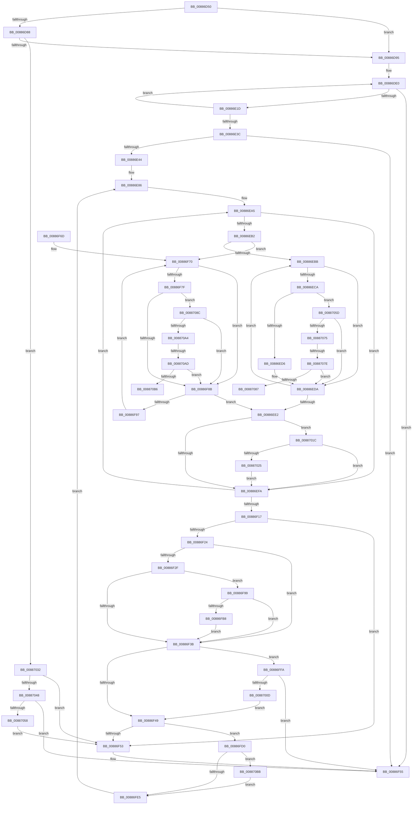

# MiCommitPageTablesForVad

- RVA: `0x00886D50`–`0x008870CF` (길이 `895` bytes)
- VA: `0x0000000140886D50`
- 실행 섹션: `PAGE`
- PDB 이름 있음: `예`; PDB Function 태그: `예`
- unwind 정보 RVA: `0x0007CB88`
- 디코드: `217`개 명령, `895/895` bytes 표시
- 미해석 바이트: `0` (있으면 어셈블리에 `.byte`로 보존)

> 이 문서는 커널 이미지의 기계어와 PDB 기호를 분석해 생성했습니다. 4번과 5번은 함수 원형과 자료형을 바이너리 사용 방식에서 추정한 C 해석이며 원본 소스 복구 결과는 아닙니다.

## 1. Dependencies

- 직접 호출 지점: **10**; 고유 호출 대상: **7**
- 직접 호출자로 확인된 함수: **5**
- RIP 상대 이미지 참조: **0**

### Outgoing calls
- `0x00886D88` → [MiVadPureReserve](../../text/2C/MiVadPureReserve_function_002C34C0.md) (function, `0x002C34C0`)
- `0x00886E10` → [MiMakeHyperRangeAccessible](../../text/27/MiMakeHyperRangeAccessible_function_0027CE10.md) (function, `0x0027CE10`)
- `0x00886E53` → [MiVadPageTableChargeLevel](../../text/41/MiVadPageTableChargeLevel_function_0041F500.md) (function, `0x0041F500`)
- `0x00886E5E` → [MiVadLeafPagesPrecharged](../../text/42/MiVadLeafPagesPrecharged_function_0042A900.md) (function, `0x0042A900`)
- `0x00886F32` → [MiVadPureReserve](../../text/2C/MiVadPureReserve_function_002C34C0.md) (function, `0x002C34C0`)
- `0x00887000` → [MiChargeFullProcessCommitment](MiChargeFullProcessCommitment_function_00887630.md) (function, `0x00887630`)
- `0x0088704B` → [MiChargeFullProcessCommitment](MiChargeFullProcessCommitment_function_00887630.md) (function, `0x00887630`)
- `0x00887068` → [Feature_Servicing_AutoBoostEtwEventingFixes__private_IsEnabledPreCheckWithReporting](../../text/22/Feature_Servicing_AutoBoostEtwEventingFixes__private_IsEnabledPreCheckWithReporting_function_00222FE0.md) (function, `0x00222FE0`)
- `0x00887097` → [Feature_Servicing_AutoBoostEtwEventingFixes__private_IsEnabledPreCheckWithReporting](../../text/22/Feature_Servicing_AutoBoostEtwEventingFixes__private_IsEnabledPreCheckWithReporting_function_00222FE0.md) (function, `0x00222FE0`)
- `0x008870C5` → [MiUpdateChargedWsles](../../text/4F/MiUpdateChargedWsles_function_004F6EA0.md) (function, `0x004F6EA0`)

### Direct callers
- [MiSplitPrivatePage](../../text/2A/MiSplitPrivatePage_function_002A6210.md) at `0x002A6530`
- [MiCommitPageTableRangesForVad](../../text/2A/MiCommitPageTableRangesForVad_function_002A69D4.md) at `0x002A6A73`
- [sub_002C3A7C](../../text/2C/Unknown_function_002C3A7C.md) at `0x002C3AF3`
- [MiCommitExistingVad](../../text/32/MiCommitExistingVad_function_0032A860.md) at `0x0032AB72`
- [MiInsertVadCharges](MiInsertVadCharges_function_00886AA8.md) at `0x00886B9D`

### Static image references
- 디코드된 RIP-relative 메모리 참조가 없습니다.

## 2. Other-region calls and transfers

- 다른 실행 섹션으로 향하는 call: **8**
  - `0x00886D88` → [MiVadPureReserve](../../text/2C/MiVadPureReserve_function_002C34C0.md) (`PAGE` → `.text`)
  - `0x00886E10` → [MiMakeHyperRangeAccessible](../../text/27/MiMakeHyperRangeAccessible_function_0027CE10.md) (`PAGE` → `.text`)
  - `0x00886E53` → [MiVadPageTableChargeLevel](../../text/41/MiVadPageTableChargeLevel_function_0041F500.md) (`PAGE` → `.text`)
  - `0x00886E5E` → [MiVadLeafPagesPrecharged](../../text/42/MiVadLeafPagesPrecharged_function_0042A900.md) (`PAGE` → `.text`)
  - `0x00886F32` → [MiVadPureReserve](../../text/2C/MiVadPureReserve_function_002C34C0.md) (`PAGE` → `.text`)
  - `0x00887068` → [Feature_Servicing_AutoBoostEtwEventingFixes__private_IsEnabledPreCheckWithReporting](../../text/22/Feature_Servicing_AutoBoostEtwEventingFixes__private_IsEnabledPreCheckWithReporting_function_00222FE0.md) (`PAGE` → `.text`)
  - `0x00887097` → [Feature_Servicing_AutoBoostEtwEventingFixes__private_IsEnabledPreCheckWithReporting](../../text/22/Feature_Servicing_AutoBoostEtwEventingFixes__private_IsEnabledPreCheckWithReporting_function_00222FE0.md) (`PAGE` → `.text`)
  - `0x008870C5` → [MiUpdateChargedWsles](../../text/4F/MiUpdateChargedWsles_function_004F6EA0.md) (`PAGE` → `.text`)
- call이 아닌 외부 분기/꼬리 이동: **4**
  - `0x00887078` → [sub_00B1902C](../B1/Unknown_function_00B1902C.md) (`tail-transfer`)
  - `0x00887087` → [sub_00B1902C](../B1/Unknown_function_00B1902C.md) (`tail-transfer`)
  - `0x008870A7` → [sub_00B1902C + 0x25](../B1/Unknown_function_00B1902C.md) (`tail-transfer`)
  - `0x008870B6` → [sub_00B1902C + 0x25](../B1/Unknown_function_00B1902C.md) (`tail-transfer`)

## 3. Assembly (complete function range)

```asm
00886D50  48 89 5C 24 10                  mov qword ptr [rsp + 0x10], rbx
00886D55  48 89 4C 24 08                  mov qword ptr [rsp + 8], rcx
00886D5A  55                              push rbp
00886D5B  56                              push rsi
00886D5C  57                              push rdi
00886D5D  41 54                           push r12
00886D5F  41 55                           push r13
00886D61  41 56                           push r14
00886D63  41 57                           push r15
00886D65  48 83 EC 70                     sub rsp, 0x70
00886D69  65 48 8B 04 25 88 01 00 00      mov rax, qword ptr gs:[0x188]
00886D72  4C 8B F9                        mov r15, rcx
00886D75  48 83 79 10 FE                  cmp qword ptr [rcx + 0x10], -2
00886D7A  4C 8B A8 B8 00 00 00            mov r13, qword ptr [rax + 0xb8]
00886D81  4C 89 6C 24 40                  mov qword ptr [rsp + 0x40], r13
00886D86  75 0D                           jne 0x140886d95
00886D88  E8 33 C7 A3 FF                  call 0x1402c34c0
00886D8D  85 C0                           test eax, eax
00886D8F  0F 85 9D 02 00 00               jne 0x140887032
00886D95  48 C1 EA 15                     shr rdx, 0x15
00886D99  49 C1 E8 15                     shr r8, 0x15
00886D9D  8B C2                           mov eax, edx
00886D9F  33 DB                           xor ebx, ebx
00886DA1  48 89 44 24 48                  mov qword ptr [rsp + 0x48], rax
00886DA6  41 8B C0                        mov eax, r8d
00886DA9  48 89 44 24 50                  mov qword ptr [rsp + 0x50], rax
00886DAE  65 48 8B 04 25 88 01 00 00      mov rax, qword ptr gs:[0x188]
00886DB7  48 C7 84 24 C8 00 00 00 00 00 00 00  mov qword ptr [rsp + 0xc8], 0
00886DC3  8B FA                           mov edi, edx
00886DC5  41 8B F0                        mov esi, r8d
00886DC8  48 8B 88 B8 00 00 00            mov rcx, qword ptr [rax + 0xb8]
00886DCF  4C 8B B1 10 04 00 00            mov r14, qword ptr [rcx + 0x410]
00886DD6  66 66 0F 1F 84 00 00 00 00 00   nop word ptr [rax + rax]
00886DE0  B8 02 00 00 00                  mov eax, 2
00886DE5  48 8B D6                        mov rdx, rsi
00886DE8  2B C3                           sub eax, ebx
00886DEA  48 C1 EA 03                     shr rdx, 3
00886DEE  8B E8                           mov ebp, eax
00886DF0  48 8B CF                        mov rcx, rdi
00886DF3  48 03 C0                        add rax, rax
00886DF6  48 C1 E9 03                     shr rcx, 3
00886DFA  4D 8B 84 C6 28 05 00 00         mov r8, qword ptr [r14 + rax*8 + 0x528]
00886E02  49 03 D0                        add rdx, r8
00886E05  49 03 C8                        add rcx, r8
00886E08  4C 8D 84 24 C8 00 00 00         lea r8, [rsp + 0xc8]
00886E10  E8 FB 5F 9F FF                  call 0x14027ce10
00886E15  85 C0                           test eax, eax
00886E17  0F 88 38 01 00 00               js 0x140886f55
00886E1D  48 8B 8C 24 C8 00 00 00         mov rcx, qword ptr [rsp + 0xc8]
00886E25  FF C3                           inc ebx
00886E27  49 01 8C EE 50 05 00 00         add qword ptr [r14 + rbp*8 + 0x550], rcx
00886E2F  48 C1 EF 09                     shr rdi, 9
00886E33  48 C1 EE 09                     shr rsi, 9
00886E37  83 FB 02                        cmp ebx, 2
00886E3A  72 A4                           jb 0x140886de0
00886E3C  85 C0                           test eax, eax
00886E3E  0F 88 11 01 00 00               js 0x140886f55
00886E44  49 8B 9D 10 04 00 00            mov rbx, qword ptr [r13 + 0x410]
00886E4B  49 8B CF                        mov rcx, r15
00886E4E  48 89 5C 24 58                  mov qword ptr [rsp + 0x58], rbx
00886E53  E8 A8 86 B9 FF                  call 0x14041f500
00886E58  49 8B CF                        mov rcx, r15
00886E5B  4C 63 D0                        movsxd r10, eax
00886E5E  E8 9D 3A BA FF                  call 0x14042a900
00886E63  89 44 24 30                     mov dword ptr [rsp + 0x30], eax
00886E67  45 33 E4                        xor r12d, r12d
00886E6A  48 8D 83 40 05 00 00            lea rax, [rbx + 0x540]
00886E71  44 89 A4 24 C8 00 00 00         mov dword ptr [rsp + 0xc8], r12d
00886E79  49 8B CA                        mov rcx, r10
00886E7C  48 89 44 24 60                  mov qword ptr [rsp + 0x60], rax
00886E81  48 89 4C 24 38                  mov qword ptr [rsp + 0x38], rcx
00886E86  4C 8B 74 24 48                  mov r14, qword ptr [rsp + 0x48]
00886E8B  45 33 DB                        xor r11d, r11d
00886E8E  48 8B 7C 24 50                  mov rdi, qword ptr [rsp + 0x50]
00886E93  45 33 D2                        xor r10d, r10d
00886E96  4C 89 5C 24 28                  mov qword ptr [rsp + 0x28], r11
00886E9B  33 ED                           xor ebp, ebp
00886E9D  4C 89 54 24 20                  mov qword ptr [rsp + 0x20], r10
00886EA2  4C 8B E8                        mov r13, rax
00886EA5  33 F6                           xor esi, esi
00886EA7  45 33 FF                        xor r15d, r15d
00886EAA  49 8B DE                        mov rbx, r14
00886EAD  4C 3B F7                        cmp r14, rdi
00886EB0  77 48                           ja 0x140886efa
00886EB2  48 3B E9                        cmp rbp, rcx
00886EB5  0F 8C B5 00 00 00               jl 0x140886f70
00886EBB  49 8B 4D 08                     mov rcx, qword ptr [r13 + 8]
00886EBF  48 0F A3 19                     bt qword ptr [rcx], rbx
00886EC3  0F 92 C0                        setb al
00886EC6  84 C0                           test al, al
00886EC8  75 10                           jne 0x140886eda
00886ECA  48 FF C6                        inc rsi
00886ECD  45 85 E4                        test r12d, r12d
00886ED0  0F 84 87 01 00 00               je 0x14088705d
00886ED6  48 0F AB 19                     bts qword ptr [rcx], rbx
00886EDA  48 FF C3                        inc rbx
00886EDD  48 3B DF                        cmp rbx, rdi
00886EE0  76 D9                           jbe 0x140886ebb
00886EE2  48 8B 4C 24 38                  mov rcx, qword ptr [rsp + 0x38]
00886EE7  4C 8B 5C 24 28                  mov r11, qword ptr [rsp + 0x28]
00886EEC  4C 8B 54 24 20                  mov r10, qword ptr [rsp + 0x20]
00886EF1  48 85 F6                        test rsi, rsi
00886EF4  0F 85 22 01 00 00               jne 0x14088701c
00886EFA  4D 03 D7                        add r10, r15
00886EFD  49 C1 EE 09                     shr r14, 9
00886F01  48 C1 EF 09                     shr rdi, 9
00886F05  48 FF C5                        inc rbp
00886F08  49 83 ED 10                     sub r13, 0x10
00886F0C  4C 89 54 24 20                  mov qword ptr [rsp + 0x20], r10
00886F11  48 83 FD 03                     cmp rbp, 3
00886F15  7C 8E                           jl 0x140886ea5
00886F17  4C 8B BC 24 B0 00 00 00         mov r15, qword ptr [rsp + 0xb0]
00886F1F  45 85 E4                        test r12d, r12d
00886F22  75 2F                           jne 0x140886f53
00886F24  4F 8D 0C 1A                     lea r9, [r10 + r11]
00886F28  44 39 64 24 30                  cmp dword ptr [rsp + 0x30], r12d
00886F2D  75 0C                           jne 0x140886f3b
00886F2F  49 8B CF                        mov rcx, r15
00886F32  E8 89 C5 A3 FF                  call 0x1402c34c0
00886F37  85 C0                           test eax, eax
00886F39  74 5E                           je 0x140886f99
00886F3B  48 8B 5C 24 40                  mov rbx, qword ptr [rsp + 0x40]
00886F40  4D 85 C9                        test r9, r9
00886F43  0F 85 B1 00 00 00               jne 0x140886ffa
00886F49  83 BC 24 C8 00 00 00 00         cmp dword ptr [rsp + 0xc8], 0
00886F51  75 7D                           jne 0x140886fd0
00886F53  33 C0                           xor eax, eax
00886F55  48 8B 9C 24 B8 00 00 00         mov rbx, qword ptr [rsp + 0xb8]
00886F5D  48 83 C4 70                     add rsp, 0x70
00886F61  41 5F                           pop r15
00886F63  41 5E                           pop r14
00886F65  41 5D                           pop r13
00886F67  41 5C                           pop r12
00886F69  5F                              pop rdi
00886F6A  5E                              pop rsi
00886F6B  5D                              pop rbp
00886F6C  C3                              ret
00886F6D  CC                              int3
00886F6E  66 90                           nop
00886F70  49 8B 45 08                     mov rax, qword ptr [r13 + 8]
00886F74  48 0F A3 18                     bt qword ptr [rax], rbx
00886F78  0F 92 C0                        setb al
00886F7B  84 C0                           test al, al
00886F7D  75 0C                           jne 0x140886f8b
00886F7F  48 FF C6                        inc rsi
00886F82  45 85 E4                        test r12d, r12d
00886F85  0F 84 01 01 00 00               je 0x14088708c
00886F8B  48 FF C3                        inc rbx
00886F8E  48 3B DF                        cmp rbx, rdi
00886F91  0F 87 4B FF FF FF               ja 0x140886ee2
00886F97  EB D7                           jmp 0x140886f70
00886F99  41 8B 57 34                     mov edx, dword ptr [r15 + 0x34]
00886F9D  48 B8 FE FF FF FF 07 00 00 00   movabs rax, 0x7fffffffe
00886FA7  41 0F B6 4F 22                  movzx ecx, byte ptr [r15 + 0x22]
00886FAC  48 C1 E1 20                     shl rcx, 0x20
00886FB0  48 0B CA                        or rcx, rdx
00886FB3  48 3B C8                        cmp rcx, rax
00886FB6  74 83                           je 0x140886f3b
00886FB8  41 8B 4F 34                     mov ecx, dword ptr [r15 + 0x34]
00886FBC  45 0F B6 47 22                  movzx r8d, byte ptr [r15 + 0x22]
00886FC1  49 C1 E0 20                     shl r8, 0x20
00886FC5  4C 0B C1                        or r8, rcx
00886FC8  4D 03 C8                        add r9, r8
00886FCB  E9 6B FF FF FF                  jmp 0x140886f3b
00886FD0  48 8B 44 24 58                  mov rax, qword ptr [rsp + 0x58]
00886FD5  4C 01 98 F0 03 00 00            add qword ptr [rax + 0x3f0], r11
00886FDC  4D 85 D2                        test r10, r10
00886FDF  0F 85 D6 00 00 00               jne 0x1408870bb
00886FE5  48 8B 44 24 60                  mov rax, qword ptr [rsp + 0x60]
00886FEA  41 BC 01 00 00 00               mov r12d, 1
00886FF0  48 8B 4C 24 38                  mov rcx, qword ptr [rsp + 0x38]
00886FF5  E9 8C FE FF FF                  jmp 0x140886e86
00886FFA  49 8B D1                        mov rdx, r9
00886FFD  48 8B CB                        mov rcx, rbx
00887000  E8 2B 06 00 00                  call 0x140887630
00887005  85 C0                           test eax, eax
00887007  0F 88 48 FF FF FF               js 0x140886f55
0088700D  4C 8B 54 24 20                  mov r10, qword ptr [rsp + 0x20]
00887012  4C 8B 5C 24 28                  mov r11, qword ptr [rsp + 0x28]
00887017  E9 2D FF FF FF                  jmp 0x140886f49
0088701C  48 3B E9                        cmp rbp, rcx
0088701F  0F 8C D5 FE FF FF               jl 0x140886efa
00887025  4C 03 DE                        add r11, rsi
00887028  4C 89 5C 24 28                  mov qword ptr [rsp + 0x28], r11
0088702D  E9 C8 FE FF FF                  jmp 0x140886efa
00887032  45 8B 47 34                     mov r8d, dword ptr [r15 + 0x34]
00887036  41 0F B6 57 22                  movzx edx, byte ptr [r15 + 0x22]
0088703B  48 C1 E2 20                     shl rdx, 0x20
0088703F  49 0B D0                        or rdx, r8
00887042  0F 84 0B FF FF FF               je 0x140886f53
00887048  49 8B CD                        mov rcx, r13
0088704B  E8 E0 05 00 00                  call 0x140887630
00887050  85 C0                           test eax, eax
00887052  0F 88 FD FE FF FF               js 0x140886f55
00887058  E9 F6 FE FF FF                  jmp 0x140886f53
0088705D  C7 84 24 C8 00 00 00 01 00 00 00  mov dword ptr [rsp + 0xc8], 1
00887068  E8 73 BF 99 FF                  call 0x140222fe0
0088706D  85 C0                           test eax, eax
0088706F  0F 85 65 FE FF FF               jne 0x140886eda
00887075  49 3B DE                        cmp rbx, r14
00887078  0F 84 AE 1F 29 00               je 0x140b1902c
0088707E  F6 C3 07                        test bl, 7
00887081  0F 85 53 FE FF FF               jne 0x140886eda
00887087  E9 A0 1F 29 00                  jmp 0x140b1902c
0088708C  C7 84 24 C8 00 00 00 01 00 00 00  mov dword ptr [rsp + 0xc8], 1
00887097  E8 44 BF 99 FF                  call 0x140222fe0
0088709C  85 C0                           test eax, eax
0088709E  0F 85 E7 FE FF FF               jne 0x140886f8b
008870A4  49 3B DE                        cmp rbx, r14
008870A7  0F 84 A4 1F 29 00               je 0x140b19051
008870AD  F6 C3 07                        test bl, 7
008870B0  0F 85 D5 FE FF FF               jne 0x140886f8b
008870B6  E9 96 1F 29 00                  jmp 0x140b19051
008870BB  48 8D 8B 00 04 00 00            lea rcx, [rbx + 0x400]
008870C2  49 8B D2                        mov rdx, r10
008870C5  E8 D6 FD C6 FF                  call 0x1404f6ea0
008870CA  E9 16 FF FF FF                  jmp 0x140886fe5
```

## 4. C-style interpretation (structured pseudocode)

```c
__int64 __fastcall MiCommitPageTablesForVad(__int64 a1, __int64 a2, __int64 a3)
{
    __int64 result;
    __int64 v_r10;
    __int64 v_r11;
    __int64 v_r12;
    __int64 v_r13;
    __int64 v_r14;
    __int64 v_r15;
    __int64 v_rbp;
    __int64 v_rbx;
    __int64 v_rdi;
    __int64 v_rsi;
    __int64 v_rsp;
    unsigned __int64 v_stack_m48;
    unsigned __int64 v_stack_m50;
    unsigned __int64 v_stack_m58;
    unsigned __int64 v_stack_m60;
    unsigned __int64 v_stack_m68;
    unsigned __int64 v_stack_m70;
    unsigned int v_stack_m78;
    unsigned __int64 v_stack_m80;
    unsigned __int64 v_stack_m88;
    unsigned __int64 v_stack_p10;
    unsigned __int64 v_stack_p20;
    unsigned __int64 v_stack_p28;
    unsigned __int64 v_stack_p38;
    unsigned __int64 v_stack_p58;
    unsigned __int64 v_stack_p60;
    unsigned __int64 v_stack_p8;
    unsigned int v_stack_pC8;

    v_stack_p10 = v_rbx;
    v_stack_p8 = a1;
    v_rsp = (v_rsp) - (112);
    v_stack_m68 = *(unsigned __int64 *)(*(unsigned __int64 *)(gs_base + (0 + 392)) + 184);
    if ((*(unsigned __int64 *)(a1 + 16)) != -2) goto loc_00886D95;
    result = MiVadPureReserve(a1, a2, a3, a4);
    if ((unsigned int)(result) != 0) goto loc_00887032;
loc_00886D95:
    a2 = (a2) >> (21);
    a3 = (a3) >> (21);
    v_rbx = 0;
    v_stack_m60 = (unsigned int)((unsigned int)(a2));
    v_stack_m58 = (unsigned int)((unsigned int)(a3));
    v_stack_p20 = 0;
loc_00886DE0:
    result = (unsigned int)((2) - (0));
    a2 = ((unsigned int)((unsigned int)(a3))) >> (3);
    result = (result) + (result);
    a1 = ((unsigned int)((unsigned int)(a2))) >> (3);
    a2 = (a2) + (*(unsigned __int64 *)(*(unsigned __int64 *)(*(unsigned __int64 *)(*(unsigned __int64 *)(gs_base + (0 + 392)) + 184) + 1040) + result * 8 + 1320));
    a1 = (a1) + (*(unsigned __int64 *)(*(unsigned __int64 *)(*(unsigned __int64 *)(*(unsigned __int64 *)(gs_base + (0 + 392)) + 184) + 1040) + result * 8 + 1320));
    result = MiMakeHyperRangeAccessible(a1, a2, v_stack_p20, a4);
    if (sign_flag) goto loc_00886F55;
    v_rbx = (unsigned int)((v_rbx) + 1);
    v_rdi = ((unsigned int)((unsigned int)(a2))) >> (9);
    v_rsi = ((unsigned int)((unsigned int)(a3))) >> (9);
    if (((unsigned int)(v_rbx)) < 2) goto loc_00886DE0;
    if (sign_flag) goto loc_00886F55;
    v_stack_m50 = *(unsigned __int64 *)(*(unsigned __int64 *)(*(unsigned __int64 *)(gs_base + (0 + 392)) + 184) + 1040);
    result = MiVadPageTableChargeLevel(a1, a2, v_stack_p20, a4);
    result = MiVadLeafPagesPrecharged(a1, a2, v_stack_p20, a4);
    v_stack_m78 = (unsigned int)(result);
    v_r12 = 0;
    v_stack_p20 = 0;
    v_stack_m48 = *(unsigned __int64 *)(*(unsigned __int64 *)(*(unsigned __int64 *)(gs_base + (0 + 392)) + 184) + 1040) + 1344;
    v_stack_m70 = (int)((unsigned int)(result));
loc_00886E86:
    v_r11 = 0;
    v_r10 = 0;
    v_stack_m80 = 0;
    v_rbp = 0;
    v_stack_m88 = 0;
loc_00886EA5:
    v_rsi = 0;
    v_r15 = 0;
    if (v_stack_m60 > v_stack_m58) goto loc_00886EFA;
    if (0 < ((int)((unsigned int)(result)))) goto loc_00886F70;
loc_00886EBB:
    result = (0 < ((int)((unsigned int)(result)))) ? 1 : 0;
    if ((unsigned __int8)(result) != 0) goto loc_00886EDA;
    v_rsi = (v_rsi) + 1;
    if (0 == 0) goto loc_0088705D;
loc_00886EDA:
    v_rbx = (v_stack_m60) + 1;
    if (v_rbx <= v_stack_m58) goto loc_00886EBB;
loc_00886EE2:
    if (v_rsi != 0) goto loc_0088701C;
loc_00886EFA:
    v_r10 = (v_stack_m88) + (0);
    v_r14 = (v_stack_m60) >> (9);
    v_rdi = (v_stack_m58) >> (9);
    v_rbp = (v_rbp) + 1;
    v_r13 = (*(unsigned __int64 *)(*(unsigned __int64 *)(*(unsigned __int64 *)(gs_base + (0 + 392)) + 184) + 1040) + 1344) - (16);
    v_stack_m88 = v_r10;
    if (v_rbp < 3) goto loc_00886EA5;
    if (0 != 0) goto loc_00886F53;
    if (v_stack_m78 != 0) goto loc_00886F3B;
    result = MiVadPureReserve(v_stack_p8, a2, v_stack_p20, v_r10 + v_stack_m80 * 1);
    if ((unsigned int)(result) == 0) goto loc_00886F99;
loc_00886F3B:
    if (v_r10 + v_stack_m80 * 1 != 0) goto loc_00886FFA;
loc_00886F49:
    if (v_stack_p20 != 0) goto loc_00886FD0;
loc_00886F53:
    result = 0;
loc_00886F55:
    v_rsp = (v_rsp) + (112);
    return result;
loc_00886F70:
    result = (condition_is_below) ? 1 : 0;
    if ((unsigned __int8)(result) != 0) goto loc_00886F8B;
    v_rsi = (v_rsi) + 1;
    if (0 == 0) goto loc_0088708C;
loc_00886F8B:
    v_rbx = (v_stack_p10) + 1;
    if (v_rbx > v_rdi) goto loc_00886EE2;
    goto loc_00886F70;
loc_00886F99:
    a1 = (*(unsigned __int8 *)(v_stack_p8 + 34)) << (32);
    a1 = (a1) | ((unsigned int)(*(unsigned int *)(v_stack_p8 + 52)));
    if (a1 == result) goto loc_00886F3B;
    a3 = (*(unsigned __int8 *)(v_stack_p8 + 34)) << (32);
    a3 = (a3) | ((unsigned int)(*(unsigned int *)(v_stack_p8 + 52)));
    a4 = (v_r10 + v_stack_m80 * 1) + (a3);
    goto loc_00886F3B;
loc_00886FD0:
    if (v_r10 != 0) goto loc_008870BB;
loc_00886FE5:
    goto loc_00886E86;
loc_00886FFA:
    result = MiChargeFullProcessCommitment(v_rbx, a4, a3, a4);
    if (sign_flag) goto loc_00886F55;
    goto loc_00886F49;
loc_0088701C:
    if (v_rbp < v_rbx) goto loc_00886EFA;
    v_r11 = (v_stack_p28) + (v_rsi);
    v_stack_p28 = v_r11;
    goto loc_00886EFA;
loc_00887032:
    a2 = (*(unsigned __int8 *)(v_stack_p8 + 34)) << (32);
    a2 = (a2) | ((unsigned int)(*(unsigned int *)(v_stack_p8 + 52)));
    if (condition_is_equal) goto loc_00886F53;
    result = MiChargeFullProcessCommitment(v_r13, a2, (unsigned int)(*(unsigned int *)(v_stack_p8 + 52)), a4);
    if (sign_flag) goto loc_00886F55;
    goto loc_00886F53;
loc_0088705D:
    v_stack_pC8 = 1;
    result = Feature_Servicing_AutoBoostEtwEventingFixes__private_IsEnabledPreCheckWithReporting(v_r13, a2, (unsigned int)(*(unsigned int *)(v_stack_p8 + 52)), a4);
    if ((unsigned int)(result) != 0) goto loc_00886EDA;
    if ((((unsigned __int8)(v_rbx)) & (7)) != 0) goto loc_00886EDA;
loc_0088708C:
    v_stack_pC8 = 1;
    result = Feature_Servicing_AutoBoostEtwEventingFixes__private_IsEnabledPreCheckWithReporting(v_r13, a2, (unsigned int)(*(unsigned int *)(v_stack_p8 + 52)), a4);
    if ((unsigned int)(result) != 0) goto loc_00886F8B;
    if ((((unsigned __int8)(v_rbx)) & (7)) != 0) goto loc_00886F8B;
loc_008870BB:
    result = MiUpdateChargedWsles(v_rbx + 1024, v_stack_p20, (unsigned int)(*(unsigned int *)(v_stack_p8 + 52)), a4);
    goto loc_00886FE5;
}
```

## 5. (Beta) C Style

```c
int64_t MiCommitPageTablesForVad(void *Arg1, int64_t Arg2, int64_t Arg3)
{
    uint8_t *arg1 = (uint8_t *)Arg1;

    int64_t result;
    int64_t local_r10;
    int64_t local_r11;
    int64_t local_r12;
    int64_t local_r13;
    int64_t local_r14;
    int64_t local_r15;
    int64_t local_rbp;
    int64_t local_rbx;
    int64_t local_rdi;
    int64_t local_rsi;
    int64_t local_rsp;
    uint64_t v_stack_m48;
    uint64_t v_stack_m50;
    uint64_t v_stack_m58;
    uint64_t v_stack_m60;
    uint64_t v_stack_m68;
    uint64_t v_stack_m70;
    uint32_t v_stack_m78;
    uint64_t v_stack_m80;
    uint64_t v_stack_m88;
    uint64_t v_stack_p10;
    uint64_t v_stack_p20;
    uint64_t v_stack_p28;
    uint64_t v_stack_p38;
    uint64_t v_stack_p58;
    uint64_t v_stack_p60;
    uint64_t v_stack_p8;
    uint32_t v_stack_pC8;

    v_stack_p10 = local_rbx;
    v_stack_p8 = Arg1;
    local_rsp = (local_rsp) - (112);
    v_stack_m68 = *(uint64_t *)(*(uint64_t *)(gs_base + (0 + 0x188)) + 0xB8);
    if ((*(uint64_t *)(arg1 + 0x10)) != -2) goto loc_00886D95;
    result = MiVadPureReserve(Arg1, Arg2, Arg3, a4);
    if ((uint32_t)(result) != 0) goto loc_00887032;
loc_00886D95:
    Arg2 = (Arg2) >> (21);
    Arg3 = (Arg3) >> (21);
    local_rbx = 0;
    v_stack_m60 = (uint32_t)((uint32_t)(Arg2));
    v_stack_m58 = (uint32_t)((uint32_t)(Arg3));
    v_stack_p20 = 0;
loc_00886DE0:
    result = (uint32_t)((2) - (0));
    Arg2 = ((uint32_t)((uint32_t)(Arg3))) >> (3);
    result = (result) + (result);
    Arg1 = ((uint32_t)((uint32_t)(Arg2))) >> (3);
    Arg2 = (Arg2) + (*(uint64_t *)(*(uint64_t *)(*(uint64_t *)(*(uint64_t *)(gs_base + (0 + 0x188)) + 0xB8) + 0x410) + result * 8 + 0x528));
    Arg1 = (Arg1) + (*(uint64_t *)(*(uint64_t *)(*(uint64_t *)(*(uint64_t *)(gs_base + (0 + 0x188)) + 0xB8) + 0x410) + result * 8 + 0x528));
    result = MiMakeHyperRangeAccessible(Arg1, Arg2, v_stack_p20, a4);
    if (sign_flag) goto loc_00886F55;
    local_rbx = (uint32_t)((local_rbx) + 1);
    local_rdi = ((uint32_t)((uint32_t)(Arg2))) >> (9);
    local_rsi = ((uint32_t)((uint32_t)(Arg3))) >> (9);
    if (((uint32_t)(local_rbx)) < 2) goto loc_00886DE0;
    if (sign_flag) goto loc_00886F55;
    v_stack_m50 = *(uint64_t *)(*(uint64_t *)(*(uint64_t *)(gs_base + (0 + 0x188)) + 0xB8) + 0x410);
    result = MiVadPageTableChargeLevel(Arg1, Arg2, v_stack_p20, a4);
    result = MiVadLeafPagesPrecharged(Arg1, Arg2, v_stack_p20, a4);
    v_stack_m78 = (uint32_t)(result);
    local_r12 = 0;
    v_stack_p20 = 0;
    v_stack_m48 = *(uint64_t *)(*(uint64_t *)(*(uint64_t *)(gs_base + (0 + 0x188)) + 0xB8) + 0x410) + 1344;
    v_stack_m70 = (int32_t)((uint32_t)(result));
loc_00886E86:
    local_r11 = 0;
    local_r10 = 0;
    v_stack_m80 = 0;
    local_rbp = 0;
    v_stack_m88 = 0;
loc_00886EA5:
    local_rsi = 0;
    local_r15 = 0;
    if (v_stack_m60 > v_stack_m58) goto loc_00886EFA;
    if (0 < ((int32_t)((uint32_t)(result)))) goto loc_00886F70;
loc_00886EBB:
    result = (0 < ((int32_t)((uint32_t)(result)))) ? 1 : 0;
    if ((uint8_t)(result) != 0) goto loc_00886EDA;
    local_rsi = (local_rsi) + 1;
    if (0 == 0) goto loc_0088705D;
loc_00886EDA:
    local_rbx = (v_stack_m60) + 1;
    if (local_rbx <= v_stack_m58) goto loc_00886EBB;
loc_00886EE2:
    if (local_rsi != 0) goto loc_0088701C;
loc_00886EFA:
    local_r10 = (v_stack_m88) + (0);
    local_r14 = (v_stack_m60) >> (9);
    local_rdi = (v_stack_m58) >> (9);
    local_rbp = (local_rbp) + 1;
    local_r13 = (*(uint64_t *)(*(uint64_t *)(*(uint64_t *)(gs_base + (0 + 0x188)) + 0xB8) + 0x410) + 1344) - (16);
    v_stack_m88 = local_r10;
    if (local_rbp < 3) goto loc_00886EA5;
    if (0 != 0) goto loc_00886F53;
    if (v_stack_m78 != 0) goto loc_00886F3B;
    result = MiVadPureReserve(v_stack_p8, Arg2, v_stack_p20, local_r10 + v_stack_m80 * 1);
    if ((uint32_t)(result) == 0) goto loc_00886F99;
loc_00886F3B:
    if (local_r10 + v_stack_m80 * 1 != 0) goto loc_00886FFA;
loc_00886F49:
    if (v_stack_p20 != 0) goto loc_00886FD0;
loc_00886F53:
    result = 0;
loc_00886F55:
    local_rsp = (local_rsp) + (112);
    return result;
loc_00886F70:
    result = (condition_is_below) ? 1 : 0;
    if ((uint8_t)(result) != 0) goto loc_00886F8B;
    local_rsi = (local_rsi) + 1;
    if (0 == 0) goto loc_0088708C;
loc_00886F8B:
    local_rbx = (v_stack_p10) + 1;
    if (local_rbx > local_rdi) goto loc_00886EE2;
    goto loc_00886F70;
loc_00886F99:
    Arg1 = (*(uint8_t *)(v_stack_p8 + 0x22)) << (32);
    Arg1 = (Arg1) | ((uint32_t)(*(uint32_t *)(v_stack_p8 + 0x34)));
    if (Arg1 == result) goto loc_00886F3B;
    Arg3 = (*(uint8_t *)(v_stack_p8 + 0x22)) << (32);
    Arg3 = (Arg3) | ((uint32_t)(*(uint32_t *)(v_stack_p8 + 0x34)));
    a4 = (local_r10 + v_stack_m80 * 1) + (Arg3);
    goto loc_00886F3B;
loc_00886FD0:
    if (local_r10 != 0) goto loc_008870BB;
loc_00886FE5:
    goto loc_00886E86;
loc_00886FFA:
    result = MiChargeFullProcessCommitment(local_rbx, a4, Arg3, a4);
    if (sign_flag) goto loc_00886F55;
    goto loc_00886F49;
loc_0088701C:
    if (local_rbp < local_rbx) goto loc_00886EFA;
    local_r11 = (v_stack_p28) + (local_rsi);
    v_stack_p28 = local_r11;
    goto loc_00886EFA;
loc_00887032:
    Arg2 = (*(uint8_t *)(v_stack_p8 + 0x22)) << (32);
    Arg2 = (Arg2) | ((uint32_t)(*(uint32_t *)(v_stack_p8 + 0x34)));
    if (condition_is_equal) goto loc_00886F53;
    result = MiChargeFullProcessCommitment(local_r13, Arg2, (uint32_t)(*(uint32_t *)(v_stack_p8 + 0x34)), a4);
    if (sign_flag) goto loc_00886F55;
    goto loc_00886F53;
loc_0088705D:
    v_stack_pC8 = 1;
    result = Feature_Servicing_AutoBoostEtwEventingFixes__private_IsEnabledPreCheckWithReporting(local_r13, Arg2, (uint32_t)(*(uint32_t *)(v_stack_p8 + 0x34)), a4);
    if ((uint32_t)(result) != 0) goto loc_00886EDA;
    if ((((uint8_t)(local_rbx)) & (7)) != 0) goto loc_00886EDA;
loc_0088708C:
    v_stack_pC8 = 1;
    result = Feature_Servicing_AutoBoostEtwEventingFixes__private_IsEnabledPreCheckWithReporting(local_r13, Arg2, (uint32_t)(*(uint32_t *)(v_stack_p8 + 0x34)), a4);
    if ((uint32_t)(result) != 0) goto loc_00886F8B;
    if ((((uint8_t)(local_rbx)) & (7)) != 0) goto loc_00886F8B;
loc_008870BB:
    result = MiUpdateChargedWsles(local_rbx + 1024, v_stack_p20, (uint32_t)(*(uint32_t *)(v_stack_p8 + 0x34)), a4);
    goto loc_00886FE5;
}
```

### 관측된 메모리 오프셋

구조체 형식이 확인되지 않은 접근은 인자 기준의 오프셋으로만 기록했습니다.

| 기준 인자 | 오프셋 표현 | 폭 (bit) | 접근 |
|---|---:|---:|---|
| `Arg1` | `+ 0x10` | `64` | `R` |
| `Arg1` | `+ 0x22` | `8` | `R` |
| `Arg1` | `+ 0x34` | `32` | `R` |

## 6. Execution-region graph

[열기: 2D/3D 그래프와 함수 탐색 컨트롤 패널](../../../control-panel.html?section=page&rva=0x00886D50&view=graph)

- 2D 그래프는 위에서 아래로 흐르고, 3D 그래프는 빈 공간을 드래그해 회전합니다. Shift+드래그는 이동, 휠은 확대·축소, 함수 노드 선택은 대상 보고서 이동입니다.

### Static fallback


