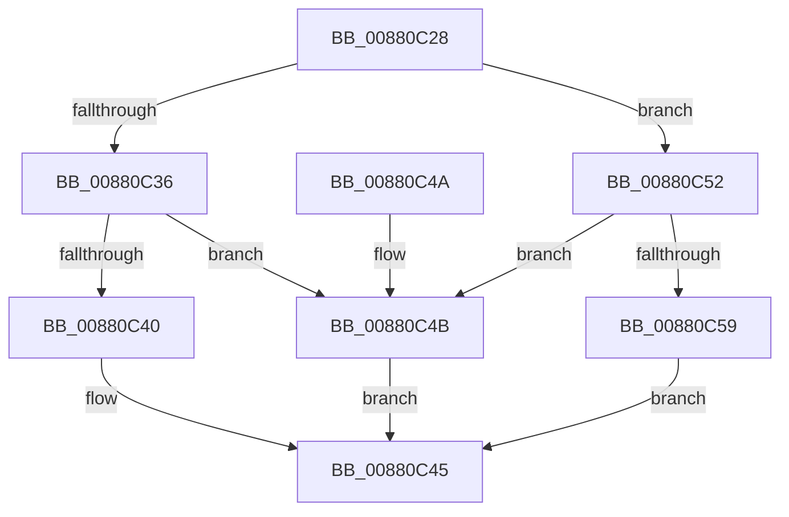

# MiDecommitEnclavePages

- RVA: `0x00880C28`–`0x00880C92` (길이 `106` bytes)
- VA: `0x0000000140880C28`
- 실행 섹션: `PAGE`
- PDB 이름 있음: `예`; PDB Function 태그: `아니요`
- unwind 정보 RVA: `0x0007C528`
- 디코드: `31`개 명령, `106/106` bytes 표시
- 미해석 바이트: `0` (있으면 어셈블리에 `.byte`로 보존)

> 이 문서는 커널 이미지의 기계어와 PDB 기호를 분석해 생성했습니다. 4번과 5번은 함수 원형과 자료형을 바이너리 사용 방식에서 추정한 C 해석이며 원본 소스 복구 결과는 아닙니다.

## 1. Dependencies

- 직접 호출 지점: **2**; 고유 호출 대상: **2**
- 직접 호출자로 확인된 함수: **1**
- RIP 상대 이미지 참조: **0**

### Outgoing calls
- `0x00880C5C` → [MiGetPteAddress](../../text/43/MiGetPteAddress_function_0043E130.md) (function, `0x0043E130`)
- `0x00880C89` → [MiDecommitHardwareEnclavePages](../../text/36/MiDecommitHardwareEnclavePages_function_003688D4.md) (function, `0x003688D4`)

### Direct callers
- [MiFreeVirtualMemory](MiFreeVirtualMemory_function_00880268.md) at `0x00880600`

### Static image references
- 디코드된 RIP-relative 메모리 참조가 없습니다.

## 2. Other-region calls and transfers

- 다른 실행 섹션으로 향하는 call: **2**
  - `0x00880C5C` → [MiGetPteAddress](../../text/43/MiGetPteAddress_function_0043E130.md) (`PAGE` → `.text`)
  - `0x00880C89` → [MiDecommitHardwareEnclavePages](../../text/36/MiDecommitHardwareEnclavePages_function_003688D4.md) (`PAGE` → `.text`)
- 별도 외부 분기/꼬리 이동을 확인하지 못했습니다.

## 3. Assembly (complete function range)

```asm
00880C28  48 83 EC 38                     sub rsp, 0x38
00880C2C  8B 42 40                        mov eax, dword ptr [rdx + 0x40]
00880C2F  4C 8B D1                        mov r10, rcx
00880C32  A8 01                           test al, 1
00880C34  75 1C                           jne 0x140880c52
00880C36  F7 44 24 60 00 00 00 10         test dword ptr [rsp + 0x60], 0x10000000
00880C3E  74 0B                           je 0x140880c4b
00880C40  B8 16 00 00 C0                  mov eax, 0xc0000016
00880C45  48 83 C4 38                     add rsp, 0x38
00880C49  C3                              ret
00880C4A  CC                              int3
00880C4B  B8 A0 00 00 C0                  mov eax, 0xc00000a0
00880C50  EB F3                           jmp 0x140880c45
00880C52  8B 42 48                        mov eax, dword ptr [rdx + 0x48]
00880C55  A8 01                           test al, 1
00880C57  74 F2                           je 0x140880c4b
00880C59  49 8B C8                        mov rcx, r8
00880C5C  E8 CF D4 BB FF                  call 0x14043e130
00880C61  49 F7 C1 FF 0F 00 00            test r9, 0xfff
00880C68  B9 00 00 00 00                  mov ecx, 0
00880C6D  4C 8B C0                        mov r8, rax
00880C70  0F 95 C1                        setne cl
00880C73  83 64 24 20 00                  and dword ptr [rsp + 0x20], 0
00880C78  49 C1 E9 0C                     shr r9, 0xc
00880C7C  49 FF C9                        dec r9
00880C7F  49 03 C9                        add rcx, r9
00880C82  4C 8D 0C C8                     lea r9, [rax + rcx*8]
00880C86  49 8B CA                        mov rcx, r10
00880C89  E8 46 7C AE FF                  call 0x1403688d4
00880C8E  33 C0                           xor eax, eax
00880C90  EB B3                           jmp 0x140880c45
```

## 4. C-style interpretation (structured pseudocode)

```c
__int64 __fastcall MiDecommitEnclavePages(__int64 a1, __int64 a2, __int64 a3, __int64 a4, unsigned int a5)
{
    __int64 result;
    __int64 v_rsp;
    unsigned int v_stack_p20;

    v_rsp = (v_rsp) - (56);
    if ((((unsigned __int8)((unsigned int)(*(unsigned int *)(a2 + 64)))) & (1)) != 0) goto loc_00880C52;
    if (((a5) & (0x10000000ULL)) == 0) goto loc_00880C4B;
loc_00880C45:
    v_rsp = (v_rsp) + (56);
    return (unsigned int)(0xC0000016ULL);
loc_00880C4B:
    goto loc_00880C45;
loc_00880C52:
    if ((((unsigned __int8)((unsigned int)(*(unsigned int *)(a2 + 72)))) & (1)) == 0) goto loc_00880C4B;
    result = MiGetPteAddress(a3, a2, a3, a4);
    a1 = (((a4) & (0xFFFULL)) != 0) ? 1 : 0;
    a4 = (a4) >> (12);
    a4 = (a4) - 1;
    a1 = (a1) + (a4);
    result = MiDecommitHardwareEnclavePages(a1, a2, result, result + a1 * 8);
    result = 0;
    goto loc_00880C45;
}
```

## 5. (Beta) C Style

```c
int64_t MiDecommitEnclavePages(int64_t Arg1, void *Arg2, int64_t Arg3, int64_t Arg4, uint32_t Arg5)
{
    uint8_t *arg2 = (uint8_t *)Arg2;

    int64_t result;
    int64_t local_rsp;
    uint32_t v_stack_p20;

    local_rsp = (local_rsp) - (56);
    if ((((uint8_t)((uint32_t)(*(uint32_t *)(arg2 + 0x40)))) & (1)) != 0) goto loc_00880C52;
    if (((Arg5) & (0x10000000ULL)) == 0) goto loc_00880C4B;
loc_00880C45:
    local_rsp = (local_rsp) + (56);
    return (uint32_t)(0xC0000016ULL);
loc_00880C4B:
    goto loc_00880C45;
loc_00880C52:
    if ((((uint8_t)((uint32_t)(*(uint32_t *)(arg2 + 0x48)))) & (1)) == 0) goto loc_00880C4B;
    result = MiGetPteAddress(Arg3, Arg2, Arg3, Arg4);
    Arg1 = (((Arg4) & (0xFFFULL)) != 0) ? 1 : 0;
    Arg4 = (Arg4) >> (12);
    Arg4 = (Arg4) - 1;
    Arg1 = (Arg1) + (Arg4);
    result = MiDecommitHardwareEnclavePages(Arg1, Arg2, result, result + Arg1 * 8);
    result = 0;
    goto loc_00880C45;
}
```

### 관측된 메모리 오프셋

구조체 형식이 확인되지 않은 접근은 인자 기준의 오프셋으로만 기록했습니다.

| 기준 인자 | 오프셋 표현 | 폭 (bit) | 접근 |
|---|---:|---:|---|
| `Arg2` | `+ 0x40` | `32` | `R` |
| `Arg2` | `+ 0x48` | `32` | `R` |

## 6. Execution-region graph

[열기: 2D/3D 그래프와 함수 탐색 컨트롤 패널](../../../control-panel.html?section=page&rva=0x00880C28&view=graph)

- 2D 그래프는 위에서 아래로 흐르고, 3D 그래프는 빈 공간을 드래그해 회전합니다. Shift+드래그는 이동, 휠은 확대·축소, 함수 노드 선택은 대상 보고서 이동입니다.

### Static fallback


