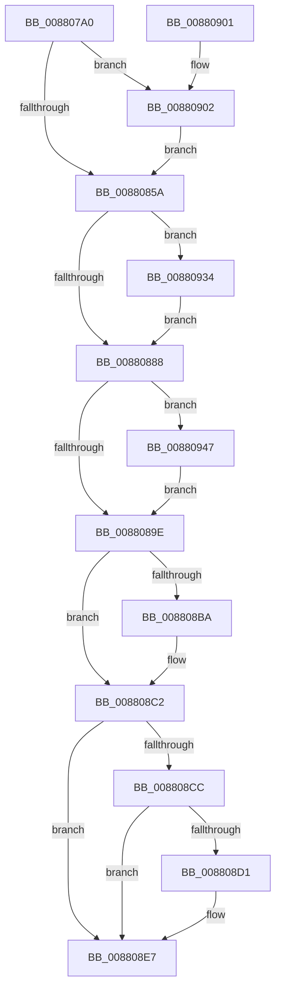

# MiDecommitRegion

- RVA: `0x008807A0`–`0x00880954` (길이 `436` bytes)
- VA: `0x00000001408807A0`
- 실행 섹션: `PAGE`
- PDB 이름 있음: `예`; PDB Function 태그: `아니요`
- unwind 정보 RVA: `0x0007C4E8`
- 디코드: `106`개 명령, `436/436` bytes 표시
- 미해석 바이트: `0` (있으면 어셈블리에 `.byte`로 보존)

> 이 문서는 커널 이미지의 기계어와 PDB 기호를 분석해 생성했습니다. 4번과 5번은 함수 원형과 자료형을 바이너리 사용 방식에서 추정한 C 해석이며 원본 소스 복구 결과는 아닙니다.

## 1. Dependencies

- 직접 호출 지점: **9**; 고유 호출 대상: **7**
- 직접 호출자로 확인된 함수: **4**
- RIP 상대 이미지 참조: **0**

### Outgoing calls
- `0x008807F0` → [MiGetPteAddress](../../text/43/MiGetPteAddress_function_0043E130.md) (function, `0x0043E130`)
- `0x008807FB` → [MiGetPteAddress](../../text/43/MiGetPteAddress_function_0043E130.md) (function, `0x0043E130`)
- `0x00880835` → [MiDecommitPages](../../text/24/MiDecommitPages_function_00241BD0.md) (function, `0x00241BD0`)
- `0x008808AB` → [MiFillCommitReturnInfo](../../text/44/MiFillCommitReturnInfo_function_00447990.md) (function, `0x00447990`)
- `0x008808BD` → [MiReturnFullProcessCharges](../../text/2C/MiReturnFullProcessCharges_function_002C2E70.md) (function, `0x002C2E70`)
- `0x008808D4` → [MiGetProcessPartition](../../text/44/MiGetProcessPartition_function_00443B10.md) (function, `0x00443B10`)
- `0x008808E2` → [MiReturnCommit](../../text/24/MiReturnCommit_function_00248410.md) (function, `0x00248410`)
- `0x00880905` → [MiGetProcessPartition](../../text/44/MiGetProcessPartition_function_00443B10.md) (function, `0x00443B10`)
- `0x00880925` → [MiFreeLargePages](../../text/2A/MiFreeLargePages_function_002A99D0.md) (function, `0x002A99D0`)

### Direct callers
- [MiFreeToSubAllocatedRegion](../87/MiFreeToSubAllocatedRegion_function_0087FB7C.md) at `0x0087FCB2`
- [MiFreeVirtualMemory](MiFreeVirtualMemory_function_00880268.md) at `0x008803FB`
- [MiLoadSectionIntoVsmEnclave](../AB/MiLoadSectionIntoVsmEnclave_function_00AB1D4C.md) at `0x00AB1FFA`
- [MiLoadDataIntoVsmEnclave](../AC/MiLoadDataIntoVsmEnclave_function_00ACD114.md) at `0x00ACD477`

### Static image references
- 디코드된 RIP-relative 메모리 참조가 없습니다.

## 2. Other-region calls and transfers

- 다른 실행 섹션으로 향하는 call: **9**
  - `0x008807F0` → [MiGetPteAddress](../../text/43/MiGetPteAddress_function_0043E130.md) (`PAGE` → `.text`)
  - `0x008807FB` → [MiGetPteAddress](../../text/43/MiGetPteAddress_function_0043E130.md) (`PAGE` → `.text`)
  - `0x00880835` → [MiDecommitPages](../../text/24/MiDecommitPages_function_00241BD0.md) (`PAGE` → `.text`)
  - `0x008808AB` → [MiFillCommitReturnInfo](../../text/44/MiFillCommitReturnInfo_function_00447990.md) (`PAGE` → `.text`)
  - `0x008808BD` → [MiReturnFullProcessCharges](../../text/2C/MiReturnFullProcessCharges_function_002C2E70.md) (`PAGE` → `.text`)
  - `0x008808D4` → [MiGetProcessPartition](../../text/44/MiGetProcessPartition_function_00443B10.md) (`PAGE` → `.text`)
  - `0x008808E2` → [MiReturnCommit](../../text/24/MiReturnCommit_function_00248410.md) (`PAGE` → `.text`)
  - `0x00880905` → [MiGetProcessPartition](../../text/44/MiGetProcessPartition_function_00443B10.md) (`PAGE` → `.text`)
  - `0x00880925` → [MiFreeLargePages](../../text/2A/MiFreeLargePages_function_002A99D0.md) (`PAGE` → `.text`)
- 별도 외부 분기/꼬리 이동을 확인하지 못했습니다.

## 3. Assembly (complete function range)

```asm
008807A0  4C 8B DC                        mov r11, rsp
008807A3  49 89 5B 10                     mov qword ptr [r11 + 0x10], rbx
008807A7  49 89 6B 18                     mov qword ptr [r11 + 0x18], rbp
008807AB  56                              push rsi
008807AC  57                              push rdi
008807AD  41 56                           push r14
008807AF  48 81 EC 90 00 00 00            sub rsp, 0x90
008807B6  0F 57 C0                        xorps xmm0, xmm0
008807B9  33 C0                           xor eax, eax
008807BB  0F 11 44 24 50                  movups xmmword ptr [rsp + 0x50], xmm0
008807C0  48 8B F1                        mov rsi, rcx
008807C3  45 33 F6                        xor r14d, r14d
008807C6  0F 11 44 24 60                  movups xmmword ptr [rsp + 0x60], xmm0
008807CB  48 8B CA                        mov rcx, rdx
008807CE  4D 89 73 20                     mov qword ptr [r11 + 0x20], r14
008807D2  0F 11 44 24 70                  movups xmmword ptr [rsp + 0x70], xmm0
008807D7  49 89 43 D8                     mov qword ptr [r11 - 0x28], rax
008807DB  65 48 8B 04 25 88 01 00 00      mov rax, qword ptr gs:[0x188]
008807E4  0F 11 44 24 40                  movups xmmword ptr [rsp + 0x40], xmm0
008807E9  48 8B B8 B8 00 00 00            mov rdi, qword ptr [rax + 0xb8]
008807F0  E8 3B D9 BB FF                  call 0x14043e130
008807F5  49 8B C8                        mov rcx, r8
008807F8  4C 8B D0                        mov r10, rax
008807FB  E8 30 D9 BB FF                  call 0x14043e130
00880800  48 8B D8                        mov rbx, rax
00880803  4C 8B CF                        mov r9, rdi
00880806  49 2B DA                        sub rbx, r10
00880809  48 8D 44 24 50                  lea rax, [rsp + 0x50]
0088080E  48 89 44 24 38                  mov qword ptr [rsp + 0x38], rax
00880813  45 33 C0                        xor r8d, r8d
00880816  4C 89 74 24 30                  mov qword ptr [rsp + 0x30], r14
0088081B  49 8B CA                        mov rcx, r10
0088081E  48 C1 FB 03                     sar rbx, 3
00880822  48 FF C3                        inc rbx
00880825  C7 44 24 28 01 00 00 00         mov dword ptr [rsp + 0x28], 1
0088082D  48 8B D3                        mov rdx, rbx
00880830  48 89 74 24 20                  mov qword ptr [rsp + 0x20], rsi
00880835  E8 96 13 9C FF                  call 0x140241bd0
0088083A  4C 8B 94 24 80 00 00 00         mov r10, qword ptr [rsp + 0x80]
00880842  8B E8                           mov ebp, eax
00880844  48 2B 5C 24 68                  sub rbx, qword ptr [rsp + 0x68]
00880849  4C 89 B4 24 B0 00 00 00         mov qword ptr [rsp + 0xb0], r14
00880851  4D 85 D2                        test r10, r10
00880854  0F 85 A8 00 00 00               jne 0x140880902
0088085A  8B 4E 34                        mov ecx, dword ptr [rsi + 0x34]
0088085D  0F B6 56 22                     movzx edx, byte ptr [rsi + 0x22]
00880861  48 C1 E2 20                     shl rdx, 0x20
00880865  48 0B D1                        or rdx, rcx
00880868  48 2B D3                        sub rdx, rbx
0088086B  89 56 34                        mov dword ptr [rsi + 0x34], edx
0088086E  48 C1 EA 20                     shr rdx, 0x20
00880872  88 56 22                        mov byte ptr [rsi + 0x22], dl
00880875  8B 46 30                        mov eax, dword ptr [rsi + 0x30]
00880878  25 00 00 A0 00                  and eax, 0xa00000
0088087D  3D 00 00 A0 00                  cmp eax, 0xa00000
00880882  0F 84 AC 00 00 00               je 0x140880934
00880888  48 8B B4 24 B0 00 00 00         mov rsi, qword ptr [rsp + 0xb0]
00880890  4C 39 B4 24 80 00 00 00         cmp qword ptr [rsp + 0x80], r14
00880898  0F 85 A9 00 00 00               jne 0x140880947
0088089E  4C 8D 44 24 40                  lea r8, [rsp + 0x40]
008808A3  48 8B CB                        mov rcx, rbx
008808A6  48 8D 54 24 50                  lea rdx, [rsp + 0x50]
008808AB  E8 E0 70 BC FF                  call 0x140447990
008808B0  48 8B 54 24 40                  mov rdx, qword ptr [rsp + 0x40]
008808B5  48 85 D2                        test rdx, rdx
008808B8  74 08                           je 0x1408808c2
008808BA  48 8B CF                        mov rcx, rdi
008808BD  E8 AE 25 A4 FF                  call 0x1402c2e70
008808C2  4C 8B 4C 24 48                  mov r9, qword ptr [rsp + 0x48]
008808C7  4D 85 C9                        test r9, r9
008808CA  74 1B                           je 0x1408808e7
008808CC  4C 2B CE                        sub r9, rsi
008808CF  74 16                           je 0x1408808e7
008808D1  48 8B CF                        mov rcx, rdi
008808D4  E8 37 32 BC FF                  call 0x140443b10
008808D9  49 8B D1                        mov rdx, r9
008808DC  48 8B C8                        mov rcx, rax
008808DF  45 33 C0                        xor r8d, r8d
008808E2  E8 29 7B 9C FF                  call 0x140248410
008808E7  4C 8D 9C 24 90 00 00 00         lea r11, [rsp + 0x90]
008808EF  8B C5                           mov eax, ebp
008808F1  49 8B 5B 28                     mov rbx, qword ptr [r11 + 0x28]
008808F5  49 8B 6B 30                     mov rbp, qword ptr [r11 + 0x30]
008808F9  49 8B E3                        mov rsp, r11
008808FC  41 5E                           pop r14
008808FE  5F                              pop rdi
008808FF  5E                              pop rsi
00880900  C3                              ret
00880901  CC                              int3
00880902  48 8B CF                        mov rcx, rdi
00880905  E8 06 32 BC FF                  call 0x140443b10
0088090A  48 8B C8                        mov rcx, rax
0088090D  44 89 74 24 20                  mov dword ptr [rsp + 0x20], r14d
00880912  49 8B D2                        mov rdx, r10
00880915  4C 8D 8C 24 C8 00 00 00         lea r9, [rsp + 0xc8]
0088091D  4C 8D 84 24 B0 00 00 00         lea r8, [rsp + 0xb0]
00880925  E8 A6 90 A2 FF                  call 0x1402a99d0
0088092A  48 89 44 24 58                  mov qword ptr [rsp + 0x58], rax
0088092F  E9 26 FF FF FF                  jmp 0x14088085a
00880934  48 8B C3                        mov rax, rbx
00880937  48 F7 D8                        neg rax
0088093A  F0 48 01 87 70 05 00 00         lock add qword ptr [rdi + 0x570], rax
00880942  E9 41 FF FF FF                  jmp 0x140880888
00880947  48 8B 5C 24 58                  mov rbx, qword ptr [rsp + 0x58]
0088094C  48 03 DE                        add rbx, rsi
0088094F  E9 4A FF FF FF                  jmp 0x14088089e
```

## 4. C-style interpretation (structured pseudocode)

```c
__int64 __fastcall MiDecommitRegion(__int64 a1, __int64 a2, __int64 a3)
{
    __int64 result;
    __int64 v_r14;
    __int64 v_rbx;
    __int64 v_rsp;
    unsigned __int64 v_stack_m18;
    unsigned __int64 v_stack_m28;
    unsigned __int64 v_stack_m38;
    unsigned __int64 v_stack_m40;
    unsigned __int64 v_stack_m48;
    unsigned __int64 v_stack_m58;
    unsigned __int64 v_stack_m60;
    unsigned __int64 v_stack_m68;
    unsigned __int64 v_stack_m70;
    unsigned __int64 v_stack_m78;
    unsigned int v_stack_m80;
    unsigned __int64 v_stack_m88;
    unsigned __int64 v_stack_p20;
    unsigned __int64 v_stack_p38;
    unsigned __int64 v_stack_p8;

    *(unsigned __int64 *)(v_rsp + 16) = v_rbx;
    *(unsigned __int64 *)(v_rsp + 24) = v_rbp;
    v_rsp = (v_rsp) - (144);
    result = 0;
    v_stack_m58 = v_xmm0;
    v_r14 = 0;
    v_stack_m48 = v_xmm0;
    *(unsigned __int64 *)(v_rsp + 32) = 0;
    v_stack_m38 = v_xmm0;
    *(unsigned __int64 *)(v_rsp - 40) = 0;
    v_stack_m68 = v_xmm0;
    result = MiGetPteAddress(a2, a2, a3, a4);
    result = MiGetPteAddress(a3, a2, a3, a4);
    v_rbx = (result) - (result);
    v_stack_m70 = v_stack_m58;
    a3 = 0;
    v_stack_m78 = 0;
    v_rbx = (v_rbx) >> (3);
    v_rbx = (v_rbx) + 1;
    v_stack_m80 = 1;
    v_stack_m88 = a1;
    result = MiDecommitPages(result, v_rbx, a3, *(unsigned __int64 *)(*(unsigned __int64 *)(gs_base + (0 + 392)) + 184));
    v_rbx = (v_rbx) - (v_stack_m40);
    v_stack_p8 = 0;
    if (v_stack_m28 != 0) goto loc_00880902;
loc_0088085A:
    a2 = (*(unsigned __int8 *)(a1 + 34)) << (32);
    a2 = (a2) | ((unsigned int)(*(unsigned int *)(a1 + 52)));
    a2 = (a2) - (v_rbx);
    *(unsigned int *)(a1 + 52) = (unsigned int)(a2);
    a2 = (a2) >> (32);
    *(unsigned __int8 *)(a1 + 34) = (unsigned __int8)(a2);
    result = (unsigned int)(((unsigned int)(*(unsigned int *)(a1 + 48))) & (0xA00000ULL));
    if (((unsigned int)(result)) == 0xA00000ULL) goto loc_00880934;
loc_00880888:
    if (v_stack_m28 != 0) goto loc_00880947;
loc_0088089E:
    result = MiFillCommitReturnInfo(v_rbx, v_stack_m58, v_stack_m68, *(unsigned __int64 *)(*(unsigned __int64 *)(gs_base + (0 + 392)) + 184));
    if (v_stack_m68 != 0) {
        a1 = *(unsigned __int64 *)(*(unsigned __int64 *)(gs_base + (0 + 392)) + 184);
        result = MiReturnFullProcessCharges(a1, v_stack_m68, v_stack_m68, *(unsigned __int64 *)(*(unsigned __int64 *)(gs_base + (0 + 392)) + 184));
    }
    if (v_stack_m60 == 0) goto loc_008808E7;
    a4 = (v_stack_m60) - (v_stack_p8);
    if (!(condition_is_equal)) {
        a1 = *(unsigned __int64 *)(*(unsigned __int64 *)(gs_base + (0 + 392)) + 184);
        result = MiGetProcessPartition(a1, v_stack_m68, v_stack_m68, a4);
        a2 = a4;
        a1 = result;
        a3 = 0;
        result = MiReturnCommit(a1, a2, a3, a4);
    }
    return (unsigned int)((unsigned int)((unsigned int)((unsigned int)(result))));
loc_00880902:
    result = MiGetProcessPartition(*(unsigned __int64 *)(*(unsigned __int64 *)(gs_base + (0 + 392)) + 184), a2, a3, a4);
    v_stack_m70 = 0;
    result = MiFreeLargePages(result, v_stack_m28, v_stack_p20, v_stack_p38);
    v_stack_m38 = result;
    goto loc_0088085A;
loc_00880934:
    result = -(*(unsigned __int64 *)(v_stack_m18 + 40));
    goto loc_00880888;
loc_00880947:
    v_rbx = (v_stack_m38) + (v_stack_p8);
    goto loc_0088089E;
}
```

## 5. (Beta) C Style

```c
int64_t MiDecommitRegion(void *Arg1, int64_t Arg2, int64_t Arg3)
{
    uint8_t *arg1 = (uint8_t *)Arg1;

    int64_t result;
    int64_t local_r14;
    int64_t local_rbx;
    int64_t local_rsp;
    uint64_t v_stack_m18;
    uint64_t v_stack_m28;
    uint64_t v_stack_m38;
    uint64_t v_stack_m40;
    uint64_t v_stack_m48;
    uint64_t v_stack_m58;
    uint64_t v_stack_m60;
    uint64_t v_stack_m68;
    uint64_t v_stack_m70;
    uint64_t v_stack_m78;
    uint32_t v_stack_m80;
    uint64_t v_stack_m88;
    uint64_t v_stack_p20;
    uint64_t v_stack_p38;
    uint64_t v_stack_p8;

    *(uint64_t *)(local_rsp + 0x10) = local_rbx;
    *(uint64_t *)(local_rsp + 0x18) = local_rbp;
    local_rsp = (local_rsp) - (144);
    result = 0;
    v_stack_m58 = v_xmm0;
    local_r14 = 0;
    v_stack_m48 = v_xmm0;
    *(uint64_t *)(local_rsp + 0x20) = 0;
    v_stack_m38 = v_xmm0;
    *(uint64_t *)(local_rsp - 0x28) = 0;
    v_stack_m68 = v_xmm0;
    result = MiGetPteAddress(Arg2, Arg2, Arg3, a4);
    result = MiGetPteAddress(Arg3, Arg2, Arg3, a4);
    local_rbx = (result) - (result);
    v_stack_m70 = v_stack_m58;
    Arg3 = 0;
    v_stack_m78 = 0;
    local_rbx = (local_rbx) >> (3);
    local_rbx = (local_rbx) + 1;
    v_stack_m80 = 1;
    v_stack_m88 = Arg1;
    result = MiDecommitPages(result, local_rbx, Arg3, *(uint64_t *)(*(uint64_t *)(gs_base + (0 + 0x188)) + 0xB8));
    local_rbx = (local_rbx) - (v_stack_m40);
    v_stack_p8 = 0;
    if (v_stack_m28 != 0) goto loc_00880902;
loc_0088085A:
    Arg2 = (*(uint8_t *)(arg1 + 0x22)) << (32);
    Arg2 = (Arg2) | ((uint32_t)(*(uint32_t *)(arg1 + 0x34)));
    Arg2 = (Arg2) - (local_rbx);
    *(uint32_t *)(arg1 + 0x34) = (uint32_t)(Arg2);
    Arg2 = (Arg2) >> (32);
    *(uint8_t *)(arg1 + 0x22) = (uint8_t)(Arg2);
    result = (uint32_t)(((uint32_t)(*(uint32_t *)(arg1 + 0x30))) & (0xA00000ULL));
    if (((uint32_t)(result)) == 0xA00000ULL) goto loc_00880934;
loc_00880888:
    if (v_stack_m28 != 0) goto loc_00880947;
loc_0088089E:
    result = MiFillCommitReturnInfo(local_rbx, v_stack_m58, v_stack_m68, *(uint64_t *)(*(uint64_t *)(gs_base + (0 + 0x188)) + 0xB8));
    if (v_stack_m68 != 0) {
        Arg1 = *(uint64_t *)(*(uint64_t *)(gs_base + (0 + 0x188)) + 0xB8);
        result = MiReturnFullProcessCharges(Arg1, v_stack_m68, v_stack_m68, *(uint64_t *)(*(uint64_t *)(gs_base + (0 + 0x188)) + 0xB8));
    }
    if (v_stack_m60 == 0) goto loc_008808E7;
    a4 = (v_stack_m60) - (v_stack_p8);
    if (!(condition_is_equal)) {
        Arg1 = *(uint64_t *)(*(uint64_t *)(gs_base + (0 + 0x188)) + 0xB8);
        result = MiGetProcessPartition(Arg1, v_stack_m68, v_stack_m68, a4);
        Arg2 = a4;
        Arg1 = result;
        Arg3 = 0;
        result = MiReturnCommit(Arg1, Arg2, Arg3, a4);
    }
    return (uint32_t)((uint32_t)((uint32_t)((uint32_t)(result))));
loc_00880902:
    result = MiGetProcessPartition(*(uint64_t *)(*(uint64_t *)(gs_base + (0 + 0x188)) + 0xB8), Arg2, Arg3, a4);
    v_stack_m70 = 0;
    result = MiFreeLargePages(result, v_stack_m28, v_stack_p20, v_stack_p38);
    v_stack_m38 = result;
    goto loc_0088085A;
loc_00880934:
    result = -(*(uint64_t *)(v_stack_m18 + 0x28));
    goto loc_00880888;
loc_00880947:
    local_rbx = (v_stack_m38) + (v_stack_p8);
    goto loc_0088089E;
}
```

### 관측된 메모리 오프셋

구조체 형식이 확인되지 않은 접근은 인자 기준의 오프셋으로만 기록했습니다.

| 기준 인자 | 오프셋 표현 | 폭 (bit) | 접근 |
|---|---:|---:|---|
| `Arg1` | `+ 0x22` | `8` | `R` |
| `Arg1` | `+ 0x22` | `8` | `W` |
| `Arg1` | `+ 0x30` | `32` | `R` |
| `Arg1` | `+ 0x34` | `32` | `R` |
| `Arg1` | `+ 0x34` | `32` | `W` |

## 6. Execution-region graph

[열기: 2D/3D 그래프와 함수 탐색 컨트롤 패널](../../../control-panel.html?section=page&rva=0x008807A0&view=graph)

- 2D 그래프는 위에서 아래로 흐르고, 3D 그래프는 빈 공간을 드래그해 회전합니다. Shift+드래그는 이동, 휠은 확대·축소, 함수 노드 선택은 대상 보고서 이동입니다.

### Static fallback


