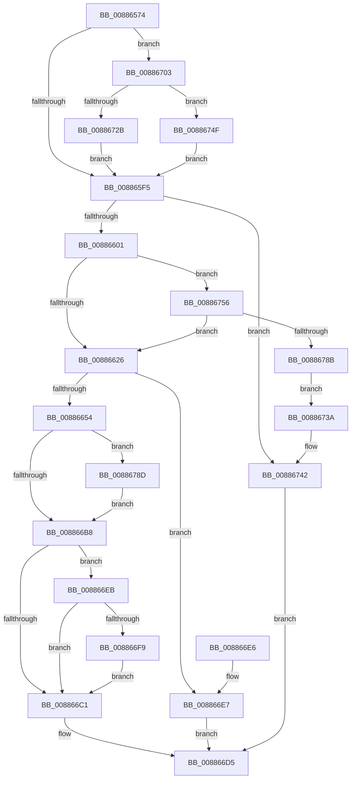

# MiExpandVadBitMap

- RVA: `0x00886574`–`0x0088679F` (길이 `555` bytes)
- VA: `0x0000000140886574`
- 실행 섹션: `PAGE`
- PDB 이름 있음: `예`; PDB Function 태그: `아니요`
- unwind 정보 RVA: `0x0007CA40`
- 디코드: `150`개 명령, `555/555` bytes 표시
- 미해석 바이트: `0` (있으면 어셈블리에 `.byte`로 보존)

> 이 문서는 커널 이미지의 기계어와 PDB 기호를 분석해 생성했습니다. 4번과 5번은 함수 원형과 자료형을 바이너리 사용 방식에서 추정한 C 해석이며 원본 소스 복구 결과는 아닙니다.

## 1. Dependencies

- 직접 호출 지점: **4**; 고유 호출 대상: **4**
- 직접 호출자로 확인된 함수: **3**
- RIP 상대 이미지 참조: **1**

### Outgoing calls
- `0x00886618` → [MiLocateLowestConflictingVad](../../text/44/MiLocateLowestConflictingVad_function_0044BD14.md) (function, `0x0044BD14`)
- `0x00886647` → [MiMakeHyperRangeAccessible](../../text/27/MiMakeHyperRangeAccessible_function_0027CE10.md) (function, `0x0027CE10`)
- `0x008866CB` → [MiUpdateVadBits](../A8/MiUpdateVadBits_function_00A8DAC8.md) (function, `0x00A8DAC8`)
- `0x00886748` → [MiExpandVadBitMapDown](../A9/MiExpandVadBitMapDown_function_00A95EC4.md) (function, `0x00A95EC4`)

### Direct callers
- [MiFindEmptyAddressRange](MiFindEmptyAddressRange_function_00886050.md) at `0x008862A9`
- [MiInitializeVadCellBitMap](MiInitializeVadCellBitMap_function_00887B64.md) at `0x00887BDB`
- [MiInitializeVadBitMap](../A4/MiInitializeVadBitMap_function_00A4869C.md) at `0x00A48738`

### Static image references
- `0x0088659E` → RVA `0x00E2F388` (`.data`; read)

## 2. Other-region calls and transfers

- 다른 실행 섹션으로 향하는 call: **2**
  - `0x00886618` → [MiLocateLowestConflictingVad](../../text/44/MiLocateLowestConflictingVad_function_0044BD14.md) (`PAGE` → `.text`)
  - `0x00886647` → [MiMakeHyperRangeAccessible](../../text/27/MiMakeHyperRangeAccessible_function_0027CE10.md) (`PAGE` → `.text`)
- 별도 외부 분기/꼬리 이동을 확인하지 못했습니다.

## 3. Assembly (complete function range)

```asm
00886574  4C 89 44 24 18                  mov qword ptr [rsp + 0x18], r8
00886579  53                              push rbx
0088657A  55                              push rbp
0088657B  56                              push rsi
0088657C  57                              push rdi
0088657D  41 54                           push r12
0088657F  41 55                           push r13
00886581  41 56                           push r14
00886583  41 57                           push r15
00886585  48 83 EC 28                     sub rsp, 0x28
00886589  65 48 8B 04 25 88 01 00 00      mov rax, qword ptr gs:[0x188]
00886592  4C 8B F2                        mov r14, rdx
00886595  48 83 64 24 70 00               and qword ptr [rsp + 0x70], 0
0088659B  48 8B F1                        mov rsi, rcx
0088659E  48 8B 15 E3 8D 5A 00            mov rdx, qword ptr [rip + 0x5a8de3]
008865A5  4C 8B 69 08                     mov r13, qword ptr [rcx + 8]
008865A9  4C 8B 90 B8 00 00 00            mov r10, qword ptr [rax + 0xb8]
008865B0  4D 8B FD                        mov r15, r13
008865B3  4C 8B 21                        mov r12, qword ptr [rcx]
008865B6  49 C1 E7 13                     shl r15, 0x13
008865BA  49 8B 82 10 04 00 00            mov rax, qword ptr [r10 + 0x410]
008865C1  48 89 84 24 88 00 00 00         mov qword ptr [rsp + 0x88], rax
008865C9  48 69 C2 00 00 F8 FF            imul rax, rdx, -0x80000
008865D0  4C 03 F8                        add r15, rax
008865D3  48 8B 41 28                     mov rax, qword ptr [rcx + 0x28]
008865D7  49 C1 EF 10                     shr r15, 0x10
008865DB  4D 03 FC                        add r15, r12
008865DE  49 2B C7                        sub rax, r15
008865E1  48 FF C0                        inc rax
008865E4  48 89 44 24 78                  mov qword ptr [rsp + 0x78], rax
008865E9  48 8B D8                        mov rbx, rax
008865EC  4D 85 C9                        test r9, r9
008865EF  0F 85 0E 01 00 00               jne 0x140886703
008865F5  49 8B FE                        mov rdi, r14
008865F8  4C 3B F3                        cmp r14, rbx
008865FB  0F 87 41 01 00 00               ja 0x140886742
00886601  49 8B C5                        mov rax, r13
00886604  49 8B CA                        mov rcx, r10
00886607  48 2B C2                        sub rax, rdx
0088660A  49 8D 2C C4                     lea rbp, [r12 + rax*8]
0088660E  48 C1 E5 10                     shl rbp, 0x10
00886612  4C 8B C5                        mov r8, rbp
00886615  48 8B D5                        mov rdx, rbp
00886618  E8 F7 56 BC FF                  call 0x14044bd14
0088661D  48 85 C0                        test rax, rax
00886620  0F 85 30 01 00 00               jne 0x140886756
00886626  49 8B DC                        mov rbx, r12
00886629  49 8D 54 24 FF                  lea rdx, [r12 - 1]
0088662E  48 03 D7                        add rdx, rdi
00886631  48 C1 EB 03                     shr rbx, 3
00886635  48 C1 EA 03                     shr rdx, 3
00886639  4C 8D 44 24 70                  lea r8, [rsp + 0x70]
0088663E  49 03 DD                        add rbx, r13
00886641  49 03 D5                        add rdx, r13
00886644  48 8B CB                        mov rcx, rbx
00886647  E8 C4 67 9F FF                  call 0x14027ce10
0088664C  85 C0                           test eax, eax
0088664E  0F 88 93 00 00 00               js 0x1408866e7
00886654  48 8B 8C 24 88 00 00 00         mov rcx, qword ptr [rsp + 0x88]
0088665C  BA 00 00 00 00                  mov edx, 0
00886661  48 8B 44 24 70                  mov rax, qword ptr [rsp + 0x70]
00886666  48 01 81 E0 03 00 00            add qword ptr [rcx + 0x3e0], rax
0088666D  B8 00 00 00 00                  mov eax, 0
00886672  4C 8B 06                        mov r8, qword ptr [rsi]
00886675  40 F6 C7 3F                     test dil, 0x3f
00886679  0F 95 C0                        setne al
0088667C  48 C1 EF 06                     shr rdi, 6
00886680  48 03 C7                        add rax, rdi
00886683  48 C1 E0 03                     shl rax, 3
00886687  48 A9 FF 0F 00 00               test rax, 0xfff
0088668D  0F 95 C2                        setne dl
00886690  48 C1 E8 0C                     shr rax, 0xc
00886694  48 03 D0                        add rdx, rax
00886697  48 8B CA                        mov rcx, rdx
0088669A  48 C1 E1 0F                     shl rcx, 0xf
0088669E  4C 03 C1                        add r8, rcx
008866A1  4C 03 F9                        add r15, rcx
008866A4  4C 89 06                        mov qword ptr [rsi], r8
008866A7  48 8B 4E 28                     mov rcx, qword ptr [rsi + 0x28]
008866AB  48 8D 41 01                     lea rax, [rcx + 1]
008866AF  4C 3B F8                        cmp r15, rax
008866B2  0F 87 D5 00 00 00               ja 0x14088678d
008866B8  48 3B 1D C9 8C 5A 00            cmp rbx, qword ptr [rip + 0x5a8cc9]
008866BF  74 2A                           je 0x1408866eb
008866C1  48 C1 E2 1F                     shl rdx, 0x1f
008866C5  48 8B CD                        mov rcx, rbp
008866C8  48 03 D5                        add rdx, rbp
008866CB  E8 F8 73 20 00                  call 0x140a8dac8
008866D0  B8 01 00 00 00                  mov eax, 1
008866D5  48 83 C4 28                     add rsp, 0x28
008866D9  41 5F                           pop r15
008866DB  41 5E                           pop r14
008866DD  41 5D                           pop r13
008866DF  41 5C                           pop r12
008866E1  5F                              pop rdi
008866E2  5E                              pop rsi
008866E3  5D                              pop rbp
008866E4  5B                              pop rbx
008866E5  C3                              ret
008866E6  CC                              int3
008866E7  33 C0                           xor eax, eax
008866E9  EB EA                           jmp 0x1408866d5
008866EB  4C 8B 46 08                     mov r8, qword ptr [rsi + 8]
008866EF  49 0F BA 28 00                  bts qword ptr [r8], 0
008866F4  4D 85 E4                        test r12, r12
008866F7  74 C8                           je 0x1408866c1
008866F9  48 C7 46 10 01 00 00 00         mov qword ptr [rsi + 0x10], 1
00886701  EB BE                           jmp 0x1408866c1
00886703  48 8B 5E 30                     mov rbx, qword ptr [rsi + 0x30]
00886707  49 8B C5                        mov rax, r13
0088670A  48 2B C2                        sub rax, rdx
0088670D  48 FF CB                        dec rbx
00886710  49 8D 0C C4                     lea rcx, [r12 + rax*8]
00886714  48 C1 E1 10                     shl rcx, 0x10
00886718  49 3B D9                        cmp rbx, r9
0088671B  49 0F 47 D9                     cmova rbx, r9
0088671F  48 8D 83 00 00 01 00            lea rax, [rbx + 0x10000]
00886726  48 3B C1                        cmp rax, rcx
00886729  76 24                           jbe 0x14088674f
0088672B  48 2B D9                        sub rbx, rcx
0088672E  48 C1 EB 10                     shr rbx, 0x10
00886732  48 FF C3                        inc rbx
00886735  E9 BB FE FF FF                  jmp 0x1408865f5
0088673A  4C 8B 84 24 80 00 00 00         mov r8, qword ptr [rsp + 0x80]
00886742  49 8B D6                        mov rdx, r14
00886745  48 8B CE                        mov rcx, rsi
00886748  E8 77 F7 20 00                  call 0x140a95ec4
0088674D  EB 86                           jmp 0x1408866d5
0088674F  33 DB                           xor ebx, ebx
00886751  E9 9F FE FF FF                  jmp 0x1408865f5
00886756  0F B6 78 21                     movzx edi, byte ptr [rax + 0x21]
0088675A  8B 40 1C                        mov eax, dword ptr [rax + 0x1c]
0088675D  48 C1 E8 04                     shr rax, 4
00886761  48 C1 E7 1C                     shl rdi, 0x1c
00886765  48 0B F8                        or rdi, rax
00886768  48 8B C5                        mov rax, rbp
0088676B  48 C1 E8 10                     shr rax, 0x10
0088676F  48 2B F8                        sub rdi, rax
00886772  48 83 C8 FF                     or rax, 0xffffffffffffffff
00886776  49 03 FE                        add rdi, r14
00886779  48 3B 7C 24 78                  cmp rdi, qword ptr [rsp + 0x78]
0088677E  48 0F 47 F8                     cmova rdi, rax
00886782  48 3B FB                        cmp rdi, rbx
00886785  0F 86 9B FE FF FF               jbe 0x140886626
0088678B  EB AD                           jmp 0x14088673a
0088678D  49 2B CF                        sub rcx, r15
00886790  48 8D 41 01                     lea rax, [rcx + 1]
00886794  49 03 C0                        add rax, r8
00886797  48 89 06                        mov qword ptr [rsi], rax
0088679A  E9 19 FF FF FF                  jmp 0x1408866b8
```

## 4. C-style interpretation (structured pseudocode)

```c
__int64 __fastcall MiExpandVadBitMap(__int64 a1, __int64 a2, __int64 a3, __int64 a4)
{
    __int64 result;
    __int64 v_r15;
    __int64 v_rbp;
    __int64 v_rbx;
    __int64 v_rdi;
    __int64 v_rsp;
    unsigned __int64 v_stack_p10;
    unsigned __int64 v_stack_p18;
    unsigned __int64 v_stack_p20;
    unsigned __int64 v_stack_p78;
    unsigned __int64 v_stack_p8;
    unsigned __int64 v_stack_p80;

    v_stack_p18 = a3;
    v_rsp = (v_rsp) - (40);
    v_r15 = (*(unsigned __int64 *)(a1 + 8)) << (19);
    v_stack_p20 = *(unsigned __int64 *)(*(unsigned __int64 *)(*(unsigned __int64 *)(gs_base + (0 + 392)) + 184) + 1040);
    result = (*(unsigned __int64 *)(*(unsigned __int64 *)(*(unsigned __int64 *)(gs_base + (0 + 392)) + 184) + 1040)) * (*(unsigned __int64 *)(v_rip + 5934563));
    v_r15 = (v_r15) + (result);
    v_r15 = (v_r15) >> (16);
    v_r15 = (v_r15) + (*(unsigned __int64 *)(a1));
    result = (*(unsigned __int64 *)(a1 + 40)) - (v_r15);
    result = (result) + 1;
    v_stack_p10 = result;
    if (a4 != 0) goto loc_00886703;
loc_008865F5:
    if (a2 > result) goto loc_00886742;
    result = (*(unsigned __int64 *)(a1 + 8)) - (*(unsigned __int64 *)(v_rip + 5934563));
    v_rbp = (*(unsigned __int64 *)(a1) + result * 8) << (16);
    result = MiLocateLowestConflictingVad(*(unsigned __int64 *)(*(unsigned __int64 *)(gs_base + (0 + 392)) + 184), v_rbp, v_rbp, a4);
    if (result != 0) goto loc_00886756;
loc_00886626:
    a2 = (*(unsigned __int64 *)(a1) - 1) + (a2);
    v_rbx = (*(unsigned __int64 *)(a1)) >> (3);
    a2 = (a2) >> (3);
    v_rbx = (v_rbx) + (*(unsigned __int64 *)(a1 + 8));
    a2 = (a2) + (*(unsigned __int64 *)(a1 + 8));
    result = MiMakeHyperRangeAccessible(v_rbx, a2, v_stack_p8, a4);
    if (sign_flag) goto loc_008866E7;
    result = ((((unsigned __int8)(a2)) & (63)) != 0) ? 1 : 0;
    v_rdi = (a2) >> (6);
    result = (result) + (v_rdi);
    result = (result) << (3);
    a2 = (((result) & (0xFFFULL)) != 0) ? 1 : 0;
    result = (result) >> (12);
    a2 = (a2) + (result);
    a1 = (a2) << (15);
    a3 = (*(unsigned __int64 *)(a1)) + (a1);
    v_r15 = (v_r15) + (a1);
    *(unsigned __int64 *)(a1) = a3;
    if (v_r15 > (*(unsigned __int64 *)(a1 + 40) + 1)) goto loc_0088678D;
loc_008866B8:
    if (v_rbx == (*(unsigned __int64 *)(v_rip + 5934281))) goto loc_008866EB;
loc_008866C1:
    a2 = (a2) << (31);
    a2 = (a2) + (v_rbp);
    result = MiUpdateVadBits(v_rbp, a2, a3, a4);
loc_008866D5:
    v_rsp = (v_rsp) + (40);
    return 1;
loc_008866E7:
    result = 0;
    goto loc_008866D5;
loc_008866EB:
    if (*(unsigned __int64 *)(a1) == 0) goto loc_008866C1;
    *(unsigned __int64 *)(a1 + 16) = 1;
    goto loc_008866C1;
loc_00886703:
    result = (*(unsigned __int64 *)(a1 + 8)) - (a2);
    v_rbx = (*(unsigned __int64 *)(a1 + 48)) - 1;
    a1 = (*(unsigned __int64 *)(a1) + result * 8) << (16);
    if (v_rbx > a4) { v_rbx = a4; }
    if ((v_rbx + 65536) <= a1) goto loc_0088674F;
    v_rbx = (v_rbx) - (a1);
    v_rbx = (v_rbx) >> (16);
    v_rbx = (v_rbx) + 1;
    goto loc_008865F5;
loc_0088673A:
loc_00886742:
    result = MiExpandVadBitMapDown(a1, a2, v_stack_p80, a4);
    goto loc_008866D5;
loc_0088674F:
    v_rbx = 0;
    goto loc_008865F5;
loc_00886756:
    result = ((unsigned int)(*(unsigned int *)(result + 28))) >> (4);
    v_rdi = (*(unsigned __int8 *)(result + 33)) << (28);
    v_rdi = (v_rdi) | (result);
    result = (v_rbp) >> (16);
    v_rdi = (v_rdi) - (result);
    result = (result) | (-1);
    v_rdi = (v_rdi) + (a2);
    if (v_rdi > v_stack_p78) { v_rdi = result; }
    if (v_rdi <= 0) goto loc_00886626;
    goto loc_0088673A;
loc_0088678D:
    a1 = (a1) - (v_r15);
    result = (a1 + 1) + (v_stack_p80);
    *(unsigned __int64 *)(a1) = result;
    goto loc_008866B8;
}
```

## 5. (Beta) C Style

```c
int64_t MiExpandVadBitMap(void *Arg1, int64_t Arg2, int64_t Arg3, int64_t Arg4)
{
    uint8_t *arg1 = (uint8_t *)Arg1;

    int64_t result;
    int64_t local_r15;
    int64_t local_rbp;
    int64_t local_rbx;
    int64_t local_rdi;
    int64_t local_rsp;
    uint64_t v_stack_p10;
    uint64_t v_stack_p18;
    uint64_t v_stack_p20;
    uint64_t v_stack_p78;
    uint64_t v_stack_p8;
    uint64_t v_stack_p80;

    v_stack_p18 = Arg3;
    local_rsp = (local_rsp) - (40);
    local_r15 = (*(uint64_t *)(arg1 + 0x8)) << (19);
    v_stack_p20 = *(uint64_t *)(*(uint64_t *)(*(uint64_t *)(gs_base + (0 + 0x188)) + 0xB8) + 0x410);
    result = (*(uint64_t *)(*(uint64_t *)(*(uint64_t *)(gs_base + (0 + 0x188)) + 0xB8) + 0x410)) * (*(uint64_t *)(v_rip + 0x5A8DE3));
    local_r15 = (local_r15) + (result);
    local_r15 = (local_r15) >> (16);
    local_r15 = (local_r15) + (*(uint64_t *)(arg1));
    result = (*(uint64_t *)(arg1 + 0x28)) - (local_r15);
    result = (result) + 1;
    v_stack_p10 = result;
    if (Arg4 != 0) goto loc_00886703;
loc_008865F5:
    if (Arg2 > result) goto loc_00886742;
    result = (*(uint64_t *)(arg1 + 0x8)) - (*(uint64_t *)(v_rip + 0x5A8DE3));
    local_rbp = (*(uint64_t *)(arg1) + result * 8) << (16);
    result = MiLocateLowestConflictingVad(*(uint64_t *)(*(uint64_t *)(gs_base + (0 + 0x188)) + 0xB8), local_rbp, local_rbp, Arg4);
    if (result != 0) goto loc_00886756;
loc_00886626:
    Arg2 = (*(uint64_t *)(arg1) - 1) + (Arg2);
    local_rbx = (*(uint64_t *)(arg1)) >> (3);
    Arg2 = (Arg2) >> (3);
    local_rbx = (local_rbx) + (*(uint64_t *)(arg1 + 0x8));
    Arg2 = (Arg2) + (*(uint64_t *)(arg1 + 0x8));
    result = MiMakeHyperRangeAccessible(local_rbx, Arg2, v_stack_p8, Arg4);
    if (sign_flag) goto loc_008866E7;
    result = ((((uint8_t)(Arg2)) & (63)) != 0) ? 1 : 0;
    local_rdi = (Arg2) >> (6);
    result = (result) + (local_rdi);
    result = (result) << (3);
    Arg2 = (((result) & (0xFFFULL)) != 0) ? 1 : 0;
    result = (result) >> (12);
    Arg2 = (Arg2) + (result);
    Arg1 = (Arg2) << (15);
    Arg3 = (*(uint64_t *)(arg1)) + (Arg1);
    local_r15 = (local_r15) + (Arg1);
    *(uint64_t *)(arg1) = Arg3;
    if (local_r15 > (*(uint64_t *)(arg1 + 0x28) + 1)) goto loc_0088678D;
loc_008866B8:
    if (local_rbx == (*(uint64_t *)(v_rip + 0x5A8CC9))) goto loc_008866EB;
loc_008866C1:
    Arg2 = (Arg2) << (31);
    Arg2 = (Arg2) + (local_rbp);
    result = MiUpdateVadBits(local_rbp, Arg2, Arg3, Arg4);
loc_008866D5:
    local_rsp = (local_rsp) + (40);
    return 1;
loc_008866E7:
    result = 0;
    goto loc_008866D5;
loc_008866EB:
    if (*(uint64_t *)(arg1) == 0) goto loc_008866C1;
    *(uint64_t *)(arg1 + 0x10) = 1;
    goto loc_008866C1;
loc_00886703:
    result = (*(uint64_t *)(arg1 + 0x8)) - (Arg2);
    local_rbx = (*(uint64_t *)(arg1 + 0x30)) - 1;
    Arg1 = (*(uint64_t *)(arg1) + result * 8) << (16);
    if (local_rbx > Arg4) { local_rbx = Arg4; }
    if ((local_rbx + 65536) <= Arg1) goto loc_0088674F;
    local_rbx = (local_rbx) - (Arg1);
    local_rbx = (local_rbx) >> (16);
    local_rbx = (local_rbx) + 1;
    goto loc_008865F5;
loc_0088673A:
loc_00886742:
    result = MiExpandVadBitMapDown(Arg1, Arg2, v_stack_p80, Arg4);
    goto loc_008866D5;
loc_0088674F:
    local_rbx = 0;
    goto loc_008865F5;
loc_00886756:
    result = ((uint32_t)(*(uint32_t *)(result + 0x1C))) >> (4);
    local_rdi = (*(uint8_t *)(result + 0x21)) << (28);
    local_rdi = (local_rdi) | (result);
    result = (local_rbp) >> (16);
    local_rdi = (local_rdi) - (result);
    result = (result) | (-1);
    local_rdi = (local_rdi) + (Arg2);
    if (local_rdi > v_stack_p78) { local_rdi = result; }
    if (local_rdi <= 0) goto loc_00886626;
    goto loc_0088673A;
loc_0088678D:
    Arg1 = (Arg1) - (local_r15);
    result = (Arg1 + 1) + (v_stack_p80);
    *(uint64_t *)(arg1) = result;
    goto loc_008866B8;
}
```

### 관측된 메모리 오프셋

구조체 형식이 확인되지 않은 접근은 인자 기준의 오프셋으로만 기록했습니다.

| 기준 인자 | 오프셋 표현 | 폭 (bit) | 접근 |
|---|---:|---:|---|
| `Arg1` | `+ 0x0` | `64` | `R` |
| `Arg1` | `+ 0x0` | `64` | `W` |
| `Arg1` | `+ 0x8` | `64` | `R` |
| `Arg1` | `+ 0x10` | `64` | `W` |
| `Arg1` | `+ 0x28` | `64` | `R` |
| `Arg1` | `+ 0x30` | `64` | `R` |

## 6. Execution-region graph

[열기: 2D/3D 그래프와 함수 탐색 컨트롤 패널](../../../control-panel.html?section=page&rva=0x00886574&view=graph)

- 2D 그래프는 위에서 아래로 흐르고, 3D 그래프는 빈 공간을 드래그해 회전합니다. Shift+드래그는 이동, 휠은 확대·축소, 함수 노드 선택은 대상 보고서 이동입니다.

### Static fallback


