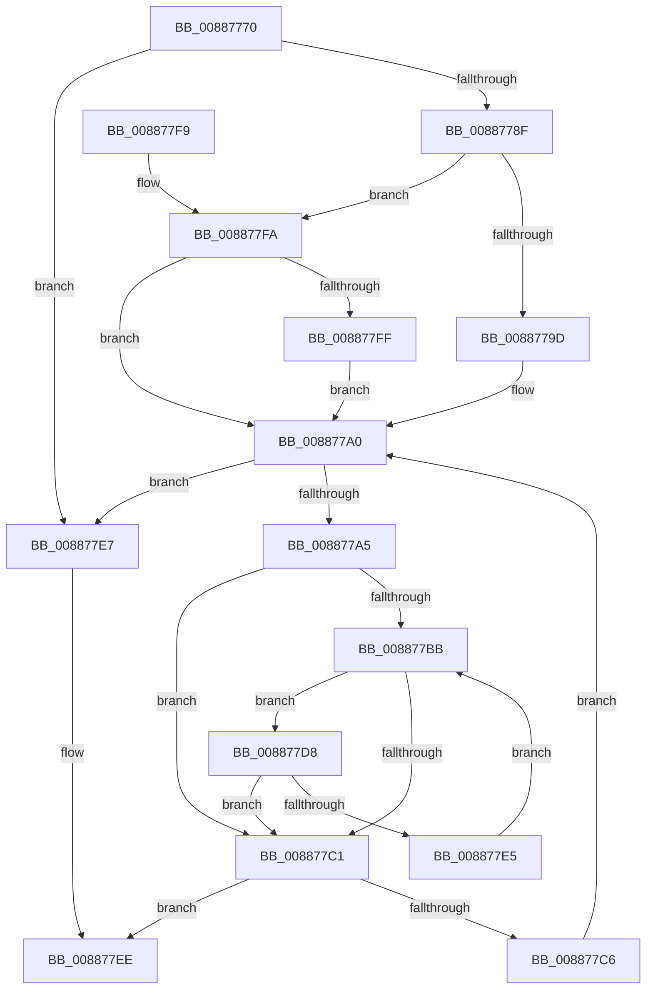

# MiFindClearVadBitsAligned

- RVA: `0x00887770`–`0x00887812` (길이 `162` bytes)
- VA: `0x0000000140887770`
- 실행 섹션: `PAGE`
- PDB 이름 있음: `예`; PDB Function 태그: `아니요`
- unwind 정보 RVA: `0x0007CCB4`
- 디코드: `52`개 명령, `162/162` bytes 표시
- 미해석 바이트: `0` (있으면 어셈블리에 `.byte`로 보존)

> 이 문서는 커널 이미지의 기계어와 PDB 기호를 분석해 생성했습니다. 4번과 5번은 함수 원형과 자료형을 바이너리 사용 방식에서 추정한 C 해석이며 원본 소스 복구 결과는 아닙니다.

## 1. Dependencies

- 직접 호출 지점: **0**; 고유 호출 대상: **0**
- 직접 호출자로 확인된 함수: **1**
- RIP 상대 이미지 참조: **0**

### Outgoing calls
- 직접 디코드된 call 명령이 없습니다.

### Direct callers
- [MiFindEmptyAddressRange](MiFindEmptyAddressRange_function_00886050.md) at `0x00886300`

### Static image references
- 디코드된 RIP-relative 메모리 참조가 없습니다.

## 2. Other-region calls and transfers

- 다른 실행 섹션으로 향하는 call: **0**
- 별도 외부 분기/꼬리 이동을 확인하지 못했습니다.

## 3. Assembly (complete function range)

```asm
00887770  48 89 5C 24 08                  mov qword ptr [rsp + 8], rbx
00887775  48 89 7C 24 10                  mov qword ptr [rsp + 0x10], rdi
0088777A  48 8B DA                        mov rbx, rdx
0088777D  4D 8B D0                        mov r10, r8
00887780  48 8B 11                        mov rdx, qword ptr [rcx]
00887783  48 8B F9                        mov rdi, rcx
00887786  48 C1 EB 10                     shr rbx, 0x10
0088778A  4C 3B C2                        cmp r8, rdx
0088778D  73 58                           jae 0x1408877e7
0088778F  4C 8B DA                        mov r11, rdx
00887792  48 8B C3                        mov rax, rbx
00887795  4D 2B D8                        sub r11, r8
00887798  4C 3B CA                        cmp r9, rdx
0088779B  72 5D                           jb 0x1408877fa
0088779D  0F 1F 00                        nop dword ptr [rax]
008877A0  49 3B C3                        cmp rax, r11
008877A3  77 42                           ja 0x1408877e7
008877A5  48 8B 4F 08                     mov rcx, qword ptr [rdi + 8]
008877A9  48 8B D0                        mov rdx, rax
008877AC  48 C1 EA 05                     shr rdx, 5
008877B0  4C 8D 04 91                     lea r8, [rcx + rdx*4]
008877B4  33 C9                           xor ecx, ecx
008877B6  4D 85 D2                        test r10, r10
008877B9  74 06                           je 0x1408877c1
008877BB  41 83 38 00                     cmp dword ptr [r8], 0
008877BF  74 17                           je 0x1408877d8
008877C1  49 3B CA                        cmp rcx, r10
008877C4  74 28                           je 0x1408877ee
008877C6  48 03 C1                        add rax, rcx
008877C9  48 8D 4B FF                     lea rcx, [rbx - 1]
008877CD  48 F7 D1                        not rcx
008877D0  48 23 C1                        and rax, rcx
008877D3  48 03 C3                        add rax, rbx
008877D6  EB C8                           jmp 0x1408877a0
008877D8  49 83 C0 04                     add r8, 4
008877DC  48 83 C1 20                     add rcx, 0x20
008877E0  49 3B CA                        cmp rcx, r10
008877E3  73 DC                           jae 0x1408877c1
008877E5  EB D4                           jmp 0x1408877bb
008877E7  48 C7 C0 FF FF FF FF            mov rax, 0xffffffffffffffff
008877EE  48 8B 5C 24 08                  mov rbx, qword ptr [rsp + 8]
008877F3  48 8B 7C 24 10                  mov rdi, qword ptr [rsp + 0x10]
008877F8  C3                              ret
008877F9  CC                              int3
008877FA  4C 3B CB                        cmp r9, rbx
008877FD  76 A1                           jbe 0x1408877a0
008877FF  49 8D 41 FF                     lea rax, [r9 - 1]
00887803  48 8D 4B FF                     lea rcx, [rbx - 1]
00887807  48 03 C3                        add rax, rbx
0088780A  48 F7 D1                        not rcx
0088780D  48 23 C1                        and rax, rcx
00887810  EB 8E                           jmp 0x1408877a0
```

## 4. C-style interpretation (structured pseudocode)

```c
__int64 __fastcall MiFindClearVadBitsAligned(__int64 a1, __int64 a2, __int64 a3, __int64 a4)
{
    __int64 result;
    __int64 v_r11;
    __int64 v_rbx;
    unsigned __int64 v_stack_p10;
    unsigned __int64 v_stack_p8;

    v_stack_p8 = v_rbx;
    v_stack_p10 = v_rdi;
    v_rbx = (a2) >> (16);
    if (a3 >= (*(unsigned __int64 *)(a1))) goto loc_008877E7;
    v_r11 = (*(unsigned __int64 *)(a1)) - (a3);
    if (a4 < (*(unsigned __int64 *)(a1))) goto loc_008877FA;
loc_008877A0:
    if (v_rbx > v_r11) goto loc_008877E7;
    a2 = (v_rbx) >> (5);
    a1 = 0;
    if (a3 == 0) goto loc_008877C1;
loc_008877BB:
    if ((*(unsigned int *)(*(unsigned __int64 *)(a1 + 8) + a2 * 4)) == 0) goto loc_008877D8;
loc_008877C1:
    if (0 == a3) goto loc_008877EE;
    result = (v_rbx) + (0);
    a1 = ~(v_rbx - 1);
    result = (result) & (a1);
    result = (result) + (v_rbx);
    goto loc_008877A0;
loc_008877D8:
    a3 = (*(unsigned __int64 *)(a1 + 8) + a2 * 4) + (4);
    a1 = (a1) + (32);
    if (a1 >= a3) goto loc_008877C1;
    goto loc_008877BB;
loc_008877E7:
loc_008877EE:
    return -1;
loc_008877FA:
    if (a4 <= v_stack_p8) goto loc_008877A0;
    result = (a4 - 1) + (v_stack_p8);
    a1 = ~(v_stack_p8 - 1);
    result = (result) & (a1);
    goto loc_008877A0;
}
```

## 5. (Beta) C Style

```c
int64_t MiFindClearVadBitsAligned(void *Arg1, int64_t Arg2, int64_t Arg3, int64_t Arg4)
{
    uint8_t *arg1 = (uint8_t *)Arg1;

    int64_t result;
    int64_t local_r11;
    int64_t local_rbx;
    uint64_t v_stack_p10;
    uint64_t v_stack_p8;

    v_stack_p8 = local_rbx;
    v_stack_p10 = local_rdi;
    local_rbx = (Arg2) >> (16);
    if (Arg3 >= (*(uint64_t *)(arg1))) goto loc_008877E7;
    local_r11 = (*(uint64_t *)(arg1)) - (Arg3);
    if (Arg4 < (*(uint64_t *)(arg1))) goto loc_008877FA;
loc_008877A0:
    if (local_rbx > local_r11) goto loc_008877E7;
    Arg2 = (local_rbx) >> (5);
    Arg1 = 0;
    if (Arg3 == 0) goto loc_008877C1;
loc_008877BB:
    if ((*(uint32_t *)(*(uint64_t *)(arg1 + 0x8) + Arg2 * 4)) == 0) goto loc_008877D8;
loc_008877C1:
    if (0 == Arg3) goto loc_008877EE;
    result = (local_rbx) + (0);
    Arg1 = ~(local_rbx - 1);
    result = (result) & (Arg1);
    result = (result) + (local_rbx);
    goto loc_008877A0;
loc_008877D8:
    Arg3 = (*(uint64_t *)(arg1 + 0x8) + Arg2 * 4) + (4);
    Arg1 = (Arg1) + (32);
    if (Arg1 >= Arg3) goto loc_008877C1;
    goto loc_008877BB;
loc_008877E7:
loc_008877EE:
    return -1;
loc_008877FA:
    if (Arg4 <= v_stack_p8) goto loc_008877A0;
    result = (Arg4 - 1) + (v_stack_p8);
    Arg1 = ~(v_stack_p8 - 1);
    result = (result) & (Arg1);
    goto loc_008877A0;
}
```

### 관측된 메모리 오프셋

구조체 형식이 확인되지 않은 접근은 인자 기준의 오프셋으로만 기록했습니다.

| 기준 인자 | 오프셋 표현 | 폭 (bit) | 접근 |
|---|---:|---:|---|
| `Arg1` | `+ 0x0` | `64` | `R` |
| `Arg1` | `+ 0x8` | `64` | `R` |

## 6. Execution-region graph

[열기: 2D/3D 그래프와 함수 탐색 컨트롤 패널](../../../control-panel.html?section=page&rva=0x00887770&view=graph)

- 2D 그래프는 위에서 아래로 흐르고, 3D 그래프는 빈 공간을 드래그해 회전합니다. Shift+드래그는 이동, 휠은 확대·축소, 함수 노드 선택은 대상 보고서 이동입니다.

### Static fallback


