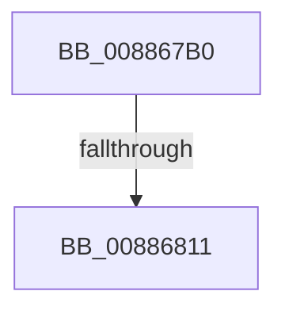

# MiFindEmptyAddressRangeDownTree

- RVA: `0x008867B0`–`0x00886820` (길이 `112` bytes)
- VA: `0x00000001408867B0`
- 실행 섹션: `PAGE`
- PDB 이름 있음: `예`; PDB Function 태그: `아니요`
- unwind 정보 RVA: `0x0007CA5C`
- 디코드: `28`개 명령, `112/112` bytes 표시
- 미해석 바이트: `0` (있으면 어셈블리에 `.byte`로 보존)

> 이 문서는 커널 이미지의 기계어와 PDB 기호를 분석해 생성했습니다. 4번과 5번은 함수 원형과 자료형을 바이너리 사용 방식에서 추정한 C 해석이며 원본 소스 복구 결과는 아닙니다.

## 1. Dependencies

- 직접 호출 지점: **1**; 고유 호출 대상: **1**
- 직접 호출자로 확인된 함수: **2**
- RIP 상대 이미지 참조: **0**

### Outgoing calls
- `0x008867D2` → [memset](../../text/6C/memset_function_006C6C40.md) (function, `0x006C6C40`)

### Direct callers
- [MiSelectUserAddress](MiSelectUserAddress_function_00885C40.md) at `0x00885EB7`
- [sub_00B2AB7A](../B2/Unknown_function_00B2AB7A.md) at `0x00B2ABF1`

### Static image references
- 디코드된 RIP-relative 메모리 참조가 없습니다.

## 2. Other-region calls and transfers

- 다른 실행 섹션으로 향하는 call: **1**
  - `0x008867D2` → [memset](../../text/6C/memset_function_006C6C40.md) (`PAGE` → `.text`)
- call이 아닌 외부 분기/꼬리 이동: **2**
  - `0x0088680B` → [sub_00886A19](Unknown_function_00886A19.md) (`tail-transfer`)
  - `0x0088681A` → [sub_00886A19](Unknown_function_00886A19.md) (`tail-transfer`)

## 3. Assembly (complete function range)

```asm
008867B0  40 53                           push rbx
008867B2  55                              push rbp
008867B3  56                              push rsi
008867B4  57                              push rdi
008867B5  41 56                           push r14
008867B7  48 83 EC 60                     sub rsp, 0x60
008867BB  48 8B DA                        mov rbx, rdx
008867BE  49 8B F0                        mov rsi, r8
008867C1  33 D2                           xor edx, edx
008867C3  4C 8B F1                        mov r14, rcx
008867C6  48 8D 4C 24 20                  lea rcx, [rsp + 0x20]
008867CB  49 8B E9                        mov rbp, r9
008867CE  44 8D 42 40                     lea r8d, [rdx + 0x40]
008867D2  E8 69 04 E4 FF                  call 0x1406c6c40
008867D7  48 8B BC 24 B0 00 00 00         mov rdi, qword ptr [rsp + 0xb0]
008867DF  48 81 C3 FF 0F 00 00            add rbx, 0xfff
008867E6  48 8B 8C 24 B8 00 00 00         mov rcx, qword ptr [rsp + 0xb8]
008867EE  48 81 E3 00 F0 FF FF            and rbx, 0xfffffffffffff000
008867F5  4C 8B CB                        mov r9, rbx
008867F8  48 C1 ED 0C                     shr rbp, 0xc
008867FC  49 C1 E9 0C                     shr r9, 0xc
00886800  4C 89 8C 24 98 00 00 00         mov qword ptr [rsp + 0x98], r9
00886808  48 3B F9                        cmp rdi, rcx
0088680B  0F 83 08 02 00 00               jae 0x140886a19
00886811  48 8B C1                        mov rax, rcx
00886814  48 2B C7                        sub rax, rdi
00886817  48 3B C3                        cmp rax, rbx
0088681A  0F 82 F9 01 00 00               jb 0x140886a19
```

## 4. C-style interpretation (structured pseudocode)

```c
__int64 __fastcall MiFindEmptyAddressRangeDownTree(__int64 a1, __int64 a2, __int64 a3, __int64 a4, __int64 a5, __int64 a6)
{
    __int64 result;
    __int64 v_rbp;
    __int64 v_rbx;
    __int64 v_rsp;
    unsigned __int64 v_stack_m68;
    unsigned __int64 v_stack_p10;

    v_rsp = (v_rsp) - (96);
    a2 = 0;
    result = memset(v_stack_m68, a2, a2 + 64, a4);
    v_rbx = (a2) + (0xFFFULL);
    v_rbx = (v_rbx) & (0xFFFFFFFFFFFFF000ULL);
    v_rbp = (a4) >> (12);
    a4 = (v_rbx) >> (12);
    v_stack_p10 = a4;
    result = (a6) - (a5);
}
```

## 5. (Beta) C Style

```c
int64_t MiFindEmptyAddressRangeDownTree(int64_t Arg1, int64_t Arg2, int64_t Arg3, int64_t Arg4, int64_t Arg5, int64_t Arg6)
{
    int64_t result;
    int64_t local_rbp;
    int64_t local_rbx;
    int64_t local_rsp;
    uint64_t v_stack_m68;
    uint64_t v_stack_p10;

    local_rsp = (local_rsp) - (96);
    Arg2 = 0;
    result = memset(v_stack_m68, Arg2, Arg2 + 64, Arg4);
    local_rbx = (Arg2) + (0xFFFULL);
    local_rbx = (local_rbx) & (0xFFFFFFFFFFFFF000ULL);
    local_rbp = (Arg4) >> (12);
    Arg4 = (local_rbx) >> (12);
    v_stack_p10 = Arg4;
    result = (Arg6) - (Arg5);
}
```

## 6. Execution-region graph

[열기: 2D/3D 그래프와 함수 탐색 컨트롤 패널](../../../control-panel.html?section=page&rva=0x008867B0&view=graph)

- 2D 그래프는 위에서 아래로 흐르고, 3D 그래프는 빈 공간을 드래그해 회전합니다. Shift+드래그는 이동, 휠은 확대·축소, 함수 노드 선택은 대상 보고서 이동입니다.

### Static fallback


