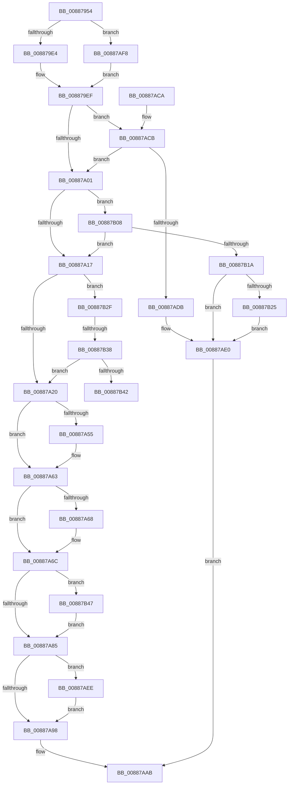

# MiInitializePartialVad

- RVA: `0x00887954`–`0x00887B5E` (길이 `522` bytes)
- VA: `0x0000000140887954`
- 실행 섹션: `PAGE`
- PDB 이름 있음: `예`; PDB Function 태그: `예`
- unwind 정보 RVA: `0x0007CCF4`
- 디코드: `136`개 명령, `522/522` bytes 표시
- 미해석 바이트: `0` (있으면 어셈블리에 `.byte`로 보존)

> 이 문서는 커널 이미지의 기계어와 PDB 기호를 분석해 생성했습니다. 4번과 5번은 함수 원형과 자료형을 바이너리 사용 방식에서 추정한 C 해석이며 원본 소스 복구 결과는 아닙니다.

## 1. Dependencies

- 직접 호출 지점: **12**; 고유 호출 대상: **12**
- 직접 호출자로 확인된 함수: **1**
- RIP 상대 이미지 참조: **0**

### Outgoing calls
- `0x008879A2` → [memcpy](../../text/6C/memcpy_function_006C6840.md) (function, `0x006C6840`)
- `0x00887A09` → [MiLocateLockedVadEvent](../../text/2A/MiLocateLockedVadEvent_function_002A7A0C.md) (function, `0x002A7A0C`)
- `0x00887A45` → [KeAbPreAcquire](../../text/21/KeAbPreAcquire_function_00210230.md) (function, `0x00210230`)
- `0x00887A5E` → [ExfAcquirePushLockExclusiveEx](../../text/20/ExfAcquirePushLockExclusiveEx_function_0020FC90.md) (function, `0x0020FC90`)
- `0x00887A72` → [MiAdvanceVadView](../../text/2A/MiAdvanceVadView_function_002A60EC.md) (function, `0x002A60EC`)
- `0x00887A9B` → [KeAbPostRelease](../../text/2E/KeAbPostRelease_function_002E1600.md) (function, `0x002E1600`)
- `0x00887ACE` → [MiCreateRotateView](../A7/MiCreateRotateView_function_00A7F498.md) (function, `0x00A7F498`)
- `0x00887AE5` → [ExFreePoolWithTag](../../poolcode/B8/ExFreePoolWithTag_function_00B82870.md) (function, `0x00B82870`)
- `0x00887AF1` → [ExfTryToWakePushLock](../../text/26/ExfTryToWakePushLock_function_00265DD0.md) (function, `0x00265DD0`)
- `0x00887B0B` → [MiCreatePlaceholderStorage](../8C/MiCreatePlaceholderStorage_function_008CF330.md) (function, `0x008CF330`)
- `0x00887B28` → [MiFreeRotateView](../7F/MiFreeRotateView_function_007FE6CC.md) (function, `0x007FE6CC`)
- `0x00887B4C` → [MiClearVadTrimBehind](../../text/42/MiClearVadTrimBehind_function_0042AC90.md) (function, `0x0042AC90`)

### Direct callers
- [MiAllocateSplitVads](MiAllocateSplitVads_function_00887818.md) at `0x0088789D`

### Static image references
- 디코드된 RIP-relative 메모리 참조가 없습니다.

## 2. Other-region calls and transfers

- 다른 실행 섹션으로 향하는 call: **9**
  - `0x008879A2` → [memcpy](../../text/6C/memcpy_function_006C6840.md) (`PAGE` → `.text`)
  - `0x00887A09` → [MiLocateLockedVadEvent](../../text/2A/MiLocateLockedVadEvent_function_002A7A0C.md) (`PAGE` → `.text`)
  - `0x00887A45` → [KeAbPreAcquire](../../text/21/KeAbPreAcquire_function_00210230.md) (`PAGE` → `.text`)
  - `0x00887A5E` → [ExfAcquirePushLockExclusiveEx](../../text/20/ExfAcquirePushLockExclusiveEx_function_0020FC90.md) (`PAGE` → `.text`)
  - `0x00887A72` → [MiAdvanceVadView](../../text/2A/MiAdvanceVadView_function_002A60EC.md) (`PAGE` → `.text`)
  - `0x00887A9B` → [KeAbPostRelease](../../text/2E/KeAbPostRelease_function_002E1600.md) (`PAGE` → `.text`)
  - `0x00887AE5` → [ExFreePoolWithTag](../../poolcode/B8/ExFreePoolWithTag_function_00B82870.md) (`PAGE` → `POOLCODE`)
  - `0x00887AF1` → [ExfTryToWakePushLock](../../text/26/ExfTryToWakePushLock_function_00265DD0.md) (`PAGE` → `.text`)
  - `0x00887B4C` → [MiClearVadTrimBehind](../../text/42/MiClearVadTrimBehind_function_0042AC90.md) (`PAGE` → `.text`)
- call이 아닌 외부 분기/꼬리 이동: **2**
  - `0x00887B32` → [sub_00B19096](../B1/Unknown_function_00B19096.md) (`tail-transfer`)
  - `0x00887B42` → [sub_00B19096](../B1/Unknown_function_00B19096.md) (`tail-transfer`)

## 3. Assembly (complete function range)

```asm
00887954  48 8B C4                        mov rax, rsp
00887957  48 89 58 08                     mov qword ptr [rax + 8], rbx
0088795B  48 89 68 10                     mov qword ptr [rax + 0x10], rbp
0088795F  48 89 70 18                     mov qword ptr [rax + 0x18], rsi
00887963  48 89 78 20                     mov qword ptr [rax + 0x20], rdi
00887967  41 55                           push r13
00887969  41 56                           push r14
0088796B  41 57                           push r15
0088796D  48 83 EC 20                     sub rsp, 0x20
00887971  4C 8B 7A 08                     mov r15, qword ptr [rdx + 8]
00887975  4C 8B F2                        mov r14, rdx
00887978  8B 72 10                        mov esi, dword ptr [rdx + 0x10]
0088797B  48 8B D9                        mov rbx, rcx
0088797E  48 8B 6A 18                     mov rbp, qword ptr [rdx + 0x18]
00887982  4C 8B 6A 20                     mov r13, qword ptr [rdx + 0x20]
00887986  49 8B D7                        mov rdx, r15
00887989  41 8B 47 30                     mov eax, dword ptr [r15 + 0x30]
0088798D  25 00 00 20 00                  and eax, 0x200000
00887992  F7 D8                           neg eax
00887994  4D 1B C0                        sbb r8, r8
00887997  49 83 E0 B8                     and r8, 0xffffffffffffffb8
0088799B  49 81 C0 88 00 00 00            add r8, 0x88
008879A2  E8 99 EE E3 FF                  call 0x1406c6840
008879A7  C7 43 24 00 00 00 00            mov dword ptr [rbx + 0x24], 0
008879AE  48 C7 43 10 FE FF FF FF         mov qword ptr [rbx + 0x10], 0xfffffffffffffffe
008879B6  48 8B 43 38                     mov rax, qword ptr [rbx + 0x38]
008879BA  83 E0 0F                        and eax, 0xf
008879BD  48 89 43 38                     mov qword ptr [rbx + 0x38], rax
008879C1  48 B8 FD FF FF FF 07 00 00 00   movabs rax, 0x7fffffffd
008879CB  41 8B 4F 34                     mov ecx, dword ptr [r15 + 0x34]
008879CF  41 0F B6 57 22                  movzx edx, byte ptr [r15 + 0x22]
008879D4  48 C1 E2 20                     shl rdx, 0x20
008879D8  48 0B D1                        or rdx, rcx
008879DB  48 3B D0                        cmp rdx, rax
008879DE  0F 84 14 01 00 00               je 0x140887af8
008879E4  C7 43 34 00 00 00 00            mov dword ptr [rbx + 0x34], 0
008879EB  C6 43 22 00                     mov byte ptr [rbx + 0x22], 0
008879EF  8B 43 30                        mov eax, dword ptr [rbx + 0x30]
008879F2  48 83 63 28 00                  and qword ptr [rbx + 0x28], 0
008879F7  24 70                           and al, 0x70
008879F9  3C 40                           cmp al, 0x40
008879FB  0F 84 CA 00 00 00               je 0x140887acb
00887A01  BA 80 00 00 00                  mov edx, 0x80
00887A06  49 8B CF                        mov rcx, r15
00887A09  E8 FE FF A1 FF                  call 0x1402a7a0c
00887A0E  48 85 C0                        test rax, rax
00887A11  0F 85 F1 00 00 00               jne 0x140887b08
00887A17  83 FE 01                        cmp esi, 1
00887A1A  0F 85 0F 01 00 00               jne 0x140887b2f
00887A20  0F B6 4B 20                     movzx ecx, byte ptr [rbx + 0x20]
00887A24  49 8D 7D 01                     lea rdi, [r13 + 1]
00887A28  8B 43 18                        mov eax, dword ptr [rbx + 0x18]
00887A2B  48 C1 E1 20                     shl rcx, 0x20
00887A2F  48 0B C8                        or rcx, rax
00887A32  48 C1 EF 0C                     shr rdi, 0xc
00887A36  48 2B F9                        sub rdi, rcx
00887A39  48 8D 73 28                     lea rsi, [rbx + 0x28]
00887A3D  45 33 C0                        xor r8d, r8d
00887A40  48 8B CE                        mov rcx, rsi
00887A43  33 D2                           xor edx, edx
00887A45  E8 E6 87 98 FF                  call 0x140210230
00887A4A  F0 48 0F BA 2E 00               lock bts qword ptr [rsi], 0
00887A50  48 8B E8                        mov rbp, rax
00887A53  73 0E                           jae 0x140887a63
00887A55  4C 8B C6                        mov r8, rsi
00887A58  48 8B D0                        mov rdx, rax
00887A5B  48 8B CE                        mov rcx, rsi
00887A5E  E8 2D 82 98 FF                  call 0x14020fc90
00887A63  48 85 ED                        test rbp, rbp
00887A66  74 04                           je 0x140887a6c
00887A68  C6 45 0A 01                     mov byte ptr [rbp + 0xa], 1
00887A6C  48 8B D7                        mov rdx, rdi
00887A6F  48 8B CB                        mov rcx, rbx
00887A72  E8 75 E6 A1 FF                  call 0x1402a60ec
00887A77  41 F7 47 30 00 00 20 00         test dword ptr [r15 + 0x30], 0x200000
00887A7F  0F 84 C2 00 00 00               je 0x140887b47
00887A85  48 8D 7B 28                     lea rdi, [rbx + 0x28]
00887A89  48 83 C8 FF                     or rax, 0xffffffffffffffff
00887A8D  F0 48 0F C1 07                  lock xadd qword ptr [rdi], rax
00887A92  24 06                           and al, 6
00887A94  3C 02                           cmp al, 2
00887A96  74 56                           je 0x140887aee
00887A98  48 8B CF                        mov rcx, rdi
00887A9B  E8 60 9B A5 FF                  call 0x1402e1600
00887AA0  49 8B 06                        mov rax, qword ptr [r14]
00887AA3  48 89 03                        mov qword ptr [rbx], rax
00887AA6  33 C0                           xor eax, eax
00887AA8  49 89 1E                        mov qword ptr [r14], rbx
00887AAB  48 8B 5C 24 40                  mov rbx, qword ptr [rsp + 0x40]
00887AB0  48 8B 6C 24 48                  mov rbp, qword ptr [rsp + 0x48]
00887AB5  48 8B 74 24 50                  mov rsi, qword ptr [rsp + 0x50]
00887ABA  48 8B 7C 24 58                  mov rdi, qword ptr [rsp + 0x58]
00887ABF  48 83 C4 20                     add rsp, 0x20
00887AC3  41 5F                           pop r15
00887AC5  41 5E                           pop r14
00887AC7  41 5D                           pop r13
00887AC9  C3                              ret
00887ACA  CC                              int3
00887ACB  48 8B CB                        mov rcx, rbx
00887ACE  E8 C5 79 1F 00                  call 0x140a7f498
00887AD3  85 C0                           test eax, eax
00887AD5  0F 85 26 FF FF FF               jne 0x140887a01
00887ADB  BF 9A 00 00 C0                  mov edi, 0xc000009a
00887AE0  33 D2                           xor edx, edx
00887AE2  48 8B CB                        mov rcx, rbx
00887AE5  E8 86 AD 2F 00                  call 0x140b82870
00887AEA  8B C7                           mov eax, edi
00887AEC  EB BD                           jmp 0x140887aab
00887AEE  48 8B CF                        mov rcx, rdi
00887AF1  E8 DA E2 9D FF                  call 0x140265dd0
00887AF6  EB A0                           jmp 0x140887a98
00887AF8  C7 43 34 FD FF FF FF            mov dword ptr [rbx + 0x34], 0xfffffffd
00887AFF  C6 43 22 07                     mov byte ptr [rbx + 0x22], 7
00887B03  E9 E7 FE FF FF                  jmp 0x1408879ef
00887B08  48 8B CB                        mov rcx, rbx
00887B0B  E8 20 78 04 00                  call 0x1408cf330
00887B10  8B F8                           mov edi, eax
00887B12  85 C0                           test eax, eax
00887B14  0F 89 FD FE FF FF               jns 0x140887a17
00887B1A  8B 4B 30                        mov ecx, dword ptr [rbx + 0x30]
00887B1D  80 E1 70                        and cl, 0x70
00887B20  80 F9 40                        cmp cl, 0x40
00887B23  75 BB                           jne 0x140887ae0
00887B25  48 8B CB                        mov rcx, rbx
00887B28  E8 9F 6B F7 FF                  call 0x1407fe6cc
00887B2D  EB B1                           jmp 0x140887ae0
00887B2F  83 FE 03                        cmp esi, 3
00887B32  0F 85 5E 15 29 00               jne 0x140b19096
00887B38  49 83 3E 00                     cmp qword ptr [r14], 0
00887B3C  0F 84 DE FE FF FF               je 0x140887a20
00887B42  E9 4F 15 29 00                  jmp 0x140b19096
00887B47  33 D2                           xor edx, edx
00887B49  48 8B CB                        mov rcx, rbx
00887B4C  E8 3F 31 BA FF                  call 0x14042ac90
00887B51  48 C7 43 78 00 00 00 00         mov qword ptr [rbx + 0x78], 0
00887B59  E9 27 FF FF FF                  jmp 0x140887a85
```

## 4. C-style interpretation (structured pseudocode)

```c
__int64 __fastcall MiInitializePartialVad(__int64 a1, __int64 a2, __int64 a3)
{
    __int64 result;
    __int64 v_rdi;
    __int64 v_rsp;
    unsigned __int64 v_stack_p10;
    unsigned __int64 v_stack_p18;
    unsigned __int64 v_stack_p20;
    unsigned __int64 v_stack_p8;

    *(unsigned __int64 *)(v_rsp + 8) = v_rbx;
    *(unsigned __int64 *)(v_rsp + 16) = v_rbp;
    *(unsigned __int64 *)(v_rsp + 24) = v_rsi;
    *(unsigned __int64 *)(v_rsp + 32) = v_rdi;
    v_rsp = (v_rsp) - (32);
    result = (unsigned int)(((unsigned int)(*(unsigned int *)(*(unsigned __int64 *)(a2 + 8) + 48))) & (0x200000ULL));
    result = (unsigned int)(-(result));
    a3 = (a3) & (-72);
    a3 = (a3) + (136);
    result = memcpy(a1, *(unsigned __int64 *)(a2 + 8), a3, a4);
    *(unsigned int *)(a1 + 36) = 0;
    *(unsigned __int64 *)(a1 + 16) = -2;
    result = (unsigned int)((*(unsigned __int64 *)(a1 + 56)) & (15));
    *(unsigned __int64 *)(a1 + 56) = result;
    a2 = (*(unsigned __int8 *)(*(unsigned __int64 *)(a2 + 8) + 34)) << (32);
    a2 = (a2) | ((unsigned int)(*(unsigned int *)(*(unsigned __int64 *)(a2 + 8) + 52)));
    if (a2 == result) goto loc_00887AF8;
    *(unsigned int *)(a1 + 52) = 0;
    *(unsigned __int8 *)(a1 + 34) = 0;
loc_008879EF:
    result = (unsigned __int8)(((unsigned int)(*(unsigned int *)(a1 + 48))) & (112));
    if (((unsigned __int8)(result)) == 64) goto loc_00887ACB;
loc_00887A01:
    result = MiLocateLockedVadEvent(*(unsigned __int64 *)(a2 + 8), 128, a3, a4);
    if (result != 0) goto loc_00887B08;
loc_00887A17:
    if (((unsigned int)((unsigned int)(*(unsigned int *)(a2 + 16)))) != 1) goto loc_00887B2F;
loc_00887A20:
    a1 = (*(unsigned __int8 *)(a1 + 32)) << (32);
    a1 = (a1) | ((unsigned int)(*(unsigned int *)(a1 + 24)));
    v_rdi = (*(unsigned __int64 *)(a2 + 32) + 1) >> (12);
    v_rdi = (v_rdi) - (a1);
    a3 = 0;
    a2 = 0;
    result = KeAbPreAcquire(a1 + 40, a2, a3, a4);
    if (!(condition_is_above_or_equal)) {
        a3 = a1 + 40;
        a2 = result;
        a1 = a1 + 40;
        result = ExfAcquirePushLockExclusiveEx(a1, a2, a3, a4);
    }
    if (result != 0) {
        *(unsigned __int8 *)(result + 10) = 1;
    }
    result = MiAdvanceVadView(a1, v_rdi, a3, a4);
    if (((*(unsigned int *)(*(unsigned __int64 *)(a2 + 8) + 48)) & (0x200000ULL)) == 0) goto loc_00887B47;
loc_00887A85:
    result = (result) | (-1);
    result = (unsigned __int8)((result) & (6));
    if (((unsigned __int8)(result)) == 2) goto loc_00887AEE;
loc_00887A98:
    result = KeAbPostRelease(a1 + 40, v_rdi, a3, a4);
    *(unsigned __int64 *)(a1) = *(unsigned __int64 *)(a2);
    result = 0;
    *(unsigned __int64 *)(a2) = a1;
loc_00887AAB:
    v_rsp = (v_rsp) + (32);
    return result;
loc_00887ACB:
    result = MiCreateRotateView(v_stack_p8, v_rdi, a3, a4);
    if ((unsigned int)(result) != 0) goto loc_00887A01;
loc_00887AE0:
    a2 = 0;
    result = ExFreePoolWithTag(v_stack_p8, a2, a3, a4);
    goto loc_00887AAB;
loc_00887AEE:
    result = ExfTryToWakePushLock((unsigned int)(0xC000009AULL), a2, a3, a4);
    goto loc_00887A98;
loc_00887AF8:
    *(unsigned int *)(v_stack_p8 + 52) = 0xFFFFFFFDULL;
    *(unsigned __int8 *)(v_stack_p8 + 34) = 7;
    goto loc_008879EF;
loc_00887B08:
    result = MiCreatePlaceholderStorage(v_stack_p8, a2, a3, a4);
    if (!sign_flag) goto loc_00887A17;
    a1 = (unsigned __int8)(((unsigned int)(*(unsigned int *)(v_stack_p8 + 48))) & (112));
    if (((unsigned __int8)(a1)) != 64) goto loc_00887AE0;
    result = MiFreeRotateView(v_stack_p8, a2, a3, a4);
    goto loc_00887AE0;
loc_00887B2F:
    if ((*(unsigned __int64 *)(a2)) == 0) goto loc_00887A20;
loc_00887B47:
    a2 = 0;
    result = MiClearVadTrimBehind(v_stack_p8, a2, a3, a4);
    *(unsigned __int64 *)(v_stack_p8 + 120) = 0;
    goto loc_00887A85;
}
```

## 5. (Beta) C Style

```c
int64_t MiInitializePartialVad(void *Arg1, void *Arg2, int64_t Arg3)
{
    uint8_t *arg1 = (uint8_t *)Arg1;
    uint8_t *arg2 = (uint8_t *)Arg2;

    int64_t result;
    int64_t local_rdi;
    int64_t local_rsp;
    uint64_t v_stack_p10;
    uint64_t v_stack_p18;
    uint64_t v_stack_p20;
    uint64_t v_stack_p8;

    *(uint64_t *)(local_rsp + 0x8) = local_rbx;
    *(uint64_t *)(local_rsp + 0x10) = local_rbp;
    *(uint64_t *)(local_rsp + 0x18) = local_rsi;
    *(uint64_t *)(local_rsp + 0x20) = local_rdi;
    local_rsp = (local_rsp) - (32);
    result = (uint32_t)(((uint32_t)(*(uint32_t *)(*(uint64_t *)(arg2 + 0x8) + 0x30))) & (0x200000ULL));
    result = (uint32_t)(-(result));
    Arg3 = (Arg3) & (-72);
    Arg3 = (Arg3) + (136);
    result = memcpy(Arg1, *(uint64_t *)(arg2 + 0x8), Arg3, a4);
    *(uint32_t *)(arg1 + 0x24) = 0;
    *(uint64_t *)(arg1 + 0x10) = -2;
    result = (uint32_t)((*(uint64_t *)(arg1 + 0x38)) & (15));
    *(uint64_t *)(arg1 + 0x38) = result;
    Arg2 = (*(uint8_t *)(*(uint64_t *)(arg2 + 0x8) + 0x22)) << (32);
    Arg2 = (Arg2) | ((uint32_t)(*(uint32_t *)(*(uint64_t *)(arg2 + 0x8) + 0x34)));
    if (Arg2 == result) goto loc_00887AF8;
    *(uint32_t *)(arg1 + 0x34) = 0;
    *(uint8_t *)(arg1 + 0x22) = 0;
loc_008879EF:
    result = (uint8_t)(((uint32_t)(*(uint32_t *)(arg1 + 0x30))) & (112));
    if (((uint8_t)(result)) == 64) goto loc_00887ACB;
loc_00887A01:
    result = MiLocateLockedVadEvent(*(uint64_t *)(arg2 + 0x8), 128, Arg3, a4);
    if (result != 0) goto loc_00887B08;
loc_00887A17:
    if (((uint32_t)((uint32_t)(*(uint32_t *)(arg2 + 0x10)))) != 1) goto loc_00887B2F;
loc_00887A20:
    Arg1 = (*(uint8_t *)(arg1 + 0x20)) << (32);
    Arg1 = (Arg1) | ((uint32_t)(*(uint32_t *)(arg1 + 0x18)));
    local_rdi = (*(uint64_t *)(arg2 + 0x20) + 1) >> (12);
    local_rdi = (local_rdi) - (Arg1);
    Arg3 = 0;
    Arg2 = 0;
    result = KeAbPreAcquire(Arg1 + 40, Arg2, Arg3, a4);
    if (!(condition_is_above_or_equal)) {
        Arg3 = Arg1 + 40;
        Arg2 = result;
        Arg1 = Arg1 + 40;
        result = ExfAcquirePushLockExclusiveEx(Arg1, Arg2, Arg3, a4);
    }
    if (result != 0) {
        *(uint8_t *)(result + 0xA) = 1;
    }
    result = MiAdvanceVadView(Arg1, local_rdi, Arg3, a4);
    if (((*(uint32_t *)(*(uint64_t *)(arg2 + 0x8) + 0x30)) & (0x200000ULL)) == 0) goto loc_00887B47;
loc_00887A85:
    result = (result) | (-1);
    result = (uint8_t)((result) & (6));
    if (((uint8_t)(result)) == 2) goto loc_00887AEE;
loc_00887A98:
    result = KeAbPostRelease(Arg1 + 40, local_rdi, Arg3, a4);
    *(uint64_t *)(arg1) = *(uint64_t *)(arg2);
    result = 0;
    *(void **)(arg2) = Arg1;
loc_00887AAB:
    local_rsp = (local_rsp) + (32);
    return result;
loc_00887ACB:
    result = MiCreateRotateView(v_stack_p8, local_rdi, Arg3, a4);
    if ((uint32_t)(result) != 0) goto loc_00887A01;
loc_00887AE0:
    Arg2 = 0;
    result = ExFreePoolWithTag(v_stack_p8, Arg2, Arg3, a4);
    goto loc_00887AAB;
loc_00887AEE:
    result = ExfTryToWakePushLock((uint32_t)(0xC000009AULL), Arg2, Arg3, a4);
    goto loc_00887A98;
loc_00887AF8:
    *(uint32_t *)(v_stack_p8 + 0x34) = 0xFFFFFFFDULL;
    *(uint8_t *)(v_stack_p8 + 0x22) = 7;
    goto loc_008879EF;
loc_00887B08:
    result = MiCreatePlaceholderStorage(v_stack_p8, Arg2, Arg3, a4);
    if (!sign_flag) goto loc_00887A17;
    Arg1 = (uint8_t)(((uint32_t)(*(uint32_t *)(v_stack_p8 + 0x30))) & (112));
    if (((uint8_t)(Arg1)) != 64) goto loc_00887AE0;
    result = MiFreeRotateView(v_stack_p8, Arg2, Arg3, a4);
    goto loc_00887AE0;
loc_00887B2F:
    if ((*(uint64_t *)(arg2)) == 0) goto loc_00887A20;
loc_00887B47:
    Arg2 = 0;
    result = MiClearVadTrimBehind(v_stack_p8, Arg2, Arg3, a4);
    *(uint64_t *)(v_stack_p8 + 0x78) = 0;
    goto loc_00887A85;
}
```

### 관측된 메모리 오프셋

구조체 형식이 확인되지 않은 접근은 인자 기준의 오프셋으로만 기록했습니다.

| 기준 인자 | 오프셋 표현 | 폭 (bit) | 접근 |
|---|---:|---:|---|
| `Arg1` | `+ 0x0` | `64` | `R/W` |
| `Arg1` | `+ 0x0` | `64` | `W` |
| `Arg1` | `+ 0x10` | `64` | `W` |
| `Arg1` | `+ 0x18` | `32` | `R` |
| `Arg1` | `+ 0x20` | `8` | `R` |
| `Arg1` | `+ 0x22` | `8` | `W` |
| `Arg1` | `+ 0x24` | `32` | `W` |
| `Arg1` | `+ 0x28` | `64` | `R` |
| `Arg1` | `+ 0x28` | `64` | `R/W` |
| `Arg1` | `+ 0x30` | `32` | `R` |
| `Arg1` | `+ 0x34` | `32` | `W` |
| `Arg1` | `+ 0x38` | `64` | `R` |
| `Arg1` | `+ 0x38` | `64` | `W` |
| `Arg1` | `+ 0x78` | `64` | `W` |
| `Arg2` | `+ 0x0` | `64` | `R` |
| `Arg2` | `+ 0x0` | `64` | `W` |
| `Arg2` | `+ 0x8` | `64` | `R` |
| `Arg2` | `+ 0x10` | `32` | `R` |
| `Arg2` | `+ 0x18` | `64` | `R` |
| `Arg2` | `+ 0x20` | `64` | `R` |

## 6. Execution-region graph

[열기: 2D/3D 그래프와 함수 탐색 컨트롤 패널](../../../control-panel.html?section=page&rva=0x00887954&view=graph)

- 2D 그래프는 위에서 아래로 흐르고, 3D 그래프는 빈 공간을 드래그해 회전합니다. Shift+드래그는 이동, 휠은 확대·축소, 함수 노드 선택은 대상 보고서 이동입니다.

### Static fallback


