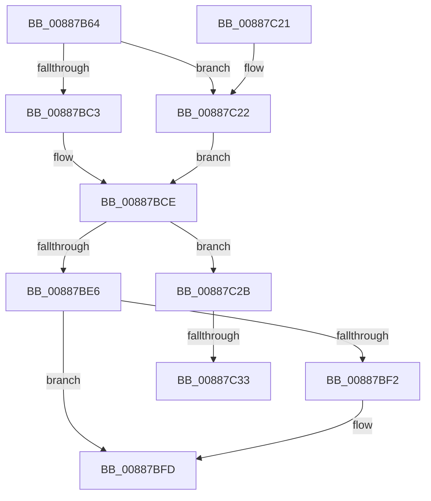

# MiInitializeVadCellBitMap

- RVA: `0x00887B64`–`0x00887C3F` (길이 `219` bytes)
- VA: `0x0000000140887B64`
- 실행 섹션: `PAGE`
- PDB 이름 있음: `예`; PDB Function 태그: `예`
- unwind 정보 RVA: `0x0007CD24`
- 디코드: `60`개 명령, `219/219` bytes 표시
- 미해석 바이트: `0` (있으면 어셈블리에 `.byte`로 보존)

> 이 문서는 커널 이미지의 기계어와 PDB 기호를 분석해 생성했습니다. 4번과 5번은 함수 원형과 자료형을 바이너리 사용 방식에서 추정한 C 해석이며 원본 소스 복구 결과는 아닙니다.

## 1. Dependencies

- 직접 호출 지점: **3**; 고유 호출 대상: **3**
- 직접 호출자로 확인된 함수: **1**
- RIP 상대 이미지 참조: **1**

### Outgoing calls
- `0x00887BC9` → [LOCK_ADDRESS_SPACE](../../text/2A/LOCK_ADDRESS_SPACE_function_002A4944.md) (function, `0x002A4944`)
- `0x00887BDB` → [MiExpandVadBitMap](MiExpandVadBitMap_function_00886574.md) (function, `0x00886574`)
- `0x00887BF8` → [UNLOCK_ADDRESS_SPACE](../../text/2A/UNLOCK_ADDRESS_SPACE_function_002A4844.md) (function, `0x002A4844`)

### Direct callers
- [sub_00B18F9A](../B1/Unknown_function_00B18F9A.md) at `0x00B18FD6`

### Static image references
- `0x00887BB0` → RVA `0x00E2F388` (`.data`; read)

## 2. Other-region calls and transfers

- 다른 실행 섹션으로 향하는 call: **2**
  - `0x00887BC9` → [LOCK_ADDRESS_SPACE](../../text/2A/LOCK_ADDRESS_SPACE_function_002A4944.md) (`PAGE` → `.text`)
  - `0x00887BF8` → [UNLOCK_ADDRESS_SPACE](../../text/2A/UNLOCK_ADDRESS_SPACE_function_002A4844.md) (`PAGE` → `.text`)
- call이 아닌 외부 분기/꼬리 이동: **2**
  - `0x00887C2D` → [sub_00B190B0](../B1/Unknown_function_00B190B0.md) (`tail-transfer`)
  - `0x00887C3A` → [sub_00B190B0](../B1/Unknown_function_00B190B0.md) (`tail-transfer`)

## 3. Assembly (complete function range)

```asm
00887B64  48 89 5C 24 08                  mov qword ptr [rsp + 8], rbx
00887B69  48 89 6C 24 10                  mov qword ptr [rsp + 0x10], rbp
00887B6E  48 89 74 24 18                  mov qword ptr [rsp + 0x18], rsi
00887B73  57                              push rdi
00887B74  41 56                           push r14
00887B76  41 57                           push r15
00887B78  48 83 EC 20                     sub rsp, 0x20
00887B7C  65 4C 8B 34 25 88 01 00 00      mov r14, qword ptr gs:[0x188]
00887B85  8B EA                           mov ebp, edx
00887B87  4C 8B 41 40                     mov r8, qword ptr [rcx + 0x40]
00887B8B  48 8B F9                        mov rdi, rcx
00887B8E  49 8B C0                        mov rax, r8
00887B91  49 C1 E8 0F                     shr r8, 0xf
00887B95  25 FF 7F 00 00                  and eax, 0x7fff
00887B9A  49 C1 E0 0C                     shl r8, 0xc
00887B9E  4D 8B BE B8 00 00 00            mov r15, qword ptr [r14 + 0xb8]
00887BA5  49 8B 9F 10 04 00 00            mov rbx, qword ptr [r15 + 0x410]
00887BAC  48 89 41 10                     mov qword ptr [rcx + 0x10], rax
00887BB0  4C 03 05 D1 77 5A 00            add r8, qword ptr [rip + 0x5a77d1]
00887BB7  48 83 21 00                     and qword ptr [rcx], 0
00887BBB  4C 89 41 08                     mov qword ptr [rcx + 8], r8
00887BBF  85 D2                           test edx, edx
00887BC1  75 5F                           jne 0x140887c22
00887BC3  49 8B D7                        mov rdx, r15
00887BC6  49 8B CE                        mov rcx, r14
00887BC9  E8 76 CD A1 FF                  call 0x1402a4944
00887BCE  45 33 C9                        xor r9d, r9d
00887BD1  45 33 C0                        xor r8d, r8d
00887BD4  48 8B CF                        mov rcx, rdi
00887BD7  41 8D 51 01                     lea edx, [r9 + 1]
00887BDB  E8 94 E9 FF FF                  call 0x140886574
00887BE0  8B F0                           mov esi, eax
00887BE2  85 C0                           test eax, eax
00887BE4  74 45                           je 0x140887c2b
00887BE6  4C 8B 47 10                     mov r8, qword ptr [rdi + 0x10]
00887BEA  4C 89 47 20                     mov qword ptr [rdi + 0x20], r8
00887BEE  85 ED                           test ebp, ebp
00887BF0  75 0B                           jne 0x140887bfd
00887BF2  49 8B D7                        mov rdx, r15
00887BF5  49 8B CE                        mov rcx, r14
00887BF8  E8 47 CC A1 FF                  call 0x1402a4844
00887BFD  48 8B 5C 24 40                  mov rbx, qword ptr [rsp + 0x40]
00887C02  F7 DE                           neg esi
00887C04  48 8B 6C 24 48                  mov rbp, qword ptr [rsp + 0x48]
00887C09  48 8B 74 24 50                  mov rsi, qword ptr [rsp + 0x50]
00887C0E  1B C0                           sbb eax, eax
00887C10  F7 D0                           not eax
00887C12  25 17 00 00 C0                  and eax, 0xc0000017
00887C17  48 83 C4 20                     add rsp, 0x20
00887C1B  41 5F                           pop r15
00887C1D  41 5E                           pop r14
00887C1F  5F                              pop rdi
00887C20  C3                              ret
00887C21  CC                              int3
00887C22  48 FF 83 D8 03 00 00            inc qword ptr [rbx + 0x3d8]
00887C29  EB A3                           jmp 0x140887bce
00887C2B  85 ED                           test ebp, ebp
00887C2D  0F 84 7D 14 29 00               je 0x140b190b0
00887C33  48 FF 8B D8 03 00 00            dec qword ptr [rbx + 0x3d8]
00887C3A  E9 71 14 29 00                  jmp 0x140b190b0
```

## 4. C-style interpretation (structured pseudocode)

```c
__int64 __fastcall MiInitializeVadCellBitMap(__int64 a1, int a2, __int64 a3, int a4)
{
    __int64 result;
    __int64 v_rsi;
    __int64 v_rsp;
    unsigned __int64 v_stack_p10;
    unsigned __int64 v_stack_p18;
    unsigned __int64 v_stack_p8;

    v_stack_p8 = v_rbx;
    v_stack_p10 = v_rbp;
    v_stack_p18 = v_rsi;
    v_rsp = (v_rsp) - (32);
    a3 = (*(unsigned __int64 *)(a1 + 64)) >> (15);
    result = (unsigned int)((*(unsigned __int64 *)(a1 + 64)) & (0x7FFFULL));
    a3 = (a3) << (12);
    *(unsigned __int64 *)(a1 + 16) = result;
    a3 = (a3) + (*(unsigned __int64 *)(v_rip + 5928913));
    *(unsigned __int64 *)(a1 + 8) = a3;
    if (a2 != 0) goto loc_00887C22;
    result = LOCK_ADDRESS_SPACE(*(unsigned __int64 *)(gs_base + (0 + 392)), *(unsigned __int64 *)(*(unsigned __int64 *)(gs_base + (0 + 392)) + 184), a3, a4);
loc_00887BCE:
    a4 = 0;
    a3 = 0;
    result = MiExpandVadBitMap(a1, a4 + 1, a3, a4);
    if ((unsigned int)(result) == 0) goto loc_00887C2B;
    *(unsigned __int64 *)(a1 + 32) = *(unsigned __int64 *)(a1 + 16);
    if ((unsigned int)((unsigned int)(a2)) == 0) {
        a2 = *(unsigned __int64 *)(*(unsigned __int64 *)(gs_base + (0 + 392)) + 184);
        a1 = *(unsigned __int64 *)(gs_base + (0 + 392));
        result = UNLOCK_ADDRESS_SPACE(a1, a2, *(unsigned __int64 *)(a1 + 16), a4);
    }
    v_rsi = (unsigned int)(-((unsigned int)((unsigned int)(result))));
    result = (unsigned int)(~(result));
    result = (unsigned int)((result) & (0xC0000017ULL));
    v_rsp = (v_rsp) + (32);
    return result;
loc_00887C22:
    goto loc_00887BCE;
loc_00887C2B:
}
```

## 5. (Beta) C Style

```c
int64_t MiInitializeVadCellBitMap(void *Arg1, int32_t Arg2, int64_t Arg3, int32_t Arg4)
{
    uint8_t *arg1 = (uint8_t *)Arg1;

    int64_t result;
    int64_t local_rsi;
    int64_t local_rsp;
    uint64_t v_stack_p10;
    uint64_t v_stack_p18;
    uint64_t v_stack_p8;

    v_stack_p8 = local_rbx;
    v_stack_p10 = local_rbp;
    v_stack_p18 = local_rsi;
    local_rsp = (local_rsp) - (32);
    Arg3 = (*(uint64_t *)(arg1 + 0x40)) >> (15);
    result = (uint32_t)((*(uint64_t *)(arg1 + 0x40)) & (0x7FFFULL));
    Arg3 = (Arg3) << (12);
    *(uint64_t *)(arg1 + 0x10) = result;
    Arg3 = (Arg3) + (*(uint64_t *)(v_rip + 0x5A77D1));
    *(uint64_t *)(arg1 + 0x8) = Arg3;
    if (Arg2 != 0) goto loc_00887C22;
    result = LOCK_ADDRESS_SPACE(*(uint64_t *)(gs_base + (0 + 0x188)), *(uint64_t *)(*(uint64_t *)(gs_base + (0 + 0x188)) + 0xB8), Arg3, Arg4);
loc_00887BCE:
    Arg4 = 0;
    Arg3 = 0;
    result = MiExpandVadBitMap(Arg1, Arg4 + 1, Arg3, Arg4);
    if ((uint32_t)(result) == 0) goto loc_00887C2B;
    *(uint64_t *)(arg1 + 0x20) = *(uint64_t *)(arg1 + 0x10);
    if ((uint32_t)((uint32_t)(Arg2)) == 0) {
        Arg2 = *(uint64_t *)(*(uint64_t *)(gs_base + (0 + 0x188)) + 0xB8);
        Arg1 = *(uint64_t *)(gs_base + (0 + 0x188));
        result = UNLOCK_ADDRESS_SPACE(Arg1, Arg2, *(uint64_t *)(arg1 + 0x10), Arg4);
    }
    local_rsi = (uint32_t)(-((uint32_t)((uint32_t)(result))));
    result = (uint32_t)(~(result));
    result = (uint32_t)((result) & (0xC0000017ULL));
    local_rsp = (local_rsp) + (32);
    return result;
loc_00887C22:
    goto loc_00887BCE;
loc_00887C2B:
}
```

### 관측된 메모리 오프셋

구조체 형식이 확인되지 않은 접근은 인자 기준의 오프셋으로만 기록했습니다.

| 기준 인자 | 오프셋 표현 | 폭 (bit) | 접근 |
|---|---:|---:|---|
| `Arg1` | `+ 0x0` | `64` | `R/W` |
| `Arg1` | `+ 0x8` | `64` | `W` |
| `Arg1` | `+ 0x10` | `64` | `R` |
| `Arg1` | `+ 0x10` | `64` | `W` |
| `Arg1` | `+ 0x20` | `64` | `W` |
| `Arg1` | `+ 0x40` | `64` | `R` |

## 6. Execution-region graph

[열기: 2D/3D 그래프와 함수 탐색 컨트롤 패널](../../../control-panel.html?section=page&rva=0x00887B64&view=graph)

- 2D 그래프는 위에서 아래로 흐르고, 3D 그래프는 빈 공간을 드래그해 회전합니다. Shift+드래그는 이동, 휠은 확대·축소, 함수 노드 선택은 대상 보고서 이동입니다.

### Static fallback


