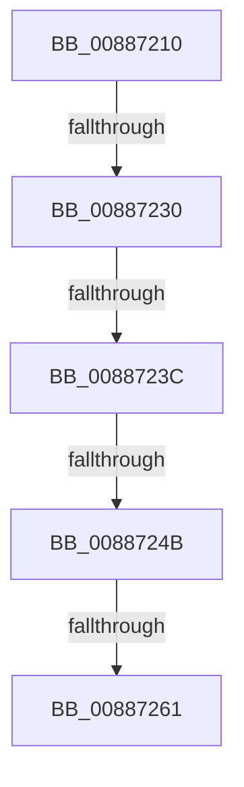

# MiInsertSharedCommitNode

- RVA: `0x00887210`–`0x00887272` (길이 `98` bytes)
- VA: `0x0000000140887210`
- 실행 섹션: `PAGE`
- PDB 이름 있음: `예`; PDB Function 태그: `아니요`
- unwind 정보 RVA: `0x0007CBD0`
- 디코드: `25`개 명령, `98/98` bytes 표시
- 미해석 바이트: `0` (있으면 어셈블리에 `.byte`로 보존)

> 이 문서는 커널 이미지의 기계어와 PDB 기호를 분석해 생성했습니다. 4번과 5번은 함수 원형과 자료형을 바이너리 사용 방식에서 추정한 C 해석이며 원본 소스 복구 결과는 아닙니다.

## 1. Dependencies

- 직접 호출 지점: **1**; 고유 호출 대상: **1**
- 직접 호출자로 확인된 함수: **7**
- RIP 상대 이미지 참조: **0**

### Outgoing calls
- `0x00887223` → [MiIncludeSharedCommit](../../text/42/MiIncludeSharedCommit_function_00428010.md) (function, `0x00428010`)

### Direct callers
- [sub_00884EE1](Unknown_function_00884EE1.md) at `0x008851FF`
- [MiSectionOpen](MiSectionOpen_function_008871E0.md) at `0x008871F8`
- [sub_008874E4](Unknown_function_008874E4.md) at `0x0088758A`
- [MiAllocateSplitVads](MiAllocateSplitVads_function_00887818.md) at `0x00887911`
- [MmLinkJobProcess](MmLinkJobProcess_function_00887C48.md) at `0x00887E08`
- [MiAllocateChildVads](../97/MiAllocateChildVads_function_0097E380.md) at `0x0097E5C9`
- [MiMapViewOfImageSection](../97/MiMapViewOfImageSection_function_0097E92C.md) at `0x0097EE15`

### Static image references
- 디코드된 RIP-relative 메모리 참조가 없습니다.

## 2. Other-region calls and transfers

- 다른 실행 섹션으로 향하는 call: **1**
  - `0x00887223` → [MiIncludeSharedCommit](../../text/42/MiIncludeSharedCommit_function_00428010.md) (`PAGE` → `.text`)
- call이 아닌 외부 분기/꼬리 이동: **4**
  - `0x0088722A` → [sub_00887458](Unknown_function_00887458.md) (`tail-transfer`)
  - `0x00887236` → [sub_00887458](Unknown_function_00887458.md) (`tail-transfer`)
  - `0x00887245` → [sub_008874C2](Unknown_function_008874C2.md) (`tail-transfer`)
  - `0x0088725B` → [sub_00887458](Unknown_function_00887458.md) (`tail-transfer`)

## 3. Assembly (complete function range)

```asm
00887210  40 55                           push rbp
00887212  56                              push rsi
00887213  57                              push rdi
00887214  41 56                           push r14
00887216  48 83 EC 48                     sub rsp, 0x48
0088721A  41 8B F0                        mov esi, r8d
0088721D  48 8B FA                        mov rdi, rdx
00887220  4C 8B F1                        mov r14, rcx
00887223  E8 E8 0D BA FF                  call 0x140428010
00887228  85 C0                           test eax, eax
0088722A  0F 84 28 02 00 00               je 0x140887458
00887230  41 8B 46 38                     mov eax, dword ptr [r14 + 0x38]
00887234  A8 20                           test al, 0x20
00887236  0F 85 1C 02 00 00               jne 0x140887458
0088723C  33 ED                           xor ebp, ebp
0088723E  48 8B CF                        mov rcx, rdi
00887241  40 F6 C7 01                     test dil, 1
00887245  0F 85 77 02 00 00               jne 0x1408874c2
0088724B  8B 87 FC 05 00 00               mov eax, dword ptr [rdi + 0x5fc]
00887251  48 89 8C 24 88 00 00 00         mov qword ptr [rsp + 0x88], rcx
00887259  A8 10                           test al, 0x10
0088725B  0F 85 F7 01 00 00               jne 0x140887458
00887261  48 89 6C 24 30                  mov qword ptr [rsp + 0x30], rbp
00887266  48 C7 44 24 28 40 00 00 00      mov qword ptr [rsp + 0x28], 0x40
0088726F  49 8B 06                        mov rax, qword ptr [r14]
```

## 4. C-style interpretation (structured pseudocode)

```c
__int64 __fastcall MiInsertSharedCommitNode(__int64 a1, __int64 a2, int a3)
{
    __int64 result;
    __int64 v_rbp;
    __int64 v_rsp;
    unsigned __int64 v_stack_m38;
    unsigned __int64 v_stack_m40;
    unsigned __int64 v_stack_p20;

    v_rsp = (v_rsp) - (72);
    result = MiIncludeSharedCommit(a1, a2, a3, a4);
    v_rbp = 0;
    v_stack_p20 = a2;
    v_stack_m38 = 0;
    v_stack_m40 = 64;
    return *(unsigned __int64 *)(a1);
}
```

## 5. (Beta) C Style

```c
int64_t MiInsertSharedCommitNode(void *Arg1, int64_t Arg2, int32_t Arg3)
{
    uint8_t *arg1 = (uint8_t *)Arg1;

    int64_t result;
    int64_t local_rbp;
    int64_t local_rsp;
    uint64_t v_stack_m38;
    uint64_t v_stack_m40;
    uint64_t v_stack_p20;

    local_rsp = (local_rsp) - (72);
    result = MiIncludeSharedCommit(Arg1, Arg2, Arg3, a4);
    local_rbp = 0;
    v_stack_p20 = Arg2;
    v_stack_m38 = 0;
    v_stack_m40 = 64;
    return *(uint64_t *)(arg1);
}
```

### 관측된 메모리 오프셋

구조체 형식이 확인되지 않은 접근은 인자 기준의 오프셋으로만 기록했습니다.

| 기준 인자 | 오프셋 표현 | 폭 (bit) | 접근 |
|---|---:|---:|---|
| `Arg1` | `+ 0x0` | `64` | `R` |
| `Arg1` | `+ 0x38` | `32` | `R` |

## 6. Execution-region graph

[열기: 2D/3D 그래프와 함수 탐색 컨트롤 패널](../../../control-panel.html?section=page&rva=0x00887210&view=graph)

- 2D 그래프는 위에서 아래로 흐르고, 3D 그래프는 빈 공간을 드래그해 회전합니다. Shift+드래그는 이동, 휠은 확대·축소, 함수 노드 선택은 대상 보고서 이동입니다.

### Static fallback


