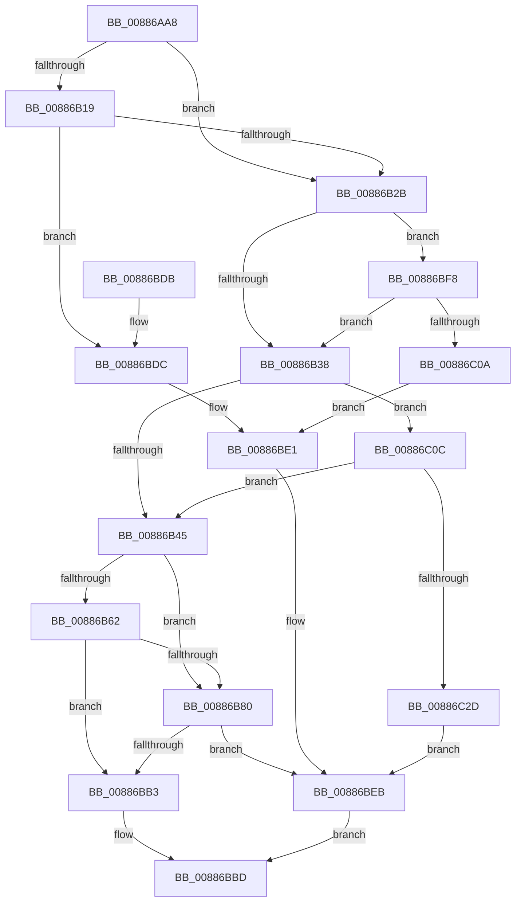

# MiInsertVadCharges

- RVA: `0x00886AA8`–`0x00886C39` (길이 `401` bytes)
- VA: `0x0000000140886AA8`
- 실행 섹션: `PAGE`
- PDB 이름 있음: `예`; PDB Function 태그: `아니요`
- unwind 정보 RVA: `0x0007CB1C`
- 디코드: `108`개 명령, `401/401` bytes 표시
- 미해석 바이트: `0` (있으면 어셈블리에 `.byte`로 보존)

> 이 문서는 커널 이미지의 기계어와 PDB 기호를 분석해 생성했습니다. 4번과 5번은 함수 원형과 자료형을 바이너리 사용 방식에서 추정한 C 해석이며 원본 소스 복구 결과는 아닙니다.

## 1. Dependencies

- 직접 호출 지점: **10**; 고유 호출 대상: **10**
- 직접 호출자로 확인된 함수: **10**
- RIP 상대 이미지 참조: **0**

### Outgoing calls
- `0x00886B0B` → [MiComputeVadCharges](../../text/2C/MiComputeVadCharges_function_002C3348.md) (function, `0x002C3348`)
- `0x00886B1C` → [PsChargeProcessNonPagedPoolQuota](../../text/2A/PsChargeProcessNonPagedPoolQuota_function_002A7B80.md) (function, `0x002A7B80`)
- `0x00886B8F` → [LOCK_PAGE_TABLE_COMMITMENT](../../text/2A/LOCK_PAGE_TABLE_COMMITMENT_function_002A6090.md) (function, `0x002A6090`)
- `0x00886B9D` → [MiCommitPageTablesForVad](MiCommitPageTablesForVad_function_00886D50.md) (function, `0x00886D50`)
- `0x00886BAA` → [UNLOCK_PAGE_TABLE_COMMITMENT](../../text/2E/UNLOCK_PAGE_TABLE_COMMITMENT_function_002E27D0.md) (function, `0x002E27D0`)
- `0x00886BB6` → [MiSetVadBits](MiSetVadBits_function_008870D8.md) (function, `0x008870D8`)
- `0x00886BEF` → [MiReturnVadCharges](MiReturnVadCharges_function_008875B8.md) (function, `0x008875B8`)
- `0x00886BFB` → [PsChargeProcessPagedPoolQuota](../89/PsChargeProcessPagedPoolQuota_function_00891170.md) (function, `0x00891170`)
- `0x00886C0F` → [MiGetProcessPartition](../../text/44/MiGetProcessPartition_function_00443B10.md) (function, `0x00443B10`)
- `0x00886C20` → [MiChargeResident](../../text/28/MiChargeResident_function_0028A0F0.md) (function, `0x0028A0F0`)

### Direct callers
- [MiAllocateEnclaveVad](../80/MiAllocateEnclaveVad_function_008080A4.md) at `0x00808360`
- [MiReserveUserMemory](MiReserveUserMemory_function_00884498.md) at `0x0088476B`
- [sub_00884EE1](Unknown_function_00884EE1.md) at `0x0088522C`
- [MiAllocateSplitVads](MiAllocateSplitVads_function_00887818.md) at `0x008878E4`
- [MiInsertProcessVads](../8C/MiInsertProcessVads_function_008CFD08.md) at `0x008CFD51`
- [MiInsertChildVads](../97/MiInsertChildVads_function_0097DBB0.md) at `0x0097DC38`
- [MiMapViewOfImageSection](../97/MiMapViewOfImageSection_function_0097E92C.md) at `0x0097EE59`
- [MiMapViewOfPhysicalSection](../97/MiMapViewOfPhysicalSection_function_0097F984.md) at `0x0097FBB0`
- [MiMapLockedPagesInUserSpace](../97/MiMapLockedPagesInUserSpace_function_0097FE04.md) at `0x009800B4`
- [MiAllocateNewSubAllocatedRegion](../98/MiAllocateNewSubAllocatedRegion_function_00981EC0.md) at `0x009820A4`

### Static image references
- 디코드된 RIP-relative 메모리 참조가 없습니다.

## 2. Other-region calls and transfers

- 다른 실행 섹션으로 향하는 call: **6**
  - `0x00886B0B` → [MiComputeVadCharges](../../text/2C/MiComputeVadCharges_function_002C3348.md) (`PAGE` → `.text`)
  - `0x00886B1C` → [PsChargeProcessNonPagedPoolQuota](../../text/2A/PsChargeProcessNonPagedPoolQuota_function_002A7B80.md) (`PAGE` → `.text`)
  - `0x00886B8F` → [LOCK_PAGE_TABLE_COMMITMENT](../../text/2A/LOCK_PAGE_TABLE_COMMITMENT_function_002A6090.md) (`PAGE` → `.text`)
  - `0x00886BAA` → [UNLOCK_PAGE_TABLE_COMMITMENT](../../text/2E/UNLOCK_PAGE_TABLE_COMMITMENT_function_002E27D0.md) (`PAGE` → `.text`)
  - `0x00886C0F` → [MiGetProcessPartition](../../text/44/MiGetProcessPartition_function_00443B10.md) (`PAGE` → `.text`)
  - `0x00886C20` → [MiChargeResident](../../text/28/MiChargeResident_function_0028A0F0.md) (`PAGE` → `.text`)
- 별도 외부 분기/꼬리 이동을 확인하지 못했습니다.

## 3. Assembly (complete function range)

```asm
00886AA8  48 8B C4                        mov rax, rsp
00886AAB  48 89 58 08                     mov qword ptr [rax + 8], rbx
00886AAF  48 89 70 10                     mov qword ptr [rax + 0x10], rsi
00886AB3  48 89 78 18                     mov qword ptr [rax + 0x18], rdi
00886AB7  4C 89 60 20                     mov qword ptr [rax + 0x20], r12
00886ABB  55                              push rbp
00886ABC  41 56                           push r14
00886ABE  41 57                           push r15
00886AC0  48 8B EC                        mov rbp, rsp
00886AC3  48 83 EC 40                     sub rsp, 0x40
00886AC7  44 0F B6 61 20                  movzx r12d, byte ptr [rcx + 0x20]
00886ACC  33 C0                           xor eax, eax
00886ACE  44 0F B6 79 21                  movzx r15d, byte ptr [rcx + 0x21]
00886AD3  4C 8B F2                        mov r14, rdx
00886AD6  48 89 45 F0                     mov qword ptr [rbp - 0x10], rax
00886ADA  48 8D 55 E0                     lea rdx, [rbp - 0x20]
00886ADE  8B 41 18                        mov eax, dword ptr [rcx + 0x18]
00886AE1  0F 57 C0                        xorps xmm0, xmm0
00886AE4  49 C1 E7 20                     shl r15, 0x20
00886AE8  48 8B F1                        mov rsi, rcx
00886AEB  49 C1 E4 20                     shl r12, 0x20
00886AEF  4C 0B E0                        or r12, rax
00886AF2  8B 41 1C                        mov eax, dword ptr [rcx + 0x1c]
00886AF5  4C 0B F8                        or r15, rax
00886AF8  49 C1 E4 0C                     shl r12, 0xc
00886AFC  49 C1 E7 0C                     shl r15, 0xc
00886B00  49 81 CF FF 0F 00 00            or r15, 0xfff
00886B07  0F 11 45 E0                     movups xmmword ptr [rbp - 0x20], xmm0
00886B0B  E8 38 C8 A3 FF                  call 0x1402c3348
00886B10  48 8B 55 F0                     mov rdx, qword ptr [rbp - 0x10]
00886B14  48 85 D2                        test rdx, rdx
00886B17  74 12                           je 0x140886b2b
00886B19  49 8B CE                        mov rcx, r14
00886B1C  E8 5F 10 A2 FF                  call 0x1402a7b80
00886B21  8B F8                           mov edi, eax
00886B23  85 C0                           test eax, eax
00886B25  0F 88 B1 00 00 00               js 0x140886bdc
00886B2B  48 8B 55 E8                     mov rdx, qword ptr [rbp - 0x18]
00886B2F  48 85 D2                        test rdx, rdx
00886B32  0F 85 C0 00 00 00               jne 0x140886bf8
00886B38  4C 8B 4D E0                     mov r9, qword ptr [rbp - 0x20]
00886B3C  4D 85 C9                        test r9, r9
00886B3F  0F 85 C7 00 00 00               jne 0x140886c0c
00886B45  8B 56 34                        mov edx, dword ptr [rsi + 0x34]
00886B48  48 B8 FD FF FF FF 07 00 00 00   movabs rax, 0x7fffffffd
00886B52  0F B6 4E 22                     movzx ecx, byte ptr [rsi + 0x22]
00886B56  48 C1 E1 20                     shl rcx, 0x20
00886B5A  48 0B CA                        or rcx, rdx
00886B5D  48 3B C8                        cmp rcx, rax
00886B60  72 1E                           jb 0x140886b80
00886B62  8B 4E 34                        mov ecx, dword ptr [rsi + 0x34]
00886B65  48 B8 FE FF FF FF 07 00 00 00   movabs rax, 0x7fffffffe
00886B6F  44 0F B6 4E 22                  movzx r9d, byte ptr [rsi + 0x22]
00886B74  49 C1 E1 20                     shl r9, 0x20
00886B78  4C 0B C9                        or r9, rcx
00886B7B  4C 3B C8                        cmp r9, rax
00886B7E  75 33                           jne 0x140886bb3
00886B80  65 48 8B 1C 25 88 01 00 00      mov rbx, qword ptr gs:[0x188]
00886B89  49 8B D6                        mov rdx, r14
00886B8C  48 8B CB                        mov rcx, rbx
00886B8F  E8 FC F4 A1 FF                  call 0x1402a6090
00886B94  4D 8B C7                        mov r8, r15
00886B97  49 8B D4                        mov rdx, r12
00886B9A  48 8B CE                        mov rcx, rsi
00886B9D  E8 AE 01 00 00                  call 0x140886d50
00886BA2  49 8B D6                        mov rdx, r14
00886BA5  48 8B CB                        mov rcx, rbx
00886BA8  8B F8                           mov edi, eax
00886BAA  E8 21 BC A5 FF                  call 0x1402e27d0
00886BAF  85 FF                           test edi, edi
00886BB1  78 38                           js 0x140886beb
00886BB3  48 8B CE                        mov rcx, rsi
00886BB6  E8 1D 05 00 00                  call 0x1408870d8
00886BBB  33 C0                           xor eax, eax
00886BBD  48 8B 5C 24 60                  mov rbx, qword ptr [rsp + 0x60]
00886BC2  48 8B 74 24 68                  mov rsi, qword ptr [rsp + 0x68]
00886BC7  48 8B 7C 24 70                  mov rdi, qword ptr [rsp + 0x70]
00886BCC  4C 8B 64 24 78                  mov r12, qword ptr [rsp + 0x78]
00886BD1  48 83 C4 40                     add rsp, 0x40
00886BD5  41 5F                           pop r15
00886BD7  41 5E                           pop r14
00886BD9  5D                              pop rbp
00886BDA  C3                              ret
00886BDB  CC                              int3
00886BDC  48 83 65 F0 00                  and qword ptr [rbp - 0x10], 0
00886BE1  48 83 65 E8 00                  and qword ptr [rbp - 0x18], 0
00886BE6  48 83 65 E0 00                  and qword ptr [rbp - 0x20], 0
00886BEB  48 8D 4D E0                     lea rcx, [rbp - 0x20]
00886BEF  E8 C4 09 00 00                  call 0x1408875b8
00886BF4  8B C7                           mov eax, edi
00886BF6  EB C5                           jmp 0x140886bbd
00886BF8  49 8B CE                        mov rcx, r14
00886BFB  E8 70 A5 00 00                  call 0x140891170
00886C00  8B F8                           mov edi, eax
00886C02  85 C0                           test eax, eax
00886C04  0F 89 2E FF FF FF               jns 0x140886b38
00886C0A  EB D5                           jmp 0x140886be1
00886C0C  49 8B CE                        mov rcx, r14
00886C0F  E8 FC CE BB FF                  call 0x140443b10
00886C14  49 8B D1                        mov rdx, r9
00886C17  48 8B C8                        mov rcx, rax
00886C1A  41 B8 80 00 00 00               mov r8d, 0x80
00886C20  E8 CB 34 A0 FF                  call 0x14028a0f0
00886C25  85 C0                           test eax, eax
00886C27  0F 85 18 FF FF FF               jne 0x140886b45
00886C2D  48 83 65 E0 00                  and qword ptr [rbp - 0x20], 0
00886C32  BF 9A 00 00 C0                  mov edi, 0xc000009a
00886C37  EB B2                           jmp 0x140886beb
```

## 4. C-style interpretation (structured pseudocode)

```c
__int64 __fastcall MiInsertVadCharges(__int64 a1, __int64 a2)
{
    __int64 result;
    __int64 v_r12;
    __int64 v_r15;
    __int64 v_rsp;
    unsigned __int64 v_stack_m28;
    unsigned __int64 v_stack_m30;
    unsigned __int64 v_stack_m38;
    unsigned __int64 v_stack_p10;
    unsigned __int64 v_stack_p18;
    unsigned __int64 v_stack_p20;
    unsigned __int64 v_stack_p8;

    *(unsigned __int64 *)(v_rsp + 8) = v_rbx;
    *(unsigned __int64 *)(v_rsp + 16) = v_rsi;
    *(unsigned __int64 *)(v_rsp + 24) = v_rdi;
    *(unsigned __int64 *)(v_rsp + 32) = v_r12;
    v_rsp = (v_rsp) - (64);
    result = 0;
    v_stack_m28 = 0;
    v_r15 = (*(unsigned __int8 *)(a1 + 33)) << (32);
    v_r12 = (*(unsigned __int8 *)(a1 + 32)) << (32);
    v_r12 = (v_r12) | ((unsigned int)(*(unsigned int *)(a1 + 24)));
    v_r15 = (v_r15) | ((unsigned int)(*(unsigned int *)(a1 + 28)));
    v_r12 = (v_r12) << (12);
    v_r15 = (v_r15) << (12);
    v_r15 = (v_r15) | (0xFFFULL);
    v_stack_m38 = v_xmm0;
    result = MiComputeVadCharges(a1, v_stack_m38, a3, a4);
    if (v_stack_m28 == 0) goto loc_00886B2B;
    result = PsChargeProcessNonPagedPoolQuota(a2, v_stack_m28, a3, a4);
    if (sign_flag) goto loc_00886BDC;
loc_00886B2B:
    if (v_stack_m30 != 0) goto loc_00886BF8;
loc_00886B38:
    if (v_stack_m38 != 0) goto loc_00886C0C;
loc_00886B45:
    a1 = (*(unsigned __int8 *)(a1 + 34)) << (32);
    a1 = (a1) | ((unsigned int)(*(unsigned int *)(a1 + 52)));
    if (a1 < result) goto loc_00886B80;
    a4 = (*(unsigned __int8 *)(a1 + 34)) << (32);
    a4 = (a4) | ((unsigned int)(*(unsigned int *)(a1 + 52)));
    if (a4 != result) goto loc_00886BB3;
loc_00886B80:
    result = LOCK_PAGE_TABLE_COMMITMENT(*(unsigned __int64 *)(gs_base + (0 + 392)), a2, a3, a4);
    result = MiCommitPageTablesForVad(a1, v_r12, v_r15, a4);
    result = UNLOCK_PAGE_TABLE_COMMITMENT(*(unsigned __int64 *)(gs_base + (0 + 392)), a2, v_r15, a4);
    if (sign_flag) goto loc_00886BEB;
loc_00886BB3:
    result = MiSetVadBits(a1, a2, v_r15, a4);
    result = 0;
loc_00886BBD:
    v_rsp = (v_rsp) + (64);
    return result;
loc_00886BDC:
loc_00886BE1:
loc_00886BEB:
    result = MiReturnVadCharges(v_stack_m38, a2, v_r15, a4);
    goto loc_00886BBD;
loc_00886BF8:
    result = PsChargeProcessPagedPoolQuota(a2, a2, v_r15, a4);
    if (!sign_flag) goto loc_00886B38;
    goto loc_00886BE1;
loc_00886C0C:
    result = MiGetProcessPartition(a2, a2, v_r15, a4);
    result = MiChargeResident(result, a4, 128, a4);
    if ((unsigned int)(result) != 0) goto loc_00886B45;
    goto loc_00886BEB;
}
```

## 5. (Beta) C Style

```c
int64_t MiInsertVadCharges(void *Arg1, int64_t Arg2)
{
    uint8_t *arg1 = (uint8_t *)Arg1;

    int64_t result;
    int64_t local_r12;
    int64_t local_r15;
    int64_t local_rsp;
    uint64_t v_stack_m28;
    uint64_t v_stack_m30;
    uint64_t v_stack_m38;
    uint64_t v_stack_p10;
    uint64_t v_stack_p18;
    uint64_t v_stack_p20;
    uint64_t v_stack_p8;

    *(uint64_t *)(local_rsp + 0x8) = local_rbx;
    *(uint64_t *)(local_rsp + 0x10) = local_rsi;
    *(uint64_t *)(local_rsp + 0x18) = local_rdi;
    *(uint64_t *)(local_rsp + 0x20) = local_r12;
    local_rsp = (local_rsp) - (64);
    result = 0;
    v_stack_m28 = 0;
    local_r15 = (*(uint8_t *)(arg1 + 0x21)) << (32);
    local_r12 = (*(uint8_t *)(arg1 + 0x20)) << (32);
    local_r12 = (local_r12) | ((uint32_t)(*(uint32_t *)(arg1 + 0x18)));
    local_r15 = (local_r15) | ((uint32_t)(*(uint32_t *)(arg1 + 0x1C)));
    local_r12 = (local_r12) << (12);
    local_r15 = (local_r15) << (12);
    local_r15 = (local_r15) | (0xFFFULL);
    v_stack_m38 = v_xmm0;
    result = MiComputeVadCharges(Arg1, v_stack_m38, a3, a4);
    if (v_stack_m28 == 0) goto loc_00886B2B;
    result = PsChargeProcessNonPagedPoolQuota(Arg2, v_stack_m28, a3, a4);
    if (sign_flag) goto loc_00886BDC;
loc_00886B2B:
    if (v_stack_m30 != 0) goto loc_00886BF8;
loc_00886B38:
    if (v_stack_m38 != 0) goto loc_00886C0C;
loc_00886B45:
    Arg1 = (*(uint8_t *)(arg1 + 0x22)) << (32);
    Arg1 = (Arg1) | ((uint32_t)(*(uint32_t *)(arg1 + 0x34)));
    if (Arg1 < result) goto loc_00886B80;
    a4 = (*(uint8_t *)(arg1 + 0x22)) << (32);
    a4 = (a4) | ((uint32_t)(*(uint32_t *)(arg1 + 0x34)));
    if (a4 != result) goto loc_00886BB3;
loc_00886B80:
    result = LOCK_PAGE_TABLE_COMMITMENT(*(uint64_t *)(gs_base + (0 + 0x188)), Arg2, a3, a4);
    result = MiCommitPageTablesForVad(Arg1, local_r12, local_r15, a4);
    result = UNLOCK_PAGE_TABLE_COMMITMENT(*(uint64_t *)(gs_base + (0 + 0x188)), Arg2, local_r15, a4);
    if (sign_flag) goto loc_00886BEB;
loc_00886BB3:
    result = MiSetVadBits(Arg1, Arg2, local_r15, a4);
    result = 0;
loc_00886BBD:
    local_rsp = (local_rsp) + (64);
    return result;
loc_00886BDC:
loc_00886BE1:
loc_00886BEB:
    result = MiReturnVadCharges(v_stack_m38, Arg2, local_r15, a4);
    goto loc_00886BBD;
loc_00886BF8:
    result = PsChargeProcessPagedPoolQuota(Arg2, Arg2, local_r15, a4);
    if (!sign_flag) goto loc_00886B38;
    goto loc_00886BE1;
loc_00886C0C:
    result = MiGetProcessPartition(Arg2, Arg2, local_r15, a4);
    result = MiChargeResident(result, a4, 128, a4);
    if ((uint32_t)(result) != 0) goto loc_00886B45;
    goto loc_00886BEB;
}
```

### 관측된 메모리 오프셋

구조체 형식이 확인되지 않은 접근은 인자 기준의 오프셋으로만 기록했습니다.

| 기준 인자 | 오프셋 표현 | 폭 (bit) | 접근 |
|---|---:|---:|---|
| `Arg1` | `+ 0x18` | `32` | `R` |
| `Arg1` | `+ 0x1C` | `32` | `R` |
| `Arg1` | `+ 0x20` | `8` | `R` |
| `Arg1` | `+ 0x21` | `8` | `R` |
| `Arg1` | `+ 0x22` | `8` | `R` |
| `Arg1` | `+ 0x34` | `32` | `R` |

## 6. Execution-region graph

[열기: 2D/3D 그래프와 함수 탐색 컨트롤 패널](../../../control-panel.html?section=page&rva=0x00886AA8&view=graph)

- 2D 그래프는 위에서 아래로 흐르고, 3D 그래프는 빈 공간을 드래그해 회전합니다. Shift+드래그는 이동, 휠은 확대·축소, 함수 노드 선택은 대상 보고서 이동입니다.

### Static fallback


