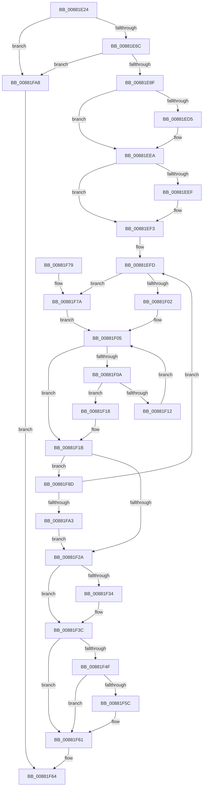

# MiIsRangeFullyCommitted

- RVA: `0x00881E24`–`0x00881FAC` (길이 `392` bytes)
- VA: `0x0000000140881E24`
- 실행 섹션: `PAGE`
- PDB 이름 있음: `예`; PDB Function 태그: `아니요`
- unwind 정보 RVA: `0x0007C5F8`
- 디코드: `117`개 명령, `392/392` bytes 표시
- 미해석 바이트: `0` (있으면 어셈블리에 `.byte`로 보존)

> 이 문서는 커널 이미지의 기계어와 PDB 기호를 분석해 생성했습니다. 4번과 5번은 함수 원형과 자료형을 바이너리 사용 방식에서 추정한 C 해석이며 원본 소스 복구 결과는 아닙니다.

## 1. Dependencies

- 직접 호출 지점: **7**; 고유 호출 대상: **6**
- 직접 호출자로 확인된 함수: **2**
- RIP 상대 이미지 참조: **0**

### Outgoing calls
- `0x00881E5B` → [MiGetProtoPteAddress](../../text/32/MiGetProtoPteAddress_function_0032E970.md) (function, `0x0032E970`)
- `0x00881E7E` → [MiGetProtoPteAddress](../../text/32/MiGetProtoPteAddress_function_0032E970.md) (function, `0x0032E970`)
- `0x00881EBF` → [KeAbPreAcquire](../../text/21/KeAbPreAcquire_function_00210230.md) (function, `0x00210230`)
- `0x00881EE0` → [ExfAcquirePushLockSharedEx](../../text/21/ExfAcquirePushLockSharedEx_function_0021044C.md) (function, `0x0021044C`)
- `0x00881F37` → [ExfReleasePushLockShared](../../text/26/ExfReleasePushLockShared_function_00263440.md) (function, `0x00263440`)
- `0x00881F3F` → [KeAbPostRelease](../../text/2E/KeAbPostRelease_function_002E1600.md) (function, `0x002E1600`)
- `0x00881F5C` → [KiCheckForKernelApcDelivery](../../text/2E/KiCheckForKernelApcDelivery_function_002E2C80.md) (function, `0x002E2C80`)

### Direct callers
- [MmProtectVirtualMemory](MmProtectVirtualMemory_function_00881050.md) at `0x0088131F`
- [MmSecureVirtualMemoryAgainstWrites](../89/MmSecureVirtualMemoryAgainstWrites_function_00890164.md) at `0x00890378`

### Static image references
- 디코드된 RIP-relative 메모리 참조가 없습니다.

## 2. Other-region calls and transfers

- 다른 실행 섹션으로 향하는 call: **7**
  - `0x00881E5B` → [MiGetProtoPteAddress](../../text/32/MiGetProtoPteAddress_function_0032E970.md) (`PAGE` → `.text`)
  - `0x00881E7E` → [MiGetProtoPteAddress](../../text/32/MiGetProtoPteAddress_function_0032E970.md) (`PAGE` → `.text`)
  - `0x00881EBF` → [KeAbPreAcquire](../../text/21/KeAbPreAcquire_function_00210230.md) (`PAGE` → `.text`)
  - `0x00881EE0` → [ExfAcquirePushLockSharedEx](../../text/21/ExfAcquirePushLockSharedEx_function_0021044C.md) (`PAGE` → `.text`)
  - `0x00881F37` → [ExfReleasePushLockShared](../../text/26/ExfReleasePushLockShared_function_00263440.md) (`PAGE` → `.text`)
  - `0x00881F3F` → [KeAbPostRelease](../../text/2E/KeAbPostRelease_function_002E1600.md) (`PAGE` → `.text`)
  - `0x00881F5C` → [KiCheckForKernelApcDelivery](../../text/2E/KiCheckForKernelApcDelivery_function_002E2C80.md) (`PAGE` → `.text`)
- 별도 외부 분기/꼬리 이동을 확인하지 못했습니다.

## 3. Assembly (complete function range)

```asm
00881E24  48 8B C4                        mov rax, rsp
00881E27  48 89 58 18                     mov qword ptr [rax + 0x18], rbx
00881E2B  55                              push rbp
00881E2C  56                              push rsi
00881E2D  57                              push rdi
00881E2E  41 54                           push r12
00881E30  41 55                           push r13
00881E32  41 56                           push r14
00881E34  41 57                           push r15
00881E36  48 83 EC 20                     sub rsp, 0x20
00881E3A  45 33 E4                        xor r12d, r12d
00881E3D  48 C1 EA 0C                     shr rdx, 0xc
00881E41  49 8B F8                        mov rdi, r8
00881E44  4C 89 60 08                     mov qword ptr [rax + 8], r12
00881E48  4C 8D 48 08                     lea r9, [rax + 8]
00881E4C  4C 89 60 10                     mov qword ptr [rax + 0x10], r12
00881E50  48 8B F1                        mov rsi, rcx
00881E53  41 8D 6C 24 02                  lea ebp, [r12 + 2]
00881E58  44 8B C5                        mov r8d, ebp
00881E5B  E8 10 CB AA FF                  call 0x14032e970
00881E60  48 8B D8                        mov rbx, rax
00881E63  48 85 C0                        test rax, rax
00881E66  0F 84 3C 01 00 00               je 0x140881fa8
00881E6C  48 C1 EF 0C                     shr rdi, 0xc
00881E70  4C 8D 4C 24 68                  lea r9, [rsp + 0x68]
00881E75  48 8B D7                        mov rdx, rdi
00881E78  44 8B C5                        mov r8d, ebp
00881E7B  48 8B CE                        mov rcx, rsi
00881E7E  E8 ED CA AA FF                  call 0x14032e970
00881E83  4C 8B F8                        mov r15, rax
00881E86  48 85 C0                        test rax, rax
00881E89  0F 84 19 01 00 00               je 0x140881fa8
00881E8F  65 48 8B 2C 25 88 01 00 00      mov rbp, qword ptr gs:[0x188]
00881E98  45 8D 6C 24 01                  lea r13d, [r12 + 1]
00881E9D  48 8B 4E 48                     mov rcx, qword ptr [rsi + 0x48]
00881EA1  45 33 C0                        xor r8d, r8d
00881EA4  45 8B F5                        mov r14d, r13d
00881EA7  48 8B 11                        mov rdx, qword ptr [rcx]
00881EAA  48 8B 3A                        mov rdi, qword ptr [rdx]
00881EAD  33 D2                           xor edx, edx
00881EAF  66 44 29 AD E6 01 00 00         sub word ptr [rbp + 0x1e6], r13w
00881EB7  48 83 C7 28                     add rdi, 0x28
00881EBB  48 8B CF                        mov rcx, rdi
00881EBE  90                              nop
00881EBF  E8 6C E3 98 FF                  call 0x140210230
00881EC4  48 8B F0                        mov rsi, rax
00881EC7  45 8D 44 24 11                  lea r8d, [r12 + 0x11]
00881ECC  33 C0                           xor eax, eax
00881ECE  F0 4C 0F B1 07                  lock cmpxchg qword ptr [rdi], r8
00881ED3  74 15                           je 0x140881eea
00881ED5  4C 8B CF                        mov r9, rdi
00881ED8  4C 8B C6                        mov r8, rsi
00881EDB  33 D2                           xor edx, edx
00881EDD  48 8B CF                        mov rcx, rdi
00881EE0  E8 67 E5 98 FF                  call 0x14021044c
00881EE5  45 8D 44 24 11                  lea r8d, [r12 + 0x11]
00881EEA  48 85 F6                        test rsi, rsi
00881EED  74 04                           je 0x140881ef3
00881EEF  44 88 6E 0A                     mov byte ptr [rsi + 0xa], r13b
00881EF3  48 8B 54 24 60                  mov rdx, qword ptr [rsp + 0x60]
00881EF8  48 8B 44 24 68                  mov rax, qword ptr [rsp + 0x68]
00881EFD  48 3B D0                        cmp rdx, rax
00881F00  75 78                           jne 0x140881f7a
00881F02  49 8B CF                        mov rcx, r15
00881F05  48 3B D9                        cmp rbx, rcx
00881F08  77 11                           ja 0x140881f1b
00881F0A  48 8B 03                        mov rax, qword ptr [rbx]
00881F0D  48 85 C0                        test rax, rax
00881F10  74 06                           je 0x140881f18
00881F12  48 83 C3 08                     add rbx, 8
00881F16  EB ED                           jmp 0x140881f05
00881F18  45 8B F4                        mov r14d, r12d
00881F1B  48 8B 54 24 60                  mov rdx, qword ptr [rsp + 0x60]
00881F20  48 8B 44 24 68                  mov rax, qword ptr [rsp + 0x68]
00881F25  48 3B D0                        cmp rdx, rax
00881F28  75 63                           jne 0x140881f8d
00881F2A  49 8B C0                        mov rax, r8
00881F2D  F0 4C 0F B1 27                  lock cmpxchg qword ptr [rdi], r12
00881F32  74 08                           je 0x140881f3c
00881F34  48 8B CF                        mov rcx, rdi
00881F37  E8 04 15 9E FF                  call 0x140263440
00881F3C  48 8B CF                        mov rcx, rdi
00881F3F  E8 BC F6 A5 FF                  call 0x1402e1600
00881F44  90                              nop
00881F45  66 44 01 AD E6 01 00 00         add word ptr [rbp + 0x1e6], r13w
00881F4D  75 12                           jne 0x140881f61
00881F4F  48 8D 8D 98 00 00 00            lea rcx, [rbp + 0x98]
00881F56  90                              nop
00881F57  48 39 09                        cmp qword ptr [rcx], rcx
00881F5A  74 05                           je 0x140881f61
00881F5C  E8 1F 0D A6 FF                  call 0x1402e2c80
00881F61  41 8B C6                        mov eax, r14d
00881F64  48 8B 5C 24 70                  mov rbx, qword ptr [rsp + 0x70]
00881F69  48 83 C4 20                     add rsp, 0x20
00881F6D  41 5F                           pop r15
00881F6F  41 5E                           pop r14
00881F71  41 5D                           pop r13
00881F73  41 5C                           pop r12
00881F75  5F                              pop rdi
00881F76  5E                              pop rsi
00881F77  5D                              pop rbp
00881F78  C3                              ret
00881F79  CC                              int3
00881F7A  8B 4A 2C                        mov ecx, dword ptr [rdx + 0x2c]
00881F7D  48 8B 42 08                     mov rax, qword ptr [rdx + 8]
00881F81  41 2B CD                        sub ecx, r13d
00881F84  48 8D 0C C8                     lea rcx, [rax + rcx*8]
00881F88  E9 78 FF FF FF                  jmp 0x140881f05
00881F8D  48 8B 52 10                     mov rdx, qword ptr [rdx + 0x10]
00881F91  48 89 54 24 60                  mov qword ptr [rsp + 0x60], rdx
00881F96  48 8B 5A 08                     mov rbx, qword ptr [rdx + 8]
00881F9A  48 85 DB                        test rbx, rbx
00881F9D  0F 85 5A FF FF FF               jne 0x140881efd
00881FA3  45 8B F4                        mov r14d, r12d
00881FA6  EB 82                           jmp 0x140881f2a
00881FA8  33 C0                           xor eax, eax
00881FAA  EB B8                           jmp 0x140881f64
```

## 4. C-style interpretation (structured pseudocode)

```c
__int64 __fastcall MiIsRangeFullyCommitted(__int64 a1, __int64 a2, __int64 a3)
{
    __int64 result;
    __int64 v_r12;
    __int64 v_rbx;
    __int64 v_rdi;
    __int64 v_rsp;
    unsigned __int64 v_stack_p10;
    unsigned __int64 v_stack_p18;
    unsigned __int64 v_stack_p60;
    unsigned __int64 v_stack_p8;

    *(unsigned __int64 *)(v_rsp + 24) = v_rbx;
    v_rsp = (v_rsp) - (32);
    v_r12 = 0;
    a2 = (a2) >> (12);
    *(unsigned __int64 *)(v_rsp + 8) = 0;
    *(unsigned __int64 *)(v_rsp + 16) = 0;
    result = MiGetProtoPteAddress(a1, a2, (unsigned int)((unsigned int)(v_r12 + 2)), v_rsp + 8);
    if (result == 0) goto loc_00881FA8;
    v_rdi = (a3) >> (12);
    result = MiGetProtoPteAddress(a1, v_rdi, (unsigned int)((unsigned int)(v_r12 + 2)), v_stack_p10);
    if (result == 0) goto loc_00881FA8;
    a3 = 0;
    a2 = 0;
    v_rdi = (*(unsigned __int64 *)(*(unsigned __int64 *)(*(unsigned __int64 *)(a1 + 72)))) + (40);
    result = KeAbPreAcquire(v_rdi, a2, a3, v_stack_p10);
    result = 0;
    if (!(condition_is_equal)) {
        a4 = v_rdi;
        a3 = 0;
        a2 = 0;
        a1 = v_rdi;
        result = ExfAcquirePushLockSharedEx(a1, a2, a3, a4);
        a3 = v_r12 + 17;
    }
    if (result != 0) {
        *(unsigned __int8 *)(result + 10) = (unsigned __int8)(v_r12 + 1);
    }
loc_00881EFD:
    if (v_stack_p8 != v_stack_p10) goto loc_00881F7A;
loc_00881F05:
    if (result > result) goto loc_00881F1B;
    if (*(unsigned __int64 *)(result) == 0) goto loc_00881F18;
    v_rbx = (result) + (8);
    goto loc_00881F05;
loc_00881F18:
loc_00881F1B:
    if (v_stack_p8 != v_stack_p10) goto loc_00881F8D;
loc_00881F2A:
    result = a3;
    if (v_stack_p8 != v_stack_p10) {
        a1 = v_rdi;
        result = ExfReleasePushLockShared(a1, v_stack_p8, a3, a4);
    }
    result = KeAbPostRelease(v_rdi, v_stack_p8, a3, a4);
    if (v_stack_p8 != v_stack_p10) goto loc_00881F61;
    if ((*(unsigned __int64 *)(*(unsigned __int64 *)(gs_base + (0 + 392)) + 152)) != (*(unsigned __int64 *)(gs_base + (0 + 392)) + 152)) {
        result = KiCheckForKernelApcDelivery(*(unsigned __int64 *)(gs_base + (0 + 392)) + 152, v_stack_p8, a3, a4);
    }
loc_00881F64:
    v_rsp = (v_rsp) + (32);
    return 0;
loc_00881F7A:
    a1 = (unsigned int)(((unsigned int)(*(unsigned int *)(v_stack_p8 + 44))) - ((unsigned int)(v_r12 + 1)));
    goto loc_00881F05;
loc_00881F8D:
    v_stack_p60 = *(unsigned __int64 *)(v_stack_p8 + 16);
    if (*(unsigned __int64 *)(*(unsigned __int64 *)(v_stack_p8 + 16) + 8) != 0) goto loc_00881EFD;
    goto loc_00881F2A;
loc_00881FA8:
    result = 0;
    goto loc_00881F64;
}
```

## 5. (Beta) C Style

```c
int64_t MiIsRangeFullyCommitted(void *Arg1, int64_t Arg2, int64_t Arg3)
{
    uint8_t *arg1 = (uint8_t *)Arg1;

    int64_t result;
    int64_t local_r12;
    int64_t local_rbx;
    int64_t local_rdi;
    int64_t local_rsp;
    uint64_t v_stack_p10;
    uint64_t v_stack_p18;
    uint64_t v_stack_p60;
    uint64_t v_stack_p8;

    *(uint64_t *)(local_rsp + 0x18) = local_rbx;
    local_rsp = (local_rsp) - (32);
    local_r12 = 0;
    Arg2 = (Arg2) >> (12);
    *(uint64_t *)(local_rsp + 0x8) = 0;
    *(uint64_t *)(local_rsp + 0x10) = 0;
    result = MiGetProtoPteAddress(Arg1, Arg2, (uint32_t)((uint32_t)(local_r12 + 2)), local_rsp + 8);
    if (result == 0) goto loc_00881FA8;
    local_rdi = (Arg3) >> (12);
    result = MiGetProtoPteAddress(Arg1, local_rdi, (uint32_t)((uint32_t)(local_r12 + 2)), v_stack_p10);
    if (result == 0) goto loc_00881FA8;
    Arg3 = 0;
    Arg2 = 0;
    local_rdi = (*(uint64_t *)(*(uint64_t *)(*(uint64_t *)(arg1 + 0x48)))) + (40);
    result = KeAbPreAcquire(local_rdi, Arg2, Arg3, v_stack_p10);
    result = 0;
    if (!(condition_is_equal)) {
        a4 = local_rdi;
        Arg3 = 0;
        Arg2 = 0;
        Arg1 = local_rdi;
        result = ExfAcquirePushLockSharedEx(Arg1, Arg2, Arg3, a4);
        Arg3 = local_r12 + 17;
    }
    if (result != 0) {
        *(uint8_t *)(result + 0xA) = (uint8_t)(local_r12 + 1);
    }
loc_00881EFD:
    if (v_stack_p8 != v_stack_p10) goto loc_00881F7A;
loc_00881F05:
    if (result > result) goto loc_00881F1B;
    if (*(uint64_t *)(result) == 0) goto loc_00881F18;
    local_rbx = (result) + (8);
    goto loc_00881F05;
loc_00881F18:
loc_00881F1B:
    if (v_stack_p8 != v_stack_p10) goto loc_00881F8D;
loc_00881F2A:
    result = Arg3;
    if (v_stack_p8 != v_stack_p10) {
        Arg1 = local_rdi;
        result = ExfReleasePushLockShared(Arg1, v_stack_p8, Arg3, a4);
    }
    result = KeAbPostRelease(local_rdi, v_stack_p8, Arg3, a4);
    if (v_stack_p8 != v_stack_p10) goto loc_00881F61;
    if ((*(uint64_t *)(*(uint64_t *)(gs_base + (0 + 0x188)) + 0x98)) != (*(uint64_t *)(gs_base + (0 + 0x188)) + 152)) {
        result = KiCheckForKernelApcDelivery(*(uint64_t *)(gs_base + (0 + 0x188)) + 152, v_stack_p8, Arg3, a4);
    }
loc_00881F64:
    local_rsp = (local_rsp) + (32);
    return 0;
loc_00881F7A:
    Arg1 = (uint32_t)(((uint32_t)(*(uint32_t *)(v_stack_p8 + 0x2C))) - ((uint32_t)(local_r12 + 1)));
    goto loc_00881F05;
loc_00881F8D:
    v_stack_p60 = *(uint64_t *)(v_stack_p8 + 0x10);
    if (*(uint64_t *)(*(uint64_t *)(v_stack_p8 + 0x10) + 0x8) != 0) goto loc_00881EFD;
    goto loc_00881F2A;
loc_00881FA8:
    result = 0;
    goto loc_00881F64;
}
```

### 관측된 메모리 오프셋

구조체 형식이 확인되지 않은 접근은 인자 기준의 오프셋으로만 기록했습니다.

| 기준 인자 | 오프셋 표현 | 폭 (bit) | 접근 |
|---|---:|---:|---|
| `Arg1` | `+ 0x48` | `64` | `R` |

## 6. Execution-region graph

[열기: 2D/3D 그래프와 함수 탐색 컨트롤 패널](../../../control-panel.html?section=page&rva=0x00881E24&view=graph)

- 2D 그래프는 위에서 아래로 흐르고, 3D 그래프는 빈 공간을 드래그해 회전합니다. Shift+드래그는 이동, 휠은 확대·축소, 함수 노드 선택은 대상 보고서 이동입니다.

### Static fallback


