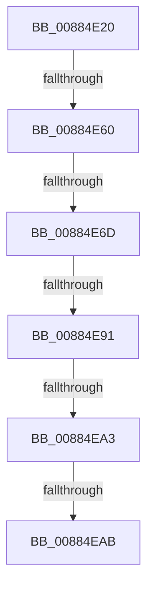

# MiMapViewOfDataSection

- RVA: `0x00884E20`–`0x00884EAF` (길이 `143` bytes)
- VA: `0x0000000140884E20`
- 실행 섹션: `PAGE`
- PDB 이름 있음: `예`; PDB Function 태그: `예`
- unwind 정보 RVA: `0x0007C894`
- 디코드: `38`개 명령, `143/143` bytes 표시
- 미해석 바이트: `0` (있으면 어셈블리에 `.byte`로 보존)

> 이 문서는 커널 이미지의 기계어와 PDB 기호를 분석해 생성했습니다. 4번과 5번은 함수 원형과 자료형을 바이너리 사용 방식에서 추정한 C 해석이며 원본 소스 복구 결과는 아닙니다.

## 1. Dependencies

- 직접 호출 지점: **1**; 고유 호출 대상: **1**
- 직접 호출자로 확인된 함수: **1**
- RIP 상대 이미지 참조: **0**

### Outgoing calls
- `0x00884E60` → [MiAweControlArea](../../text/44/MiAweControlArea_function_00447720.md) (function, `0x00447720`)

### Direct callers
- [MiMapViewOfSection](../89/MiMapViewOfSection_function_00898F10.md) at `0x008991E9`

### Static image references
- 디코드된 RIP-relative 메모리 참조가 없습니다.

## 2. Other-region calls and transfers

- 다른 실행 섹션으로 향하는 call: **1**
  - `0x00884E60` → [MiAweControlArea](../../text/44/MiAweControlArea_function_00447720.md) (`PAGE` → `.text`)
- call이 아닌 외부 분기/꼬리 이동: **5**
  - `0x00884E5A` → [sub_00885604 + 0x1C](Unknown_function_00885604.md) (`tail-transfer`)
  - `0x00884E67` → [sub_00885604 + 0x1C](Unknown_function_00885604.md) (`tail-transfer`)
  - `0x00884E8B` → [sub_008857B2](Unknown_function_008857B2.md) (`tail-transfer`)
  - `0x00884E9D` → [sub_00885970](Unknown_function_00885970.md) (`tail-transfer`)
  - `0x00884EA5` → [sub_00885604](Unknown_function_00885604.md) (`tail-transfer`)

## 3. Assembly (complete function range)

```asm
00884E20  4C 89 4C 24 20                  mov qword ptr [rsp + 0x20], r9
00884E25  4C 89 44 24 18                  mov qword ptr [rsp + 0x18], r8
00884E2A  55                              push rbp
00884E2B  53                              push rbx
00884E2C  56                              push rsi
00884E2D  57                              push rdi
00884E2E  41 57                           push r15
00884E30  48 8D 6C 24 D0                  lea rbp, [rsp - 0x30]
00884E35  48 81 EC 30 01 00 00            sub rsp, 0x130
00884E3C  8B 42 40                        mov eax, dword ptr [rdx + 0x40]
00884E3F  49 8B D9                        mov rbx, r9
00884E42  45 33 C9                        xor r9d, r9d
00884E45  48 8B F2                        mov rsi, rdx
00884E48  4C 89 4C 24 68                  mov qword ptr [rsp + 0x68], r9
00884E4D  4C 8B F9                        mov r15, rcx
00884E50  4C 89 4D D8                     mov qword ptr [rbp - 0x28], r9
00884E54  44 89 4D 84                     mov dword ptr [rbp - 0x7c], r9d
00884E58  A8 02                           test al, 2
00884E5A  0F 85 C0 07 00 00               jne 0x140885620
00884E60  E8 BB 28 BC FF                  call 0x140447720
00884E65  85 C0                           test eax, eax
00884E67  0F 85 B3 07 00 00               jne 0x140885620
00884E6D  48 8B 7A 58                     mov rdi, qword ptr [rdx + 0x58]
00884E71  8B 42 28                        mov eax, dword ptr [rdx + 0x28]
00884E74  8B D0                           mov edx, eax
00884E76  4C 8B 01                        mov r8, qword ptr [rcx]
00884E79  48 89 7D 88                     mov qword ptr [rbp - 0x78], rdi
00884E7D  4C 89 4D B0                     mov qword ptr [rbp - 0x50], r9
00884E81  4C 89 45 A0                     mov qword ptr [rbp - 0x60], r8
00884E85  81 E2 00 20 00 00               and edx, 0x2000
00884E8B  0F 85 21 09 00 00               jne 0x1408857b2
00884E91  8B C8                           mov ecx, eax
00884E93  81 E1 00 00 00 40               and ecx, 0x40000000
00884E99  0F BA E0 1D                     bt eax, 0x1d
00884E9D  0F 82 CD 0A 00 00               jb 0x140885970
00884EA3  85 C9                           test ecx, ecx
00884EA5  0F 85 59 07 00 00               jne 0x140885604
00884EAB  48 8B 46 10                     mov rax, qword ptr [rsi + 0x10]
```

## 4. C-style interpretation (structured pseudocode)

```c
__int64 __fastcall MiMapViewOfDataSection(__int64 a1, __int64 a2, __int64 a3, __int64 a4)
{
    __int64 result;
    __int64 v_rsp;
    unsigned __int64 v_stack_m58;
    unsigned __int64 v_stack_m80;
    unsigned __int64 v_stack_mA8;
    unsigned __int64 v_stack_mB8;
    unsigned __int64 v_stack_mD0;
    unsigned int v_stack_mD4;
    unsigned __int64 v_stack_mF0;
    unsigned __int64 v_stack_p18;
    unsigned __int64 v_stack_p20;

    v_stack_p20 = a4;
    v_stack_p18 = a3;
    v_rsp = (v_rsp) - (304);
    a4 = 0;
    v_stack_mF0 = 0;
    v_stack_m80 = 0;
    v_stack_mD4 = 0;
    result = MiAweControlArea(a1, a2, a3, a4);
    v_stack_mD0 = *(unsigned __int64 *)(a2 + 88);
    v_stack_mA8 = 0;
    v_stack_mB8 = *(unsigned __int64 *)(a1);
    a2 = (unsigned int)(((unsigned int)((unsigned int)((unsigned int)(*(unsigned int *)(a2 + 40))))) & (0x2000ULL));
    a1 = (unsigned int)(((unsigned int)((unsigned int)((unsigned int)(*(unsigned int *)(a2 + 40))))) & (0x40000000ULL));
    return *(unsigned __int64 *)(a2 + 16);
}
```

## 5. (Beta) C Style

```c
int64_t MiMapViewOfDataSection(int64_t Arg1, void *Arg2, int64_t Arg3, int64_t Arg4)
{
    uint8_t *arg2 = (uint8_t *)Arg2;

    int64_t result;
    int64_t local_rsp;
    uint64_t v_stack_m58;
    uint64_t v_stack_m80;
    uint64_t v_stack_mA8;
    uint64_t v_stack_mB8;
    uint64_t v_stack_mD0;
    uint32_t v_stack_mD4;
    uint64_t v_stack_mF0;
    uint64_t v_stack_p18;
    uint64_t v_stack_p20;

    v_stack_p20 = Arg4;
    v_stack_p18 = Arg3;
    local_rsp = (local_rsp) - (304);
    Arg4 = 0;
    v_stack_mF0 = 0;
    v_stack_m80 = 0;
    v_stack_mD4 = 0;
    result = MiAweControlArea(Arg1, Arg2, Arg3, Arg4);
    v_stack_mD0 = *(uint64_t *)(arg2 + 0x58);
    v_stack_mA8 = 0;
    v_stack_mB8 = *(uint64_t *)(Arg1);
    Arg2 = (uint32_t)(((uint32_t)((uint32_t)((uint32_t)(*(uint32_t *)(arg2 + 0x28))))) & (0x2000ULL));
    Arg1 = (uint32_t)(((uint32_t)((uint32_t)((uint32_t)(*(uint32_t *)(arg2 + 0x28))))) & (0x40000000ULL));
    return *(uint64_t *)(arg2 + 0x10);
}
```

### 관측된 메모리 오프셋

구조체 형식이 확인되지 않은 접근은 인자 기준의 오프셋으로만 기록했습니다.

| 기준 인자 | 오프셋 표현 | 폭 (bit) | 접근 |
|---|---:|---:|---|
| `Arg2` | `+ 0x10` | `64` | `R` |
| `Arg2` | `+ 0x40` | `32` | `R` |

## 6. Execution-region graph

[열기: 2D/3D 그래프와 함수 탐색 컨트롤 패널](../../../control-panel.html?section=page&rva=0x00884E20&view=graph)

- 2D 그래프는 위에서 아래로 흐르고, 3D 그래프는 빈 공간을 드래그해 회전합니다. Shift+드래그는 이동, 휠은 확대·축소, 함수 노드 선택은 대상 보고서 이동입니다.

### Static fallback


