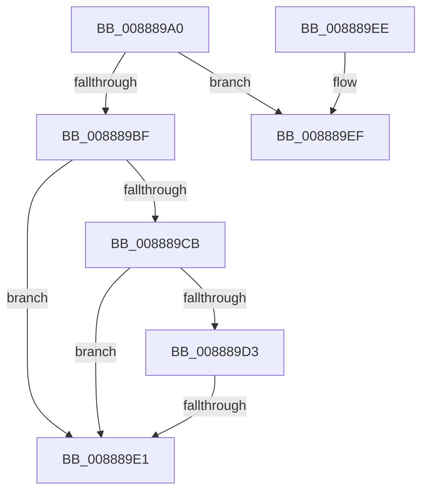

# MiRemoveSharedCommitNode

- RVA: `0x008889A0`–`0x00888A05` (길이 `101` bytes)
- VA: `0x00000001408889A0`
- 실행 섹션: `PAGE`
- PDB 이름 있음: `예`; PDB Function 태그: `아니요`
- unwind 정보 RVA: `0x0007CE2C`
- 디코드: `35`개 명령, `101/101` bytes 표시
- 미해석 바이트: `0` (있으면 어셈블리에 `.byte`로 보존)

> 이 문서는 커널 이미지의 기계어와 PDB 기호를 분석해 생성했습니다. 4번과 5번은 함수 원형과 자료형을 바이너리 사용 방식에서 추정한 C 해석이며 원본 소스 복구 결과는 아닙니다.

## 1. Dependencies

- 직접 호출 지점: **1**; 고유 호출 대상: **1**
- 직접 호출자로 확인된 함수: **11**
- RIP 상대 이미지 참조: **0**

### Outgoing calls
- `0x008889C2` → [MiIncludeSharedCommit](../../text/42/MiIncludeSharedCommit_function_00428010.md) (function, `0x00428010`)

### Direct callers
- [MiDeleteNewlyCreatedPartialVads](../81/MiDeleteNewlyCreatedPartialVads_function_00810374.md) at `0x00810436`
- [MiDeletePartialCloneVads](../81/MiDeletePartialCloneVads_function_008116E4.md) at `0x0081182C`
- [sub_0088535F](Unknown_function_0088535F.md) at `0x00885483`
- [sub_008874E4](Unknown_function_008874E4.md) at `0x008875A6`
- [MmLinkJobProcess](MmLinkJobProcess_function_00887C48.md) at `0x00887D53`
- [MiSectionClose](MiSectionClose_function_00888970.md) at `0x00888988`
- [sub_00888B41](Unknown_function_00888B41.md) at `0x00888BBA`
- [MiDeleteVad](MiDeleteVad_function_00888C80.md) at `0x00888FB1`
- [MiAllocateChildVads](../97/MiAllocateChildVads_function_0097E380.md) at `0x0097E5B5`
- [MiAllocateChildVads](../97/MiAllocateChildVads_function_0097E380.md) at `0x0097E7D6`
- [sub_00B190BA](../B1/Unknown_function_00B190BA.md) at `0x00B190D5`
- [sub_00B2A146](../B2/Unknown_function_00B2A146.md) at `0x00B2A427`

### Static image references
- 디코드된 RIP-relative 메모리 참조가 없습니다.

## 2. Other-region calls and transfers

- 다른 실행 섹션으로 향하는 call: **1**
  - `0x008889C2` → [MiIncludeSharedCommit](../../text/42/MiIncludeSharedCommit_function_00428010.md) (`PAGE` → `.text`)
- call이 아닌 외부 분기/꼬리 이동: **1**
  - `0x008889DB` → [sub_00888B39](Unknown_function_00888B39.md) (`tail-transfer`)

## 3. Assembly (complete function range)

```asm
008889A0  44 89 44 24 18                  mov dword ptr [rsp + 0x18], r8d
008889A5  53                              push rbx
008889A6  55                              push rbp
008889A7  41 54                           push r12
008889A9  41 55                           push r13
008889AB  41 56                           push r14
008889AD  48 83 EC 30                     sub rsp, 0x30
008889B1  41 8B E8                        mov ebp, r8d
008889B4  48 8B DA                        mov rbx, rdx
008889B7  4C 8B F1                        mov r14, rcx
008889BA  F6 C2 01                        test dl, 1
008889BD  75 30                           jne 0x1408889ef
008889BF  4C 8B EA                        mov r13, rdx
008889C2  E8 49 F6 B9 FF                  call 0x140428010
008889C7  85 C0                           test eax, eax
008889C9  74 16                           je 0x1408889e1
008889CB  41 8B 46 38                     mov eax, dword ptr [r14 + 0x38]
008889CF  A8 20                           test al, 0x20
008889D1  75 0E                           jne 0x1408889e1
008889D3  8B 83 FC 05 00 00               mov eax, dword ptr [rbx + 0x5fc]
008889D9  A8 10                           test al, 0x10
008889DB  0F 84 58 01 00 00               je 0x140888b39
008889E1  48 83 C4 30                     add rsp, 0x30
008889E5  41 5E                           pop r14
008889E7  41 5D                           pop r13
008889E9  41 5C                           pop r12
008889EB  5D                              pop rbp
008889EC  5B                              pop rbx
008889ED  C3                              ret
008889EE  CC                              int3
008889EF  4C 8B E3                        mov r12, rbx
008889F2  49 83 E4 FE                     and r12, 0xfffffffffffffffe
008889F6  45 33 ED                        xor r13d, r13d
008889F9  65 48 8B 04 25 88 01 00 00      mov rax, qword ptr gs:[0x188]
00888A02  49 8B 0E                        mov rcx, qword ptr [r14]
```

## 4. C-style interpretation (structured pseudocode)

```c
__int64 __fastcall MiRemoveSharedCommitNode(__int64 a1, __int64 a2, int a3)
{
    __int64 result;
    __int64 v_r12;
    __int64 v_r13;
    __int64 v_rsp;
    unsigned int v_stack_p18;

    v_stack_p18 = a3;
    v_rsp = (v_rsp) - (48);
    if ((((unsigned __int8)(a2)) & (1)) != 0) goto loc_008889EF;
    result = MiIncludeSharedCommit(a1, a2, a3, a4);
    if ((unsigned int)(result) == 0) goto loc_008889E1;
    if ((((unsigned __int8)((unsigned int)(*(unsigned int *)(a1 + 56)))) & (32)) != 0) goto loc_008889E1;
loc_008889E1:
    v_rsp = (v_rsp) + (48);
    return (unsigned int)(*(unsigned int *)(a2 + 1532));
loc_008889EF:
    v_r12 = (a2) & (-2);
    v_r13 = 0;
    return *(unsigned __int64 *)(gs_base + (0 + 392));
}
```

## 5. (Beta) C Style

```c
int64_t MiRemoveSharedCommitNode(void *Arg1, void *Arg2, int32_t Arg3)
{
    uint8_t *arg1 = (uint8_t *)Arg1;
    uint8_t *arg2 = (uint8_t *)Arg2;

    int64_t result;
    int64_t local_r12;
    int64_t local_r13;
    int64_t local_rsp;
    uint32_t v_stack_p18;

    v_stack_p18 = Arg3;
    local_rsp = (local_rsp) - (48);
    if ((((uint8_t)(Arg2)) & (1)) != 0) goto loc_008889EF;
    result = MiIncludeSharedCommit(Arg1, Arg2, Arg3, a4);
    if ((uint32_t)(result) == 0) goto loc_008889E1;
    if ((((uint8_t)((uint32_t)(*(uint32_t *)(arg1 + 0x38)))) & (32)) != 0) goto loc_008889E1;
loc_008889E1:
    local_rsp = (local_rsp) + (48);
    return (uint32_t)(*(uint32_t *)(arg2 + 0x5FC));
loc_008889EF:
    local_r12 = (Arg2) & (-2);
    local_r13 = 0;
    return *(uint64_t *)(gs_base + (0 + 0x188));
}
```

### 관측된 메모리 오프셋

구조체 형식이 확인되지 않은 접근은 인자 기준의 오프셋으로만 기록했습니다.

| 기준 인자 | 오프셋 표현 | 폭 (bit) | 접근 |
|---|---:|---:|---|
| `Arg1` | `+ 0x0` | `64` | `R` |
| `Arg1` | `+ 0x38` | `32` | `R` |
| `Arg2` | `+ 0x5FC` | `32` | `R` |

## 6. Execution-region graph

[열기: 2D/3D 그래프와 함수 탐색 컨트롤 패널](../../../control-panel.html?section=page&rva=0x008889A0&view=graph)

- 2D 그래프는 위에서 아래로 흐르고, 3D 그래프는 빈 공간을 드래그해 회전합니다. Shift+드래그는 이동, 휠은 확대·축소, 함수 노드 선택은 대상 보고서 이동입니다.

### Static fallback


