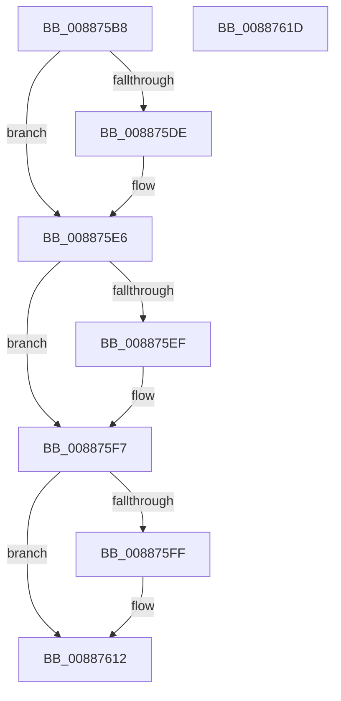

# MiReturnVadCharges

- RVA: `0x008875B8`–`0x0088761E` (길이 `102` bytes)
- VA: `0x00000001408875B8`
- 실행 섹션: `PAGE`
- PDB 이름 있음: `예`; PDB Function 태그: `아니요`
- unwind 정보 RVA: `0x0005CAAC`
- 디코드: `29`개 명령, `102/102` bytes 표시
- 미해석 바이트: `0` (있으면 어셈블리에 `.byte`로 보존)

> 이 문서는 커널 이미지의 기계어와 PDB 기호를 분석해 생성했습니다. 4번과 5번은 함수 원형과 자료형을 바이너리 사용 방식에서 추정한 C 해석이며 원본 소스 복구 결과는 아닙니다.

## 1. Dependencies

- 직접 호출 지점: **4**; 고유 호출 대상: **4**
- 직접 호출자로 확인된 함수: **2**
- RIP 상대 이미지 참조: **0**

### Outgoing calls
- `0x008875E1` → [PsReturnProcessNonPagedPoolQuota](../../text/41/PsReturnProcessNonPagedPoolQuota_function_0041C200.md) (function, `0x0041C200`)
- `0x008875F2` → [PsReturnProcessPagedPoolQuota](../../text/2A/PsReturnProcessPagedPoolQuota_function_002A6860.md) (function, `0x002A6860`)
- `0x00887602` → [MiGetProcessPartition](../../text/44/MiGetProcessPartition_function_00443B10.md) (function, `0x00443B10`)
- `0x0088760D` → [MiReturnResident](../../text/28/MiReturnResident_function_00286890.md) (function, `0x00286890`)

### Direct callers
- [MiDeleteNewlyCreatedPartialVads](../81/MiDeleteNewlyCreatedPartialVads_function_00810374.md) at `0x008103D4`
- [MiInsertVadCharges](MiInsertVadCharges_function_00886AA8.md) at `0x00886BEF`

### Static image references
- 디코드된 RIP-relative 메모리 참조가 없습니다.

## 2. Other-region calls and transfers

- 다른 실행 섹션으로 향하는 call: **4**
  - `0x008875E1` → [PsReturnProcessNonPagedPoolQuota](../../text/41/PsReturnProcessNonPagedPoolQuota_function_0041C200.md) (`PAGE` → `.text`)
  - `0x008875F2` → [PsReturnProcessPagedPoolQuota](../../text/2A/PsReturnProcessPagedPoolQuota_function_002A6860.md) (`PAGE` → `.text`)
  - `0x00887602` → [MiGetProcessPartition](../../text/44/MiGetProcessPartition_function_00443B10.md) (`PAGE` → `.text`)
  - `0x0088760D` → [MiReturnResident](../../text/28/MiReturnResident_function_00286890.md) (`PAGE` → `.text`)
- 별도 외부 분기/꼬리 이동을 확인하지 못했습니다.

## 3. Assembly (complete function range)

```asm
008875B8  48 89 5C 24 08                  mov qword ptr [rsp + 8], rbx
008875BD  57                              push rdi
008875BE  48 83 EC 20                     sub rsp, 0x20
008875C2  65 48 8B 04 25 88 01 00 00      mov rax, qword ptr gs:[0x188]
008875CB  48 8B D9                        mov rbx, rcx
008875CE  48 8B 51 10                     mov rdx, qword ptr [rcx + 0x10]
008875D2  48 8B B8 B8 00 00 00            mov rdi, qword ptr [rax + 0xb8]
008875D9  48 85 D2                        test rdx, rdx
008875DC  74 08                           je 0x1408875e6
008875DE  48 8B CF                        mov rcx, rdi
008875E1  E8 1A 4C B9 FF                  call 0x14041c200
008875E6  48 8B 53 08                     mov rdx, qword ptr [rbx + 8]
008875EA  48 85 D2                        test rdx, rdx
008875ED  74 08                           je 0x1408875f7
008875EF  48 8B CF                        mov rcx, rdi
008875F2  E8 69 F2 A1 FF                  call 0x1402a6860
008875F7  4C 8B 03                        mov r8, qword ptr [rbx]
008875FA  4D 85 C0                        test r8, r8
008875FD  74 13                           je 0x140887612
008875FF  48 8B CF                        mov rcx, rdi
00887602  E8 09 C5 BB FF                  call 0x140443b10
00887607  48 8B C8                        mov rcx, rax
0088760A  49 8B D0                        mov rdx, r8
0088760D  E8 7E F2 9F FF                  call 0x140286890
00887612  48 8B 5C 24 30                  mov rbx, qword ptr [rsp + 0x30]
00887617  48 83 C4 20                     add rsp, 0x20
0088761B  5F                              pop rdi
0088761C  C3                              ret
0088761D  CC                              int3
```

## 4. C-style interpretation (structured pseudocode)

```c
__int64 __fastcall MiReturnVadCharges(__int64 a1)
{
    __int64 result;
    __int64 v_rsp;
    unsigned __int64 v_stack_p8;

    v_stack_p8 = v_rbx;
    v_rsp = (v_rsp) - (32);
    result = *(unsigned __int64 *)(gs_base + (0 + 392));
    if (*(unsigned __int64 *)(a1 + 16) != 0) {
        a1 = *(unsigned __int64 *)(*(unsigned __int64 *)(gs_base + (0 + 392)) + 184);
        result = PsReturnProcessNonPagedPoolQuota(a1, *(unsigned __int64 *)(a1 + 16), a3, a4);
    }
    if (*(unsigned __int64 *)(a1 + 8) != 0) {
        a1 = *(unsigned __int64 *)(*(unsigned __int64 *)(gs_base + (0 + 392)) + 184);
        result = PsReturnProcessPagedPoolQuota(a1, *(unsigned __int64 *)(a1 + 8), a3, a4);
    }
    if (*(unsigned __int64 *)(a1) != 0) {
        a1 = *(unsigned __int64 *)(*(unsigned __int64 *)(gs_base + (0 + 392)) + 184);
        result = MiGetProcessPartition(a1, *(unsigned __int64 *)(a1 + 8), *(unsigned __int64 *)(a1), a4);
        a1 = result;
        a2 = *(unsigned __int64 *)(a1);
        result = MiReturnResident(a1, a2, *(unsigned __int64 *)(a1), a4);
    }
    v_rsp = (v_rsp) + (32);
    return result;
}
```

## 5. (Beta) C Style

```c
int64_t MiReturnVadCharges(void *Arg1)
{
    uint8_t *arg1 = (uint8_t *)Arg1;

    int64_t result;
    int64_t local_rsp;
    uint64_t v_stack_p8;

    v_stack_p8 = local_rbx;
    local_rsp = (local_rsp) - (32);
    result = *(uint64_t *)(gs_base + (0 + 0x188));
    if (*(uint64_t *)(arg1 + 0x10) != 0) {
        Arg1 = *(uint64_t *)(*(uint64_t *)(gs_base + (0 + 0x188)) + 0xB8);
        result = PsReturnProcessNonPagedPoolQuota(Arg1, *(uint64_t *)(arg1 + 0x10), a3, a4);
    }
    if (*(uint64_t *)(arg1 + 0x8) != 0) {
        Arg1 = *(uint64_t *)(*(uint64_t *)(gs_base + (0 + 0x188)) + 0xB8);
        result = PsReturnProcessPagedPoolQuota(Arg1, *(uint64_t *)(arg1 + 0x8), a3, a4);
    }
    if (*(uint64_t *)(arg1) != 0) {
        Arg1 = *(uint64_t *)(*(uint64_t *)(gs_base + (0 + 0x188)) + 0xB8);
        result = MiGetProcessPartition(Arg1, *(uint64_t *)(arg1 + 0x8), *(uint64_t *)(arg1), a4);
        Arg1 = result;
        a2 = *(uint64_t *)(arg1);
        result = MiReturnResident(Arg1, a2, *(uint64_t *)(arg1), a4);
    }
    local_rsp = (local_rsp) + (32);
    return result;
}
```

### 관측된 메모리 오프셋

구조체 형식이 확인되지 않은 접근은 인자 기준의 오프셋으로만 기록했습니다.

| 기준 인자 | 오프셋 표현 | 폭 (bit) | 접근 |
|---|---:|---:|---|
| `Arg1` | `+ 0x0` | `64` | `R` |
| `Arg1` | `+ 0x8` | `64` | `R` |
| `Arg1` | `+ 0x10` | `64` | `R` |

## 6. Execution-region graph

[열기: 2D/3D 그래프와 함수 탐색 컨트롤 패널](../../../control-panel.html?section=page&rva=0x008875B8&view=graph)

- 2D 그래프는 위에서 아래로 흐르고, 3D 그래프는 빈 공간을 드래그해 회전합니다. Shift+드래그는 이동, 휠은 확대·축소, 함수 노드 선택은 대상 보고서 이동입니다.

### Static fallback


