# MiSelectUserAddress

- RVA: `0x00885C40`–`0x00886049` (길이 `1,033` bytes)
- VA: `0x0000000140885C40`
- 실행 섹션: `PAGE`
- PDB 이름 있음: `예`; PDB Function 태그: `예`
- unwind 정보 RVA: `0x0007C9F8`
- 디코드: `227`개 명령, `1,033/1,033` bytes 표시
- 미해석 바이트: `0` (있으면 어셈블리에 `.byte`로 보존)

> 이 문서는 커널 이미지의 기계어와 PDB 기호를 분석해 생성했습니다. 4번과 5번은 함수 원형과 자료형을 바이너리 사용 방식에서 추정한 C 해석이며 원본 소스 복구 결과는 아닙니다.

## 1. Dependencies

- 직접 호출 지점: **2**; 고유 호출 대상: **2**
- 직접 호출자로 확인된 함수: **8**
- RIP 상대 이미지 참조: **0**

### Outgoing calls
- `0x00885DA5` → [MiFindEmptyAddressRange](MiFindEmptyAddressRange_function_00886050.md) (function, `0x00886050`)
- `0x00885EB7` → [MiFindEmptyAddressRangeDownTree](MiFindEmptyAddressRangeDownTree_function_008867B0.md) (function, `0x008867B0`)

### Direct callers
- [MiAllocateEnclaveVad](../80/MiAllocateEnclaveVad_function_008080A4.md) at `0x00808320`
- [MiReserveUserMemory](MiReserveUserMemory_function_00884498.md) at `0x00884719`
- [sub_00884EE1](Unknown_function_00884EE1.md) at `0x00885116`
- [MiMapViewOfImageSection](../97/MiMapViewOfImageSection_function_0097E92C.md) at `0x0097F2DA`
- [MiMapViewOfPhysicalSection](../97/MiMapViewOfPhysicalSection_function_0097F984.md) at `0x0097FAD2`
- [MiMapLockedPagesInUserSpace](../97/MiMapLockedPagesInUserSpace_function_0097FE04.md) at `0x0097FF85`
- [MiAllocateNewSubAllocatedRegion](../98/MiAllocateNewSubAllocatedRegion_function_00981EC0.md) at `0x00981FBF`
- [sub_00B2A146](../B2/Unknown_function_00B2A146.md) at `0x00B2A23D`

### Static image references
- 디코드된 RIP-relative 메모리 참조가 없습니다.

## 2. Other-region calls and transfers

- 다른 실행 섹션으로 향하는 call: **0**
- call이 아닌 외부 분기/꼬리 이동: **7**
  - `0x00885F51` → [sub_00B18F9A](../B1/Unknown_function_00B18F9A.md) (`tail-transfer`)
  - `0x00885F75` → [sub_00B18F9A + 0x6F](../B1/Unknown_function_00B18F9A.md) (`tail-transfer`)
  - `0x00885F9B` → [sub_00B18F9A + 0x67](../B1/Unknown_function_00B18F9A.md) (`tail-transfer`)
  - `0x00885FE1` → [sub_00B18F9A + 0x6F](../B1/Unknown_function_00B18F9A.md) (`tail-transfer`)
  - `0x00886005` → [sub_00B18F9A + 0x6F](../B1/Unknown_function_00B18F9A.md) (`tail-transfer`)
  - `0x00886015` → [sub_00B18F9A + 0x79](../B1/Unknown_function_00B18F9A.md) (`tail-transfer`)
  - `0x00886021` → [sub_00B18F9A + 0x79](../B1/Unknown_function_00B18F9A.md) (`tail-transfer`)

## 3. Assembly (complete function range)

```asm
00885C40  48 89 5C 24 20                  mov qword ptr [rsp + 0x20], rbx
00885C45  4C 89 44 24 18                  mov qword ptr [rsp + 0x18], r8
00885C4A  48 89 54 24 10                  mov qword ptr [rsp + 0x10], rdx
00885C4F  55                              push rbp
00885C50  56                              push rsi
00885C51  57                              push rdi
00885C52  41 54                           push r12
00885C54  41 55                           push r13
00885C56  41 56                           push r14
00885C58  41 57                           push r15
00885C5A  48 81 EC 80 00 00 00            sub rsp, 0x80
00885C61  48 8B 84 24 00 01 00 00         mov rax, qword ptr [rsp + 0x100]
00885C69  33 DB                           xor ebx, ebx
00885C6B  4C 8B BC 24 08 01 00 00         mov r15, qword ptr [rsp + 0x108]
00885C73  8B E9                           mov ebp, ecx
00885C75  48 8B BC 24 E0 00 00 00         mov rdi, qword ptr [rsp + 0xe0]
00885C7D  4D 8B E1                        mov r12, r9
00885C80  89 9C 24 C0 00 00 00            mov dword ptr [rsp + 0xc0], ebx
00885C87  4D 8B C8                        mov r9, r8
00885C8A  48 89 18                        mov qword ptr [rax], rbx
00885C8D  4C 8B D2                        mov r10, rdx
00885C90  49 89 1F                        mov qword ptr [r15], rbx
00885C93  44 8B C3                        mov r8d, ebx
00885C96  65 48 8B 04 25 88 01 00 00      mov rax, qword ptr gs:[0x188]
00885C9F  8D 53 01                        lea edx, [rbx + 1]
00885CA2  89 5C 24 50                     mov dword ptr [rsp + 0x50], ebx
00885CA6  48 89 7C 24 70                  mov qword ptr [rsp + 0x70], rdi
00885CAB  48 8B 88 B8 00 00 00            mov rcx, qword ptr [rax + 0xb8]
00885CB2  0F BA E5 14                     bt ebp, 0x14
00885CB6  0F 82 2C 02 00 00               jb 0x140885ee8
00885CBC  F7 81 F4 01 00 00 00 00 20 00   test dword ptr [rcx + 0x1f4], 0x200000
00885CC6  0F 85 1C 02 00 00               jne 0x140885ee8
00885CCC  48 8B B1 10 04 00 00            mov rsi, qword ptr [rcx + 0x410]
00885CD3  49 BB 00 00 00 00 01 00 00 00   movabs r11, 0x100000000
00885CDD  48 8B 81 68 03 00 00            mov rax, qword ptr [rcx + 0x368]
00885CE4  48 81 C6 00 03 00 00            add rsi, 0x300
00885CEB  44 8B B4 24 F8 00 00 00         mov r14d, dword ptr [rsp + 0xf8]
00885CF3  48 8D 48 FF                     lea rcx, [rax - 1]
00885CF7  49 3B C3                        cmp rax, r11
00885CFA  0F 86 00 01 00 00               jbe 0x140885e00
00885D00  45 85 F6                        test r14d, r14d
00885D03  78 11                           js 0x140885d16
00885D05  48 8B D3                        mov rdx, rbx
00885D08  45 85 C0                        test r8d, r8d
00885D0B  75 09                           jne 0x140885d16
00885D0D  4C 3B C9                        cmp r9, rcx
00885D10  0F 82 15 02 00 00               jb 0x140885f2b
00885D16  48 8D 04 D2                     lea rax, [rdx + rdx*8]
00885D1A  4C 8D 2C C6                     lea r13, [rsi + rax*8]
00885D1E  8B C5                           mov eax, ebp
00885D20  25 00 00 40 20                  and eax, 0x20400000
00885D25  3D 00 00 40 20                  cmp eax, 0x20400000
00885D2A  74 31                           je 0x140885d5d
00885D2C  0F BA E5 1D                     bt ebp, 0x1d
00885D30  0F 82 20 02 00 00               jb 0x140885f56
00885D36  41 F6 C6 04                     test r14b, 4
00885D3A  74 21                           je 0x140885d5d
00885D3C  3D 00 00 40 00                  cmp eax, 0x400000
00885D41  75 1A                           jne 0x140885d5d
00885D43  49 81 FC 00 00 00 40            cmp r12, 0x40000000
00885D4A  0F 83 7A 02 00 00               jae 0x140885fca
00885D50  49 81 FC 00 00 20 00            cmp r12, 0x200000
00885D57  0F 83 89 02 00 00               jae 0x140885fe6
00885D5D  48 8B B4 24 E8 00 00 00         mov rsi, qword ptr [rsp + 0xe8]
00885D65  8B AC 24 F0 00 00 00            mov ebp, dword ptr [rsp + 0xf0]
00885D6C  45 85 C0                        test r8d, r8d
00885D6F  0F 85 9E 00 00 00               jne 0x140885e13
00885D75  48 8D 44 24 50                  lea rax, [rsp + 0x50]
00885D7A  4C 8B C7                        mov r8, rdi
00885D7D  48 89 44 24 40                  mov qword ptr [rsp + 0x40], rax
00885D82  49 8B D4                        mov rdx, r12
00885D85  8B 84 24 F0 00 00 00            mov eax, dword ptr [rsp + 0xf0]
00885D8C  49 8B CD                        mov rcx, r13
00885D8F  4C 89 7C 24 38                  mov qword ptr [rsp + 0x38], r15
00885D94  89 44 24 30                     mov dword ptr [rsp + 0x30], eax
00885D98  4C 89 4C 24 28                  mov qword ptr [rsp + 0x28], r9
00885D9D  4C 8B CE                        mov r9, rsi
00885DA0  4C 89 54 24 20                  mov qword ptr [rsp + 0x20], r10
00885DA5  E8 A6 02 00 00                  call 0x140886050
00885DAA  4C 8B 8C 24 D0 00 00 00         mov r9, qword ptr [rsp + 0xd0]
00885DB2  4C 8B 94 24 C8 00 00 00         mov r10, qword ptr [rsp + 0xc8]
00885DBA  8B AC 24 F0 00 00 00            mov ebp, dword ptr [rsp + 0xf0]
00885DC1  85 C0                           test eax, eax
00885DC3  0F 88 D7 01 00 00               js 0x140885fa0
00885DC9  48 81 FF 00 00 01 00            cmp rdi, 0x10000
00885DD0  75 12                           jne 0x140885de4
00885DD2  83 7C 24 50 00                  cmp dword ptr [rsp + 0x50], 0
00885DD7  74 0B                           je 0x140885de4
00885DD9  48 8B 8C 24 00 01 00 00         mov rcx, qword ptr [rsp + 0x100]
00885DE1  4C 89 29                        mov qword ptr [rcx], r13
00885DE4  48 8B 9C 24 D8 00 00 00         mov rbx, qword ptr [rsp + 0xd8]
00885DEC  48 81 C4 80 00 00 00            add rsp, 0x80
00885DF3  41 5F                           pop r15
00885DF5  41 5E                           pop r14
00885DF7  41 5D                           pop r13
00885DF9  41 5C                           pop r12
00885DFB  5F                              pop rdi
00885DFC  5E                              pop rsi
00885DFD  5D                              pop rbp
00885DFE  C3                              ret
00885DFF  CC                              int3
00885E00  4C 3B C9                        cmp r9, rcx
00885E03  0F 86 F7 FE FF FF               jbe 0x140885d00
00885E09  BA 02 00 00 00                  mov edx, 2
00885E0E  E9 03 FF FF FF                  jmp 0x140885d16
00885E13  49 8B C1                        mov rax, r9
00885E16  49 2B C2                        sub rax, r10
00885E19  48 FF C0                        inc rax
00885E1C  49 3B C4                        cmp rax, r12
00885E1F  0F 82 9E 01 00 00               jb 0x140885fc3
00885E25  65 48 8B 04 25 88 01 00 00      mov rax, qword ptr gs:[0x188]
00885E2E  4D 8D 41 01                     lea r8, [r9 + 1]
00885E32  4D 8B 75 38                     mov r14, qword ptr [r13 + 0x38]
00885E36  49 8B D0                        mov rdx, r8
00885E39  4C 89 44 24 68                  mov qword ptr [rsp + 0x68], r8
00885E3E  41 BF 01 00 00 00               mov r15d, 1
00885E44  48 8B 88 B8 00 00 00            mov rcx, qword ptr [rax + 0xb8]
00885E4B  49 8B 45 30                     mov rax, qword ptr [r13 + 0x30]
00885E4F  4C 3B C0                        cmp r8, rax
00885E52  48 89 4C 24 58                  mov qword ptr [rsp + 0x58], rcx
00885E57  48 0F 47 D0                     cmova rdx, rax
00885E5B  41 8B 45 40                     mov eax, dword ptr [r13 + 0x40]
00885E5F  84 C0                           test al, al
00885E61  44 0F B6 C0                     movzx r8d, al
00885E65  48 89 94 24 E0 00 00 00         mov qword ptr [rsp + 0xe0], rdx
00885E6D  45 0F 44 C7                     cmove r8d, r15d
00885E71  4C 8B BC 24 08 01 00 00         mov r15, qword ptr [rsp + 0x108]
00885E79  4D 3B F2                        cmp r14, r10
00885E7C  4C 89 44 24 60                  mov qword ptr [rsp + 0x60], r8
00885E81  4D 0F 42 F2                     cmovb r14, r10
00885E85  4D 3B F1                        cmp r14, r9
00885E88  73 6D                           jae 0x140885ef7
00885E8A  49 8B C1                        mov rax, r9
00885E8D  49 2B C6                        sub rax, r14
00885E90  48 FF C0                        inc rax
00885E93  49 3B C4                        cmp rax, r12
00885E96  72 5F                           jb 0x140885ef7
00885E98  4C 89 7C 24 30                  mov qword ptr [rsp + 0x30], r15
00885E9D  48 81 C1 58 05 00 00            add rcx, 0x558
00885EA4  48 89 54 24 28                  mov qword ptr [rsp + 0x28], rdx
00885EA9  4C 8B CE                        mov r9, rsi
00885EAC  49 8B D4                        mov rdx, r12
00885EAF  4C 89 74 24 20                  mov qword ptr [rsp + 0x20], r14
00885EB4  4C 8B C7                        mov r8, rdi
00885EB7  E8 F4 08 00 00                  call 0x1408867b0
00885EBC  85 C0                           test eax, eax
00885EBE  0F 89 05 FF FF FF               jns 0x140885dc9
00885EC4  4C 8B 8C 24 D0 00 00 00         mov r9, qword ptr [rsp + 0xd0]
00885ECC  4C 8B 94 24 C8 00 00 00         mov r10, qword ptr [rsp + 0xc8]
00885ED4  48 8B 94 24 E0 00 00 00         mov rdx, qword ptr [rsp + 0xe0]
00885EDC  48 8B 4C 24 58                  mov rcx, qword ptr [rsp + 0x58]
00885EE1  4C 8B 44 24 60                  mov r8, qword ptr [rsp + 0x60]
00885EE6  EB 14                           jmp 0x140885efc
00885EE8  44 8B C2                        mov r8d, edx
00885EEB  89 94 24 C0 00 00 00            mov dword ptr [rsp + 0xc0], edx
00885EF2  E9 D5 FD FF FF                  jmp 0x140885ccc
00885EF7  B8 17 00 00 C0                  mov eax, 0xc0000017
00885EFC  44 8B DD                        mov r11d, ebp
00885EFF  41 83 E3 02                     and r11d, 2
00885F03  48 3B 54 24 68                  cmp rdx, qword ptr [rsp + 0x68]
00885F08  0F 84 FC 00 00 00               je 0x14088600a
00885F0E  45 85 DB                        test r11d, r11d
00885F11  0F 85 03 01 00 00               jne 0x14088601a
00885F17  49 8D 41 01                     lea rax, [r9 + 1]
00885F1B  48 8B D0                        mov rdx, rax
00885F1E  48 89 84 24 E0 00 00 00         mov qword ptr [rsp + 0xe0], rax
00885F26  E9 5A FF FF FF                  jmp 0x140885e85
00885F2B  49 3B C3                        cmp rax, r11
00885F2E  0F 86 E2 FD FF FF               jbe 0x140885d16
00885F34  4C 8D AE 90 00 00 00            lea r13, [rsi + 0x90]
00885F3B  49 39 55 00                     cmp qword ptr [r13], rdx
00885F3F  75 39                           jne 0x140885f7a
00885F41  4D 8B DA                        mov r11, r10
00885F44  49 C1 EB 10                     shr r11, 0x10
00885F48  4D 85 DB                        test r11, r11
00885F4B  0F 84 C5 FD FF FF               je 0x140885d16
00885F51  E9 44 30 29 00                  jmp 0x140b18f9a
00885F56  49 81 FC 00 00 00 40            cmp r12, 0x40000000
00885F5D  0F 82 D3 FD FF FF               jb 0x140885d36
00885F63  48 81 FF 00 00 20 00            cmp rdi, 0x200000
00885F6A  0F 85 C6 FD FF FF               jne 0x140885d36
00885F70  BF 00 00 00 40                  mov edi, 0x40000000
00885F75  E9 8F 30 29 00                  jmp 0x140b19009
00885F7A  4D 3B 55 38                     cmp r10, qword ptr [r13 + 0x38]
00885F7E  0F 82 92 FD FF FF               jb 0x140885d16
00885F84  49 8B C1                        mov rax, r9
00885F87  48 8B CB                        mov rcx, rbx
00885F8A  48 C1 E8 10                     shr rax, 0x10
00885F8E  BA 02 00 00 00                  mov edx, 2
00885F93  49 3B 45 28                     cmp rax, qword ptr [r13 + 0x28]
00885F97  48 0F 46 CA                     cmovbe rcx, rdx
00885F9B  E9 61 30 29 00                  jmp 0x140b19001
00885FA0  44 8B 84 24 C0 00 00 00         mov r8d, dword ptr [rsp + 0xc0]
00885FA8  85 DB                           test ebx, ebx
00885FAA  0F 84 19 FE FF FF               je 0x140885dc9
00885FB0  48 81 FF 00 00 00 40            cmp rdi, 0x40000000
00885FB7  75 6D                           jne 0x140886026
00885FB9  BF 00 00 20 00                  mov edi, 0x200000
00885FBE  E9 A9 FD FF FF                  jmp 0x140885d6c
00885FC3  B8 17 00 00 C0                  mov eax, 0xc0000017
00885FC8  EB DE                           jmp 0x140885fa8
00885FCA  49 F7 C4 FF FF FF 3F            test r12, 0x3fffffff
00885FD1  75 13                           jne 0x140885fe6
00885FD3  48 81 FF 00 00 00 40            cmp rdi, 0x40000000
00885FDA  73 0A                           jae 0x140885fe6
00885FDC  BF 00 00 00 40                  mov edi, 0x40000000
00885FE1  E9 23 30 29 00                  jmp 0x140b19009
00885FE6  49 F7 C4 FF FF 1F 00            test r12, 0x1fffff
00885FED  0F 85 6A FD FF FF               jne 0x140885d5d
00885FF3  48 81 FF 00 00 20 00            cmp rdi, 0x200000
00885FFA  0F 83 5D FD FF FF               jae 0x140885d5d
00886000  BF 00 00 20 00                  mov edi, 0x200000
00886005  E9 FF 2F 29 00                  jmp 0x140b19009
0088600A  45 85 DB                        test r11d, r11d
0088600D  75 0B                           jne 0x14088601a
0088600F  41 BB 00 00 01 00               mov r11d, 0x10000
00886015  E9 F9 2F 29 00                  jmp 0x140b19013
0088601A  4D 8B D8                        mov r11, r8
0088601D  49 C1 E3 10                     shl r11, 0x10
00886021  E9 ED 2F 29 00                  jmp 0x140b19013
00886026  48 81 FF 00 00 20 00            cmp rdi, 0x200000
0088602D  0F 85 96 FD FF FF               jne 0x140885dc9
00886033  4C 8B 5C 24 70                  mov r11, qword ptr [rsp + 0x70]
00886038  4C 3B DF                        cmp r11, rdi
0088603B  0F 84 A3 FD FF FF               je 0x140885de4
00886041  49 8B FB                        mov rdi, r11
00886044  E9 23 FD FF FF                  jmp 0x140885d6c
```

## 4. C-style interpretation (structured pseudocode)

```c
__int64 __fastcall MiSelectUserAddress(int a1, __int64 a2, __int64 a3, __int64 a4, __int64 a5, __int64 a6, unsigned int a7, unsigned int a8, __int64 a9, __int64 a10)
{
    __int64 result;
    __int64 v_r11;
    __int64 v_r14;
    __int64 v_rbx;
    __int64 v_rsi;
    __int64 v_rsp;
    unsigned __int64 v_stack_m48;
    unsigned int v_stack_m68;
    unsigned __int64 v_stack_m78;
    unsigned __int64 v_stack_m80;
    unsigned int v_stack_m88;
    unsigned __int64 v_stack_m90;
    unsigned __int64 v_stack_m98;
    unsigned __int64 v_stack_p10;
    unsigned __int64 v_stack_p18;
    unsigned __int64 v_stack_p20;
    unsigned __int64 v_stack_p28;
    unsigned __int64 v_stack_p30;
    unsigned __int64 v_stack_p58;
    unsigned __int64 v_stack_p60;
    unsigned __int64 v_stack_p68;
    unsigned __int64 v_stack_p70;
    unsigned int v_stack_p8;
    unsigned int v_stack_pC0;
    unsigned __int64 v_stack_pC8;
    unsigned __int64 v_stack_pD0;
    unsigned __int64 v_stack_pE0;

    v_stack_p20 = v_rbx;
    v_stack_p18 = a3;
    v_stack_p10 = a2;
    v_rsp = (v_rsp) - (128);
    v_rbx = 0;
    v_stack_p8 = 0;
    *(unsigned __int64 *)(a9) = 0;
    *(unsigned __int64 *)(a10) = 0;
    v_stack_m68 = 0;
    v_stack_m48 = a5;
    if (condition_is_below) goto loc_00885EE8;
    if (((*(unsigned int *)(*(unsigned __int64 *)(*(unsigned __int64 *)(gs_base + (0 + 392)) + 184) + 500)) & (0x200000ULL)) != 0) goto loc_00885EE8;
loc_00885CCC:
    v_rsi = (*(unsigned __int64 *)(*(unsigned __int64 *)(*(unsigned __int64 *)(gs_base + (0 + 392)) + 184) + 1040)) + (768);
    if ((*(unsigned __int64 *)(*(unsigned __int64 *)(*(unsigned __int64 *)(gs_base + (0 + 392)) + 184) + 872)) <= v_r11) goto loc_00885E00;
loc_00885D00:
    if (sign_flag) goto loc_00885D16;
    if (0 != 0) goto loc_00885D16;
    if (a3 < (*(unsigned __int64 *)(*(unsigned __int64 *)(*(unsigned __int64 *)(gs_base + (0 + 392)) + 184) + 872) - 1)) goto loc_00885F2B;
loc_00885D16:
    result = (unsigned int)(((unsigned int)((unsigned int)((unsigned int)(a1)))) & (0x20400000ULL));
    if (((unsigned int)(result)) == 0x20400000ULL) goto loc_00885D5D;
    if (((unsigned int)(result)) < 0x20400000ULL) goto loc_00885F56;
loc_00885D36:
    if ((((unsigned __int8)((unsigned int)(a8))) & (4)) == 0) goto loc_00885D5D;
    if (((unsigned int)(result)) != 0x400000ULL) goto loc_00885D5D;
    if (a4 >= 0x40000000ULL) goto loc_00885FCA;
    if (a4 >= 0x200000ULL) goto loc_00885FE6;
loc_00885D5D:
loc_00885D6C:
    if (0 != 0) goto loc_00885E13;
    v_stack_m78 = v_stack_m68;
    v_stack_m80 = a10;
    v_stack_m88 = (unsigned int)((unsigned int)(a7));
    v_stack_m90 = a3;
    v_stack_m98 = a2;
    result = MiFindEmptyAddressRange(v_rsi + 0 + 0 * 8 * 8, a4, a5, a6);
    if (sign_flag) goto loc_00885FA0;
loc_00885DC9:
    if (a5 != 0x10000ULL) goto loc_00885DE4;
    if (v_stack_m68 != 0) {
        a1 = a9;
        *(unsigned __int64 *)(a1) = v_rsi + 0 + 0 * 8 * 8;
    }
    v_rsp = (v_rsp) + (128);
    return result;
loc_00885E00:
    if (v_stack_p18 <= a1) goto loc_00885D00;
    goto loc_00885D16;
loc_00885E13:
    result = (v_stack_p18) - (v_stack_p10);
    result = (result) + 1;
    if (result < a4) goto loc_00885FC3;
    v_stack_p68 = v_stack_p18 + 1;
    v_stack_p58 = *(unsigned __int64 *)(*(unsigned __int64 *)(gs_base + (0 + 392)) + 184);
    a2 = v_stack_p18 + 1;
    if ((v_stack_p18 + 1) > (*(unsigned __int64 *)(v_rsi + 0 + 0 * 8 * 8 + 48))) { a2 = *(unsigned __int64 *)(v_rsi + 0 + 0 * 8 * 8 + 48); }
    v_stack_pE0 = a2;
    a3 = (unsigned __int8)((unsigned int)(*(unsigned int *)(v_rsi + 0 + 0 * 8 * 8 + 64)));
    if ((unsigned __int8)((unsigned int)(*(unsigned int *)(v_rsi + 0 + 0 * 8 * 8 + 64))) == 0) { a3 = 1; }
    v_stack_p60 = a3;
    v_r14 = *(unsigned __int64 *)(v_rsi + 0 + 0 * 8 * 8 + 56);
    if ((*(unsigned __int64 *)(v_rsi + 0 + 0 * 8 * 8 + 56)) < v_stack_p10) { v_r14 = v_stack_p10; }
loc_00885E85:
    if (v_r14 >= v_stack_p18) goto loc_00885EF7;
    result = (v_stack_p18) - (v_r14);
    result = (result) + 1;
    if (result < a4) goto loc_00885EF7;
    v_stack_p30 = a10;
    a1 = (*(unsigned __int64 *)(*(unsigned __int64 *)(gs_base + (0 + 392)) + 184)) + (0x558ULL);
    v_stack_p28 = a2;
    v_stack_p20 = v_r14;
    result = MiFindEmptyAddressRangeDownTree(a1, a4, a5, a6);
    if (!sign_flag) goto loc_00885DC9;
    goto loc_00885EFC;
loc_00885EE8:
    v_stack_pC0 = (unsigned int)(a5);
    goto loc_00885CCC;
loc_00885EF7:
loc_00885EFC:
    v_r11 = (unsigned int)(((unsigned int)((unsigned int)((unsigned int)(a7)))) & (2));
    if (a5 == v_stack_p68) goto loc_0088600A;
    if ((unsigned int)(v_r11) != 0) goto loc_0088601A;
    v_stack_pE0 = v_stack_pD0 + 1;
    goto loc_00885E85;
loc_00885F2B:
    if ((v_stack_pD0 + 1) <= v_r11) goto loc_00885D16;
    if ((*(unsigned __int64 *)(a6 + 144)) != (v_stack_pD0 + 1)) goto loc_00885F7A;
    v_r11 = (v_stack_pC8) >> (16);
    if (v_r11 == 0) goto loc_00885D16;
loc_00885F56:
    if (a4 < 0x40000000ULL) goto loc_00885D36;
    if (a5 != 0x200000ULL) goto loc_00885D36;
loc_00885F7A:
    if (v_stack_pC8 < (*(unsigned __int64 *)(a6 + 144 + 56))) goto loc_00885D16;
    result = (v_stack_pD0) >> (16);
    a1 = v_stack_p20;
    if (result <= (*(unsigned __int64 *)(a6 + 144 + 40))) { a1 = 2; }
loc_00885FA0:
loc_00885FA8:
    if ((unsigned int)(v_stack_p20) == 0) goto loc_00885DC9;
    if (((unsigned int)(0x40000000ULL)) != 0x40000000ULL) goto loc_00886026;
    goto loc_00885D6C;
loc_00885FC3:
    goto loc_00885FA8;
loc_00885FCA:
    if (((a4) & (0x3FFFFFFFULL)) != 0) goto loc_00885FE6;
    if (((unsigned int)(0x200000ULL)) >= 0x40000000ULL) goto loc_00885FE6;
loc_00885FE6:
    if (((a4) & (0x1FFFFFULL)) != 0) goto loc_00885D5D;
    if (((unsigned int)(0x40000000ULL)) >= 0x200000ULL) goto loc_00885D5D;
loc_0088600A:
    if ((unsigned int)(v_r11) != 0) goto loc_0088601A;
loc_0088601A:
    v_r11 = ((unsigned int)(v_stack_pC0)) << (16);
loc_00886026:
    if (((unsigned int)(0x200000ULL)) != 0x200000ULL) goto loc_00885DC9;
    if (v_stack_p70 == ((unsigned int)(0x200000ULL))) goto loc_00885DE4;
    goto loc_00885D6C;
}
```

## 5. (Beta) C Style

```c
int64_t MiSelectUserAddress(int32_t Arg1, int64_t Arg2, int64_t Arg3, int64_t Arg4, int64_t Arg5, int64_t Arg6, uint32_t Arg7, uint32_t Arg8, void *Arg9, void *Arg10)
{
    uint8_t *arg9 = (uint8_t *)Arg9;
    uint8_t *arg10 = (uint8_t *)Arg10;

    int64_t result;
    int64_t local_r11;
    int64_t local_r14;
    int64_t local_rbx;
    int64_t local_rsi;
    int64_t local_rsp;
    uint64_t v_stack_m48;
    uint32_t v_stack_m68;
    uint64_t v_stack_m78;
    uint64_t v_stack_m80;
    uint32_t v_stack_m88;
    uint64_t v_stack_m90;
    uint64_t v_stack_m98;
    uint64_t v_stack_p10;
    uint64_t v_stack_p18;
    uint64_t v_stack_p20;
    uint64_t v_stack_p28;
    uint64_t v_stack_p30;
    uint64_t v_stack_p58;
    uint64_t v_stack_p60;
    uint64_t v_stack_p68;
    uint64_t v_stack_p70;
    uint32_t v_stack_p8;
    uint32_t v_stack_pC0;
    uint64_t v_stack_pC8;
    uint64_t v_stack_pD0;
    uint64_t v_stack_pE0;

    v_stack_p20 = local_rbx;
    v_stack_p18 = Arg3;
    v_stack_p10 = Arg2;
    local_rsp = (local_rsp) - (128);
    local_rbx = 0;
    v_stack_p8 = 0;
    *(uint64_t *)(arg9) = 0;
    *(uint64_t *)(arg10) = 0;
    v_stack_m68 = 0;
    v_stack_m48 = Arg5;
    if (condition_is_below) goto loc_00885EE8;
    if (((*(uint32_t *)(*(uint64_t *)(*(uint64_t *)(gs_base + (0 + 0x188)) + 0xB8) + 0x1F4)) & (0x200000ULL)) != 0) goto loc_00885EE8;
loc_00885CCC:
    local_rsi = (*(uint64_t *)(*(uint64_t *)(*(uint64_t *)(gs_base + (0 + 0x188)) + 0xB8) + 0x410)) + (768);
    if ((*(uint64_t *)(*(uint64_t *)(*(uint64_t *)(gs_base + (0 + 0x188)) + 0xB8) + 0x368)) <= local_r11) goto loc_00885E00;
loc_00885D00:
    if (sign_flag) goto loc_00885D16;
    if (0 != 0) goto loc_00885D16;
    if (Arg3 < (*(uint64_t *)(*(uint64_t *)(*(uint64_t *)(gs_base + (0 + 0x188)) + 0xB8) + 0x368) - 1)) goto loc_00885F2B;
loc_00885D16:
    result = (uint32_t)(((uint32_t)((uint32_t)((uint32_t)(Arg1)))) & (0x20400000ULL));
    if (((uint32_t)(result)) == 0x20400000ULL) goto loc_00885D5D;
    if (((uint32_t)(result)) < 0x20400000ULL) goto loc_00885F56;
loc_00885D36:
    if ((((uint8_t)((uint32_t)(Arg8))) & (4)) == 0) goto loc_00885D5D;
    if (((uint32_t)(result)) != 0x400000ULL) goto loc_00885D5D;
    if (Arg4 >= 0x40000000ULL) goto loc_00885FCA;
    if (Arg4 >= 0x200000ULL) goto loc_00885FE6;
loc_00885D5D:
loc_00885D6C:
    if (0 != 0) goto loc_00885E13;
    v_stack_m78 = v_stack_m68;
    v_stack_m80 = Arg10;
    v_stack_m88 = (uint32_t)((uint32_t)(Arg7));
    v_stack_m90 = Arg3;
    v_stack_m98 = Arg2;
    result = MiFindEmptyAddressRange(local_rsi + 0 + 0 * 8 * 8, Arg4, Arg5, Arg6);
    if (sign_flag) goto loc_00885FA0;
loc_00885DC9:
    if (Arg5 != 0x10000ULL) goto loc_00885DE4;
    if (v_stack_m68 != 0) {
        Arg1 = Arg9;
        *(uint64_t *)(Arg1) = local_rsi + 0 + 0 * 8 * 8;
    }
    local_rsp = (local_rsp) + (128);
    return result;
loc_00885E00:
    if (v_stack_p18 <= Arg1) goto loc_00885D00;
    goto loc_00885D16;
loc_00885E13:
    result = (v_stack_p18) - (v_stack_p10);
    result = (result) + 1;
    if (result < Arg4) goto loc_00885FC3;
    v_stack_p68 = v_stack_p18 + 1;
    v_stack_p58 = *(uint64_t *)(*(uint64_t *)(gs_base + (0 + 0x188)) + 0xB8);
    Arg2 = v_stack_p18 + 1;
    if ((v_stack_p18 + 1) > (*(uint64_t *)(local_rsi + 0x0 + 0x0 * 8 * 8 + 0x30))) { Arg2 = *(uint64_t *)(local_rsi + 0x0 + 0x0 * 8 * 8 + 0x30); }
    v_stack_pE0 = Arg2;
    Arg3 = (uint8_t)((uint32_t)(*(uint32_t *)(local_rsi + 0x0 + 0x0 * 8 * 8 + 0x40)));
    if ((uint8_t)((uint32_t)(*(uint32_t *)(local_rsi + 0x0 + 0x0 * 8 * 8 + 0x40))) == 0) { Arg3 = 1; }
    v_stack_p60 = Arg3;
    local_r14 = *(uint64_t *)(local_rsi + 0x0 + 0x0 * 8 * 8 + 0x38);
    if ((*(uint64_t *)(local_rsi + 0x0 + 0x0 * 8 * 8 + 0x38)) < v_stack_p10) { local_r14 = v_stack_p10; }
loc_00885E85:
    if (local_r14 >= v_stack_p18) goto loc_00885EF7;
    result = (v_stack_p18) - (local_r14);
    result = (result) + 1;
    if (result < Arg4) goto loc_00885EF7;
    v_stack_p30 = Arg10;
    Arg1 = (*(uint64_t *)(*(uint64_t *)(gs_base + (0 + 0x188)) + 0xB8)) + (0x558ULL);
    v_stack_p28 = Arg2;
    v_stack_p20 = local_r14;
    result = MiFindEmptyAddressRangeDownTree(Arg1, Arg4, Arg5, Arg6);
    if (!sign_flag) goto loc_00885DC9;
    goto loc_00885EFC;
loc_00885EE8:
    v_stack_pC0 = (uint32_t)(Arg5);
    goto loc_00885CCC;
loc_00885EF7:
loc_00885EFC:
    local_r11 = (uint32_t)(((uint32_t)((uint32_t)((uint32_t)(Arg7)))) & (2));
    if (Arg5 == v_stack_p68) goto loc_0088600A;
    if ((uint32_t)(local_r11) != 0) goto loc_0088601A;
    v_stack_pE0 = v_stack_pD0 + 1;
    goto loc_00885E85;
loc_00885F2B:
    if ((v_stack_pD0 + 1) <= local_r11) goto loc_00885D16;
    if ((*(uint64_t *)(Arg6 + 0x90)) != (v_stack_pD0 + 1)) goto loc_00885F7A;
    local_r11 = (v_stack_pC8) >> (16);
    if (local_r11 == 0) goto loc_00885D16;
loc_00885F56:
    if (Arg4 < 0x40000000ULL) goto loc_00885D36;
    if (Arg5 != 0x200000ULL) goto loc_00885D36;
loc_00885F7A:
    if (v_stack_pC8 < (*(uint64_t *)(Arg6 + 0x90 + 0x38))) goto loc_00885D16;
    result = (v_stack_pD0) >> (16);
    Arg1 = v_stack_p20;
    if (result <= (*(uint64_t *)(Arg6 + 0x90 + 0x28))) { Arg1 = 2; }
loc_00885FA0:
loc_00885FA8:
    if ((uint32_t)(v_stack_p20) == 0) goto loc_00885DC9;
    if (((uint32_t)(0x40000000ULL)) != 0x40000000ULL) goto loc_00886026;
    goto loc_00885D6C;
loc_00885FC3:
    goto loc_00885FA8;
loc_00885FCA:
    if (((Arg4) & (0x3FFFFFFFULL)) != 0) goto loc_00885FE6;
    if (((uint32_t)(0x200000ULL)) >= 0x40000000ULL) goto loc_00885FE6;
loc_00885FE6:
    if (((Arg4) & (0x1FFFFFULL)) != 0) goto loc_00885D5D;
    if (((uint32_t)(0x40000000ULL)) >= 0x200000ULL) goto loc_00885D5D;
loc_0088600A:
    if ((uint32_t)(local_r11) != 0) goto loc_0088601A;
loc_0088601A:
    local_r11 = ((uint32_t)(v_stack_pC0)) << (16);
loc_00886026:
    if (((uint32_t)(0x200000ULL)) != 0x200000ULL) goto loc_00885DC9;
    if (v_stack_p70 == ((uint32_t)(0x200000ULL))) goto loc_00885DE4;
    goto loc_00885D6C;
}
```

### 관측된 메모리 오프셋

구조체 형식이 확인되지 않은 접근은 인자 기준의 오프셋으로만 기록했습니다.

| 기준 인자 | 오프셋 표현 | 폭 (bit) | 접근 |
|---|---:|---:|---|
| `Arg9` | `+ 0x0` | `64` | `W` |
| `Arg10` | `+ 0x0` | `64` | `W` |

## 6. Execution-region graph

[열기: 2D/3D 그래프와 함수 탐색 컨트롤 패널](../../../control-panel.html?section=page&rva=0x00885C40&view=graph)

- 2D 그래프는 위에서 아래로 흐르고, 3D 그래프는 빈 공간을 드래그해 회전합니다. Shift+드래그는 이동, 휠은 확대·축소, 함수 노드 선택은 대상 보고서 이동입니다.

### Static fallback

```mermaid
flowchart TD
  bb_00885C40[BB_00885C40]
  bb_00885CBC[BB_00885CBC]
  bb_00885CCC[BB_00885CCC]
  bb_00885D00[BB_00885D00]
  bb_00885D05[BB_00885D05]
  bb_00885D0D[BB_00885D0D]
  bb_00885D16[BB_00885D16]
  bb_00885D2C[BB_00885D2C]
  bb_00885D36[BB_00885D36]
  bb_00885D3C[BB_00885D3C]
  bb_00885D43[BB_00885D43]
  bb_00885D50[BB_00885D50]
  bb_00885D5D[BB_00885D5D]
  bb_00885D6C[BB_00885D6C]
  bb_00885D75[BB_00885D75]
  bb_00885DC9[BB_00885DC9]
  bb_00885DD2[BB_00885DD2]
  bb_00885DD9[BB_00885DD9]
  bb_00885DE4[BB_00885DE4]
  bb_00885DFF[BB_00885DFF]
  bb_00885E00[BB_00885E00]
  bb_00885E09[BB_00885E09]
  bb_00885E13[BB_00885E13]
  bb_00885E25[BB_00885E25]
  bb_00885E85[BB_00885E85]
  bb_00885E8A[BB_00885E8A]
  bb_00885E98[BB_00885E98]
  bb_00885EC4[BB_00885EC4]
  bb_00885EE8[BB_00885EE8]
  bb_00885EF7[BB_00885EF7]
  bb_00885EFC[BB_00885EFC]
  bb_00885F0E[BB_00885F0E]
  bb_00885F17[BB_00885F17]
  bb_00885F2B[BB_00885F2B]
  bb_00885F34[BB_00885F34]
  bb_00885F41[BB_00885F41]
  bb_00885F51[BB_00885F51]
  bb_00885F56[BB_00885F56]
  bb_00885F63[BB_00885F63]
  bb_00885F70[BB_00885F70]
  bb_00885F7A[BB_00885F7A]
  bb_00885F84[BB_00885F84]
  bb_00885FA0[BB_00885FA0]
  bb_00885FA8[BB_00885FA8]
  bb_00885FB0[BB_00885FB0]
  bb_00885FB9[BB_00885FB9]
  bb_00885FC3[BB_00885FC3]
  bb_00885FCA[BB_00885FCA]
  bb_00885FD3[BB_00885FD3]
  bb_00885FDC[BB_00885FDC]
  bb_00885FE6[BB_00885FE6]
  bb_00885FF3[BB_00885FF3]
  bb_00886000[BB_00886000]
  bb_0088600A[BB_0088600A]
  bb_0088600F[BB_0088600F]
  bb_0088601A[BB_0088601A]
  bb_00886026[BB_00886026]
  bb_00886033[BB_00886033]
  bb_00886041[BB_00886041]
  bb_00885C40 -->|branch| bb_00885EE8
  bb_00885C40 -->|fallthrough| bb_00885CBC
  bb_00885CBC -->|branch| bb_00885EE8
  bb_00885CBC -->|fallthrough| bb_00885CCC
  bb_00885CCC -->|branch| bb_00885E00
  bb_00885CCC -->|fallthrough| bb_00885D00
  bb_00885D00 -->|branch| bb_00885D16
  bb_00885D00 -->|fallthrough| bb_00885D05
  bb_00885D05 -->|branch| bb_00885D16
  bb_00885D05 -->|fallthrough| bb_00885D0D
  bb_00885D0D -->|branch| bb_00885F2B
  bb_00885D0D -->|fallthrough| bb_00885D16
  bb_00885D16 -->|branch| bb_00885D5D
  bb_00885D16 -->|fallthrough| bb_00885D2C
  bb_00885D2C -->|branch| bb_00885F56
  bb_00885D2C -->|fallthrough| bb_00885D36
  bb_00885D36 -->|branch| bb_00885D5D
  bb_00885D36 -->|fallthrough| bb_00885D3C
  bb_00885D3C -->|branch| bb_00885D5D
  bb_00885D3C -->|fallthrough| bb_00885D43
  bb_00885D43 -->|branch| bb_00885FCA
  bb_00885D43 -->|fallthrough| bb_00885D50
  bb_00885D50 -->|branch| bb_00885FE6
  bb_00885D50 -->|fallthrough| bb_00885D5D
  bb_00885D5D -->|flow| bb_00885D6C
  bb_00885D6C -->|branch| bb_00885E13
  bb_00885D6C -->|fallthrough| bb_00885D75
  bb_00885D75 -->|branch| bb_00885FA0
  bb_00885D75 -->|fallthrough| bb_00885DC9
  bb_00885DC9 -->|branch| bb_00885DE4
  bb_00885DC9 -->|fallthrough| bb_00885DD2
  bb_00885DD2 -->|branch| bb_00885DE4
  bb_00885DD2 -->|fallthrough| bb_00885DD9
  bb_00885DD9 -->|flow| bb_00885DE4
  bb_00885DFF -->|flow| bb_00885E00
  bb_00885E00 -->|branch| bb_00885D00
  bb_00885E00 -->|fallthrough| bb_00885E09
  bb_00885E09 -->|branch| bb_00885D16
  bb_00885E13 -->|branch| bb_00885FC3
  bb_00885E13 -->|fallthrough| bb_00885E25
  bb_00885E25 -->|flow| bb_00885E85
  bb_00885E85 -->|branch| bb_00885EF7
  bb_00885E85 -->|fallthrough| bb_00885E8A
  bb_00885E8A -->|branch| bb_00885EF7
  bb_00885E8A -->|fallthrough| bb_00885E98
  bb_00885E98 -->|branch| bb_00885DC9
  bb_00885E98 -->|fallthrough| bb_00885EC4
  bb_00885EC4 -->|branch| bb_00885EFC
  bb_00885EE8 -->|branch| bb_00885CCC
  bb_00885EF7 -->|flow| bb_00885EFC
  bb_00885EFC -->|branch| bb_0088600A
  bb_00885EFC -->|fallthrough| bb_00885F0E
  bb_00885F0E -->|branch| bb_0088601A
  bb_00885F0E -->|fallthrough| bb_00885F17
  bb_00885F17 -->|branch| bb_00885E85
  bb_00885F2B -->|branch| bb_00885D16
  bb_00885F2B -->|fallthrough| bb_00885F34
  bb_00885F34 -->|branch| bb_00885F7A
  bb_00885F34 -->|fallthrough| bb_00885F41
  bb_00885F41 -->|branch| bb_00885D16
  bb_00885F41 -->|fallthrough| bb_00885F51
  bb_00885F56 -->|branch| bb_00885D36
  bb_00885F56 -->|fallthrough| bb_00885F63
  bb_00885F63 -->|branch| bb_00885D36
  bb_00885F63 -->|fallthrough| bb_00885F70
  bb_00885F7A -->|branch| bb_00885D16
  bb_00885F7A -->|fallthrough| bb_00885F84
  bb_00885FA0 -->|flow| bb_00885FA8
  bb_00885FA8 -->|branch| bb_00885DC9
  bb_00885FA8 -->|fallthrough| bb_00885FB0
  bb_00885FB0 -->|branch| bb_00886026
  bb_00885FB0 -->|fallthrough| bb_00885FB9
  bb_00885FB9 -->|branch| bb_00885D6C
  bb_00885FC3 -->|branch| bb_00885FA8
  bb_00885FCA -->|branch| bb_00885FE6
  bb_00885FCA -->|fallthrough| bb_00885FD3
  bb_00885FD3 -->|branch| bb_00885FE6
  bb_00885FD3 -->|fallthrough| bb_00885FDC
  bb_00885FE6 -->|branch| bb_00885D5D
  bb_00885FE6 -->|fallthrough| bb_00885FF3
  bb_00885FF3 -->|branch| bb_00885D5D
  bb_00885FF3 -->|fallthrough| bb_00886000
  bb_0088600A -->|branch| bb_0088601A
  bb_0088600A -->|fallthrough| bb_0088600F
  bb_00886026 -->|branch| bb_00885DC9
  bb_00886026 -->|fallthrough| bb_00886033
  bb_00886033 -->|branch| bb_00885DE4
  bb_00886033 -->|fallthrough| bb_00886041
  bb_00886041 -->|branch| bb_00885D6C
```


