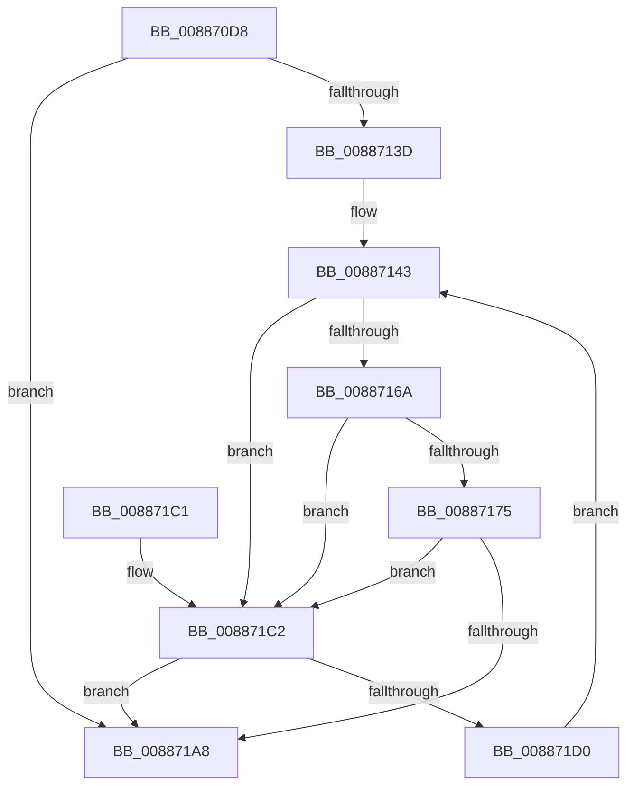

# MiSetVadBits

- RVA: `0x008870D8`–`0x008871D5` (길이 `253` bytes)
- VA: `0x00000001408870D8`
- 실행 섹션: `PAGE`
- PDB 이름 있음: `예`; PDB Function 태그: `아니요`
- unwind 정보 RVA: `0x0007CBB4`
- 디코드: `69`개 명령, `253/253` bytes 표시
- 미해석 바이트: `0` (있으면 어셈블리에 `.byte`로 보존)

> 이 문서는 커널 이미지의 기계어와 PDB 기호를 분석해 생성했습니다. 4번과 5번은 함수 원형과 자료형을 바이너리 사용 방식에서 추정한 C 해석이며 원본 소스 복구 결과는 아닙니다.

## 1. Dependencies

- 직접 호출 지점: **1**; 고유 호출 대상: **1**
- 직접 호출자로 확인된 함수: **2**
- RIP 상대 이미지 참조: **1**

### Outgoing calls
- `0x0088719F` → [RtlSetBitsEx](../../text/3B/RtlSetBitsEx_function_003B6570.md) (function, `0x003B6570`)

### Direct callers
- [MiInsertVadCharges](MiInsertVadCharges_function_00886AA8.md) at `0x00886BB6`
- [MiUpdateVadBits](../A8/MiUpdateVadBits_function_00A8DAC8.md) at `0x00A8DB19`

### Static image references
- `0x0088714B` → RVA `0x00E2F388` (`.data`; read)

## 2. Other-region calls and transfers

- 다른 실행 섹션으로 향하는 call: **1**
  - `0x0088719F` → [RtlSetBitsEx](../../text/3B/RtlSetBitsEx_function_003B6570.md) (`PAGE` → `.text`)
- 별도 외부 분기/꼬리 이동을 확인하지 못했습니다.

## 3. Assembly (complete function range)

```asm
008870D8  48 89 5C 24 08                  mov qword ptr [rsp + 8], rbx
008870DD  48 89 6C 24 10                  mov qword ptr [rsp + 0x10], rbp
008870E2  48 89 74 24 18                  mov qword ptr [rsp + 0x18], rsi
008870E7  57                              push rdi
008870E8  41 56                           push r14
008870EA  41 57                           push r15
008870EC  48 83 EC 20                     sub rsp, 0x20
008870F0  0F B6 79 20                     movzx edi, byte ptr [rcx + 0x20]
008870F4  33 ED                           xor ebp, ebp
008870F6  8B 41 18                        mov eax, dword ptr [rcx + 0x18]
008870F9  0F B6 71 21                     movzx esi, byte ptr [rcx + 0x21]
008870FD  48 C1 E8 04                     shr rax, 4
00887101  48 C1 E7 1C                     shl rdi, 0x1c
00887105  48 0B F8                        or rdi, rax
00887108  48 C1 E6 1C                     shl rsi, 0x1c
0088710C  8B 41 1C                        mov eax, dword ptr [rcx + 0x1c]
0088710F  48 C1 E8 04                     shr rax, 4
00887113  48 0B F0                        or rsi, rax
00887116  65 48 8B 04 25 88 01 00 00      mov rax, qword ptr gs:[0x188]
0088711F  48 8B 88 B8 00 00 00            mov rcx, qword ptr [rax + 0xb8]
00887126  4C 8B B1 10 04 00 00            mov r14, qword ptr [rcx + 0x410]
0088712D  49 81 C6 00 03 00 00            add r14, 0x300
00887134  49 39 AE D8 00 00 00            cmp qword ptr [r14 + 0xd8], rbp
0088713B  76 6B                           jbe 0x1408871a8
0088713D  33 C0                           xor eax, eax
0088713F  44 8D 7D 01                     lea r15d, [rbp + 1]
00887143  48 8D 04 C0                     lea rax, [rax + rax*8]
00887147  49 8D 0C C6                     lea rcx, [r14 + rax*8]
0088714B  48 69 05 32 82 5A 00 00 00 F8 FF  imul rax, qword ptr [rip + 0x5a8232], -0x80000
00887156  4C 8B 49 08                     mov r9, qword ptr [rcx + 8]
0088715A  49 C1 E1 13                     shl r9, 0x13
0088715E  4C 03 C8                        add r9, rax
00887161  49 C1 E9 10                     shr r9, 0x10
00887165  49 3B F1                        cmp rsi, r9
00887168  72 58                           jb 0x1408871c2
0088716A  4C 8B 11                        mov r10, qword ptr [rcx]
0088716D  4D 03 D1                        add r10, r9
00887170  49 3B FA                        cmp rdi, r10
00887173  73 4D                           jae 0x1408871c2
00887175  49 3B F9                        cmp rdi, r9
00887178  4D 8D 42 FF                     lea r8, [r10 - 1]
0088717C  49 8B D1                        mov rdx, r9
0088717F  48 0F 43 D7                     cmovae rdx, rdi
00887183  33 DB                           xor ebx, ebx
00887185  49 3B F9                        cmp rdi, r9
00887188  0F 92 C3                        setb bl
0088718B  49 3B F2                        cmp rsi, r10
0088718E  4C 0F 42 C6                     cmovb r8, rsi
00887192  41 0F 43 DF                     cmovae ebx, r15d
00887196  4C 2B C2                        sub r8, rdx
00887199  49 2B D1                        sub rdx, r9
0088719C  4D 03 C7                        add r8, r15
0088719F  E8 CC F3 B2 FF                  call 0x1403b6570
008871A4  85 DB                           test ebx, ebx
008871A6  75 1A                           jne 0x1408871c2
008871A8  48 8B 5C 24 40                  mov rbx, qword ptr [rsp + 0x40]
008871AD  48 8B 6C 24 48                  mov rbp, qword ptr [rsp + 0x48]
008871B2  48 8B 74 24 50                  mov rsi, qword ptr [rsp + 0x50]
008871B7  48 83 C4 20                     add rsp, 0x20
008871BB  41 5F                           pop r15
008871BD  41 5E                           pop r14
008871BF  5F                              pop rdi
008871C0  C3                              ret
008871C1  CC                              int3
008871C2  41 03 EF                        add ebp, r15d
008871C5  8B C5                           mov eax, ebp
008871C7  49 3B 86 D8 00 00 00            cmp rax, qword ptr [r14 + 0xd8]
008871CE  73 D8                           jae 0x1408871a8
008871D0  E9 6E FF FF FF                  jmp 0x140887143
```

## 4. C-style interpretation (structured pseudocode)

```c
__int64 __fastcall MiSetVadBits(__int64 a1)
{
    __int64 result;
    __int64 v_r10;
    __int64 v_r14;
    __int64 v_rbp;
    __int64 v_rbx;
    __int64 v_rdi;
    __int64 v_rsi;
    __int64 v_rsp;
    unsigned __int64 v_stack_p10;
    unsigned __int64 v_stack_p18;
    unsigned __int64 v_stack_p8;

    v_stack_p8 = v_rbx;
    v_stack_p10 = v_rbp;
    v_stack_p18 = v_rsi;
    v_rsp = (v_rsp) - (32);
    v_rbp = 0;
    result = ((unsigned int)(*(unsigned int *)(a1 + 24))) >> (4);
    v_rdi = (*(unsigned __int8 *)(a1 + 32)) << (28);
    v_rdi = (v_rdi) | (result);
    v_rsi = (*(unsigned __int8 *)(a1 + 33)) << (28);
    result = ((unsigned int)(*(unsigned int *)(a1 + 28))) >> (4);
    v_rsi = (v_rsi) | (result);
    v_r14 = (*(unsigned __int64 *)(*(unsigned __int64 *)(*(unsigned __int64 *)(gs_base + (0 + 392)) + 184) + 1040)) + (768);
    if ((*(unsigned __int64 *)(v_r14 + 216)) <= 0) goto loc_008871A8;
    result = 0;
loc_00887143:
    result = (result + result * 8) * (*(unsigned __int64 *)(v_rip + 5931570));
    a4 = (*(unsigned __int64 *)(v_r14 + result + result * 8 * 8 + 8)) << (19);
    a4 = (a4) + (result);
    a4 = (a4) >> (16);
    if (v_rsi < a4) goto loc_008871C2;
    v_r10 = (*(unsigned __int64 *)(v_r14 + result + result * 8 * 8)) + (a4);
    if (v_rdi >= v_r10) goto loc_008871C2;
    if (v_rdi >= a4) { a4 = v_rdi; }
    v_rbx = 0;
    v_rbx = (v_rdi < a4) ? 1 : 0;
    a3 = v_r10 - 1;
    if (v_rsi < v_r10) { a3 = v_rsi; }
    if (v_rsi >= v_r10) { v_rbx = (unsigned int)(v_rbp + 1); }
    a3 = (a3) - (a4);
    a2 = (a4) - (a4);
    a3 = (a3) + (v_rbp + 1);
    result = RtlSetBitsEx(v_r14 + result + result * 8 * 8, a2, a3, a4);
    if ((unsigned int)(v_rbx) != 0) goto loc_008871C2;
loc_008871A8:
    v_rsp = (v_rsp) + (32);
    return result;
loc_008871C2:
    v_rbp = (unsigned int)((v_stack_p10) + ((unsigned int)(v_rbp + 1)));
    if (((unsigned int)((unsigned int)(v_rbp))) >= (*(unsigned __int64 *)(v_r14 + 216))) goto loc_008871A8;
    goto loc_00887143;
}
```

## 5. (Beta) C Style

```c
int64_t MiSetVadBits(void *Arg1)
{
    uint8_t *arg1 = (uint8_t *)Arg1;

    int64_t result;
    int64_t local_r10;
    int64_t local_r14;
    int64_t local_rbp;
    int64_t local_rbx;
    int64_t local_rdi;
    int64_t local_rsi;
    int64_t local_rsp;
    uint64_t v_stack_p10;
    uint64_t v_stack_p18;
    uint64_t v_stack_p8;

    v_stack_p8 = local_rbx;
    v_stack_p10 = local_rbp;
    v_stack_p18 = local_rsi;
    local_rsp = (local_rsp) - (32);
    local_rbp = 0;
    result = ((uint32_t)(*(uint32_t *)(arg1 + 0x18))) >> (4);
    local_rdi = (*(uint8_t *)(arg1 + 0x20)) << (28);
    local_rdi = (local_rdi) | (result);
    local_rsi = (*(uint8_t *)(arg1 + 0x21)) << (28);
    result = ((uint32_t)(*(uint32_t *)(arg1 + 0x1C))) >> (4);
    local_rsi = (local_rsi) | (result);
    local_r14 = (*(uint64_t *)(*(uint64_t *)(*(uint64_t *)(gs_base + (0 + 0x188)) + 0xB8) + 0x410)) + (768);
    if ((*(uint64_t *)(local_r14 + 0xD8)) <= 0) goto loc_008871A8;
    result = 0;
loc_00887143:
    result = (result + result * 8) * (*(uint64_t *)(v_rip + 0x5A8232));
    a4 = (*(uint64_t *)(local_r14 + result + result * 8 * 8 + 0x8)) << (19);
    a4 = (a4) + (result);
    a4 = (a4) >> (16);
    if (local_rsi < a4) goto loc_008871C2;
    local_r10 = (*(uint64_t *)(local_r14 + result + result * 8 * 8)) + (a4);
    if (local_rdi >= local_r10) goto loc_008871C2;
    if (local_rdi >= a4) { a4 = local_rdi; }
    local_rbx = 0;
    local_rbx = (local_rdi < a4) ? 1 : 0;
    a3 = local_r10 - 1;
    if (local_rsi < local_r10) { a3 = local_rsi; }
    if (local_rsi >= local_r10) { local_rbx = (uint32_t)(local_rbp + 1); }
    a3 = (a3) - (a4);
    a2 = (a4) - (a4);
    a3 = (a3) + (local_rbp + 1);
    result = RtlSetBitsEx(local_r14 + result + result * 8 * 8, a2, a3, a4);
    if ((uint32_t)(local_rbx) != 0) goto loc_008871C2;
loc_008871A8:
    local_rsp = (local_rsp) + (32);
    return result;
loc_008871C2:
    local_rbp = (uint32_t)((v_stack_p10) + ((uint32_t)(local_rbp + 1)));
    if (((uint32_t)((uint32_t)(local_rbp))) >= (*(uint64_t *)(local_r14 + 0xD8))) goto loc_008871A8;
    goto loc_00887143;
}
```

### 관측된 메모리 오프셋

구조체 형식이 확인되지 않은 접근은 인자 기준의 오프셋으로만 기록했습니다.

| 기준 인자 | 오프셋 표현 | 폭 (bit) | 접근 |
|---|---:|---:|---|
| `Arg1` | `+ 0x18` | `32` | `R` |
| `Arg1` | `+ 0x1C` | `32` | `R` |
| `Arg1` | `+ 0x20` | `8` | `R` |
| `Arg1` | `+ 0x21` | `8` | `R` |

## 6. Execution-region graph

[열기: 2D/3D 그래프와 함수 탐색 컨트롤 패널](../../../control-panel.html?section=page&rva=0x008870D8&view=graph)

- 2D 그래프는 위에서 아래로 흐르고, 3D 그래프는 빈 공간을 드래그해 회전합니다. Shift+드래그는 이동, 휠은 확대·축소, 함수 노드 선택은 대상 보고서 이동입니다.

### Static fallback


