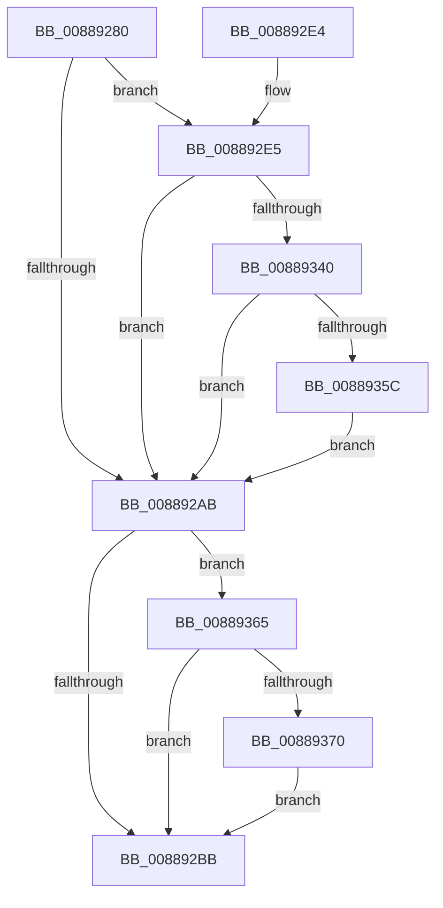

# MiUnmapVad

- RVA: `0x00889280`–`0x00889382` (길이 `258` bytes)
- VA: `0x0000000140889280`
- 실행 섹션: `PAGE`
- PDB 이름 있음: `예`; PDB Function 태그: `아니요`
- unwind 정보 RVA: `0x0007CEE0`
- 디코드: `62`개 명령, `258/258` bytes 표시
- 미해석 바이트: `0` (있으면 어셈블리에 `.byte`로 보존)

> 이 문서는 커널 이미지의 기계어와 PDB 기호를 분석해 생성했습니다. 4번과 5번은 함수 원형과 자료형을 바이너리 사용 방식에서 추정한 C 해석이며 원본 소스 복구 결과는 아닙니다.

## 1. Dependencies

- 직접 호출 지점: **6**; 고유 호출 대상: **6**
- 직접 호출자로 확인된 함수: **5**
- RIP 상대 이미지 참조: **1**

### Outgoing calls
- `0x008892A2` → [MiReadVadFlags2](../../text/45/MiReadVadFlags2_function_00452C1C.md) (function, `0x00452C1C`)
- `0x008892C4` → [MiDeleteVad](MiDeleteVad_function_00888C80.md) (function, `0x00888C80`)
- `0x008892EF` → [MiReferenceControlAreaFile](../../text/43/MiReferenceControlAreaFile_function_00431554.md) (function, `0x00431554`)
- `0x008892FE` → [MiDereferenceControlAreaFile](../../text/43/MiDereferenceControlAreaFile_function_004345E0.md) (function, `0x004345E0`)
- `0x0088934F` → [PfCheckDeprioritizeFile](PfCheckDeprioritizeFile_function_00887F6C.md) (function, `0x00887F6C`)
- `0x00889378` → [MiLogMapFileEvent](../97/MiLogMapFileEvent_function_0097E0FC.md) (function, `0x0097E0FC`)

### Direct callers
- [MiDeletePartialVad](../../text/2A/MiDeletePartialVad_function_002A7A30.md) at `0x002A7ADF`
- [sub_0088535F](Unknown_function_0088535F.md) at `0x008853F0`
- [MiCleanVad](MiCleanVad_function_00889224.md) at `0x0088924A`
- [MiUnmapViewOfSection](MiUnmapViewOfSection_function_0088A4C4.md) at `0x0088A605`
- [MiMapViewOfImageSection](../97/MiMapViewOfImageSection_function_0097E92C.md) at `0x0097F3A1`

### Static image references
- `0x008892AB` → RVA `0x00FC6B00` (`ALMOSTRO`; read)

## 2. Other-region calls and transfers

- 다른 실행 섹션으로 향하는 call: **3**
  - `0x008892A2` → [MiReadVadFlags2](../../text/45/MiReadVadFlags2_function_00452C1C.md) (`PAGE` → `.text`)
  - `0x008892EF` → [MiReferenceControlAreaFile](../../text/43/MiReferenceControlAreaFile_function_00431554.md) (`PAGE` → `.text`)
  - `0x008892FE` → [MiDereferenceControlAreaFile](../../text/43/MiDereferenceControlAreaFile_function_004345E0.md) (`PAGE` → `.text`)
- 별도 외부 분기/꼬리 이동을 확인하지 못했습니다.

## 3. Assembly (complete function range)

```asm
00889280  48 8B C4                        mov rax, rsp
00889283  48 89 58 08                     mov qword ptr [rax + 8], rbx
00889287  48 89 68 10                     mov qword ptr [rax + 0x10], rbp
0088928B  48 89 70 18                     mov qword ptr [rax + 0x18], rsi
0088928F  48 89 78 20                     mov qword ptr [rax + 0x20], rdi
00889293  41 56                           push r14
00889295  48 83 EC 20                     sub rsp, 0x20
00889299  41 8B F0                        mov esi, r8d
0088929C  48 8B EA                        mov rbp, rdx
0088929F  48 8B F9                        mov rdi, rcx
008892A2  E8 75 99 BC FF                  call 0x140452c1c
008892A7  A8 02                           test al, 2
008892A9  75 3A                           jne 0x1408892e5
008892AB  F7 05 4B D8 73 00 00 80 00 00   test dword ptr [rip + 0x73d84b], 0x8000
008892B5  0F 85 AA 00 00 00               jne 0x140889365
008892BB  44 8B C6                        mov r8d, esi
008892BE  48 8B D5                        mov rdx, rbp
008892C1  48 8B CF                        mov rcx, rdi
008892C4  E8 B7 F9 FF FF                  call 0x140888c80
008892C9  48 8B 5C 24 30                  mov rbx, qword ptr [rsp + 0x30]
008892CE  48 8B 6C 24 38                  mov rbp, qword ptr [rsp + 0x38]
008892D3  48 8B 74 24 40                  mov rsi, qword ptr [rsp + 0x40]
008892D8  48 8B 7C 24 48                  mov rdi, qword ptr [rsp + 0x48]
008892DD  48 83 C4 20                     add rsp, 0x20
008892E1  41 5E                           pop r14
008892E3  C3                              ret
008892E4  CC                              int3
008892E5  48 8B 41 48                     mov rax, qword ptr [rcx + 0x48]
008892E9  48 8B 18                        mov rbx, qword ptr [rax]
008892EC  48 8B CB                        mov rcx, rbx
008892EF  E8 60 82 BA FF                  call 0x140431554
008892F4  48 8B D0                        mov rdx, rax
008892F7  48 8B CB                        mov rcx, rbx
008892FA  4C 8B 70 18                     mov r14, qword ptr [rax + 0x18]
008892FE  E8 DD B2 BA FF                  call 0x1404345e0
00889303  65 48 8B 04 25 88 01 00 00      mov rax, qword ptr gs:[0x188]
0088930C  44 0F B6 4F 21                  movzx r9d, byte ptr [rdi + 0x21]
00889311  0F B6 57 20                     movzx edx, byte ptr [rdi + 0x20]
00889315  49 C1 E1 20                     shl r9, 0x20
00889319  48 8B 88 B8 00 00 00            mov rcx, qword ptr [rax + 0xb8]
00889320  8B 47 1C                        mov eax, dword ptr [rdi + 0x1c]
00889323  4C 0B C8                        or r9, rax
00889326  48 C1 E2 20                     shl rdx, 0x20
0088932A  8B 47 18                        mov eax, dword ptr [rdi + 0x18]
0088932D  48 0B D0                        or rdx, rax
00889330  F7 81 F4 01 00 00 00 40 00 00   test dword ptr [rcx + 0x1f4], 0x4000
0088933A  0F 84 6B FF FF FF               je 0x1408892ab
00889340  4C 2B CA                        sub r9, rdx
00889343  4D 8B C6                        mov r8, r14
00889346  8B 91 84 03 00 00               mov edx, dword ptr [rcx + 0x384]
0088934C  49 FF C1                        inc r9
0088934F  E8 18 EC FF FF                  call 0x140887f6c
00889354  85 C0                           test eax, eax
00889356  0F 84 4F FF FF FF               je 0x1408892ab
0088935C  0F BA EE 1F                     bts esi, 0x1f
00889360  E9 46 FF FF FF                  jmp 0x1408892ab
00889365  48 83 7F 48 00                  cmp qword ptr [rdi + 0x48], 0
0088936A  0F 84 4B FF FF FF               je 0x1408892bb
00889370  BA 26 04 00 00                  mov edx, 0x426
00889375  48 8B CF                        mov rcx, rdi
00889378  E8 7F 4D 0F 00                  call 0x14097e0fc
0088937D  E9 39 FF FF FF                  jmp 0x1408892bb
```

## 4. C-style interpretation (structured pseudocode)

```c
__int64 __fastcall MiUnmapVad(__int64 a1, __int64 a2, int a3)
{
    __int64 result;
    __int64 v_rsp;
    unsigned __int64 v_stack_p10;
    unsigned __int64 v_stack_p18;
    unsigned __int64 v_stack_p20;
    unsigned __int64 v_stack_p8;

    *(unsigned __int64 *)(v_rsp + 8) = v_rbx;
    *(unsigned __int64 *)(v_rsp + 16) = v_rbp;
    *(unsigned __int64 *)(v_rsp + 24) = v_rsi;
    *(unsigned __int64 *)(v_rsp + 32) = v_rdi;
    v_rsp = (v_rsp) - (32);
    result = MiReadVadFlags2(a1, a2, a3, a4);
    if ((((unsigned __int8)(result)) & (2)) != 0) goto loc_008892E5;
loc_008892AB:
    if (((*(unsigned int *)(v_rip + 7592011)) & (0x8000ULL)) != 0) goto loc_00889365;
loc_008892BB:
    result = MiDeleteVad(a1, a2, (unsigned int)((unsigned int)((unsigned int)(a3))), a4);
    v_rsp = (v_rsp) + (32);
    return result;
loc_008892E5:
    result = MiReferenceControlAreaFile(*(unsigned __int64 *)(*(unsigned __int64 *)(a1 + 72)), a2, (unsigned int)((unsigned int)((unsigned int)(a3))), a4);
    result = MiDereferenceControlAreaFile(*(unsigned __int64 *)(*(unsigned __int64 *)(a1 + 72)), result, (unsigned int)((unsigned int)((unsigned int)(a3))), a4);
    a4 = (*(unsigned __int8 *)(v_stack_p20 + 33)) << (32);
    a4 = (a4) | ((unsigned int)(*(unsigned int *)(v_stack_p20 + 28)));
    a2 = (*(unsigned __int8 *)(v_stack_p20 + 32)) << (32);
    a2 = (a2) | ((unsigned int)(*(unsigned int *)(v_stack_p20 + 24)));
    if (((*(unsigned int *)(*(unsigned __int64 *)(*(unsigned __int64 *)(gs_base + (0 + 392)) + 184) + 500)) & (0x4000ULL)) == 0) goto loc_008892AB;
    a4 = (a4) - (a2);
    a4 = (a4) + 1;
    result = PfCheckDeprioritizeFile(*(unsigned __int64 *)(*(unsigned __int64 *)(gs_base + (0 + 392)) + 184), (unsigned int)(*(unsigned int *)(*(unsigned __int64 *)(*(unsigned __int64 *)(gs_base + (0 + 392)) + 184) + 900)), *(unsigned __int64 *)(result + 24), a4);
    if ((unsigned int)(result) == 0) goto loc_008892AB;
    goto loc_008892AB;
loc_00889365:
    if ((*(unsigned __int64 *)(v_stack_p20 + 72)) == 0) goto loc_008892BB;
    result = MiLogMapFileEvent(v_stack_p20, (unsigned int)(0x426ULL), *(unsigned __int64 *)(result + 24), a4);
    goto loc_008892BB;
}
```

## 5. (Beta) C Style

```c
int64_t MiUnmapVad(void *Arg1, int64_t Arg2, int32_t Arg3)
{
    uint8_t *arg1 = (uint8_t *)Arg1;

    int64_t result;
    int64_t local_rsp;
    uint64_t v_stack_p10;
    uint64_t v_stack_p18;
    uint64_t v_stack_p20;
    uint64_t v_stack_p8;

    *(uint64_t *)(local_rsp + 0x8) = local_rbx;
    *(uint64_t *)(local_rsp + 0x10) = local_rbp;
    *(uint64_t *)(local_rsp + 0x18) = local_rsi;
    *(uint64_t *)(local_rsp + 0x20) = local_rdi;
    local_rsp = (local_rsp) - (32);
    result = MiReadVadFlags2(Arg1, Arg2, Arg3, a4);
    if ((((uint8_t)(result)) & (2)) != 0) goto loc_008892E5;
loc_008892AB:
    if (((*(uint32_t *)(v_rip + 0x73D84B)) & (0x8000ULL)) != 0) goto loc_00889365;
loc_008892BB:
    result = MiDeleteVad(Arg1, Arg2, (uint32_t)((uint32_t)((uint32_t)(Arg3))), a4);
    local_rsp = (local_rsp) + (32);
    return result;
loc_008892E5:
    result = MiReferenceControlAreaFile(*(uint64_t *)(*(uint64_t *)(arg1 + 0x48)), Arg2, (uint32_t)((uint32_t)((uint32_t)(Arg3))), a4);
    result = MiDereferenceControlAreaFile(*(uint64_t *)(*(uint64_t *)(arg1 + 0x48)), result, (uint32_t)((uint32_t)((uint32_t)(Arg3))), a4);
    a4 = (*(uint8_t *)(v_stack_p20 + 0x21)) << (32);
    a4 = (a4) | ((uint32_t)(*(uint32_t *)(v_stack_p20 + 0x1C)));
    Arg2 = (*(uint8_t *)(v_stack_p20 + 0x20)) << (32);
    Arg2 = (Arg2) | ((uint32_t)(*(uint32_t *)(v_stack_p20 + 0x18)));
    if (((*(uint32_t *)(*(uint64_t *)(*(uint64_t *)(gs_base + (0 + 0x188)) + 0xB8) + 0x1F4)) & (0x4000ULL)) == 0) goto loc_008892AB;
    a4 = (a4) - (Arg2);
    a4 = (a4) + 1;
    result = PfCheckDeprioritizeFile(*(uint64_t *)(*(uint64_t *)(gs_base + (0 + 0x188)) + 0xB8), (uint32_t)(*(uint32_t *)(*(uint64_t *)(*(uint64_t *)(gs_base + (0 + 0x188)) + 0xB8) + 0x384)), *(uint64_t *)(result + 0x18), a4);
    if ((uint32_t)(result) == 0) goto loc_008892AB;
    goto loc_008892AB;
loc_00889365:
    if ((*(uint64_t *)(v_stack_p20 + 0x48)) == 0) goto loc_008892BB;
    result = MiLogMapFileEvent(v_stack_p20, (uint32_t)(0x426ULL), *(uint64_t *)(result + 0x18), a4);
    goto loc_008892BB;
}
```

### 관측된 메모리 오프셋

구조체 형식이 확인되지 않은 접근은 인자 기준의 오프셋으로만 기록했습니다.

| 기준 인자 | 오프셋 표현 | 폭 (bit) | 접근 |
|---|---:|---:|---|
| `Arg1` | `+ 0x18` | `32` | `R` |
| `Arg1` | `+ 0x1C` | `32` | `R` |
| `Arg1` | `+ 0x20` | `8` | `R` |
| `Arg1` | `+ 0x21` | `8` | `R` |
| `Arg1` | `+ 0x48` | `64` | `R` |

## 6. Execution-region graph

[열기: 2D/3D 그래프와 함수 탐색 컨트롤 패널](../../../control-panel.html?section=page&rva=0x00889280&view=graph)

- 2D 그래프는 위에서 아래로 흐르고, 3D 그래프는 빈 공간을 드래그해 회전합니다. Shift+드래그는 이동, 휠은 확대·축소, 함수 노드 선택은 대상 보고서 이동입니다.

### Static fallback


