# MiUnmapViewOfSection

- RVA: `0x0088A4C4`–`0x0088A89C` (길이 `984` bytes)
- VA: `0x000000014088A4C4`
- 실행 섹션: `PAGE`
- PDB 이름 있음: `예`; PDB Function 태그: `아니요`
- unwind 정보 RVA: `0x0007D120`
- 디코드: `248`개 명령, `984/984` bytes 표시
- 미해석 바이트: `0` (있으면 어셈블리에 `.byte`로 보존)

> 이 문서는 커널 이미지의 기계어와 PDB 기호를 분석해 생성했습니다. 4번과 5번은 함수 원형과 자료형을 바이너리 사용 방식에서 추정한 C 해석이며 원본 소스 복구 결과는 아닙니다.

## 1. Dependencies

- 직접 호출 지점: **19**; 고유 호출 대상: **18**
- 직접 호출자로 확인된 함수: **14**
- RIP 상대 이미지 참조: **2**

### Outgoing calls
- `0x0088A541` → [KeStackAttachProcess](../../text/21/KeStackAttachProcess_function_00216800.md) (function, `0x00216800`)
- `0x0088A559` → [MiObtainReferencedVadEx](../../text/31/MiObtainReferencedVadEx_function_00316690.md) (function, `0x00316690`)
- `0x0088A605` → [MiUnmapVad](MiUnmapVad_function_00889280.md) (function, `0x00889280`)
- `0x0088A61A` → [KiUnstackDetachProcess](../../text/21/KiUnstackDetachProcess_function_00217D30.md) (function, `0x00217D30`)
- `0x0088A634` → [_security_check_cookie](../../text/6A/_security_check_cookie_function_006AC640.md) (function, `0x006AC640`)
- `0x0088A65B` → [DbgkUnMapViewOfSection](../A3/DbgkUnMapViewOfSection_function_00A3B18C.md) (function, `0x00A3B18C`)
- `0x0088A698` → [MiCheckSecuredVad](MiCheckSecuredVad_function_00881FB4.md) (function, `0x00881FB4`)
- `0x0088A722` → [MiReferenceControlAreaFile](../../text/43/MiReferenceControlAreaFile_function_00431554.md) (function, `0x00431554`)
- `0x0088A72D` → [MiReadVadFlags2](../../text/45/MiReadVadFlags2_function_00452C1C.md) (function, `0x00452C1C`)
- `0x0088A77F` → [PerfLogImageUnload](../A2/PerfLogImageUnload_function_00A2216C.md) (function, `0x00A2216C`)
- `0x0088A78A` → [MiDereferenceControlAreaFile](../../text/43/MiDereferenceControlAreaFile_function_004345E0.md) (function, `0x004345E0`)
- `0x0088A7AA` → [MiUnlockAndDereferenceVad](../../text/31/MiUnlockAndDereferenceVad_function_00316E60.md) (function, `0x00316E60`)
- `0x0088A7B4` → [MiDeleteVad](MiDeleteVad_function_00888C80.md) (function, `0x00888C80`)
- `0x0088A7C1` → [MiVadMapsLargeImage](../../text/2A/MiVadMapsLargeImage_function_002A70F0.md) (function, `0x002A70F0`)
- `0x0088A7D3` → [MiLocateLockedVadEvent](../../text/2A/MiLocateLockedVadEvent_function_002A7A0C.md) (function, `0x002A7A0C`)
- `0x0088A820` → [MiLocateLockedVadEvent](../../text/2A/MiLocateLockedVadEvent_function_002A7A0C.md) (function, `0x002A7A0C`)
- `0x0088A83F` → [KeAbPreAcquire](../../text/21/KeAbPreAcquire_function_00210230.md) (function, `0x00210230`)
- `0x0088A858` → [ExfAcquirePushLockExclusiveEx](../../text/20/ExfAcquirePushLockExclusiveEx_function_0020FC90.md) (function, `0x0020FC90`)
- `0x0088A878` → [MiUpdateVadStartVpn](../../text/45/MiUpdateVadStartVpn_function_00450ED4.md) (function, `0x00450ED4`)

### Direct callers
- [IopCloseIoRing](../71/IopCloseIoRing_function_0071F860.md) at `0x0071F87D`
- [PsShutdownSystem](../78/PsShutdownSystem_function_00785E94.md) at `0x0078609C`
- [NtMapCMFModule](../7D/NtMapCMFModule_function_007D4310.md) at `0x007D4CCD`
- [MiFinalizeLagePageImageMapping](../7F/MiFinalizeLagePageImageMapping_function_007FE454.md) at `0x007FE4DA`
- [MmUnmapViewOfSection](MmUnmapViewOfSection_function_0088A310.md) at `0x0088A31A`
- [sub_0088A3A2](Unknown_function_0088A3A2.md) at `0x0088A3AA`
- [sub_0088A40D](Unknown_function_0088A40D.md) at `0x0088A47A`
- [AlpcViewDestroyProcedure](AlpcViewDestroyProcedure_function_0088B080.md) at `0x0088B1FF`
- [MiUnmapImageInSystemSpace](../94/MiUnmapImageInSystemSpace_function_0094206C.md) at `0x009420BD`
- [EtwpCoverageEnsureUserModeView](../98/EtwpCoverageEnsureUserModeView_function_00980584.md) at `0x0098078E`
- [PspSchedulerSharedDataRegionDelete](../A7/PspSchedulerSharedDataRegionDelete_function_00A777A0.md) at `0x00A777C2`
- [MiUnmapImageForEnclaveUse](../AB/MiUnmapImageForEnclaveUse_function_00AB90C4.md) at `0x00AB9111`
- [sub_00B19B64](../B1/Unknown_function_00B19B64.md) at `0x00B19BC5`
- [MmInitializeImageViewExtension](../../init/C6/MmInitializeImageViewExtension_function_00C64F08.md) at `0x00C64F9E`

### Static image references
- `0x0088A4E0` → RVA `0x00E0A740` (`.data`; read)
- `0x0088A5DB` → RVA `0x00FC6B00` (`ALMOSTRO`; read)

## 2. Other-region calls and transfers

- 다른 실행 섹션으로 향하는 call: **14**
  - `0x0088A541` → [KeStackAttachProcess](../../text/21/KeStackAttachProcess_function_00216800.md) (`PAGE` → `.text`)
  - `0x0088A559` → [MiObtainReferencedVadEx](../../text/31/MiObtainReferencedVadEx_function_00316690.md) (`PAGE` → `.text`)
  - `0x0088A61A` → [KiUnstackDetachProcess](../../text/21/KiUnstackDetachProcess_function_00217D30.md) (`PAGE` → `.text`)
  - `0x0088A634` → [_security_check_cookie](../../text/6A/_security_check_cookie_function_006AC640.md) (`PAGE` → `.text`)
  - `0x0088A722` → [MiReferenceControlAreaFile](../../text/43/MiReferenceControlAreaFile_function_00431554.md) (`PAGE` → `.text`)
  - `0x0088A72D` → [MiReadVadFlags2](../../text/45/MiReadVadFlags2_function_00452C1C.md) (`PAGE` → `.text`)
  - `0x0088A78A` → [MiDereferenceControlAreaFile](../../text/43/MiDereferenceControlAreaFile_function_004345E0.md) (`PAGE` → `.text`)
  - `0x0088A7AA` → [MiUnlockAndDereferenceVad](../../text/31/MiUnlockAndDereferenceVad_function_00316E60.md) (`PAGE` → `.text`)
  - `0x0088A7C1` → [MiVadMapsLargeImage](../../text/2A/MiVadMapsLargeImage_function_002A70F0.md) (`PAGE` → `.text`)
  - `0x0088A7D3` → [MiLocateLockedVadEvent](../../text/2A/MiLocateLockedVadEvent_function_002A7A0C.md) (`PAGE` → `.text`)
  - `0x0088A820` → [MiLocateLockedVadEvent](../../text/2A/MiLocateLockedVadEvent_function_002A7A0C.md) (`PAGE` → `.text`)
  - `0x0088A83F` → [KeAbPreAcquire](../../text/21/KeAbPreAcquire_function_00210230.md) (`PAGE` → `.text`)
  - `0x0088A858` → [ExfAcquirePushLockExclusiveEx](../../text/20/ExfAcquirePushLockExclusiveEx_function_0020FC90.md) (`PAGE` → `.text`)
  - `0x0088A878` → [MiUpdateVadStartVpn](../../text/45/MiUpdateVadStartVpn_function_00450ED4.md) (`PAGE` → `.text`)
- 별도 외부 분기/꼬리 이동을 확인하지 못했습니다.

## 3. Assembly (complete function range)

```asm
0088A4C4  48 89 5C 24 20                  mov qword ptr [rsp + 0x20], rbx
0088A4C9  55                              push rbp
0088A4CA  56                              push rsi
0088A4CB  57                              push rdi
0088A4CC  41 54                           push r12
0088A4CE  41 55                           push r13
0088A4D0  41 56                           push r14
0088A4D2  41 57                           push r15
0088A4D4  48 8D 6C 24 D9                  lea rbp, [rsp - 0x27]
0088A4D9  48 81 EC A0 00 00 00            sub rsp, 0xa0
0088A4E0  48 8B 05 59 02 58 00            mov rax, qword ptr [rip + 0x580259]
0088A4E7  48 33 C4                        xor rax, rsp
0088A4EA  48 89 45 1F                     mov qword ptr [rbp + 0x1f], rax
0088A4EE  83 65 D7 00                     and dword ptr [rbp - 0x29], 0
0088A4F2  0F 57 C0                        xorps xmm0, xmm0
0088A4F5  83 65 DF 00                     and dword ptr [rbp - 0x21], 0
0088A4F9  33 FF                           xor edi, edi
0088A4FB  0F 11 45 EF                     movups xmmword ptr [rbp - 0x11], xmm0
0088A4FF  45 33 ED                        xor r13d, r13d
0088A502  4C 8B F1                        mov r14, rcx
0088A505  0F 11 45 FF                     movups xmmword ptr [rbp - 1], xmm0
0088A509  41 81 E1 00 00 00 04            and r9d, 0x4000000
0088A510  44 89 45 DB                     mov dword ptr [rbp - 0x25], r8d
0088A514  0F 11 45 0F                     movups xmmword ptr [rbp + 0xf], xmm0
0088A518  65 48 8B 04 25 88 01 00 00      mov rax, qword ptr gs:[0x188]
0088A521  4C 8B FA                        mov r15, rdx
0088A524  44 89 4D E7                     mov dword ptr [rbp - 0x19], r9d
0088A528  48 8B 88 B8 00 00 00            mov rcx, qword ptr [rax + 0xb8]
0088A52F  0F 85 78 01 00 00               jne 0x14088a6ad
0088A535  49 3B CE                        cmp rcx, r14
0088A538  74 13                           je 0x14088a54d
0088A53A  48 8D 55 EF                     lea rdx, [rbp - 0x11]
0088A53E  49 8B CE                        mov rcx, r14
0088A541  E8 BA C2 98 FF                  call 0x140216800
0088A546  C7 45 DF 01 00 00 00            mov dword ptr [rbp - 0x21], 1
0088A54D  4C 8D 45 D7                     lea r8, [rbp - 0x29]
0088A551  BA 01 00 00 00                  mov edx, 1
0088A556  49 8B CF                        mov rcx, r15
0088A559  E8 32 C1 A8 FF                  call 0x140316690
0088A55E  48 8B D8                        mov rbx, rax
0088A561  48 85 C0                        test rax, rax
0088A564  0F 84 90 02 00 00               je 0x14088a7fa
0088A56A  8B 50 30                        mov edx, dword ptr [rax + 0x30]
0088A56D  8B CA                           mov ecx, edx
0088A56F  C1 E9 04                        shr ecx, 4
0088A572  0F BA E2 15                     bt edx, 0x15
0088A576  0F 82 18 02 00 00               jb 0x14088a794
0088A57C  44 0F B6 43 20                  movzx r8d, byte ptr [rbx + 0x20]
0088A581  80 E1 07                        and cl, 7
0088A584  44 8B 4B 18                     mov r9d, dword ptr [rbx + 0x18]
0088A588  41 8B F0                        mov esi, r8d
0088A58B  48 C1 E6 20                     shl rsi, 0x20
0088A58F  49 0B F1                        or rsi, r9
0088A592  48 C1 E6 0C                     shl rsi, 0xc
0088A596  80 F9 02                        cmp cl, 2
0088A599  0F 84 2A 01 00 00               je 0x14088a6c9
0088A59F  44 0F B6 63 21                  movzx r12d, byte ptr [rbx + 0x21]
0088A5A4  8B 43 1C                        mov eax, dword ptr [rbx + 0x1c]
0088A5A7  49 C1 E4 20                     shl r12, 0x20
0088A5AB  4C 0B E0                        or r12, rax
0088A5AE  49 C1 E0 20                     shl r8, 0x20
0088A5B2  4D 0B C1                        or r8, r9
0088A5B5  4D 2B E0                        sub r12, r8
0088A5B8  49 FF C4                        inc r12
0088A5BB  49 C1 E4 0C                     shl r12, 0xc
0088A5BF  F6 C2 08                        test dl, 8
0088A5C2  0F 85 9A 00 00 00               jne 0x14088a662
0088A5C8  44 39 6D E7                     cmp dword ptr [rbp - 0x19], r13d
0088A5CC  0F 85 41 02 00 00               jne 0x14088a813
0088A5D2  48 85 FF                        test rdi, rdi
0088A5D5  0F 85 E3 01 00 00               jne 0x14088a7be
0088A5DB  8B 05 1F C5 73 00               mov eax, dword ptr [rip + 0x73c51f]
0088A5E1  A8 04                           test al, 4
0088A5E3  74 09                           je 0x14088a5ee
0088A5E5  48 85 FF                        test rdi, rdi
0088A5E8  0F 85 F0 00 00 00               jne 0x14088a6de
0088A5EE  8B 43 30                        mov eax, dword ptr [rbx + 0x30]
0088A5F1  49 8B D5                        mov rdx, r13
0088A5F4  44 8B 45 DB                     mov r8d, dword ptr [rbp - 0x25]
0088A5F8  24 70                           and al, 0x70
0088A5FA  48 8B CB                        mov rcx, rbx
0088A5FD  3C 10                           cmp al, 0x10
0088A5FF  0F 84 AF 01 00 00               je 0x14088a7b4
0088A605  E8 76 EC FF FF                  call 0x140889280
0088A60A  83 65 D7 00                     and dword ptr [rbp - 0x29], 0
0088A60E  83 7D DF 00                     cmp dword ptr [rbp - 0x21], 0
0088A612  74 0B                           je 0x14088a61f
0088A614  33 D2                           xor edx, edx
0088A616  48 8D 4D EF                     lea rcx, [rbp - 0x11]
0088A61A  E8 11 D7 98 FF                  call 0x140217d30
0088A61F  83 7D D7 00                     cmp dword ptr [rbp - 0x29], 0
0088A623  7C 05                           jl 0x14088a62a
0088A625  48 85 FF                        test rdi, rdi
0088A628  75 2B                           jne 0x14088a655
0088A62A  8B 45 D7                        mov eax, dword ptr [rbp - 0x29]
0088A62D  48 8B 4D 1F                     mov rcx, qword ptr [rbp + 0x1f]
0088A631  48 33 CC                        xor rcx, rsp
0088A634  E8 07 20 E2 FF                  call 0x1406ac640
0088A639  48 8B 9C 24 F8 00 00 00         mov rbx, qword ptr [rsp + 0xf8]
0088A641  48 81 C4 A0 00 00 00            add rsp, 0xa0
0088A648  41 5F                           pop r15
0088A64A  41 5E                           pop r14
0088A64C  41 5D                           pop r13
0088A64E  41 5C                           pop r12
0088A650  5F                              pop rdi
0088A651  5E                              pop rsi
0088A652  5D                              pop rbp
0088A653  C3                              ret
0088A654  CC                              int3
0088A655  48 8B D7                        mov rdx, rdi
0088A658  49 8B CE                        mov rcx, r14
0088A65B  E8 2C 0B 1B 00                  call 0x140a3b18c
0088A660  EB C8                           jmp 0x14088a62a
0088A662  41 8B 86 F4 01 00 00            mov eax, dword ptr [r14 + 0x1f4]
0088A669  A8 20                           test al, 0x20
0088A66B  0F 85 57 FF FF FF               jne 0x14088a5c8
0088A671  65 48 8B 04 25 88 01 00 00      mov rax, qword ptr gs:[0x188]
0088A67A  41 B9 55 00 00 00               mov r9d, 0x55
0088A680  4C 21 6C 24 28                  and qword ptr [rsp + 0x28], r13
0088A685  4D 8B C4                        mov r8, r12
0088A688  48 8B D6                        mov rdx, rsi
0088A68B  48 8B CB                        mov rcx, rbx
0088A68E  8A 80 32 02 00 00               mov al, byte ptr [rax + 0x232]
0088A694  88 44 24 20                     mov byte ptr [rsp + 0x20], al
0088A698  E8 17 79 FF FF                  call 0x140881fb4
0088A69D  89 45 D7                        mov dword ptr [rbp - 0x29], eax
0088A6A0  85 C0                           test eax, eax
0088A6A2  0F 89 20 FF FF FF               jns 0x14088a5c8
0088A6A8  E9 FA 00 00 00                  jmp 0x14088a7a7
0088A6AD  49 8B C7                        mov rax, r15
0088A6B0  48 25 00 F0 FF FF               and rax, 0xfffffffffffff000
0088A6B6  4C 3B F8                        cmp r15, rax
0088A6B9  0F 84 76 FE FF FF               je 0x14088a535
0088A6BF  B8 F0 00 00 C0                  mov eax, 0xc00000f0
0088A6C4  E9 64 FF FF FF                  jmp 0x14088a62d
0088A6C9  8B C2                           mov eax, edx
0088A6CB  25 80 0F 00 00                  and eax, 0xf80
0088A6D0  3D 80 03 00 00                  cmp eax, 0x380
0088A6D5  48 0F 44 FE                     cmove rdi, rsi
0088A6D9  E9 C1 FE FF FF                  jmp 0x14088a59f
0088A6DE  49 83 BE D0 01 00 00 00         cmp qword ptr [r14 + 0x1d0], 0
0088A6E6  0F 84 02 FF FF FF               je 0x14088a5ee
0088A6EC  41 F7 86 FC 05 00 00 00 10 00 00  test dword ptr [r14 + 0x5fc], 0x1000
0088A6F7  0F 85 F1 FE FF FF               jne 0x14088a5ee
0088A6FD  48 8B 43 48                     mov rax, qword ptr [rbx + 0x48]
0088A701  48 8B 30                        mov rsi, qword ptr [rax]
0088A704  48 85 F6                        test rsi, rsi
0088A707  0F 84 E1 FE FF FF               je 0x14088a5ee
0088A70D  48 83 7E 40 00                  cmp qword ptr [rsi + 0x40], 0
0088A712  0F 84 D6 FE FF FF               je 0x14088a5ee
0088A718  48 8B 06                        mov rax, qword ptr [rsi]
0088A71B  48 8B CE                        mov rcx, rsi
0088A71E  48 89 45 E7                     mov qword ptr [rbp - 0x19], rax
0088A722  E8 2D 6E BA FF                  call 0x140431554
0088A727  48 8B CB                        mov rcx, rbx
0088A72A  4C 8B F8                        mov r15, rax
0088A72D  E8 EA 84 BC FF                  call 0x140452c1c
0088A732  48 8B 4D E7                     mov rcx, qword ptr [rbp - 0x19]
0088A736  A8 08                           test al, 8
0088A738  0F 85 B2 00 00 00               jne 0x14088a7f0
0088A73E  0F B6 41 0F                     movzx eax, byte ptr [rcx + 0xf]
0088A742  8B D0                           mov edx, eax
0088A744  44 8B C0                        mov r8d, eax
0088A747  41 83 E0 0F                     and r8d, 0xf
0088A74B  C1 EA 04                        shr edx, 4
0088A74E  83 E2 07                        and edx, 7
0088A751  48 8B 41 38                     mov rax, qword ptr [rcx + 0x38]
0088A755  4C 8B CF                        mov r9, rdi
0088A758  C7 44 24 40 01 00 00 00         mov dword ptr [rsp + 0x40], 1
0088A760  49 8D 4F 58                     lea rcx, [r15 + 0x58]
0088A764  89 54 24 38                     mov dword ptr [rsp + 0x38], edx
0088A768  49 8B D7                        mov rdx, r15
0088A76B  44 89 44 24 30                  mov dword ptr [rsp + 0x30], r8d
0088A770  4D 8B C6                        mov r8, r14
0088A773  8B 40 3C                        mov eax, dword ptr [rax + 0x3c]
0088A776  89 44 24 28                     mov dword ptr [rsp + 0x28], eax
0088A77A  4C 89 64 24 20                  mov qword ptr [rsp + 0x20], r12
0088A77F  E8 E8 79 19 00                  call 0x140a2216c
0088A784  49 8B D7                        mov rdx, r15
0088A787  48 8B CE                        mov rcx, rsi
0088A78A  E8 51 9E BA FF                  call 0x1404345e0
0088A78F  E9 5A FE FF FF                  jmp 0x14088a5ee
0088A794  8B C1                           mov eax, ecx
0088A796  24 07                           and al, 7
0088A798  3C 01                           cmp al, 1
0088A79A  0F 84 DC FD FF FF               je 0x14088a57c
0088A7A0  C7 45 D7 19 00 00 C0            mov dword ptr [rbp - 0x29], 0xc0000019
0088A7A7  48 8B CB                        mov rcx, rbx
0088A7AA  E8 B1 C6 A8 FF                  call 0x140316e60
0088A7AF  E9 5A FE FF FF                  jmp 0x14088a60e
0088A7B4  E8 C7 E4 FF FF                  call 0x140888c80
0088A7B9  E9 4C FE FF FF                  jmp 0x14088a60a
0088A7BE  48 8B CB                        mov rcx, rbx
0088A7C1  E8 2A C9 A1 FF                  call 0x1402a70f0
0088A7C6  85 C0                           test eax, eax
0088A7C8  0F 84 0D FE FF FF               je 0x14088a5db
0088A7CE  BA 10 00 00 00                  mov edx, 0x10
0088A7D3  E8 34 D2 A1 FF                  call 0x1402a7a0c
0088A7D8  0F B6 48 08                     movzx ecx, byte ptr [rax + 8]
0088A7DC  4C 8B 60 10                     mov r12, qword ptr [rax + 0x10]
0088A7E0  48 C1 E1 10                     shl rcx, 0x10
0088A7E4  48 03 F9                        add rdi, rcx
0088A7E7  49 C1 E4 0C                     shl r12, 0xc
0088A7EB  E9 EB FD FF FF                  jmp 0x14088a5db
0088A7F0  45 33 C0                        xor r8d, r8d
0088A7F3  33 D2                           xor edx, edx
0088A7F5  E9 57 FF FF FF                  jmp 0x14088a751
0088A7FA  81 7D D7 A0 00 00 C0            cmp dword ptr [rbp - 0x29], 0xc00000a0
0088A801  0F 85 07 FE FF FF               jne 0x14088a60e
0088A807  C7 45 D7 19 00 00 C0            mov dword ptr [rbp - 0x29], 0xc0000019
0088A80E  E9 FB FD FF FF                  jmp 0x14088a60e
0088A813  49 3B F7                        cmp rsi, r15
0088A816  75 78                           jne 0x14088a890
0088A818  BA 80 00 00 00                  mov edx, 0x80
0088A81D  48 8B CB                        mov rcx, rbx
0088A820  E8 E7 D1 A1 FF                  call 0x1402a7a0c
0088A825  48 85 C0                        test rax, rax
0088A828  74 66                           je 0x14088a890
0088A82A  4C 8B 68 08                     mov r13, qword ptr [rax + 8]
0088A82E  45 33 C0                        xor r8d, r8d
0088A831  48 83 60 08 00                  and qword ptr [rax + 8], 0
0088A836  33 D2                           xor edx, edx
0088A838  49 8D 75 28                     lea rsi, [r13 + 0x28]
0088A83C  48 8B CE                        mov rcx, rsi
0088A83F  E8 EC 59 98 FF                  call 0x140210230
0088A844  F0 48 0F BA 2E 00               lock bts qword ptr [rsi], 0
0088A84A  4C 8B F8                        mov r15, rax
0088A84D  73 0E                           jae 0x14088a85d
0088A84F  4C 8B C6                        mov r8, rsi
0088A852  48 8B D0                        mov rdx, rax
0088A855  48 8B CE                        mov rcx, rsi
0088A858  E8 33 54 98 FF                  call 0x14020fc90
0088A85D  4D 85 FF                        test r15, r15
0088A860  74 05                           je 0x14088a867
0088A862  41 C6 47 0A 01                  mov byte ptr [r15 + 0xa], 1
0088A867  0F B6 53 20                     movzx edx, byte ptr [rbx + 0x20]
0088A86B  49 8B CD                        mov rcx, r13
0088A86E  8B 43 18                        mov eax, dword ptr [rbx + 0x18]
0088A871  48 C1 E2 20                     shl rdx, 0x20
0088A875  48 0B D0                        or rdx, rax
0088A878  E8 57 66 BC FF                  call 0x140450ed4
0088A87D  8A 4B 21                        mov cl, byte ptr [rbx + 0x21]
0088A880  8B 43 1C                        mov eax, dword ptr [rbx + 0x1c]
0088A883  41 88 4D 21                     mov byte ptr [r13 + 0x21], cl
0088A887  41 89 45 1C                     mov dword ptr [r13 + 0x1c], eax
0088A88B  E9 42 FD FF FF                  jmp 0x14088a5d2
0088A890  C7 45 D7 18 00 00 C0            mov dword ptr [rbp - 0x29], 0xc0000018
0088A897  E9 0B FF FF FF                  jmp 0x14088a7a7
```

## 4. C-style interpretation (structured pseudocode)

```c
__int64 __fastcall MiUnmapViewOfSection(__int64 a1, __int64 a2, int a3, int a4)
{
    __int64 result;
    __int64 v_r12;
    __int64 v_r13;
    __int64 v_rdi;
    __int64 v_rsi;
    __int64 v_rsp;
    unsigned __int64 v_stack_m40;
    unsigned __int64 v_stack_m50;
    unsigned __int64 v_stack_m5F;
    unsigned __int64 v_stack_m60;
    unsigned __int64 v_stack_m70;
    unsigned int v_stack_m78;
    unsigned int v_stack_m80;
    unsigned int v_stack_m84;
    unsigned int v_stack_m88;
    unsigned __int64 v_stack_p20;
    unsigned __int64 v_stack_p28;
    unsigned int v_stack_p30;
    unsigned int v_stack_p38;
    unsigned int v_stack_p40;

    v_stack_p20 = v_rbx;
    v_rsp = (v_rsp) - (160);
    result = (*(unsigned __int64 *)(v_rip + 5767769)) ^ (v_rsp);
    v_stack_m40 = result;
    v_rdi = 0;
    v_stack_m70 = v_xmm0;
    v_r13 = 0;
    v_stack_m60 = v_xmm0;
    a4 = (unsigned int)((a4) & (0x4000000ULL));
    v_stack_m84 = a3;
    v_stack_m50 = v_xmm0;
    v_stack_m78 = a4;
    if (condition_is_not_equal) goto loc_0088A6AD;
loc_0088A535:
    result = *(unsigned __int64 *)(gs_base + (0 + 392));
    if ((*(unsigned __int64 *)(*(unsigned __int64 *)(gs_base + (0 + 392)) + 184)) != a1) {
        a2 = v_stack_m70;
        a1 = a1;
        result = KeStackAttachProcess(a1, a2, a3, a4);
        v_stack_m80 = 1;
    }
    result = MiObtainReferencedVadEx(a2, 1, v_stack_m88, a4);
    if (result == 0) goto loc_0088A7FA;
    a1 = (unsigned int)(((unsigned int)((unsigned int)((unsigned int)(*(unsigned int *)(result + 48))))) >> (4));
    if (condition_is_below) goto loc_0088A794;
loc_0088A57C:
    a1 = (unsigned __int8)((a1) & (7));
    v_rsi = ((unsigned int)((unsigned int)(*(unsigned __int8 *)(result + 32)))) << (32);
    v_rsi = (v_rsi) | ((unsigned int)(*(unsigned int *)(result + 24)));
    v_rsi = (v_rsi) << (12);
    if (((unsigned __int8)(a1)) == 2) goto loc_0088A6C9;
loc_0088A59F:
    v_r12 = (*(unsigned __int8 *)(result + 33)) << (32);
    v_r12 = (v_r12) | ((unsigned int)(*(unsigned int *)(result + 28)));
    a3 = (*(unsigned __int8 *)(result + 32)) << (32);
    a3 = (a3) | ((unsigned int)(*(unsigned int *)(result + 24)));
    v_r12 = (v_r12) - (a3);
    v_r12 = (v_r12) + 1;
    v_r12 = (v_r12) << (12);
    if ((((unsigned __int8)((unsigned int)(*(unsigned int *)(result + 48)))) & (8)) != 0) goto loc_0088A662;
loc_0088A5C8:
    if (v_stack_m78 != 0) goto loc_0088A813;
loc_0088A5D2:
    if (0 != 0) goto loc_0088A7BE;
loc_0088A5DB:
    if ((((unsigned __int8)((unsigned int)(*(unsigned int *)(v_rip + 7587103)))) & (4)) == 0) goto loc_0088A5EE;
    if (0 != 0) goto loc_0088A6DE;
loc_0088A5EE:
    result = (unsigned __int8)(((unsigned int)(*(unsigned int *)(result + 48))) & (112));
    if (((unsigned __int8)(result)) == 16) goto loc_0088A7B4;
    result = MiUnmapVad(result, 0, (unsigned int)(v_stack_m84), (unsigned int)(*(unsigned int *)(result + 24)));
loc_0088A60A:
loc_0088A60E:
    if (v_stack_m80 != 0) {
        a2 = 0;
        a1 = v_stack_m70;
        result = KiUnstackDetachProcess(a1, a2, (unsigned int)(v_stack_m84), (unsigned int)(*(unsigned int *)(result + 24)));
    }
    if (v_stack_m88 < 0) goto loc_0088A62A;
    if (0 != 0) goto loc_0088A655;
loc_0088A62A:
loc_0088A62D:
    a1 = (v_stack_m40) ^ (v_rsp);
    result = _security_check_cookie(a1, a2, (unsigned int)(v_stack_m84), (unsigned int)(*(unsigned int *)(result + 24)));
    v_rsp = (v_rsp) + (160);
    return result;
loc_0088A655:
    result = DbgkUnMapViewOfSection(a1, 0, (unsigned int)(v_stack_m84), (unsigned int)(*(unsigned int *)(result + 24)));
    goto loc_0088A62A;
loc_0088A662:
    if ((((unsigned __int8)((unsigned int)(*(unsigned int *)(a1 + 500)))) & (32)) != 0) goto loc_0088A5C8;
    v_stack_p20 = (unsigned __int8)(*(unsigned __int8 *)(*(unsigned __int64 *)(gs_base + (0 + 392)) + 562));
    result = MiCheckSecuredVad(v_stack_p20, v_rsi, v_r12, 85);
    v_stack_m88 = (unsigned int)(result);
    if (!sign_flag) goto loc_0088A5C8;
    goto loc_0088A7A7;
loc_0088A6AD:
    result = (0) & (0xFFFFFFFFFFFFF000ULL);
    if (0 == result) goto loc_0088A535;
    goto loc_0088A62D;
loc_0088A6C9:
    result = (unsigned int)(((unsigned int)((unsigned int)(v_rsi))) & (0xF80ULL));
    if (((unsigned int)(result)) == 896) { v_rdi = v_rsi; }
    goto loc_0088A59F;
loc_0088A6DE:
    if ((*(unsigned __int64 *)(a1 + 464)) == 0) goto loc_0088A5EE;
    if (((*(unsigned int *)(a1 + 1532)) & (0x1000ULL)) != 0) goto loc_0088A5EE;
    if (*(unsigned __int64 *)(*(unsigned __int64 *)(v_stack_p20 + 72)) == 0) goto loc_0088A5EE;
    if ((*(unsigned __int64 *)(*(unsigned __int64 *)(*(unsigned __int64 *)(v_stack_p20 + 72)) + 64)) == 0) goto loc_0088A5EE;
    v_stack_m78 = *(unsigned __int64 *)(*(unsigned __int64 *)(*(unsigned __int64 *)(v_stack_p20 + 72)));
    result = MiReferenceControlAreaFile(*(unsigned __int64 *)(*(unsigned __int64 *)(v_stack_p20 + 72)), v_rsi, v_r12, 85);
    result = MiReadVadFlags2(v_stack_p20, v_rsi, v_r12, 85);
    if ((((unsigned __int8)(result)) & (8)) != 0) goto loc_0088A7F0;
    a3 = (unsigned int)(((unsigned int)((unsigned int)(*(unsigned __int8 *)(v_stack_m78 + 15)))) & (15));
    a2 = (unsigned int)(((unsigned int)((unsigned int)(*(unsigned __int8 *)(v_stack_m78 + 15)))) >> (4));
    a2 = (unsigned int)((a2) & (7));
loc_0088A751:
    v_stack_p40 = 1;
    v_stack_p38 = (unsigned int)(a2);
    v_stack_p30 = a3;
    v_stack_p28 = (unsigned int)((unsigned int)(*(unsigned int *)(*(unsigned __int64 *)(v_stack_m78 + 56) + 60)));
    v_stack_p20 = v_r12;
    result = PerfLogImageUnload(result + 88, result, a1, v_rdi);
    result = MiDereferenceControlAreaFile(*(unsigned __int64 *)(*(unsigned __int64 *)(v_stack_p20 + 72)), result, a1, v_rdi);
    goto loc_0088A5EE;
loc_0088A794:
    result = (unsigned __int8)(((unsigned int)((unsigned int)(*(unsigned __int64 *)(*(unsigned __int64 *)(v_stack_p20 + 72))))) & (7));
    if (((unsigned __int8)(result)) == 1) goto loc_0088A57C;
    v_stack_m88 = 0xC0000019ULL;
loc_0088A7A7:
    result = MiUnlockAndDereferenceVad(v_stack_p20, result, a1, v_rdi);
    goto loc_0088A60E;
loc_0088A7B4:
    result = MiDeleteVad(v_stack_p20, result, a1, v_rdi);
    goto loc_0088A60A;
loc_0088A7BE:
    result = MiVadMapsLargeImage(v_stack_p20, result, a1, v_rdi);
    if ((unsigned int)(result) == 0) goto loc_0088A5DB;
    result = MiLocateLockedVadEvent(v_stack_p20, 16, a1, v_rdi);
    a1 = (*(unsigned __int8 *)(result + 8)) << (16);
    v_rdi = (v_rdi) + (a1);
    v_r12 = (*(unsigned __int64 *)(result + 16)) << (12);
    goto loc_0088A5DB;
loc_0088A7F0:
    a3 = 0;
    a2 = 0;
    goto loc_0088A751;
loc_0088A7FA:
    if (v_stack_m88 != 0xC00000A0ULL) goto loc_0088A60E;
    v_stack_m88 = 0xC0000019ULL;
    goto loc_0088A60E;
loc_0088A813:
    if ((*(unsigned __int64 *)(*(unsigned __int64 *)(v_stack_p20 + 72))) != result) goto loc_0088A890;
    result = MiLocateLockedVadEvent(v_stack_p20, 128, a3, v_rdi);
    if (result == 0) goto loc_0088A890;
    a3 = 0;
    a2 = 0;
    result = KeAbPreAcquire(*(unsigned __int64 *)(result + 8) + 40, a2, a3, v_rdi);
    if (!(condition_is_above_or_equal)) {
        a3 = *(unsigned __int64 *)(result + 8) + 40;
        a2 = result;
        a1 = *(unsigned __int64 *)(result + 8) + 40;
        result = ExfAcquirePushLockExclusiveEx(a1, a2, a3, v_rdi);
    }
    if (result != 0) {
        *(unsigned __int8 *)(result + 10) = 1;
    }
    a2 = (*(unsigned __int8 *)(v_stack_p20 + 32)) << (32);
    a2 = (a2) | ((unsigned int)(*(unsigned int *)(v_stack_p20 + 24)));
    result = MiUpdateVadStartVpn(*(unsigned __int64 *)(result + 8), a2, a3, v_rdi);
    *(unsigned __int8 *)(*(unsigned __int64 *)(result + 8) + 33) = (unsigned __int8)(*(unsigned __int8 *)(v_stack_p20 + 33));
    *(unsigned int *)(*(unsigned __int64 *)(result + 8) + 28) = (unsigned int)((unsigned int)(*(unsigned int *)(v_stack_p20 + 28)));
    goto loc_0088A5D2;
loc_0088A890:
    v_stack_m88 = 0xC0000018ULL;
    goto loc_0088A7A7;
}
```

## 5. (Beta) C Style

```c
int64_t MiUnmapViewOfSection(void *Arg1, int64_t Arg2, int32_t Arg3, int32_t Arg4)
{
    uint8_t *arg1 = (uint8_t *)Arg1;

    int64_t result;
    int64_t local_r12;
    int64_t local_r13;
    int64_t local_rdi;
    int64_t local_rsi;
    int64_t local_rsp;
    uint64_t v_stack_m40;
    uint64_t v_stack_m50;
    uint64_t v_stack_m5F;
    uint64_t v_stack_m60;
    uint64_t v_stack_m70;
    uint32_t v_stack_m78;
    uint32_t v_stack_m80;
    uint32_t v_stack_m84;
    uint32_t v_stack_m88;
    uint64_t v_stack_p20;
    uint64_t v_stack_p28;
    uint32_t v_stack_p30;
    uint32_t v_stack_p38;
    uint32_t v_stack_p40;

    v_stack_p20 = local_rbx;
    local_rsp = (local_rsp) - (160);
    result = (*(uint64_t *)(v_rip + 0x580259)) ^ (local_rsp);
    v_stack_m40 = result;
    local_rdi = 0;
    v_stack_m70 = v_xmm0;
    local_r13 = 0;
    v_stack_m60 = v_xmm0;
    Arg4 = (uint32_t)((Arg4) & (0x4000000ULL));
    v_stack_m84 = Arg3;
    v_stack_m50 = v_xmm0;
    v_stack_m78 = Arg4;
    if (condition_is_not_equal) goto loc_0088A6AD;
loc_0088A535:
    result = *(uint64_t *)(gs_base + (0 + 0x188));
    if ((*(uint64_t *)(*(uint64_t *)(gs_base + (0 + 0x188)) + 0xB8)) != Arg1) {
        Arg2 = v_stack_m70;
        Arg1 = Arg1;
        result = KeStackAttachProcess(Arg1, Arg2, Arg3, Arg4);
        v_stack_m80 = 1;
    }
    result = MiObtainReferencedVadEx(Arg2, 1, v_stack_m88, Arg4);
    if (result == 0) goto loc_0088A7FA;
    Arg1 = (uint32_t)(((uint32_t)((uint32_t)((uint32_t)(*(uint32_t *)(result + 0x30))))) >> (4));
    if (condition_is_below) goto loc_0088A794;
loc_0088A57C:
    Arg1 = (uint8_t)((Arg1) & (7));
    local_rsi = ((uint32_t)((uint32_t)(*(uint8_t *)(result + 0x20)))) << (32);
    local_rsi = (local_rsi) | ((uint32_t)(*(uint32_t *)(result + 0x18)));
    local_rsi = (local_rsi) << (12);
    if (((uint8_t)(Arg1)) == 2) goto loc_0088A6C9;
loc_0088A59F:
    local_r12 = (*(uint8_t *)(result + 0x21)) << (32);
    local_r12 = (local_r12) | ((uint32_t)(*(uint32_t *)(result + 0x1C)));
    Arg3 = (*(uint8_t *)(result + 0x20)) << (32);
    Arg3 = (Arg3) | ((uint32_t)(*(uint32_t *)(result + 0x18)));
    local_r12 = (local_r12) - (Arg3);
    local_r12 = (local_r12) + 1;
    local_r12 = (local_r12) << (12);
    if ((((uint8_t)((uint32_t)(*(uint32_t *)(result + 0x30)))) & (8)) != 0) goto loc_0088A662;
loc_0088A5C8:
    if (v_stack_m78 != 0) goto loc_0088A813;
loc_0088A5D2:
    if (0 != 0) goto loc_0088A7BE;
loc_0088A5DB:
    if ((((uint8_t)((uint32_t)(*(uint32_t *)(v_rip + 0x73C51F)))) & (4)) == 0) goto loc_0088A5EE;
    if (0 != 0) goto loc_0088A6DE;
loc_0088A5EE:
    result = (uint8_t)(((uint32_t)(*(uint32_t *)(result + 0x30))) & (112));
    if (((uint8_t)(result)) == 16) goto loc_0088A7B4;
    result = MiUnmapVad(result, 0, (uint32_t)(v_stack_m84), (uint32_t)(*(uint32_t *)(result + 0x18)));
loc_0088A60A:
loc_0088A60E:
    if (v_stack_m80 != 0) {
        Arg2 = 0;
        Arg1 = v_stack_m70;
        result = KiUnstackDetachProcess(Arg1, Arg2, (uint32_t)(v_stack_m84), (uint32_t)(*(uint32_t *)(result + 0x18)));
    }
    if (v_stack_m88 < 0) goto loc_0088A62A;
    if (0 != 0) goto loc_0088A655;
loc_0088A62A:
loc_0088A62D:
    Arg1 = (v_stack_m40) ^ (local_rsp);
    result = _security_check_cookie(Arg1, Arg2, (uint32_t)(v_stack_m84), (uint32_t)(*(uint32_t *)(result + 0x18)));
    local_rsp = (local_rsp) + (160);
    return result;
loc_0088A655:
    result = DbgkUnMapViewOfSection(Arg1, 0, (uint32_t)(v_stack_m84), (uint32_t)(*(uint32_t *)(result + 0x18)));
    goto loc_0088A62A;
loc_0088A662:
    if ((((uint8_t)((uint32_t)(*(uint32_t *)(arg1 + 0x1F4)))) & (32)) != 0) goto loc_0088A5C8;
    v_stack_p20 = (uint8_t)(*(uint8_t *)(*(uint64_t *)(gs_base + (0 + 0x188)) + 0x232));
    result = MiCheckSecuredVad(v_stack_p20, local_rsi, local_r12, 85);
    v_stack_m88 = (uint32_t)(result);
    if (!sign_flag) goto loc_0088A5C8;
    goto loc_0088A7A7;
loc_0088A6AD:
    result = (0) & (0xFFFFFFFFFFFFF000ULL);
    if (0 == result) goto loc_0088A535;
    goto loc_0088A62D;
loc_0088A6C9:
    result = (uint32_t)(((uint32_t)((uint32_t)(local_rsi))) & (0xF80ULL));
    if (((uint32_t)(result)) == 896) { local_rdi = local_rsi; }
    goto loc_0088A59F;
loc_0088A6DE:
    if ((*(uint64_t *)(arg1 + 0x1D0)) == 0) goto loc_0088A5EE;
    if (((*(uint32_t *)(arg1 + 0x5FC)) & (0x1000ULL)) != 0) goto loc_0088A5EE;
    if (*(uint64_t *)(*(uint64_t *)(v_stack_p20 + 0x48)) == 0) goto loc_0088A5EE;
    if ((*(uint64_t *)(*(uint64_t *)(*(uint64_t *)(v_stack_p20 + 0x48)) + 0x40)) == 0) goto loc_0088A5EE;
    v_stack_m78 = *(uint64_t *)(*(uint64_t *)(*(uint64_t *)(v_stack_p20 + 0x48)));
    result = MiReferenceControlAreaFile(*(uint64_t *)(*(uint64_t *)(v_stack_p20 + 0x48)), local_rsi, local_r12, 85);
    result = MiReadVadFlags2(v_stack_p20, local_rsi, local_r12, 85);
    if ((((uint8_t)(result)) & (8)) != 0) goto loc_0088A7F0;
    Arg3 = (uint32_t)(((uint32_t)((uint32_t)(*(uint8_t *)(v_stack_m78 + 0xF)))) & (15));
    Arg2 = (uint32_t)(((uint32_t)((uint32_t)(*(uint8_t *)(v_stack_m78 + 0xF)))) >> (4));
    Arg2 = (uint32_t)((Arg2) & (7));
loc_0088A751:
    v_stack_p40 = 1;
    v_stack_p38 = (uint32_t)(Arg2);
    v_stack_p30 = Arg3;
    v_stack_p28 = (uint32_t)((uint32_t)(*(uint32_t *)(*(uint64_t *)(v_stack_m78 + 0x38) + 0x3C)));
    v_stack_p20 = local_r12;
    result = PerfLogImageUnload(result + 88, result, Arg1, local_rdi);
    result = MiDereferenceControlAreaFile(*(uint64_t *)(*(uint64_t *)(v_stack_p20 + 0x48)), result, Arg1, local_rdi);
    goto loc_0088A5EE;
loc_0088A794:
    result = (uint8_t)(((uint32_t)((uint32_t)(*(uint64_t *)(*(uint64_t *)(v_stack_p20 + 0x48))))) & (7));
    if (((uint8_t)(result)) == 1) goto loc_0088A57C;
    v_stack_m88 = 0xC0000019ULL;
loc_0088A7A7:
    result = MiUnlockAndDereferenceVad(v_stack_p20, result, Arg1, local_rdi);
    goto loc_0088A60E;
loc_0088A7B4:
    result = MiDeleteVad(v_stack_p20, result, Arg1, local_rdi);
    goto loc_0088A60A;
loc_0088A7BE:
    result = MiVadMapsLargeImage(v_stack_p20, result, Arg1, local_rdi);
    if ((uint32_t)(result) == 0) goto loc_0088A5DB;
    result = MiLocateLockedVadEvent(v_stack_p20, 16, Arg1, local_rdi);
    Arg1 = (*(uint8_t *)(result + 0x8)) << (16);
    local_rdi = (local_rdi) + (Arg1);
    local_r12 = (*(uint64_t *)(result + 0x10)) << (12);
    goto loc_0088A5DB;
loc_0088A7F0:
    Arg3 = 0;
    Arg2 = 0;
    goto loc_0088A751;
loc_0088A7FA:
    if (v_stack_m88 != 0xC00000A0ULL) goto loc_0088A60E;
    v_stack_m88 = 0xC0000019ULL;
    goto loc_0088A60E;
loc_0088A813:
    if ((*(uint64_t *)(*(uint64_t *)(v_stack_p20 + 0x48))) != result) goto loc_0088A890;
    result = MiLocateLockedVadEvent(v_stack_p20, 128, Arg3, local_rdi);
    if (result == 0) goto loc_0088A890;
    Arg3 = 0;
    Arg2 = 0;
    result = KeAbPreAcquire(*(uint64_t *)(result + 0x8) + 40, Arg2, Arg3, local_rdi);
    if (!(condition_is_above_or_equal)) {
        Arg3 = *(uint64_t *)(result + 0x8) + 40;
        Arg2 = result;
        Arg1 = *(uint64_t *)(result + 0x8) + 40;
        result = ExfAcquirePushLockExclusiveEx(Arg1, Arg2, Arg3, local_rdi);
    }
    if (result != 0) {
        *(uint8_t *)(result + 0xA) = 1;
    }
    Arg2 = (*(uint8_t *)(v_stack_p20 + 0x20)) << (32);
    Arg2 = (Arg2) | ((uint32_t)(*(uint32_t *)(v_stack_p20 + 0x18)));
    result = MiUpdateVadStartVpn(*(uint64_t *)(result + 0x8), Arg2, Arg3, local_rdi);
    *(uint8_t *)(*(uint64_t *)(result + 0x8) + 0x21) = (uint8_t)(*(uint8_t *)(v_stack_p20 + 0x21));
    *(uint32_t *)(*(uint64_t *)(result + 0x8) + 0x1C) = (uint32_t)((uint32_t)(*(uint32_t *)(v_stack_p20 + 0x1C)));
    goto loc_0088A5D2;
loc_0088A890:
    v_stack_m88 = 0xC0000018ULL;
    goto loc_0088A7A7;
}
```

### 관측된 메모리 오프셋

구조체 형식이 확인되지 않은 접근은 인자 기준의 오프셋으로만 기록했습니다.

| 기준 인자 | 오프셋 표현 | 폭 (bit) | 접근 |
|---|---:|---:|---|
| `Arg1` | `+ 0x1D0` | `64` | `R` |
| `Arg1` | `+ 0x1F4` | `32` | `R` |
| `Arg1` | `+ 0x5FC` | `32` | `R` |

## 6. Execution-region graph

[열기: 2D/3D 그래프와 함수 탐색 컨트롤 패널](../../../control-panel.html?section=page&rva=0x0088A4C4&view=graph)

- 2D 그래프는 위에서 아래로 흐르고, 3D 그래프는 빈 공간을 드래그해 회전합니다. Shift+드래그는 이동, 휠은 확대·축소, 함수 노드 선택은 대상 보고서 이동입니다.

### Static fallback

```mermaid
flowchart TD
  bb_0088A4C4[BB_0088A4C4]
  bb_0088A535[BB_0088A535]
  bb_0088A53A[BB_0088A53A]
  bb_0088A54D[BB_0088A54D]
  bb_0088A56A[BB_0088A56A]
  bb_0088A57C[BB_0088A57C]
  bb_0088A59F[BB_0088A59F]
  bb_0088A5C8[BB_0088A5C8]
  bb_0088A5D2[BB_0088A5D2]
  bb_0088A5DB[BB_0088A5DB]
  bb_0088A5E5[BB_0088A5E5]
  bb_0088A5EE[BB_0088A5EE]
  bb_0088A605[BB_0088A605]
  bb_0088A60A[BB_0088A60A]
  bb_0088A60E[BB_0088A60E]
  bb_0088A614[BB_0088A614]
  bb_0088A61F[BB_0088A61F]
  bb_0088A625[BB_0088A625]
  bb_0088A62A[BB_0088A62A]
  bb_0088A62D[BB_0088A62D]
  bb_0088A654[BB_0088A654]
  bb_0088A655[BB_0088A655]
  bb_0088A662[BB_0088A662]
  bb_0088A671[BB_0088A671]
  bb_0088A6A8[BB_0088A6A8]
  bb_0088A6AD[BB_0088A6AD]
  bb_0088A6BF[BB_0088A6BF]
  bb_0088A6C9[BB_0088A6C9]
  bb_0088A6DE[BB_0088A6DE]
  bb_0088A6EC[BB_0088A6EC]
  bb_0088A6FD[BB_0088A6FD]
  bb_0088A70D[BB_0088A70D]
  bb_0088A718[BB_0088A718]
  bb_0088A73E[BB_0088A73E]
  bb_0088A751[BB_0088A751]
  bb_0088A794[BB_0088A794]
  bb_0088A7A0[BB_0088A7A0]
  bb_0088A7A7[BB_0088A7A7]
  bb_0088A7B4[BB_0088A7B4]
  bb_0088A7BE[BB_0088A7BE]
  bb_0088A7CE[BB_0088A7CE]
  bb_0088A7F0[BB_0088A7F0]
  bb_0088A7FA[BB_0088A7FA]
  bb_0088A807[BB_0088A807]
  bb_0088A813[BB_0088A813]
  bb_0088A818[BB_0088A818]
  bb_0088A82A[BB_0088A82A]
  bb_0088A84F[BB_0088A84F]
  bb_0088A85D[BB_0088A85D]
  bb_0088A862[BB_0088A862]
  bb_0088A867[BB_0088A867]
  bb_0088A890[BB_0088A890]
  bb_0088A4C4 -->|branch| bb_0088A6AD
  bb_0088A4C4 -->|fallthrough| bb_0088A535
  bb_0088A535 -->|branch| bb_0088A54D
  bb_0088A535 -->|fallthrough| bb_0088A53A
  bb_0088A53A -->|flow| bb_0088A54D
  bb_0088A54D -->|branch| bb_0088A7FA
  bb_0088A54D -->|fallthrough| bb_0088A56A
  bb_0088A56A -->|branch| bb_0088A794
  bb_0088A56A -->|fallthrough| bb_0088A57C
  bb_0088A57C -->|branch| bb_0088A6C9
  bb_0088A57C -->|fallthrough| bb_0088A59F
  bb_0088A59F -->|branch| bb_0088A662
  bb_0088A59F -->|fallthrough| bb_0088A5C8
  bb_0088A5C8 -->|branch| bb_0088A813
  bb_0088A5C8 -->|fallthrough| bb_0088A5D2
  bb_0088A5D2 -->|branch| bb_0088A7BE
  bb_0088A5D2 -->|fallthrough| bb_0088A5DB
  bb_0088A5DB -->|branch| bb_0088A5EE
  bb_0088A5DB -->|fallthrough| bb_0088A5E5
  bb_0088A5E5 -->|branch| bb_0088A6DE
  bb_0088A5E5 -->|fallthrough| bb_0088A5EE
  bb_0088A5EE -->|branch| bb_0088A7B4
  bb_0088A5EE -->|fallthrough| bb_0088A605
  bb_0088A605 -->|flow| bb_0088A60A
  bb_0088A60A -->|flow| bb_0088A60E
  bb_0088A60E -->|branch| bb_0088A61F
  bb_0088A60E -->|fallthrough| bb_0088A614
  bb_0088A614 -->|flow| bb_0088A61F
  bb_0088A61F -->|branch| bb_0088A62A
  bb_0088A61F -->|fallthrough| bb_0088A625
  bb_0088A625 -->|branch| bb_0088A655
  bb_0088A625 -->|fallthrough| bb_0088A62A
  bb_0088A62A -->|flow| bb_0088A62D
  bb_0088A654 -->|flow| bb_0088A655
  bb_0088A655 -->|branch| bb_0088A62A
  bb_0088A662 -->|branch| bb_0088A5C8
  bb_0088A662 -->|fallthrough| bb_0088A671
  bb_0088A671 -->|branch| bb_0088A5C8
  bb_0088A671 -->|fallthrough| bb_0088A6A8
  bb_0088A6A8 -->|branch| bb_0088A7A7
  bb_0088A6AD -->|branch| bb_0088A535
  bb_0088A6AD -->|fallthrough| bb_0088A6BF
  bb_0088A6BF -->|branch| bb_0088A62D
  bb_0088A6C9 -->|branch| bb_0088A59F
  bb_0088A6DE -->|branch| bb_0088A5EE
  bb_0088A6DE -->|fallthrough| bb_0088A6EC
  bb_0088A6EC -->|branch| bb_0088A5EE
  bb_0088A6EC -->|fallthrough| bb_0088A6FD
  bb_0088A6FD -->|branch| bb_0088A5EE
  bb_0088A6FD -->|fallthrough| bb_0088A70D
  bb_0088A70D -->|branch| bb_0088A5EE
  bb_0088A70D -->|fallthrough| bb_0088A718
  bb_0088A718 -->|branch| bb_0088A7F0
  bb_0088A718 -->|fallthrough| bb_0088A73E
  bb_0088A73E -->|flow| bb_0088A751
  bb_0088A751 -->|branch| bb_0088A5EE
  bb_0088A794 -->|branch| bb_0088A57C
  bb_0088A794 -->|fallthrough| bb_0088A7A0
  bb_0088A7A0 -->|flow| bb_0088A7A7
  bb_0088A7A7 -->|branch| bb_0088A60E
  bb_0088A7B4 -->|branch| bb_0088A60A
  bb_0088A7BE -->|branch| bb_0088A5DB
  bb_0088A7BE -->|fallthrough| bb_0088A7CE
  bb_0088A7CE -->|branch| bb_0088A5DB
  bb_0088A7F0 -->|branch| bb_0088A751
  bb_0088A7FA -->|branch| bb_0088A60E
  bb_0088A7FA -->|fallthrough| bb_0088A807
  bb_0088A807 -->|branch| bb_0088A60E
  bb_0088A813 -->|branch| bb_0088A890
  bb_0088A813 -->|fallthrough| bb_0088A818
  bb_0088A818 -->|branch| bb_0088A890
  bb_0088A818 -->|fallthrough| bb_0088A82A
  bb_0088A82A -->|branch| bb_0088A85D
  bb_0088A82A -->|fallthrough| bb_0088A84F
  bb_0088A84F -->|flow| bb_0088A85D
  bb_0088A85D -->|branch| bb_0088A867
  bb_0088A85D -->|fallthrough| bb_0088A862
  bb_0088A862 -->|flow| bb_0088A867
  bb_0088A867 -->|branch| bb_0088A5D2
  bb_0088A890 -->|branch| bb_0088A7A7
```


