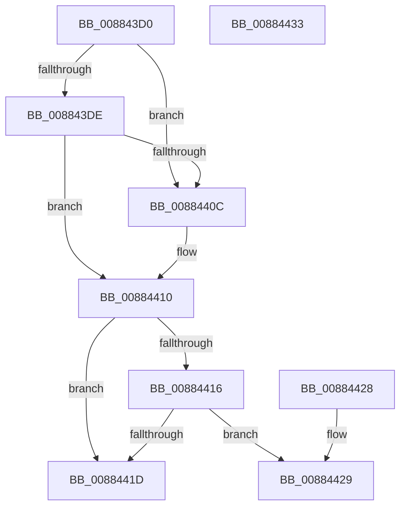

# MiValidateVadMetadataFlags

- RVA: `0x008843D0`–`0x00884434` (길이 `100` bytes)
- VA: `0x00000001408843D0`
- 실행 섹션: `PAGE`
- PDB 이름 있음: `예`; PDB Function 태그: `아니요`
- unwind 정보 RVA: `0x000767E0`
- 디코드: `31`개 명령, `100/100` bytes 표시
- 미해석 바이트: `0` (있으면 어셈블리에 `.byte`로 보존)

> 이 문서는 커널 이미지의 기계어와 PDB 기호를 분석해 생성했습니다. 4번과 5번은 함수 원형과 자료형을 바이너리 사용 방식에서 추정한 C 해석이며 원본 소스 복구 결과는 아닙니다.

## 1. Dependencies

- 직접 호출 지점: **1**; 고유 호출 대상: **1**
- 직접 호출자로 확인된 함수: **2**
- RIP 상대 이미지 참조: **0**

### Outgoing calls
- `0x008843F7` → [HalAdjustResourceList](../../text/48/HalAdjustResourceList_function_0048FDC0.md) (function, `0x0048FDC0`)

### Direct callers
- [MiAllocateVirtualMemory](MiAllocateVirtualMemory_function_00883B40.md) at `0x00883BF5`
- [MiMapViewOfSection](../89/MiMapViewOfSection_function_00898F10.md) at `0x0089919E`

### Static image references
- 디코드된 RIP-relative 메모리 참조가 없습니다.

## 2. Other-region calls and transfers

- 다른 실행 섹션으로 향하는 call: **1**
  - `0x008843F7` → [HalAdjustResourceList](../../text/48/HalAdjustResourceList_function_0048FDC0.md) (`PAGE` → `.text`)
- 별도 외부 분기/꼬리 이동을 확인하지 못했습니다.

## 3. Assembly (complete function range)

```asm
008843D0  48 83 EC 28                     sub rsp, 0x28
008843D4  8B 41 3C                        mov eax, dword ptr [rcx + 0x3c]
008843D7  45 33 C0                        xor r8d, r8d
008843DA  A8 08                           test al, 8
008843DC  74 2E                           je 0x14088440c
008843DE  48 8B 41 58                     mov rax, qword ptr [rcx + 0x58]
008843E2  48 8B 90 10 04 00 00            mov rdx, qword ptr [rax + 0x410]
008843E9  4C 39 82 A8 04 00 00            cmp qword ptr [rdx + 0x4a8], r8
008843F0  41 0F 95 C0                     setne r8b
008843F4  41 8B D0                        mov edx, r8d
008843F7  E8 C4 B9 C0 FF                  call 0x14048fdc0
008843FC  41 83 C8 04                     or r8d, 4
00884400  85 C0                           test eax, eax
00884402  44 0F 44 C2                     cmove r8d, edx
00884406  41 F6 C0 01                     test r8b, 1
0088440A  75 04                           jne 0x140884410
0088440C  83 61 78 FD                     and dword ptr [rcx + 0x78], 0xfffffffd
00884410  41 F6 C0 04                     test r8b, 4
00884414  75 07                           jne 0x14088441d
00884416  8B 41 78                        mov eax, dword ptr [rcx + 0x78]
00884419  A8 08                           test al, 8
0088441B  75 0C                           jne 0x140884429
0088441D  44 09 41 78                     or dword ptr [rcx + 0x78], r8d
00884421  33 C0                           xor eax, eax
00884423  48 83 C4 28                     add rsp, 0x28
00884427  C3                              ret
00884428  CC                              int3
00884429  B8 0D 00 00 C0                  mov eax, 0xc000000d
0088442E  48 83 C4 28                     add rsp, 0x28
00884432  C3                              ret
00884433  CC                              int3
```

## 4. C-style interpretation (structured pseudocode)

```c
__int64 __fastcall MiValidateVadMetadataFlags(__int64 a1, __int64 a2, int a3)
{
    __int64 result;
    __int64 v_rsp;

    v_rsp = (v_rsp) - (40);
    a3 = 0;
    if ((((unsigned __int8)((unsigned int)(*(unsigned int *)(a1 + 60)))) & (8)) == 0) goto loc_0088440C;
    a3 = ((*(unsigned __int64 *)(*(unsigned __int64 *)(*(unsigned __int64 *)(a1 + 88) + 1040) + 1192)) != 0) ? 1 : 0;
    result = HalAdjustResourceList(a1, (unsigned int)(a3), a3, a4);
    a3 = (unsigned int)((a3) | (4));
    if ((unsigned int)(result) == 0) { a3 = (unsigned int)((unsigned int)(a3)); }
    if ((((unsigned __int8)(a3)) & (1)) == 0) {
    }
    if ((((unsigned __int8)(a3)) & (4)) != 0) goto loc_0088441D;
    if ((((unsigned __int8)((unsigned int)(*(unsigned int *)(a1 + 120)))) & (8)) != 0) goto loc_00884429;
loc_0088441D:
    result = 0;
    v_rsp = (v_rsp) + (40);
    return result;
loc_00884429:
    v_rsp = (v_rsp) + (40);
    return (unsigned int)(0xC000000DULL);
}
```

## 5. (Beta) C Style

```c
int64_t MiValidateVadMetadataFlags(void *Arg1, int64_t Arg2, int32_t Arg3)
{
    uint8_t *arg1 = (uint8_t *)Arg1;

    int64_t result;
    int64_t local_rsp;

    local_rsp = (local_rsp) - (40);
    Arg3 = 0;
    if ((((uint8_t)((uint32_t)(*(uint32_t *)(arg1 + 0x3C)))) & (8)) == 0) goto loc_0088440C;
    Arg3 = ((*(uint64_t *)(*(uint64_t *)(*(uint64_t *)(arg1 + 0x58) + 0x410) + 0x4A8)) != 0) ? 1 : 0;
    result = HalAdjustResourceList(Arg1, (uint32_t)(Arg3), Arg3, a4);
    Arg3 = (uint32_t)((Arg3) | (4));
    if ((uint32_t)(result) == 0) { Arg3 = (uint32_t)((uint32_t)(Arg3)); }
    if ((((uint8_t)(Arg3)) & (1)) == 0) {
    }
    if ((((uint8_t)(Arg3)) & (4)) != 0) goto loc_0088441D;
    if ((((uint8_t)((uint32_t)(*(uint32_t *)(arg1 + 0x78)))) & (8)) != 0) goto loc_00884429;
loc_0088441D:
    result = 0;
    local_rsp = (local_rsp) + (40);
    return result;
loc_00884429:
    local_rsp = (local_rsp) + (40);
    return (uint32_t)(0xC000000DULL);
}
```

### 관측된 메모리 오프셋

구조체 형식이 확인되지 않은 접근은 인자 기준의 오프셋으로만 기록했습니다.

| 기준 인자 | 오프셋 표현 | 폭 (bit) | 접근 |
|---|---:|---:|---|
| `Arg1` | `+ 0x3C` | `32` | `R` |
| `Arg1` | `+ 0x58` | `64` | `R` |

## 6. Execution-region graph

[열기: 2D/3D 그래프와 함수 탐색 컨트롤 패널](../../../control-panel.html?section=page&rva=0x008843D0&view=graph)

- 2D 그래프는 위에서 아래로 흐르고, 3D 그래프는 빈 공간을 드래그해 회전합니다. Shift+드래그는 이동, 휠은 확대·축소, 함수 노드 선택은 대상 보고서 이동입니다.

### Static fallback


