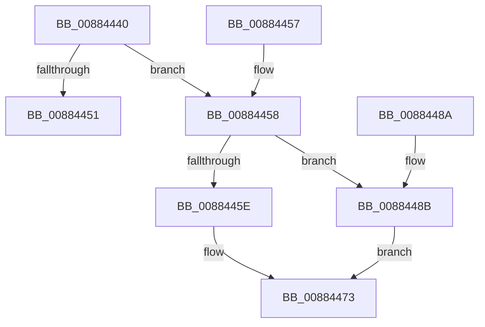

# MiValidateZeroBits

- RVA: `0x00884440`–`0x00884491` (길이 `81` bytes)
- VA: `0x0000000140884440`
- 실행 섹션: `PAGE`
- PDB 이름 있음: `예`; PDB Function 태그: `아니요`
- unwind 정보 RVA: `0x0007C858`
- 디코드: `29`개 명령, `81/81` bytes 표시
- 미해석 바이트: `0` (있으면 어셈블리에 `.byte`로 보존)

> 이 문서는 커널 이미지의 기계어와 PDB 기호를 분석해 생성했습니다. 4번과 5번은 함수 원형과 자료형을 바이너리 사용 방식에서 추정한 C 해석이며 원본 소스 복구 결과는 아닙니다.

## 1. Dependencies

- 직접 호출 지점: **1**; 고유 호출 대상: **1**
- 직접 호출자로 확인된 함수: **2**
- RIP 상대 이미지 참조: **0**

### Outgoing calls
- `0x00884461` → [RtlFindMostSignificantBit](../../text/45/RtlFindMostSignificantBit_function_00450270.md) (function, `0x00450270`)

### Direct callers
- [NtCreateEnclave](../80/NtCreateEnclave_function_00808CC0.md) at `0x00808E21`
- [MiAllocateVirtualMemoryPrepare](MiAllocateVirtualMemoryPrepare_function_00883220.md) at `0x00883594`

### Static image references
- 디코드된 RIP-relative 메모리 참조가 없습니다.

## 2. Other-region calls and transfers

- 다른 실행 섹션으로 향하는 call: **1**
  - `0x00884461` → [RtlFindMostSignificantBit](../../text/45/RtlFindMostSignificantBit_function_00450270.md) (`PAGE` → `.text`)
- 별도 외부 분기/꼬리 이동을 확인하지 못했습니다.

## 3. Assembly (complete function range)

```asm
00884440  40 53                           push rbx
00884442  48 83 EC 20                     sub rsp, 0x20
00884446  48 8B 01                        mov rax, qword ptr [rcx]
00884449  48 8B D9                        mov rbx, rcx
0088444C  48 85 C0                        test rax, rax
0088444F  75 07                           jne 0x140884458
00884451  48 83 C4 20                     add rsp, 0x20
00884455  5B                              pop rbx
00884456  C3                              ret
00884457  CC                              int3
00884458  48 83 F8 20                     cmp rax, 0x20
0088445C  72 2D                           jb 0x14088448b
0088445E  48 8B C8                        mov rcx, rax
00884461  E8 0A BE BC FF                  call 0x140450270
00884466  0F BE D0                        movsx edx, al
00884469  B8 3F 00 00 00                  mov eax, 0x3f
0088446E  2B C2                           sub eax, edx
00884470  48 63 C8                        movsxd rcx, eax
00884473  33 C0                           xor eax, eax
00884475  48 89 0B                        mov qword ptr [rbx], rcx
00884478  48 83 F9 35                     cmp rcx, 0x35
0088447C  BA 0D 00 00 C0                  mov edx, 0xc000000d
00884481  0F 47 C2                        cmova eax, edx
00884484  48 83 C4 20                     add rsp, 0x20
00884488  5B                              pop rbx
00884489  C3                              ret
0088448A  CC                              int3
0088448B  48 8D 48 20                     lea rcx, [rax + 0x20]
0088448F  EB E2                           jmp 0x140884473
```

## 4. C-style interpretation (structured pseudocode)

```c
__int64 __fastcall MiValidateZeroBits(__int64 a1)
{
    __int64 result;
    __int64 v_rsp;

    v_rsp = (v_rsp) - (32);
    if (*(unsigned __int64 *)(a1) != 0) goto loc_00884458;
    v_rsp = (v_rsp) + (32);
    return *(unsigned __int64 *)(a1);
loc_00884458:
    if ((*(unsigned __int64 *)(a1)) < 32) goto loc_0088448B;
    result = RtlFindMostSignificantBit(*(unsigned __int64 *)(a1), a2, a3, a4);
    result = (unsigned int)((63) - ((unsigned int)((__int8)((unsigned __int8)(result)))));
loc_00884473:
    result = 0;
    *(unsigned __int64 *)(a1) = (int)((unsigned int)(result));
    if (((int)((unsigned int)(result))) > 53) { result = (unsigned int)((unsigned int)(0xC000000DULL)); }
    v_rsp = (v_rsp) + (32);
    return result;
loc_0088448B:
    goto loc_00884473;
}
```

## 5. (Beta) C Style

```c
int64_t MiValidateZeroBits(void *Arg1)
{
    uint8_t *arg1 = (uint8_t *)Arg1;

    int64_t result;
    int64_t local_rsp;

    local_rsp = (local_rsp) - (32);
    if (*(uint64_t *)(arg1) != 0) goto loc_00884458;
    local_rsp = (local_rsp) + (32);
    return *(uint64_t *)(arg1);
loc_00884458:
    if ((*(uint64_t *)(arg1)) < 32) goto loc_0088448B;
    result = RtlFindMostSignificantBit(*(uint64_t *)(arg1), a2, a3, a4);
    result = (uint32_t)((63) - ((uint32_t)((int8_t)((uint8_t)(result)))));
loc_00884473:
    result = 0;
    *(uint64_t *)(arg1) = (int32_t)((uint32_t)(result));
    if (((int32_t)((uint32_t)(result))) > 53) { result = (uint32_t)((uint32_t)(0xC000000DULL)); }
    local_rsp = (local_rsp) + (32);
    return result;
loc_0088448B:
    goto loc_00884473;
}
```

### 관측된 메모리 오프셋

구조체 형식이 확인되지 않은 접근은 인자 기준의 오프셋으로만 기록했습니다.

| 기준 인자 | 오프셋 표현 | 폭 (bit) | 접근 |
|---|---:|---:|---|
| `Arg1` | `+ 0x0` | `64` | `R` |
| `Arg1` | `+ 0x0` | `64` | `W` |

## 6. Execution-region graph

[열기: 2D/3D 그래프와 함수 탐색 컨트롤 패널](../../../control-panel.html?section=page&rva=0x00884440&view=graph)

- 2D 그래프는 위에서 아래로 흐르고, 3D 그래프는 빈 공간을 드래그해 회전합니다. Shift+드래그는 이동, 휠은 확대·축소, 함수 노드 선택은 대상 보고서 이동입니다.

### Static fallback


