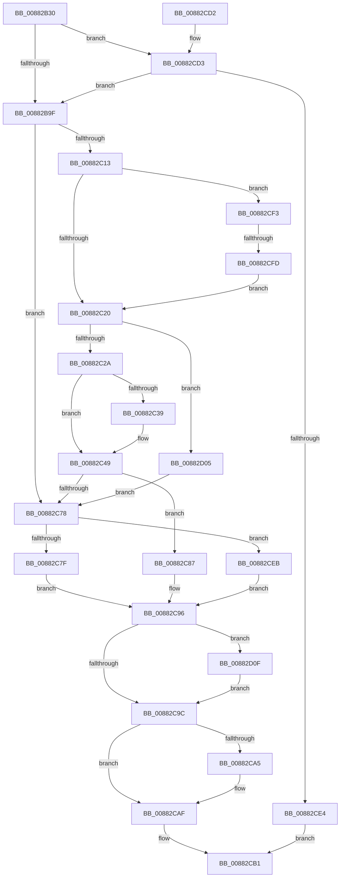

# MmAllocateUserStack

- RVA: `0x00882B30`–`0x00882D19` (길이 `489` bytes)
- VA: `0x0000000140882B30`
- 실행 섹션: `PAGE`
- PDB 이름 있음: `예`; PDB Function 태그: `예`
- unwind 정보 RVA: `0x0007C718`
- 디코드: `127`개 명령, `489/489` bytes 표시
- 미해석 바이트: `0` (있으면 어셈블리에 `.byte`로 보존)

> 이 문서는 커널 이미지의 기계어와 PDB 기호를 분석해 생성했습니다. 4번과 5번은 함수 원형과 자료형을 바이너리 사용 방식에서 추정한 C 해석이며 원본 소스 복구 결과는 아닙니다.

## 1. Dependencies

- 직접 호출 지점: **6**; 고유 호출 대상: **5**
- 직접 호출자로 확인된 함수: **2**
- RIP 상대 이미지 참조: **3**

### Outgoing calls
- `0x00882B69` → [memset](../../text/6C/memset_function_006C6C40.md) (function, `0x006C6C40`)
- `0x00882BAB` → [memset](../../text/6C/memset_function_006C6C40.md) (function, `0x006C6C40`)
- `0x00882C08` → [MiAllocateVirtualMemoryPrepare](MiAllocateVirtualMemoryPrepare_function_00883220.md) (function, `0x00883220`)
- `0x00882C5F` → [MiAllocateVirtualMemory](MiAllocateVirtualMemory_function_00883B40.md) (function, `0x00883B40`)
- `0x00882CAA` → [ObfDereferenceObjectWithTag](../../text/2F/ObfDereferenceObjectWithTag_function_002F78E0.md) (function, `0x002F78E0`)
- `0x00882D12` → [PsDereferencePartition](../../text/34/PsDereferencePartition_function_00342E70.md) (function, `0x00342E70`)

### Direct callers
- [PspReserveAndCommitUserShadowStack](PspReserveAndCommitUserShadowStack_function_008827A8.md) at `0x0088283B`
- [NtSetInformationProcess](../AE/NtSetInformationProcess_function_00AE5370.md) at `0x00AE7742`

### Static image references
- `0x00882C7F` → RVA `0x00E302B4` (`.data`; read/write)
- `0x00882CD3` → RVA `0x00FC6A88` (`ALMOSTRO`; read)
- `0x00882CEB` → RVA `0x00E302B0` (`.data`; read/write)

## 2. Other-region calls and transfers

- 다른 실행 섹션으로 향하는 call: **4**
  - `0x00882B69` → [memset](../../text/6C/memset_function_006C6C40.md) (`PAGE` → `.text`)
  - `0x00882BAB` → [memset](../../text/6C/memset_function_006C6C40.md) (`PAGE` → `.text`)
  - `0x00882CAA` → [ObfDereferenceObjectWithTag](../../text/2F/ObfDereferenceObjectWithTag_function_002F78E0.md) (`PAGE` → `.text`)
  - `0x00882D12` → [PsDereferencePartition](../../text/34/PsDereferencePartition_function_00342E70.md) (`PAGE` → `.text`)
- call이 아닌 외부 분기/꼬리 이동: **1**
  - `0x00882CF7` → [sub_00B18D64](../B1/Unknown_function_00B18D64.md) (`tail-transfer`)

## 3. Assembly (complete function range)

```asm
00882B30  48 8B C4                        mov rax, rsp
00882B33  48 89 58 08                     mov qword ptr [rax + 8], rbx
00882B37  48 89 70 10                     mov qword ptr [rax + 0x10], rsi
00882B3B  48 89 78 18                     mov qword ptr [rax + 0x18], rdi
00882B3F  4C 89 60 20                     mov qword ptr [rax + 0x20], r12
00882B43  55                              push rbp
00882B44  41 56                           push r14
00882B46  41 57                           push r15
00882B48  48 8D 68 88                     lea rbp, [rax - 0x78]
00882B4C  48 81 EC 60 01 00 00            sub rsp, 0x160
00882B53  4C 8B E2                        mov r12, rdx
00882B56  4D 8B F0                        mov r14, r8
00882B59  33 D2                           xor edx, edx
00882B5B  4C 8B F9                        mov r15, rcx
00882B5E  48 8D 4D 10                     lea rcx, [rbp + 0x10]
00882B62  41 8B D9                        mov ebx, r9d
00882B65  44 8D 42 48                     lea r8d, [rdx + 0x48]
00882B69  E8 D2 40 E4 FF                  call 0x1406c6c40
00882B6E  44 8B 8D A0 00 00 00            mov r9d, dword ptr [rbp + 0xa0]
00882B75  41 8B C1                        mov eax, r9d
00882B78  F7 D8                           neg eax
00882B7A  89 5D 30                        mov dword ptr [rbp + 0x30], ebx
00882B7D  B8 00 00 00 40                  mov eax, 0x40000000
00882B82  1B F6                           sbb esi, esi
00882B84  83 E6 FE                        and esi, 0xfffffffe
00882B87  83 C6 04                        add esi, 4
00882B8A  41 F7 D9                        neg r9d
00882B8D  1B DB                           sbb ebx, ebx
00882B8F  23 D8                           and ebx, eax
00882B91  81 C3 00 00 00 80               add ebx, 0x80000000
00882B97  85 D8                           test eax, ebx
00882B99  0F 85 34 01 00 00               jne 0x140882cd3
00882B9F  33 D2                           xor edx, edx
00882BA1  48 8D 4D 90                     lea rcx, [rbp - 0x70]
00882BA5  41 B8 80 00 00 00               mov r8d, 0x80
00882BAB  E8 90 40 E4 FF                  call 0x1406c6c40
00882BB0  4D 8B 0E                        mov r9, qword ptr [r14]
00882BB3  48 8D 45 80                     lea rax, [rbp - 0x80]
00882BB7  49 8B 17                        mov rdx, qword ptr [r15]
00882BBA  33 FF                           xor edi, edi
00882BBC  48 83 64 24 78 00               and qword ptr [rsp + 0x78], 0
00882BC2  4D 8B C4                        mov r8, r12
00882BC5  48 83 65 80 00                  and qword ptr [rbp - 0x80], 0
00882BCA  48 83 C9 FF                     or rcx, 0xffffffffffffffff
00882BCE  48 89 44 24 60                  mov qword ptr [rsp + 0x60], rax
00882BD3  48 8D 45 90                     lea rax, [rbp - 0x70]
00882BD7  48 89 44 24 58                  mov qword ptr [rsp + 0x58], rax
00882BDC  48 8D 45 10                     lea rax, [rbp + 0x10]
00882BE0  48 21 7C 24 50                  and qword ptr [rsp + 0x50], rdi
00882BE5  21 7C 24 48                     and dword ptr [rsp + 0x48], edi
00882BE9  89 5C 24 40                     mov dword ptr [rsp + 0x40], ebx
00882BED  40 88 7C 24 38                  mov byte ptr [rsp + 0x38], dil
00882BF2  48 89 44 24 30                  mov qword ptr [rsp + 0x30], rax
00882BF7  89 74 24 28                     mov dword ptr [rsp + 0x28], esi
00882BFB  C7 44 24 20 00 20 00 00         mov dword ptr [rsp + 0x20], 0x2000
00882C03  48 89 7C 24 70                  mov qword ptr [rsp + 0x70], rdi
00882C08  E8 13 06 00 00                  call 0x140883220
00882C0D  8B D8                           mov ebx, eax
00882C0F  85 C0                           test eax, eax
00882C11  78 65                           js 0x140882c78
00882C13  48 8B 4D 28                     mov rcx, qword ptr [rbp + 0x28]
00882C17  48 85 C9                        test rcx, rcx
00882C1A  0F 85 D3 00 00 00               jne 0x140882cf3
00882C20  80 7D 40 00                     cmp byte ptr [rbp + 0x40], 0
00882C24  0F 85 DB 00 00 00               jne 0x140882d05
00882C2A  48 83 64 24 70 00               and qword ptr [rsp + 0x70], 0
00882C30  F7 45 D0 00 00 00 40            test dword ptr [rbp - 0x30], 0x40000000
00882C37  74 10                           je 0x140882c49
00882C39  48 8D 44 24 70                  lea rax, [rsp + 0x70]
00882C3E  C7 45 D4 01 00 00 20            mov dword ptr [rbp - 0x2c], 0x20000001
00882C45  48 89 45 D8                     mov qword ptr [rbp - 0x28], rax
00882C49  48 8D 44 24 78                  lea rax, [rsp + 0x78]
00882C4E  45 33 C9                        xor r9d, r9d
00882C51  45 33 C0                        xor r8d, r8d
00882C54  48 89 44 24 20                  mov qword ptr [rsp + 0x20], rax
00882C59  33 D2                           xor edx, edx
00882C5B  48 8D 4D 90                     lea rcx, [rbp - 0x70]
00882C5F  E8 DC 0E 00 00                  call 0x140883b40
00882C64  48 83 65 D8 00                  and qword ptr [rbp - 0x28], 0
00882C69  83 65 D4 00                     and dword ptr [rbp - 0x2c], 0
00882C6D  33 DB                           xor ebx, ebx
00882C6F  85 C0                           test eax, eax
00882C71  0F 48 D8                        cmovs ebx, eax
00882C74  85 DB                           test ebx, ebx
00882C76  79 0F                           jns 0x140882c87
00882C78  48 83 7D 90 00                  cmp qword ptr [rbp - 0x70], 0
00882C7D  74 6C                           je 0x140882ceb
00882C7F  FF 05 2F D6 5A 00               inc dword ptr [rip + 0x5ad62f]
00882C85  EB 0F                           jmp 0x140882c96
00882C87  48 8B 44 24 78                  mov rax, qword ptr [rsp + 0x78]
00882C8C  49 89 07                        mov qword ptr [r15], rax
00882C8F  48 8B 45 A8                     mov rax, qword ptr [rbp - 0x58]
00882C93  49 89 06                        mov qword ptr [r14], rax
00882C96  48 83 FF 02                     cmp rdi, 2
00882C9A  73 73                           jae 0x140882d0f
00882C9C  48 8B 4D 80                     mov rcx, qword ptr [rbp - 0x80]
00882CA0  48 85 C9                        test rcx, rcx
00882CA3  74 0A                           je 0x140882caf
00882CA5  BA 4D 6D 56 6D                  mov edx, 0x6d566d4d
00882CAA  E8 31 4C A7 FF                  call 0x1402f78e0
00882CAF  8B C3                           mov eax, ebx
00882CB1  4C 8D 9C 24 60 01 00 00         lea r11, [rsp + 0x160]
00882CB9  49 8B 5B 20                     mov rbx, qword ptr [r11 + 0x20]
00882CBD  49 8B 73 28                     mov rsi, qword ptr [r11 + 0x28]
00882CC1  49 8B 7B 30                     mov rdi, qword ptr [r11 + 0x30]
00882CC5  4D 8B 63 38                     mov r12, qword ptr [r11 + 0x38]
00882CC9  49 8B E3                        mov rsp, r11
00882CCC  41 5F                           pop r15
00882CCE  41 5E                           pop r14
00882CD0  5D                              pop rbp
00882CD1  C3                              ret
00882CD2  CC                              int3
00882CD3  48 F7 05 AA 3D 74 00 00 00 00 01  test qword ptr [rip + 0x743daa], 0x1000000
00882CDE  0F 85 BB FE FF FF               jne 0x140882b9f
00882CE4  B8 BB 00 00 C0                  mov eax, 0xc00000bb
00882CE9  EB C6                           jmp 0x140882cb1
00882CEB  FF 05 BF D5 5A 00               inc dword ptr [rip + 0x5ad5bf]
00882CF1  EB A3                           jmp 0x140882c96
00882CF3  48 83 F9 FD                     cmp rcx, -3
00882CF7  0F 85 67 60 29 00               jne 0x140b18d64
00882CFD  8D 79 04                        lea edi, [rcx + 4]
00882D00  E9 1B FF FF FF                  jmp 0x140882c20
00882D05  BB 0D 00 00 C0                  mov ebx, 0xc000000d
00882D0A  E9 69 FF FF FF                  jmp 0x140882c78
00882D0F  48 8B CF                        mov rcx, rdi
00882D12  E8 59 01 AC FF                  call 0x140342e70
00882D17  EB 83                           jmp 0x140882c9c
```

## 4. C-style interpretation (structured pseudocode)

```c
__int64 __fastcall MmAllocateUserStack(__int64 a1, __int64 a2, __int64 a3, int a4)
{
    __int64 result;
    __int64 v_rbx;
    __int64 v_rdi;
    __int64 v_rsi;
    __int64 v_rsp;
    unsigned __int64 v_stack_m100;
    unsigned __int64 v_stack_m108;
    unsigned __int64 v_stack_m118;
    unsigned __int64 v_stack_m120;
    unsigned __int64 v_stack_m128;
    unsigned int v_stack_m130;
    unsigned int v_stack_m138;
    unsigned __int8 v_stack_m140;
    unsigned __int64 v_stack_m148;
    unsigned int v_stack_m150;
    unsigned int v_stack_m158;
    unsigned __int64 v_stack_m18;

    *(unsigned __int64 *)(v_rsp + 8) = v_rbx;
    *(unsigned __int64 *)(v_rsp + 16) = v_rsi;
    *(unsigned __int64 *)(v_rsp + 24) = v_rdi;
    *(unsigned __int64 *)(v_rsp + 32) = v_r12;
    v_rsp = (v_rsp) - (352);
    a2 = 0;
    result = memset(v_rsp - 120 + 16, a2, a2 + 72, a4);
    result = (unsigned int)(-((unsigned int)((unsigned int)((unsigned int)(*(unsigned int *)(v_rsp - 120 + 160))))));
    *(unsigned int *)(v_rsp - 120 + 48) = (unsigned int)((unsigned int)(a4));
    v_rsi = (unsigned int)((v_rsi) & (0xFFFFFFFEULL));
    v_rsi = (unsigned int)((v_rsi) + (4));
    a4 = (unsigned int)(-((unsigned int)(*(unsigned int *)(v_rsp - 120 + 160))));
    v_rbx = (unsigned int)(((unsigned int)(a4)) & ((unsigned int)((unsigned int)(0x40000000ULL))));
    v_rbx = (unsigned int)((v_rbx) + (0x80000000ULL));
    if ((((unsigned int)((unsigned int)(0x40000000ULL))) & ((unsigned int)(v_rbx))) != 0) goto loc_00882CD3;
loc_00882B9F:
    a2 = 0;
    result = memset(v_rsp - 120 - 112, a2, 128, a4);
    v_rdi = 0;
    a1 = (v_rsp - 120 - 112) | (-1);
    v_stack_m118 = v_rsp - 120 - 128;
    v_stack_m120 = v_rsp - 120 - 112;
    v_stack_m138 = (unsigned int)(v_rbx);
    v_stack_m140 = 0;
    v_stack_m148 = v_rsp - 120 + 16;
    v_stack_m150 = (unsigned int)(v_rsi);
    v_stack_m158 = 0x2000ULL;
    v_stack_m108 = 0;
    result = MiAllocateVirtualMemoryPrepare(a1, *(unsigned __int64 *)(a1), 0, *(unsigned __int64 *)(a3));
    if (sign_flag) goto loc_00882C78;
    if (*(unsigned __int64 *)(v_rsp - 120 + 40) != 0) goto loc_00882CF3;
loc_00882C20:
    if ((*(unsigned __int8 *)(v_rsp - 120 + 64)) != 0) goto loc_00882D05;
    if (((*(unsigned int *)(v_rsp - 120 - 48)) & (0x40000000ULL)) != 0) {
        result = v_stack_m108;
        *(unsigned int *)(v_rsp - 120 - 44) = 0x20000001ULL;
        *(unsigned __int64 *)(v_rsp - 120 - 40) = result;
    }
    a4 = 0;
    a3 = 0;
    v_stack_m158 = v_stack_m100;
    a2 = 0;
    result = MiAllocateVirtualMemory(v_rsp - 120 - 112, a2, a3, a4);
    v_rbx = 0;
    if (sign_flag) { v_rbx = (unsigned int)(result); }
    if (!sign_flag) goto loc_00882C87;
loc_00882C78:
    if ((*(unsigned __int64 *)(v_rsp - 120 - 112)) == 0) goto loc_00882CEB;
    goto loc_00882C96;
loc_00882C87:
    *(unsigned __int64 *)(a1) = v_stack_m100;
    *(unsigned __int64 *)(a3) = *(unsigned __int64 *)(v_rsp - 120 - 88);
loc_00882C96:
    if (0 >= 2) goto loc_00882D0F;
loc_00882C9C:
    result = *(unsigned __int64 *)(v_rsp - 120 - 88);
    if (*(unsigned __int64 *)(v_rsp - 120 - 128) != 0) {
        a2 = 0x6D566D4DULL;
        result = ObfDereferenceObjectWithTag(*(unsigned __int64 *)(v_rsp - 120 - 128), a2, a3, a4);
    }
loc_00882CB1:
    return (unsigned int)((unsigned int)(v_rbx));
loc_00882CD3:
    if (((*(unsigned __int64 *)(v_rip + 7617962)) & (0x1000000ULL)) != 0) goto loc_00882B9F;
    goto loc_00882CB1;
loc_00882CEB:
    goto loc_00882C96;
loc_00882CF3:
    goto loc_00882C20;
loc_00882D05:
    goto loc_00882C78;
loc_00882D0F:
    result = PsDereferencePartition(*(unsigned __int64 *)(v_rsp - 120 - 128) + 4, a2, a3, a4);
    goto loc_00882C9C;
}
```

## 5. (Beta) C Style

```c
int64_t MmAllocateUserStack(void *Arg1, int64_t Arg2, void *Arg3, int32_t Arg4)
{
    uint8_t *arg1 = (uint8_t *)Arg1;
    uint8_t *arg3 = (uint8_t *)Arg3;

    int64_t result;
    int64_t local_rbx;
    int64_t local_rdi;
    int64_t local_rsi;
    int64_t local_rsp;
    uint64_t v_stack_m100;
    uint64_t v_stack_m108;
    uint64_t v_stack_m118;
    uint64_t v_stack_m120;
    uint64_t v_stack_m128;
    uint32_t v_stack_m130;
    uint32_t v_stack_m138;
    uint8_t v_stack_m140;
    uint64_t v_stack_m148;
    uint32_t v_stack_m150;
    uint32_t v_stack_m158;
    uint64_t v_stack_m18;

    *(uint64_t *)(local_rsp + 0x8) = local_rbx;
    *(uint64_t *)(local_rsp + 0x10) = local_rsi;
    *(uint64_t *)(local_rsp + 0x18) = local_rdi;
    *(uint64_t *)(local_rsp + 0x20) = local_r12;
    local_rsp = (local_rsp) - (352);
    Arg2 = 0;
    result = memset(local_rsp - 120 + 16, Arg2, Arg2 + 72, Arg4);
    result = (uint32_t)(-((uint32_t)((uint32_t)((uint32_t)(*(uint32_t *)(local_rsp - 0x78 + 0xA0))))));
    *(uint32_t *)(local_rsp - 0x78 + 0x30) = (uint32_t)((uint32_t)(Arg4));
    local_rsi = (uint32_t)((local_rsi) & (0xFFFFFFFEULL));
    local_rsi = (uint32_t)((local_rsi) + (4));
    Arg4 = (uint32_t)(-((uint32_t)(*(uint32_t *)(local_rsp - 0x78 + 0xA0))));
    local_rbx = (uint32_t)(((uint32_t)(Arg4)) & ((uint32_t)((uint32_t)(0x40000000ULL))));
    local_rbx = (uint32_t)((local_rbx) + (0x80000000ULL));
    if ((((uint32_t)((uint32_t)(0x40000000ULL))) & ((uint32_t)(local_rbx))) != 0) goto loc_00882CD3;
loc_00882B9F:
    Arg2 = 0;
    result = memset(local_rsp - 120 - 112, Arg2, 128, Arg4);
    local_rdi = 0;
    Arg1 = (local_rsp - 120 - 112) | (-1);
    v_stack_m118 = local_rsp - 120 - 128;
    v_stack_m120 = local_rsp - 120 - 112;
    v_stack_m138 = (uint32_t)(local_rbx);
    v_stack_m140 = 0;
    v_stack_m148 = local_rsp - 120 + 16;
    v_stack_m150 = (uint32_t)(local_rsi);
    v_stack_m158 = 0x2000ULL;
    v_stack_m108 = 0;
    result = MiAllocateVirtualMemoryPrepare(Arg1, *(uint64_t *)(arg1), 0, *(uint64_t *)(arg3));
    if (sign_flag) goto loc_00882C78;
    if (*(uint64_t *)(local_rsp - 0x78 + 0x28) != 0) goto loc_00882CF3;
loc_00882C20:
    if ((*(uint8_t *)(local_rsp - 0x78 + 0x40)) != 0) goto loc_00882D05;
    if (((*(uint32_t *)(local_rsp - 0x78 - 0x30)) & (0x40000000ULL)) != 0) {
        result = v_stack_m108;
        *(uint32_t *)(local_rsp - 0x78 - 0x2C) = 0x20000001ULL;
        *(uint64_t *)(local_rsp - 0x78 - 0x28) = result;
    }
    Arg4 = 0;
    Arg3 = 0;
    v_stack_m158 = v_stack_m100;
    Arg2 = 0;
    result = MiAllocateVirtualMemory(local_rsp - 120 - 112, Arg2, Arg3, Arg4);
    local_rbx = 0;
    if (sign_flag) { local_rbx = (uint32_t)(result); }
    if (!sign_flag) goto loc_00882C87;
loc_00882C78:
    if ((*(uint64_t *)(local_rsp - 0x78 - 0x70)) == 0) goto loc_00882CEB;
    goto loc_00882C96;
loc_00882C87:
    *(uint64_t *)(arg1) = v_stack_m100;
    *(uint64_t *)(arg3) = *(uint64_t *)(local_rsp - 0x78 - 0x58);
loc_00882C96:
    if (0 >= 2) goto loc_00882D0F;
loc_00882C9C:
    result = *(uint64_t *)(local_rsp - 0x78 - 0x58);
    if (*(uint64_t *)(local_rsp - 0x78 - 0x80) != 0) {
        Arg2 = 0x6D566D4DULL;
        result = ObfDereferenceObjectWithTag(*(uint64_t *)(local_rsp - 0x78 - 0x80), Arg2, Arg3, Arg4);
    }
loc_00882CB1:
    return (uint32_t)((uint32_t)(local_rbx));
loc_00882CD3:
    if (((*(uint64_t *)(v_rip + 0x743DAA)) & (0x1000000ULL)) != 0) goto loc_00882B9F;
    goto loc_00882CB1;
loc_00882CEB:
    goto loc_00882C96;
loc_00882CF3:
    goto loc_00882C20;
loc_00882D05:
    goto loc_00882C78;
loc_00882D0F:
    result = PsDereferencePartition(*(uint64_t *)(local_rsp - 0x78 - 0x80) + 4, Arg2, Arg3, Arg4);
    goto loc_00882C9C;
}
```

### 관측된 메모리 오프셋

구조체 형식이 확인되지 않은 접근은 인자 기준의 오프셋으로만 기록했습니다.

| 기준 인자 | 오프셋 표현 | 폭 (bit) | 접근 |
|---|---:|---:|---|
| `Arg1` | `+ 0x0` | `64` | `R` |
| `Arg1` | `+ 0x0` | `64` | `W` |
| `Arg3` | `+ 0x0` | `64` | `R` |
| `Arg3` | `+ 0x0` | `64` | `W` |

## 6. Execution-region graph

[열기: 2D/3D 그래프와 함수 탐색 컨트롤 패널](../../../control-panel.html?section=page&rva=0x00882B30&view=graph)

- 2D 그래프는 위에서 아래로 흐르고, 3D 그래프는 빈 공간을 드래그해 회전합니다. Shift+드래그는 이동, 휠은 확대·축소, 함수 노드 선택은 대상 보고서 이동입니다.

### Static fallback


