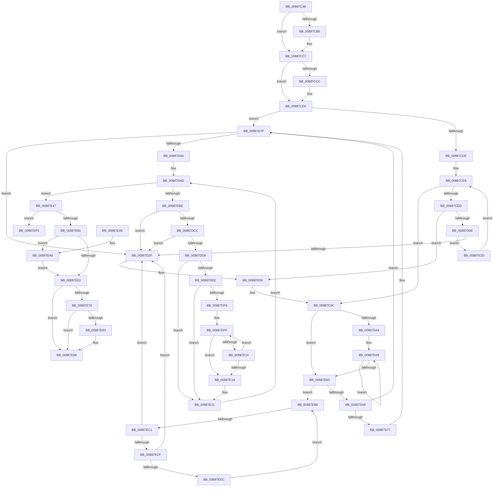

# MmLinkJobProcess

- RVA: `0x00887C48`–`0x00887F01` (길이 `697` bytes)
- VA: `0x0000000140887C48`
- 실행 섹션: `PAGE`
- PDB 이름 있음: `예`; PDB Function 태그: `예`
- unwind 정보 RVA: `0x0007CD50`
- 디코드: `184`개 명령, `697/697` bytes 표시
- 미해석 바이트: `0` (있으면 어셈블리에 `.byte`로 보존)

> 이 문서는 커널 이미지의 기계어와 PDB 기호를 분석해 생성했습니다. 4번과 5번은 함수 원형과 자료형을 바이너리 사용 방식에서 추정한 C 해석이며 원본 소스 복구 결과는 아닙니다.

## 1. Dependencies

- 직접 호출 지점: **10**; 고유 호출 대상: **9**
- 직접 호출자로 확인된 함수: **1**
- RIP 상대 이미지 참조: **0**

### Outgoing calls
- `0x00887CA9` → [KeAbPreAcquire](../../text/21/KeAbPreAcquire_function_00210230.md) (function, `0x00210230`)
- `0x00887CC2` → [ExfAcquirePushLockExclusiveEx](../../text/20/ExfAcquirePushLockExclusiveEx_function_0020FC90.md) (function, `0x0020FC90`)
- `0x00887D01` → [MiAllocatePool](../../text/35/MiAllocatePool_function_0035B540.md) (function, `0x0035B540`)
- `0x00887D53` → [MiRemoveSharedCommitNode](MiRemoveSharedCommitNode_function_008889A0.md) (function, `0x008889A0`)
- `0x00887E08` → [MiInsertSharedCommitNode](MiInsertSharedCommitNode_function_00887210.md) (function, `0x00887210`)
- `0x00887E26` → [ExFreePoolWithTag](../../poolcode/B8/ExFreePoolWithTag_function_00B82870.md) (function, `0x00B82870`)
- `0x00887E66` → [KeAbPostRelease](../../text/2E/KeAbPostRelease_function_002E1600.md) (function, `0x002E1600`)
- `0x00887E83` → [KiCheckForKernelApcDelivery](../../text/2E/KiCheckForKernelApcDelivery_function_002E2C80.md) (function, `0x002E2C80`)
- `0x00887EA9` → [ExfTryToWakePushLock](../../text/26/ExfTryToWakePushLock_function_00265DD0.md) (function, `0x00265DD0`)
- `0x00887EEE` → [ExFreePoolWithTag](../../poolcode/B8/ExFreePoolWithTag_function_00B82870.md) (function, `0x00B82870`)

### Direct callers
- [PspEstablishJobHierarchy](../87/PspEstablishJobHierarchy_function_0087E17C.md) at `0x0087E1DC`
- [PspEstablishJobHierarchy](../87/PspEstablishJobHierarchy_function_0087E17C.md) at `0x0087E2F4`
- [PspEstablishJobHierarchy](../87/PspEstablishJobHierarchy_function_0087E17C.md) at `0x0087E51A`

### Static image references
- 디코드된 RIP-relative 메모리 참조가 없습니다.

## 2. Other-region calls and transfers

- 다른 실행 섹션으로 향하는 call: **8**
  - `0x00887CA9` → [KeAbPreAcquire](../../text/21/KeAbPreAcquire_function_00210230.md) (`PAGE` → `.text`)
  - `0x00887CC2` → [ExfAcquirePushLockExclusiveEx](../../text/20/ExfAcquirePushLockExclusiveEx_function_0020FC90.md) (`PAGE` → `.text`)
  - `0x00887D01` → [MiAllocatePool](../../text/35/MiAllocatePool_function_0035B540.md) (`PAGE` → `.text`)
  - `0x00887E26` → [ExFreePoolWithTag](../../poolcode/B8/ExFreePoolWithTag_function_00B82870.md) (`PAGE` → `POOLCODE`)
  - `0x00887E66` → [KeAbPostRelease](../../text/2E/KeAbPostRelease_function_002E1600.md) (`PAGE` → `.text`)
  - `0x00887E83` → [KiCheckForKernelApcDelivery](../../text/2E/KiCheckForKernelApcDelivery_function_002E2C80.md) (`PAGE` → `.text`)
  - `0x00887EA9` → [ExfTryToWakePushLock](../../text/26/ExfTryToWakePushLock_function_00265DD0.md) (`PAGE` → `.text`)
  - `0x00887EEE` → [ExFreePoolWithTag](../../poolcode/B8/ExFreePoolWithTag_function_00B82870.md) (`PAGE` → `POOLCODE`)
- call이 아닌 외부 분기/꼬리 이동: **2**
  - `0x00887EBB` → [sub_00B190BA](../B1/Unknown_function_00B190BA.md) (`tail-transfer`)
  - `0x00887EFC` → [sub_00B190BA + 0x9](../B1/Unknown_function_00B190BA.md) (`tail-transfer`)

## 3. Assembly (complete function range)

```asm
00887C48  48 8B C4                        mov rax, rsp
00887C4B  48 89 58 10                     mov qword ptr [rax + 0x10], rbx
00887C4F  48 89 70 18                     mov qword ptr [rax + 0x18], rsi
00887C53  48 89 78 20                     mov qword ptr [rax + 0x20], rdi
00887C57  48 89 48 08                     mov qword ptr [rax + 8], rcx
00887C5B  55                              push rbp
00887C5C  41 54                           push r12
00887C5E  41 55                           push r13
00887C60  41 56                           push r14
00887C62  41 57                           push r15
00887C64  48 8B EC                        mov rbp, rsp
00887C67  48 83 EC 30                     sub rsp, 0x30
00887C6B  4C 8D B2 B0 06 00 00            lea r14, [rdx + 0x6b0]
00887C72  48 8B FA                        mov rdi, rdx
00887C75  48 8D 45 F0                     lea rax, [rbp - 0x10]
00887C79  4C 8B E1                        mov r12, rcx
00887C7C  48 89 45 F8                     mov qword ptr [rbp - 8], rax
00887C80  45 33 FF                        xor r15d, r15d
00887C83  48 8D 45 F0                     lea rax, [rbp - 0x10]
00887C87  45 33 C0                        xor r8d, r8d
00887C8A  48 89 45 F0                     mov qword ptr [rbp - 0x10], rax
00887C8E  33 D2                           xor edx, edx
00887C90  65 4C 8B 2C 25 88 01 00 00      mov r13, qword ptr gs:[0x188]
00887C99  49 8B CE                        mov rcx, r14
00887C9C  41 8D 77 01                     lea esi, [r15 + 1]
00887CA0  66 41 29 B5 E6 01 00 00         sub word ptr [r13 + 0x1e6], si
00887CA8  90                              nop
00887CA9  E8 82 85 98 FF                  call 0x140210230
00887CAE  F0 49 0F BA 2E 00               lock bts qword ptr [r14], 0
00887CB4  48 8B D8                        mov rbx, rax
00887CB7  73 0E                           jae 0x140887cc7
00887CB9  4D 8B C6                        mov r8, r14
00887CBC  48 8B D0                        mov rdx, rax
00887CBF  49 8B CE                        mov rcx, r14
00887CC2  E8 C9 7F 98 FF                  call 0x14020fc90
00887CC7  48 85 DB                        test rbx, rbx
00887CCA  74 04                           je 0x140887cd0
00887CCC  40 88 73 0A                     mov byte ptr [rbx + 0xa], sil
00887CD0  8B 87 FC 05 00 00               mov eax, dword ptr [rdi + 0x5fc]
00887CD6  A8 10                           test al, 0x10
00887CD8  0F 85 A1 00 00 00               jne 0x140887d7f
00887CDE  48 8D 9F B8 06 00 00            lea rbx, [rdi + 0x6b8]
00887CE5  48 8B 33                        mov rsi, qword ptr [rbx]
00887CE8  48 3B F3                        cmp rsi, rbx
00887CEB  74 4F                           je 0x140887d3c
00887CED  4C 8B 66 10                     mov r12, qword ptr [rsi + 0x10]
00887CF1  BA 40 00 00 00                  mov edx, 0x40
00887CF6  B9 00 01 00 00                  mov ecx, 0x100
00887CFB  41 B8 4D 69 53 6E               mov r8d, 0x6e53694d
00887D01  E8 3A 38 AD FF                  call 0x14035b540
00887D06  48 8B C8                        mov rcx, rax
00887D09  48 85 C0                        test rax, rax
00887D0C  74 28                           je 0x140887d36
00887D0E  4C 89 60 38                     mov qword ptr [rax + 0x38], r12
00887D12  48 8D 55 F0                     lea rdx, [rbp - 0x10]
00887D16  48 8B 46 F8                     mov rax, qword ptr [rsi - 8]
00887D1A  48 89 41 20                     mov qword ptr [rcx + 0x20], rax
00887D1E  48 8D 41 28                     lea rax, [rcx + 0x28]
00887D22  48 8B 4D F8                     mov rcx, qword ptr [rbp - 8]
00887D26  48 39 11                        cmp qword ptr [rcx], rdx
00887D29  0F 84 FE 00 00 00               je 0x140887e2d
00887D2F  B9 03 00 00 00                  mov ecx, 3
00887D34  CD 29                           int 0x29
00887D36  41 BF 9A 00 00 C0               mov r15d, 0xc000009a
00887D3C  48 8B 03                        mov rax, qword ptr [rbx]
00887D3F  48 3B C3                        cmp rax, rbx
00887D42  74 1C                           je 0x140887d60
00887D44  BE 01 00 00 00                  mov esi, 1
00887D49  48 8B 48 10                     mov rcx, qword ptr [rax + 0x10]
00887D4D  44 8B C6                        mov r8d, esi
00887D50  48 8B D7                        mov rdx, rdi
00887D53  E8 48 0C 00 00                  call 0x1408889a0
00887D58  48 8B 03                        mov rax, qword ptr [rbx]
00887D5B  48 3B C3                        cmp rax, rbx
00887D5E  75 E9                           jne 0x140887d49
00887D60  45 85 FF                        test r15d, r15d
00887D63  0F 88 47 01 00 00               js 0x140887eb0
00887D69  8B 87 FC 05 00 00               mov eax, dword ptr [rdi + 0x5fc]
00887D6F  4C 8B 65 30                     mov r12, qword ptr [rbp + 0x30]
00887D73  A8 08                           test al, 8
00887D75  75 08                           jne 0x140887d7f
00887D77  F0 83 8F FC 05 00 00 08         lock or dword ptr [rdi + 0x5fc], 8
00887D7F  49 8D 4C 24 28                  lea rcx, [r12 + 0x28]
00887D84  48 8B 51 08                     mov rdx, qword ptr [rcx + 8]
00887D88  48 8D 87 58 03 00 00            lea rax, [rdi + 0x358]
00887D8F  48 39 0A                        cmp qword ptr [rdx], rcx
00887D92  75 9B                           jne 0x140887d2f
00887D94  48 89 08                        mov qword ptr [rax], rcx
00887D97  48 83 CB FF                     or rbx, 0xffffffffffffffff
00887D9B  48 89 50 08                     mov qword ptr [rax + 8], rdx
00887D9F  48 89 02                        mov qword ptr [rdx], rax
00887DA2  48 89 41 08                     mov qword ptr [rcx + 8], rax
00887DA6  4C 89 A7 A0 02 00 00            mov qword ptr [rdi + 0x2a0], r12
00887DAD  48 8B 45 F0                     mov rax, qword ptr [rbp - 0x10]
00887DB1  48 8D 4D F0                     lea rcx, [rbp - 0x10]
00887DB5  48 3B C1                        cmp rax, rcx
00887DB8  0F 84 89 00 00 00               je 0x140887e47
00887DBE  48 8D 4D F0                     lea rcx, [rbp - 0x10]
00887DC2  48 39 48 08                     cmp qword ptr [rax + 8], rcx
00887DC6  0F 85 63 FF FF FF               jne 0x140887d2f
00887DCC  48 8B 08                        mov rcx, qword ptr [rax]
00887DCF  48 39 41 08                     cmp qword ptr [rcx + 8], rax
00887DD3  0F 85 56 FF FF FF               jne 0x140887d2f
00887DD9  48 89 4D F0                     mov qword ptr [rbp - 0x10], rcx
00887DDD  48 8D 55 F0                     lea rdx, [rbp - 0x10]
00887DE1  48 89 51 08                     mov qword ptr [rcx + 8], rdx
00887DE5  48 8D 70 D8                     lea rsi, [rax - 0x28]
00887DE9  45 85 FF                        test r15d, r15d
00887DEC  78 33                           js 0x140887e21
00887DEE  48 83 7E 20 00                  cmp qword ptr [rsi + 0x20], 0
00887DF3  4C 8B 66 38                     mov r12, qword ptr [rsi + 0x38]
00887DF7  74 28                           je 0x140887e21
00887DF9  41 BE 01 00 00 00               mov r14d, 1
00887DFF  45 8B C6                        mov r8d, r14d
00887E02  48 8B D7                        mov rdx, rdi
00887E05  49 8B CC                        mov rcx, r12
00887E08  E8 03 F4 FF FF                  call 0x140887210
00887E0D  44 8B F8                        mov r15d, eax
00887E10  85 C0                           test eax, eax
00887E12  78 06                           js 0x140887e1a
00887E14  48 01 5E 20                     add qword ptr [rsi + 0x20], rbx
00887E18  75 E5                           jne 0x140887dff
00887E1A  4C 8D B7 B0 06 00 00            lea r14, [rdi + 0x6b0]
00887E21  33 D2                           xor edx, edx
00887E23  48 8B CE                        mov rcx, rsi
00887E26  E8 45 AA 2F 00                  call 0x140b82870
00887E2B  EB 80                           jmp 0x140887dad
00887E2D  48 89 48 08                     mov qword ptr [rax + 8], rcx
00887E31  48 8D 55 F0                     lea rdx, [rbp - 0x10]
00887E35  48 89 10                        mov qword ptr [rax], rdx
00887E38  48 89 01                        mov qword ptr [rcx], rax
00887E3B  48 89 45 F8                     mov qword ptr [rbp - 8], rax
00887E3F  48 8B 36                        mov rsi, qword ptr [rsi]
00887E42  E9 A1 FE FF FF                  jmp 0x140887ce8
00887E47  45 85 FF                        test r15d, r15d
00887E4A  41 BF 01 00 00 00               mov r15d, 1
00887E50  0F 88 9F 00 00 00               js 0x140887ef5
00887E56  F0 49 0F C1 1E                  lock xadd qword ptr [r14], rbx
00887E5B  80 E3 06                        and bl, 6
00887E5E  80 FB 02                        cmp bl, 2
00887E61  74 43                           je 0x140887ea6
00887E63  49 8B CE                        mov rcx, r14
00887E66  E8 95 97 A5 FF                  call 0x1402e1600
00887E6B  90                              nop
00887E6C  66 45 01 BD E6 01 00 00         add word ptr [r13 + 0x1e6], r15w
00887E74  75 12                           jne 0x140887e88
00887E76  49 8D 85 98 00 00 00            lea rax, [r13 + 0x98]
00887E7D  90                              nop
00887E7E  48 39 00                        cmp qword ptr [rax], rax
00887E81  74 05                           je 0x140887e88
00887E83  E8 F8 AD A5 FF                  call 0x1402e2c80
00887E88  48 8B 5C 24 68                  mov rbx, qword ptr [rsp + 0x68]
00887E8D  48 8B 74 24 70                  mov rsi, qword ptr [rsp + 0x70]
00887E92  48 8B 7C 24 78                  mov rdi, qword ptr [rsp + 0x78]
00887E97  48 83 C4 30                     add rsp, 0x30
00887E9B  41 5F                           pop r15
00887E9D  41 5E                           pop r14
00887E9F  41 5D                           pop r13
00887EA1  41 5C                           pop r12
00887EA3  5D                              pop rbp
00887EA4  C3                              ret
00887EA5  CC                              int3
00887EA6  49 8B CE                        mov rcx, r14
00887EA9  E8 22 DF 9D FF                  call 0x140265dd0
00887EAE  EB B3                           jmp 0x140887e63
00887EB0  48 8B 4D F0                     mov rcx, qword ptr [rbp - 0x10]
00887EB4  48 8D 45 F0                     lea rax, [rbp - 0x10]
00887EB8  48 3B C8                        cmp rcx, rax
00887EBB  0F 84 F9 11 29 00               je 0x140b190ba
00887EC1  48 8D 45 F0                     lea rax, [rbp - 0x10]
00887EC5  48 39 41 08                     cmp qword ptr [rcx + 8], rax
00887EC9  0F 85 60 FE FF FF               jne 0x140887d2f
00887ECF  48 8B 01                        mov rax, qword ptr [rcx]
00887ED2  48 39 48 08                     cmp qword ptr [rax + 8], rcx
00887ED6  0F 85 53 FE FF FF               jne 0x140887d2f
00887EDC  48 8D 55 F0                     lea rdx, [rbp - 0x10]
00887EE0  48 89 45 F0                     mov qword ptr [rbp - 0x10], rax
00887EE4  48 89 50 08                     mov qword ptr [rax + 8], rdx
00887EE8  48 83 C1 D8                     add rcx, -0x28
00887EEC  33 D2                           xor edx, edx
00887EEE  E8 7D A9 2F 00                  call 0x140b82870
00887EF3  EB BB                           jmp 0x140887eb0
00887EF5  48 8D B7 B8 06 00 00            lea rsi, [rdi + 0x6b8]
00887EFC  E9 C2 11 29 00                  jmp 0x140b190c3
```

## 4. C-style interpretation (structured pseudocode)

```c
__int64 __fastcall MmLinkJobProcess(__int64 a1, __int64 a2, int a3)
{
    __int64 result;
    __int64 v_r15;
    __int64 v_rbx;
    __int64 v_rsp;
    unsigned __int64 v_stack_m30;
    unsigned __int64 v_stack_m38;
    unsigned __int64 v_stack_p10;
    unsigned __int64 v_stack_p18;
    unsigned __int64 v_stack_p20;
    unsigned __int64 v_stack_p8;

    *(unsigned __int64 *)(v_rsp + 16) = v_rbx;
    *(unsigned __int64 *)(v_rsp + 24) = v_rsi;
    *(unsigned __int64 *)(v_rsp + 32) = v_rdi;
    *(unsigned __int64 *)(v_rsp + 8) = a1;
    v_rsp = (v_rsp) - (48);
    v_stack_m30 = v_stack_m38;
    v_r15 = 0;
    a3 = 0;
    v_stack_m38 = v_stack_m38;
    a2 = 0;
    result = KeAbPreAcquire(a2 + 1712, a2, a3, a4);
    if (!(condition_is_above_or_equal)) {
        a3 = a2 + 1712;
        a2 = result;
        a1 = a2 + 1712;
        result = ExfAcquirePushLockExclusiveEx(a1, a2, a3, a4);
    }
    if (result != 0) {
        *(unsigned __int8 *)(result + 10) = (unsigned __int8)(v_r15 + 1);
    }
    if ((((unsigned __int8)((unsigned int)(*(unsigned int *)(a2 + 1532)))) & (16)) != 0) goto loc_00887D7F;
loc_00887CE8:
    if ((*(unsigned __int64 *)(a2 + 1720)) == (a2 + 1720)) goto loc_00887D3C;
    result = MiAllocatePool(256, 64, (unsigned int)(0x6E53694DULL), a4);
    if (result == 0) goto loc_00887D36;
    *(unsigned __int64 *)(result + 56) = *(unsigned __int64 *)(*(unsigned __int64 *)(a2 + 1720) + 16);
    *(unsigned __int64 *)(result + 32) = *(unsigned __int64 *)(*(unsigned __int64 *)(a2 + 1720) - 8);
    if ((*(unsigned __int64 *)(v_stack_m30)) == v_stack_m38) goto loc_00887E2D;
loc_00887D2F:
loc_00887D36:
loc_00887D3C:
    if ((*(unsigned __int64 *)(a2 + 1720)) == (a2 + 1720)) goto loc_00887D60;
loc_00887D49:
    result = MiRemoveSharedCommitNode(*(unsigned __int64 *)(*(unsigned __int64 *)(a2 + 1720) + 16), a2, 1, a4);
    if ((*(unsigned __int64 *)(a2 + 1720)) != (a2 + 1720)) goto loc_00887D49;
loc_00887D60:
    if (sign_flag) goto loc_00887EB0;
    if ((((unsigned __int8)((unsigned int)(*(unsigned int *)(a2 + 1532)))) & (8)) == 0) {
    }
    if ((*(unsigned __int64 *)(*(unsigned __int64 *)(v_stack_p8 + 40 + 8))) != (v_stack_p8 + 40)) goto loc_00887D2F;
    *(unsigned __int64 *)(a2 + 856) = v_stack_p8 + 40;
    v_rbx = (a2 + 1720) | (-1);
    *(unsigned __int64 *)(a2 + 856 + 8) = *(unsigned __int64 *)(v_stack_p8 + 40 + 8);
    *(unsigned __int64 *)(*(unsigned __int64 *)(v_stack_p8 + 40 + 8)) = a2 + 856;
    *(unsigned __int64 *)(v_stack_p8 + 40 + 8) = a2 + 856;
    *(unsigned __int64 *)(a2 + 672) = v_stack_p8;
loc_00887DAD:
    if (v_stack_m38 == v_stack_m38) goto loc_00887E47;
    if ((*(unsigned __int64 *)(v_stack_m38 + 8)) != v_stack_m38) goto loc_00887D2F;
    if ((*(unsigned __int64 *)(*(unsigned __int64 *)(v_stack_m38) + 8)) != v_stack_m38) goto loc_00887D2F;
    v_stack_m38 = *(unsigned __int64 *)(v_stack_m38);
    *(unsigned __int64 *)(*(unsigned __int64 *)(v_stack_m38) + 8) = v_stack_m38;
    if (sign_flag) goto loc_00887E21;
    if ((*(unsigned __int64 *)(v_stack_m38 - 40 + 32)) == 0) goto loc_00887E21;
loc_00887DFF:
    result = MiInsertSharedCommitNode(*(unsigned __int64 *)(v_stack_m38 - 40 + 56), a2, 1, a4);
    if (sign_flag) goto loc_00887E1A;
    if ((unsigned int)(result) != 0) goto loc_00887DFF;
loc_00887E1A:
loc_00887E21:
    a2 = 0;
    result = ExFreePoolWithTag(v_stack_m38 - 40, a2, 1, a4);
    goto loc_00887DAD;
loc_00887E2D:
    *(unsigned __int64 *)(result + 8) = v_stack_m38 - 40;
    *(unsigned __int64 *)(result) = v_stack_m38;
    *(unsigned __int64 *)(v_stack_m38 - 40) = result;
    v_stack_m30 = result;
    goto loc_00887CE8;
loc_00887E47:
    if (sign_flag) goto loc_00887EF5;
    v_rbx = (unsigned __int8)((v_rbx) & (6));
    if (((unsigned __int8)(v_rbx)) == 2) goto loc_00887EA6;
loc_00887E63:
    result = KeAbPostRelease(a2 + 1712, v_stack_m38, 1, a4);
    if (((unsigned __int8)(v_rbx)) != 2) goto loc_00887E88;
    result = *(unsigned __int64 *)(gs_base + (0 + 392)) + 152;
    if ((*(unsigned __int64 *)(*(unsigned __int64 *)(gs_base + (0 + 392)) + 152)) != (*(unsigned __int64 *)(gs_base + (0 + 392)) + 152)) {
        result = KiCheckForKernelApcDelivery(a2 + 1712, v_stack_m38, 1, a4);
    }
    v_rsp = (v_rsp) + (48);
    return result;
loc_00887EA6:
    result = ExfTryToWakePushLock(a2 + 1712, v_stack_m38, 1, a4);
    goto loc_00887E63;
loc_00887EB0:
    if ((*(unsigned __int64 *)(v_stack_m38 + 8)) != v_stack_m38) goto loc_00887D2F;
    if ((*(unsigned __int64 *)(*(unsigned __int64 *)(v_stack_m38) + 8)) != v_stack_m38) goto loc_00887D2F;
    v_stack_m38 = *(unsigned __int64 *)(v_stack_m38);
    *(unsigned __int64 *)(*(unsigned __int64 *)(v_stack_m38) + 8) = v_stack_m38;
    a1 = (v_stack_m38) + (-40);
    a2 = 0;
    result = ExFreePoolWithTag(a1, a2, 1, a4);
    goto loc_00887EB0;
loc_00887EF5:
}
```

## 5. (Beta) C Style

```c
int64_t MmLinkJobProcess(int64_t Arg1, void *Arg2, int32_t Arg3)
{
    uint8_t *arg2 = (uint8_t *)Arg2;

    int64_t result;
    int64_t local_r15;
    int64_t local_rbx;
    int64_t local_rsp;
    uint64_t v_stack_m30;
    uint64_t v_stack_m38;
    uint64_t v_stack_p10;
    uint64_t v_stack_p18;
    uint64_t v_stack_p20;
    uint64_t v_stack_p8;

    *(uint64_t *)(local_rsp + 0x10) = local_rbx;
    *(uint64_t *)(local_rsp + 0x18) = local_rsi;
    *(uint64_t *)(local_rsp + 0x20) = local_rdi;
    *(uint64_t *)(local_rsp + 0x8) = Arg1;
    local_rsp = (local_rsp) - (48);
    v_stack_m30 = v_stack_m38;
    local_r15 = 0;
    Arg3 = 0;
    v_stack_m38 = v_stack_m38;
    Arg2 = 0;
    result = KeAbPreAcquire(Arg2 + 1712, Arg2, Arg3, a4);
    if (!(condition_is_above_or_equal)) {
        Arg3 = Arg2 + 1712;
        Arg2 = result;
        Arg1 = Arg2 + 1712;
        result = ExfAcquirePushLockExclusiveEx(Arg1, Arg2, Arg3, a4);
    }
    if (result != 0) {
        *(uint8_t *)(result + 0xA) = (uint8_t)(local_r15 + 1);
    }
    if ((((uint8_t)((uint32_t)(*(uint32_t *)(arg2 + 0x5FC)))) & (16)) != 0) goto loc_00887D7F;
loc_00887CE8:
    if ((*(uint64_t *)(arg2 + 0x6B8)) == (Arg2 + 1720)) goto loc_00887D3C;
    result = MiAllocatePool(256, 64, (uint32_t)(0x6E53694DULL), a4);
    if (result == 0) goto loc_00887D36;
    *(uint64_t *)(result + 0x38) = *(uint64_t *)(*(uint64_t *)(arg2 + 0x6B8) + 0x10);
    *(uint64_t *)(result + 0x20) = *(uint64_t *)(*(uint64_t *)(arg2 + 0x6B8) - 0x8);
    if ((*(uint64_t *)(v_stack_m30)) == v_stack_m38) goto loc_00887E2D;
loc_00887D2F:
loc_00887D36:
loc_00887D3C:
    if ((*(uint64_t *)(arg2 + 0x6B8)) == (Arg2 + 1720)) goto loc_00887D60;
loc_00887D49:
    result = MiRemoveSharedCommitNode(*(uint64_t *)(*(uint64_t *)(arg2 + 0x6B8) + 0x10), Arg2, 1, a4);
    if ((*(uint64_t *)(arg2 + 0x6B8)) != (Arg2 + 1720)) goto loc_00887D49;
loc_00887D60:
    if (sign_flag) goto loc_00887EB0;
    if ((((uint8_t)((uint32_t)(*(uint32_t *)(arg2 + 0x5FC)))) & (8)) == 0) {
    }
    if ((*(uint64_t *)(*(uint64_t *)(v_stack_p8 + 0x28 + 0x8))) != (v_stack_p8 + 40)) goto loc_00887D2F;
    *(uint64_t *)(arg2 + 0x358) = v_stack_p8 + 40;
    local_rbx = (Arg2 + 1720) | (-1);
    *(uint64_t *)(arg2 + 0x358 + 0x8) = *(uint64_t *)(v_stack_p8 + 0x28 + 0x8);
    *(void **)(*(uint64_t *)(v_stack_p8 + 0x28 + 0x8)) = Arg2 + 856;
    *(void **)(v_stack_p8 + 0x28 + 0x8) = Arg2 + 856;
    *(uint64_t *)(arg2 + 0x2A0) = v_stack_p8;
loc_00887DAD:
    if (v_stack_m38 == v_stack_m38) goto loc_00887E47;
    if ((*(uint64_t *)(v_stack_m38 + 0x8)) != v_stack_m38) goto loc_00887D2F;
    if ((*(uint64_t *)(*(uint64_t *)(v_stack_m38) + 0x8)) != v_stack_m38) goto loc_00887D2F;
    v_stack_m38 = *(uint64_t *)(v_stack_m38);
    *(uint64_t *)(*(uint64_t *)(v_stack_m38) + 0x8) = v_stack_m38;
    if (sign_flag) goto loc_00887E21;
    if ((*(uint64_t *)(v_stack_m38 - 0x28 + 0x20)) == 0) goto loc_00887E21;
loc_00887DFF:
    result = MiInsertSharedCommitNode(*(uint64_t *)(v_stack_m38 - 0x28 + 0x38), Arg2, 1, a4);
    if (sign_flag) goto loc_00887E1A;
    if ((uint32_t)(result) != 0) goto loc_00887DFF;
loc_00887E1A:
loc_00887E21:
    Arg2 = 0;
    result = ExFreePoolWithTag(v_stack_m38 - 40, Arg2, 1, a4);
    goto loc_00887DAD;
loc_00887E2D:
    *(uint64_t *)(result + 0x8) = v_stack_m38 - 40;
    *(uint64_t *)(result) = v_stack_m38;
    *(uint64_t *)(v_stack_m38 - 0x28) = result;
    v_stack_m30 = result;
    goto loc_00887CE8;
loc_00887E47:
    if (sign_flag) goto loc_00887EF5;
    local_rbx = (uint8_t)((local_rbx) & (6));
    if (((uint8_t)(local_rbx)) == 2) goto loc_00887EA6;
loc_00887E63:
    result = KeAbPostRelease(Arg2 + 1712, v_stack_m38, 1, a4);
    if (((uint8_t)(local_rbx)) != 2) goto loc_00887E88;
    result = *(uint64_t *)(gs_base + (0 + 0x188)) + 152;
    if ((*(uint64_t *)(*(uint64_t *)(gs_base + (0 + 0x188)) + 0x98)) != (*(uint64_t *)(gs_base + (0 + 0x188)) + 152)) {
        result = KiCheckForKernelApcDelivery(Arg2 + 1712, v_stack_m38, 1, a4);
    }
    local_rsp = (local_rsp) + (48);
    return result;
loc_00887EA6:
    result = ExfTryToWakePushLock(Arg2 + 1712, v_stack_m38, 1, a4);
    goto loc_00887E63;
loc_00887EB0:
    if ((*(uint64_t *)(v_stack_m38 + 0x8)) != v_stack_m38) goto loc_00887D2F;
    if ((*(uint64_t *)(*(uint64_t *)(v_stack_m38) + 0x8)) != v_stack_m38) goto loc_00887D2F;
    v_stack_m38 = *(uint64_t *)(v_stack_m38);
    *(uint64_t *)(*(uint64_t *)(v_stack_m38) + 0x8) = v_stack_m38;
    Arg1 = (v_stack_m38) + (-40);
    Arg2 = 0;
    result = ExFreePoolWithTag(Arg1, Arg2, 1, a4);
    goto loc_00887EB0;
loc_00887EF5:
}
```

### 관측된 메모리 오프셋

구조체 형식이 확인되지 않은 접근은 인자 기준의 오프셋으로만 기록했습니다.

| 기준 인자 | 오프셋 표현 | 폭 (bit) | 접근 |
|---|---:|---:|---|
| `Arg2` | `+ 0x0` | `64` | `R` |
| `Arg2` | `+ 0x0` | `64` | `R/W` |
| `Arg2` | `+ 0x0` | `64` | `W` |
| `Arg2` | `+ 0x8` | `64` | `W` |
| `Arg2` | `+ 0x2A0` | `64` | `W` |
| `Arg2` | `+ 0x358` | `64` | `R` |
| `Arg2` | `+ 0x5FC` | `32` | `R` |
| `Arg2` | `+ 0x5FC` | `32` | `R/W` |
| `Arg2` | `+ 0x6B0` | `64` | `R` |
| `Arg2` | `+ 0x6B8` | `64` | `R` |

## 6. Execution-region graph

[열기: 2D/3D 그래프와 함수 탐색 컨트롤 패널](../../../control-panel.html?section=page&rva=0x00887C48&view=graph)

- 2D 그래프는 위에서 아래로 흐르고, 3D 그래프는 빈 공간을 드래그해 회전합니다. Shift+드래그는 이동, 휠은 확대·축소, 함수 노드 선택은 대상 보고서 이동입니다.

### Static fallback


