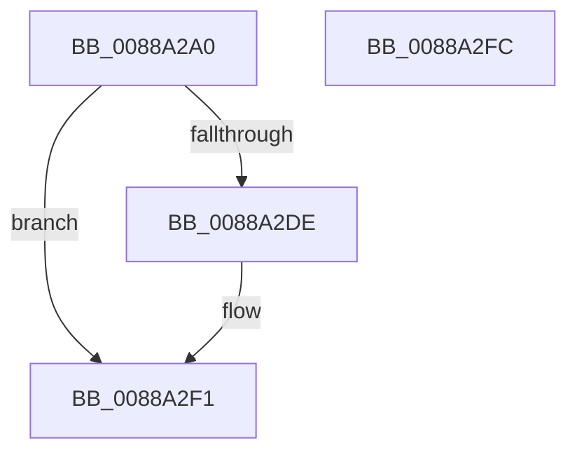

# MmUnsecureVirtualMemory

- RVA: `0x0088A2A0`–`0x0088A2FD` (길이 `93` bytes)
- VA: `0x000000014088A2A0`
- 실행 섹션: `PAGE`
- PDB 이름 있음: `예`; PDB Function 태그: `아니요`
- unwind 정보 RVA: `0x00068D5C`
- 디코드: `24`개 명령, `93/93` bytes 표시
- 미해석 바이트: `0` (있으면 어셈블리에 `.byte`로 보존)

> 이 문서는 커널 이미지의 기계어와 PDB 기호를 분석해 생성했습니다. 4번과 5번은 함수 원형과 자료형을 바이너리 사용 방식에서 추정한 C 해석이며 원본 소스 복구 결과는 아닙니다.

## 1. Dependencies

- 직접 호출 지점: **3**; 고유 호출 대상: **3**
- 직접 호출자로 확인된 함수: **14**
- RIP 상대 이미지 참조: **1**

### Outgoing calls
- `0x0088A2D1` → [MiObtainReferencedSecureVad](../../text/29/MiObtainReferencedSecureVad_function_00295688.md) (function, `0x00295688`)
- `0x0088A2E4` → [MiRemoveSecureEntry](../../text/43/MiRemoveSecureEntry_function_00430D5C.md) (function, `0x00430D5C`)
- `0x0088A2EC` → [MiUnlockAndDereferenceVad](../../text/31/MiUnlockAndDereferenceVad_function_00316E60.md) (function, `0x00316E60`)

### Direct callers
- [RtlFileMapFree](../../text/4B/RtlFileMapFree_function_004BF868.md) at `0x004BF8B3`
- [DifMmUnsecureVirtualMemoryWrapper](../../text/63/DifMmUnsecureVirtualMemoryWrapper_function_00637100.md) at `0x006371C6`
- [AlpcpForceUnlinkSecureView](../74/AlpcpForceUnlinkSecureView_function_0074C604.md) at `0x0074C669`
- [VmpUnsecureMemoryForPin](../7A/VmpUnsecureMemoryForPin_function_007AE05C.md) at `0x007AE0A3`
- [AslpFilePartialViewFree](../82/AslpFilePartialViewFree_function_00821D48.md) at `0x00821D5E`
- [AlpcpRestoreWriteAccess](AlpcpRestoreWriteAccess_function_00889990.md) at `0x008899F5`
- [AlpcpPrepareViewForDelivery](AlpcpPrepareViewForDelivery_function_00889A44.md) at `0x00889B66`
- [AlpcViewDestroyProcedure](AlpcViewDestroyProcedure_function_0088B080.md) at `0x0088B1ED`
- [MiMapViewOfImageSection](../97/MiMapViewOfImageSection_function_0097E92C.md) at `0x0097F0B9`
- [sub_009A0BF0](../9A/Unknown_function_009A0BF0.md) at `0x009A0C6F`
- [MmStoreAllocateVirtualMemory](../A6/MmStoreAllocateVirtualMemory_function_00A68238.md) at `0x00A68419`
- [VmUnsecureBackingMemory](../AC/VmUnsecureBackingMemory_function_00AC5480.md) at `0x00AC5484`
- [sub_00B19294](../B1/Unknown_function_00B19294.md) at `0x00B1932F`
- [sub_00B19294](../B1/Unknown_function_00B19294.md) at `0x00B1938C`
- [MmInitializeImageViewExtension](../../init/C6/MmInitializeImageViewExtension_function_00C64F08.md) at `0x00C64F85`

### Static image references
- `0x0088A2C4` → RVA `0x00E2DB80` (`.data`; read)

## 2. Other-region calls and transfers

- 다른 실행 섹션으로 향하는 call: **3**
  - `0x0088A2D1` → [MiObtainReferencedSecureVad](../../text/29/MiObtainReferencedSecureVad_function_00295688.md) (`PAGE` → `.text`)
  - `0x0088A2E4` → [MiRemoveSecureEntry](../../text/43/MiRemoveSecureEntry_function_00430D5C.md) (`PAGE` → `.text`)
  - `0x0088A2EC` → [MiUnlockAndDereferenceVad](../../text/31/MiUnlockAndDereferenceVad_function_00316E60.md) (`PAGE` → `.text`)
- 별도 외부 분기/꼬리 이동을 확인하지 못했습니다.

## 3. Assembly (complete function range)

```asm
0088A2A0  48 89 5C 24 10                  mov qword ptr [rsp + 0x10], rbx
0088A2A5  57                              push rdi
0088A2A6  48 83 EC 20                     sub rsp, 0x20
0088A2AA  65 48 8B 04 25 88 01 00 00      mov rax, qword ptr gs:[0x188]
0088A2B3  48 8D 54 24 30                  lea rdx, [rsp + 0x30]
0088A2B8  83 64 24 30 00                  and dword ptr [rsp + 0x30], 0
0088A2BD  48 8B 98 B8 00 00 00            mov rbx, qword ptr [rax + 0xb8]
0088A2C4  48 33 1D B5 38 5A 00            xor rbx, qword ptr [rip + 0x5a38b5]
0088A2CB  48 33 D9                        xor rbx, rcx
0088A2CE  48 8B CB                        mov rcx, rbx
0088A2D1  E8 B2 B3 A0 FF                  call 0x140295688
0088A2D6  48 8B F8                        mov rdi, rax
0088A2D9  48 85 C0                        test rax, rax
0088A2DC  74 13                           je 0x14088a2f1
0088A2DE  48 8B D3                        mov rdx, rbx
0088A2E1  48 8B C8                        mov rcx, rax
0088A2E4  E8 73 6A BA FF                  call 0x140430d5c
0088A2E9  48 8B CF                        mov rcx, rdi
0088A2EC  E8 6F CB A8 FF                  call 0x140316e60
0088A2F1  48 8B 5C 24 38                  mov rbx, qword ptr [rsp + 0x38]
0088A2F6  48 83 C4 20                     add rsp, 0x20
0088A2FA  5F                              pop rdi
0088A2FB  C3                              ret
0088A2FC  CC                              int3
```

## 4. C-style interpretation (structured pseudocode)

```c
__int64 __fastcall MmUnsecureVirtualMemory(__int64 a1)
{
    __int64 result;
    __int64 v_rbx;
    __int64 v_rsp;
    unsigned __int64 v_stack_p10;
    unsigned __int64 v_stack_p8;

    v_stack_p10 = v_rbx;
    v_rsp = (v_rsp) - (32);
    v_rbx = (*(unsigned __int64 *)(*(unsigned __int64 *)(gs_base + (0 + 392)) + 184)) ^ (*(unsigned __int64 *)(v_rip + 5912757));
    v_rbx = (v_rbx) ^ (a1);
    result = MiObtainReferencedSecureVad(v_rbx, v_stack_p8, a3, a4);
    if (result != 0) {
        a2 = v_rbx;
        a1 = result;
        result = MiRemoveSecureEntry(a1, a2, a3, a4);
        a1 = result;
        result = MiUnlockAndDereferenceVad(a1, a2, a3, a4);
    }
    v_rsp = (v_rsp) + (32);
    return result;
}
```

## 5. (Beta) C Style

```c
int64_t MmUnsecureVirtualMemory(int64_t Arg1)
{
    int64_t result;
    int64_t local_rbx;
    int64_t local_rsp;
    uint64_t v_stack_p10;
    uint64_t v_stack_p8;

    v_stack_p10 = local_rbx;
    local_rsp = (local_rsp) - (32);
    local_rbx = (*(uint64_t *)(*(uint64_t *)(gs_base + (0 + 0x188)) + 0xB8)) ^ (*(uint64_t *)(v_rip + 0x5A38B5));
    local_rbx = (local_rbx) ^ (Arg1);
    result = MiObtainReferencedSecureVad(local_rbx, v_stack_p8, a3, a4);
    if (result != 0) {
        a2 = local_rbx;
        Arg1 = result;
        result = MiRemoveSecureEntry(Arg1, a2, a3, a4);
        Arg1 = result;
        result = MiUnlockAndDereferenceVad(Arg1, a2, a3, a4);
    }
    local_rsp = (local_rsp) + (32);
    return result;
}
```

## 6. Execution-region graph

[열기: 2D/3D 그래프와 함수 탐색 컨트롤 패널](../../../control-panel.html?section=page&rva=0x0088A2A0&view=graph)

- 2D 그래프는 위에서 아래로 흐르고, 3D 그래프는 빈 공간을 드래그해 회전합니다. Shift+드래그는 이동, 휠은 확대·축소, 함수 노드 선택은 대상 보고서 이동입니다.

### Static fallback


