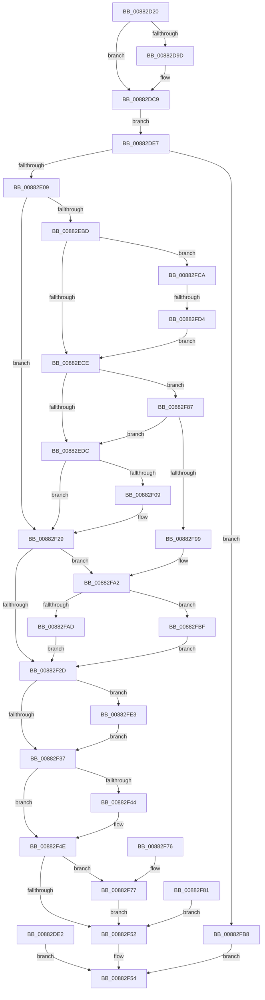

# NtAllocateVirtualMemory

- RVA: `0x00882D20`–`0x00882FF0` (길이 `720` bytes)
- VA: `0x0000000140882D20`
- 실행 섹션: `PAGE`
- PDB 이름 있음: `예`; PDB Function 태그: `예`
- unwind 정보 RVA: `0x0007C74C`
- 디코드: `152`개 명령, `720/720` bytes 표시
- 미해석 바이트: `0` (있으면 어셈블리에 `.byte`로 보존)

> 이 문서는 커널 이미지의 기계어와 PDB 기호를 분석해 생성했습니다. 4번과 5번은 함수 원형과 자료형을 바이너리 사용 방식에서 추정한 C 해석이며 원본 소스 복구 결과는 아닙니다.

## 1. Dependencies

- 직접 호출 지점: **4**; 고유 호출 대상: **4**
- 직접 호출자로 확인된 함수: **0**
- RIP 상대 이미지 참조: **2**

### Outgoing calls
- `0x00882EAE` → [MiAllocateVirtualMemoryPrepare](MiAllocateVirtualMemoryPrepare_function_00883220.md) (function, `0x00883220`)
- `0x00882EFA` → [MiAllocateVirtualMemory](MiAllocateVirtualMemory_function_00883B40.md) (function, `0x00883B40`)
- `0x00882F49` → [ObfDereferenceObjectWithTag](../../text/2F/ObfDereferenceObjectWithTag_function_002F78E0.md) (function, `0x002F78E0`)
- `0x00882FE6` → [PsDereferencePartition](../../text/34/PsDereferencePartition_function_00342E70.md) (function, `0x00342E70`)

### Direct callers
- 이 함수 시작 RVA로 연결되는 직접 call은 확인되지 않았습니다. 간접 호출은 완전히 역산할 수 없습니다.

### Static image references
- `0x00882FAD` → RVA `0x00E302B4` (`.data`; read/write)
- `0x00882FBF` → RVA `0x00E302B0` (`.data`; read/write)

## 2. Other-region calls and transfers

- 다른 실행 섹션으로 향하는 call: **2**
  - `0x00882F49` → [ObfDereferenceObjectWithTag](../../text/2F/ObfDereferenceObjectWithTag_function_002F78E0.md) (`PAGE` → `.text`)
  - `0x00882FE6` → [PsDereferencePartition](../../text/34/PsDereferencePartition_function_00342E70.md) (`PAGE` → `.text`)
- call이 아닌 외부 분기/꼬리 이동: **1**
  - `0x00882FCE` → [sub_00B18D94](../B1/Unknown_function_00B18D94.md) (`tail-transfer`)

## 3. Assembly (complete function range)

```asm
00882D20  4C 8B DC                        mov r11, rsp
00882D23  49 89 5B 08                     mov qword ptr [r11 + 8], rbx
00882D27  49 89 73 10                     mov qword ptr [r11 + 0x10], rsi
00882D2B  49 89 7B 18                     mov qword ptr [r11 + 0x18], rdi
00882D2F  4D 89 63 20                     mov qword ptr [r11 + 0x20], r12
00882D33  41 55                           push r13
00882D35  41 56                           push r14
00882D37  41 57                           push r15
00882D39  48 81 EC 80 01 00 00            sub rsp, 0x180
00882D40  4D 8B E1                        mov r12, r9
00882D43  4C 8B EA                        mov r13, rdx
00882D46  4C 8B D1                        mov r10, rcx
00882D49  33 FF                           xor edi, edi
00882D4B  49 89 BB F0 FE FF FF            mov qword ptr [r11 - 0x110], rdi
00882D52  49 89 BB F8 FE FF FF            mov qword ptr [r11 - 0x108], rdi
00882D59  0F 57 C0                        xorps xmm0, xmm0
00882D5C  33 C0                           xor eax, eax
00882D5E  0F 11 84 24 B0 00 00 00         movups xmmword ptr [rsp + 0xb0], xmm0
00882D66  0F 11 84 24 C0 00 00 00         movups xmmword ptr [rsp + 0xc0], xmm0
00882D6E  0F 11 84 24 D0 00 00 00         movups xmmword ptr [rsp + 0xd0], xmm0
00882D76  0F 11 84 24 E0 00 00 00         movups xmmword ptr [rsp + 0xe0], xmm0
00882D7E  49 89 83 58 FF FF FF            mov qword ptr [r11 - 0xa8], rax
00882D85  65 48 8B 04 25 88 01 00 00      mov rax, qword ptr gs:[0x188]
00882D8E  0F B6 88 32 02 00 00            movzx ecx, byte ptr [rax + 0x232]
00882D95  88 4C 24 70                     mov byte ptr [rsp + 0x70], cl
00882D99  84 C9                           test cl, cl
00882D9B  74 2C                           je 0x140882dc9
00882D9D  48 BA 00 00 FF FF FF 7F 00 00   movabs rdx, 0x7fffffff0000
00882DA7  48 8B CA                        mov rcx, rdx
00882DAA  4C 3B EA                        cmp r13, rdx
00882DAD  49 0F 42 CD                     cmovb rcx, r13
00882DB1  48 8B 01                        mov rax, qword ptr [rcx]
00882DB4  48 89 01                        mov qword ptr [rcx], rax
00882DB7  4C 3B CA                        cmp r9, rdx
00882DBA  49 0F 42 D1                     cmovb rdx, r9
00882DBE  48 8B 02                        mov rax, qword ptr [rdx]
00882DC1  48 89 02                        mov qword ptr [rdx], rax
00882DC4  0F B6 4C 24 70                  movzx ecx, byte ptr [rsp + 0x70]
00882DC9  4D 8B 75 00                     mov r14, qword ptr [r13]
00882DCD  4C 89 B4 24 88 00 00 00         mov qword ptr [rsp + 0x88], r14
00882DD5  4D 8B 39                        mov r15, qword ptr [r9]
00882DD8  4C 89 BC 24 90 00 00 00         mov qword ptr [rsp + 0x90], r15
00882DE0  EB 05                           jmp 0x140882de7
00882DE2  E9 6D 01 00 00                  jmp 0x140882f54
00882DE7  8B B4 24 C0 01 00 00            mov esi, dword ptr [rsp + 0x1c0]
00882DEE  8B C6                           mov eax, esi
00882DF0  83 E0 7F                        and eax, 0x7f
00882DF3  89 84 24 D0 00 00 00            mov dword ptr [rsp + 0xd0], eax
00882DFA  83 E6 80                        and esi, 0xffffff80
00882DFD  F7 C6 00 40 04 00               test esi, 0x44000
00882E03  0F 85 AF 01 00 00               jne 0x140882fb8
00882E09  0F 11 84 24 00 01 00 00         movups xmmword ptr [rsp + 0x100], xmm0
00882E11  0F 11 84 24 10 01 00 00         movups xmmword ptr [rsp + 0x110], xmm0
00882E19  0F 11 84 24 20 01 00 00         movups xmmword ptr [rsp + 0x120], xmm0
00882E21  0F 11 84 24 30 01 00 00         movups xmmword ptr [rsp + 0x130], xmm0
00882E29  0F 11 84 24 40 01 00 00         movups xmmword ptr [rsp + 0x140], xmm0
00882E31  0F 11 84 24 50 01 00 00         movups xmmword ptr [rsp + 0x150], xmm0
00882E39  0F 11 84 24 60 01 00 00         movups xmmword ptr [rsp + 0x160], xmm0
00882E41  0F 11 84 24 70 01 00 00         movups xmmword ptr [rsp + 0x170], xmm0
00882E49  48 89 BC 24 80 00 00 00         mov qword ptr [rsp + 0x80], rdi
00882E51  48 89 BC 24 98 00 00 00         mov qword ptr [rsp + 0x98], rdi
00882E59  48 89 7C 24 78                  mov qword ptr [rsp + 0x78], rdi
00882E5E  48 8D 84 24 98 00 00 00         lea rax, [rsp + 0x98]
00882E66  48 89 44 24 60                  mov qword ptr [rsp + 0x60], rax
00882E6B  48 8D 84 24 00 01 00 00         lea rax, [rsp + 0x100]
00882E73  48 89 44 24 58                  mov qword ptr [rsp + 0x58], rax
00882E78  48 89 7C 24 50                  mov qword ptr [rsp + 0x50], rdi
00882E7D  89 7C 24 48                     mov dword ptr [rsp + 0x48], edi
00882E81  89 7C 24 40                     mov dword ptr [rsp + 0x40], edi
00882E85  88 4C 24 38                     mov byte ptr [rsp + 0x38], cl
00882E89  48 8D 84 24 B0 00 00 00         lea rax, [rsp + 0xb0]
00882E91  48 89 44 24 30                  mov qword ptr [rsp + 0x30], rax
00882E96  8B 84 24 C8 01 00 00            mov eax, dword ptr [rsp + 0x1c8]
00882E9D  89 44 24 28                     mov dword ptr [rsp + 0x28], eax
00882EA1  89 74 24 20                     mov dword ptr [rsp + 0x20], esi
00882EA5  4D 8B CF                        mov r9, r15
00882EA8  49 8B D6                        mov rdx, r14
00882EAB  49 8B CA                        mov rcx, r10
00882EAE  E8 6D 03 00 00                  call 0x140883220
00882EB3  8B D8                           mov ebx, eax
00882EB5  89 44 24 74                     mov dword ptr [rsp + 0x74], eax
00882EB9  85 C0                           test eax, eax
00882EBB  78 6C                           js 0x140882f29
00882EBD  48 8B 8C 24 C8 00 00 00         mov rcx, qword ptr [rsp + 0xc8]
00882EC5  48 85 C9                        test rcx, rcx
00882EC8  0F 85 FC 00 00 00               jne 0x140882fca
00882ECE  80 BC 24 E0 00 00 00 00         cmp byte ptr [rsp + 0xe0], 0
00882ED6  0F 85 AB 00 00 00               jne 0x140882f87
00882EDC  48 8D 84 24 80 00 00 00         lea rax, [rsp + 0x80]
00882EE4  48 89 44 24 20                  mov qword ptr [rsp + 0x20], rax
00882EE9  45 33 C9                        xor r9d, r9d
00882EEC  45 33 C0                        xor r8d, r8d
00882EEF  48 8B D7                        mov rdx, rdi
00882EF2  48 8D 8C 24 00 01 00 00         lea rcx, [rsp + 0x100]
00882EFA  E8 41 0C 00 00                  call 0x140883b40
00882EFF  8B D8                           mov ebx, eax
00882F01  89 44 24 74                     mov dword ptr [rsp + 0x74], eax
00882F05  85 C0                           test eax, eax
00882F07  78 20                           js 0x140882f29
00882F09  4C 8B B4 24 80 00 00 00         mov r14, qword ptr [rsp + 0x80]
00882F11  4C 89 B4 24 88 00 00 00         mov qword ptr [rsp + 0x88], r14
00882F19  4C 8B BC 24 18 01 00 00         mov r15, qword ptr [rsp + 0x118]
00882F21  4C 89 BC 24 90 00 00 00         mov qword ptr [rsp + 0x90], r15
00882F29  85 DB                           test ebx, ebx
00882F2B  78 75                           js 0x140882fa2
00882F2D  48 83 FF 02                     cmp rdi, 2
00882F31  0F 83 AC 00 00 00               jae 0x140882fe3
00882F37  48 8B 8C 24 98 00 00 00         mov rcx, qword ptr [rsp + 0x98]
00882F3F  48 85 C9                        test rcx, rcx
00882F42  74 0A                           je 0x140882f4e
00882F44  BA 4D 6D 56 6D                  mov edx, 0x6d566d4d
00882F49  E8 92 49 A7 FF                  call 0x1402f78e0
00882F4E  85 DB                           test ebx, ebx
00882F50  79 25                           jns 0x140882f77
00882F52  8B C3                           mov eax, ebx
00882F54  4C 8D 9C 24 80 01 00 00         lea r11, [rsp + 0x180]
00882F5C  49 8B 5B 20                     mov rbx, qword ptr [r11 + 0x20]
00882F60  49 8B 73 28                     mov rsi, qword ptr [r11 + 0x28]
00882F64  49 8B 7B 30                     mov rdi, qword ptr [r11 + 0x30]
00882F68  4D 8B 63 38                     mov r12, qword ptr [r11 + 0x38]
00882F6C  49 8B E3                        mov rsp, r11
00882F6F  41 5F                           pop r15
00882F71  41 5E                           pop r14
00882F73  41 5D                           pop r13
00882F75  C3                              ret
00882F76  CC                              int3
00882F77  4D 89 75 00                     mov qword ptr [r13], r14
00882F7B  4D 89 3C 24                     mov qword ptr [r12], r15
00882F7F  EB D1                           jmp 0x140882f52
00882F81  8B 5C 24 74                     mov ebx, dword ptr [rsp + 0x74]
00882F85  EB CB                           jmp 0x140882f52
00882F87  81 E6 00 00 40 20               and esi, 0x20400000
00882F8D  81 FE 00 00 40 00               cmp esi, 0x400000
00882F93  0F 84 43 FF FF FF               je 0x140882edc
00882F99  BB 0D 00 00 C0                  mov ebx, 0xc000000d
00882F9E  89 5C 24 74                     mov dword ptr [rsp + 0x74], ebx
00882FA2  48 83 BC 24 00 01 00 00 00      cmp qword ptr [rsp + 0x100], 0
00882FAB  74 12                           je 0x140882fbf
00882FAD  FF 05 01 D3 5A 00               inc dword ptr [rip + 0x5ad301]
00882FB3  E9 75 FF FF FF                  jmp 0x140882f2d
00882FB8  B8 0D 00 00 C0                  mov eax, 0xc000000d
00882FBD  EB 95                           jmp 0x140882f54
00882FBF  FF 05 EB D2 5A 00               inc dword ptr [rip + 0x5ad2eb]
00882FC5  E9 63 FF FF FF                  jmp 0x140882f2d
00882FCA  48 83 F9 FD                     cmp rcx, -3
00882FCE  0F 85 C0 5D 29 00               jne 0x140b18d94
00882FD4  BF 01 00 00 00                  mov edi, 1
00882FD9  48 89 7C 24 78                  mov qword ptr [rsp + 0x78], rdi
00882FDE  E9 EB FE FF FF                  jmp 0x140882ece
00882FE3  48 8B CF                        mov rcx, rdi
00882FE6  E8 85 FE AB FF                  call 0x140342e70
00882FEB  E9 47 FF FF FF                  jmp 0x140882f37
```

## 4. C-style interpretation (structured pseudocode)

```c
__int64 __fastcall NtAllocateVirtualMemory(__int64 a1, __int64 a2, int a3, __int64 a4, unsigned int a5, unsigned int a6)
{
    __int64 result;
    __int64 v_r14;
    __int64 v_r15;
    __int64 v_rdi;
    __int64 v_rsi;
    __int64 v_rsp;
    unsigned __int64 v_stack_m100;
    unsigned __int64 v_stack_m108;
    unsigned int v_stack_m10C;
    unsigned __int64 v_stack_m110;
    unsigned __int64 v_stack_m118;
    unsigned __int64 v_stack_m120;
    unsigned int v_stack_m124;
    unsigned __int8 v_stack_m128;
    unsigned __int64 v_stack_m138;
    unsigned __int64 v_stack_m140;
    unsigned __int64 v_stack_m148;
    unsigned int v_stack_m150;
    unsigned int v_stack_m158;
    unsigned __int8 v_stack_m160;
    unsigned __int64 v_stack_m168;
    unsigned int v_stack_m170;
    unsigned int v_stack_m178;
    unsigned __int64 v_stack_m18;
    unsigned __int64 v_stack_m28;
    unsigned __int64 v_stack_m38;
    unsigned __int64 v_stack_m48;
    unsigned __int64 v_stack_m58;
    unsigned __int64 v_stack_m68;
    unsigned __int64 v_stack_m78;
    unsigned __int64 v_stack_m80;
    unsigned __int64 v_stack_m88;
    unsigned __int64 v_stack_m98;
    unsigned __int64 v_stack_mB8;
    unsigned __int64 v_stack_mC8;
    unsigned __int64 v_stack_mD0;
    unsigned __int64 v_stack_mD8;
    unsigned __int64 v_stack_mE8;

    *(unsigned __int64 *)(v_rsp + 8) = v_rbx;
    *(unsigned __int64 *)(v_rsp + 16) = v_rsi;
    *(unsigned __int64 *)(v_rsp + 24) = v_rdi;
    *(unsigned __int64 *)(v_rsp + 32) = v_r12;
    v_rsp = (v_rsp) - (384);
    v_rdi = 0;
    *(unsigned __int64 *)(v_rsp - 272) = 0;
    *(unsigned __int64 *)(v_rsp - 264) = 0;
    result = 0;
    v_stack_mE8 = v_xmm0;
    v_stack_mD8 = v_xmm0;
    v_stack_mC8 = v_xmm0;
    v_stack_mB8 = v_xmm0;
    *(unsigned __int64 *)(v_rsp - 168) = 0;
    v_stack_m128 = (unsigned __int8)(*(unsigned __int8 *)(*(unsigned __int64 *)(gs_base + (0 + 392)) + 562));
    result = *(unsigned __int64 *)(gs_base + (0 + 392));
    if ((unsigned __int8)(*(unsigned __int8 *)(*(unsigned __int64 *)(gs_base + (0 + 392)) + 562)) != 0) {
        a1 = a2;
        if (a2 < a2) { a1 = a2; }
        result = *(unsigned __int64 *)(a1);
        *(unsigned __int64 *)(a1) = result;
        if (a4 < a2) { a2 = a4; }
        result = *(unsigned __int64 *)(a2);
        *(unsigned __int64 *)(a2) = result;
        a1 = v_stack_m128;
    }
    v_stack_m110 = *(unsigned __int64 *)(a2);
    v_stack_m108 = *(unsigned __int64 *)(a4);
    goto loc_00882DE7;
loc_00882DE7:
    result = (unsigned int)(((unsigned int)((unsigned int)((unsigned int)(a5)))) & (127));
    v_stack_mC8 = (unsigned int)(result);
    v_rsi = (unsigned int)(((unsigned int)(a5)) & (0xFFFFFF80ULL));
    if ((((unsigned int)(v_rsi)) & (0x44000ULL)) != 0) goto loc_00882FB8;
    v_stack_m98 = v_xmm0;
    v_stack_m88 = v_xmm0;
    v_stack_m78 = v_xmm0;
    v_stack_m68 = v_xmm0;
    v_stack_m58 = v_xmm0;
    v_stack_m48 = v_xmm0;
    v_stack_m38 = v_xmm0;
    v_stack_m28 = v_xmm0;
    v_stack_m118 = 0;
    v_stack_m100 = 0;
    v_stack_m120 = 0;
    v_stack_m138 = v_stack_m100;
    v_stack_m140 = v_stack_m98;
    v_stack_m148 = 0;
    v_stack_m150 = 0;
    v_stack_m158 = 0;
    v_stack_m160 = (unsigned __int8)(a1);
    v_stack_m168 = v_stack_mE8;
    v_stack_m170 = (unsigned int)((unsigned int)(a6));
    v_stack_m178 = (unsigned int)(v_rsi);
    result = MiAllocateVirtualMemoryPrepare(a1, *(unsigned __int64 *)(a2), a3, *(unsigned __int64 *)(a4));
    v_stack_m124 = (unsigned int)(result);
    if (sign_flag) goto loc_00882F29;
    if (v_stack_mD0 != 0) goto loc_00882FCA;
loc_00882ECE:
    if (v_stack_mB8 != 0) goto loc_00882F87;
loc_00882EDC:
    v_stack_m178 = v_stack_m118;
    a4 = 0;
    a3 = 0;
    result = MiAllocateVirtualMemory(v_stack_m98, 0, a3, a4);
    v_stack_m124 = (unsigned int)(result);
    v_r14 = *(unsigned __int64 *)(a2);
    v_r15 = *(unsigned __int64 *)(a4);
    if (!(sign_flag)) {
        v_r14 = v_stack_m118;
        v_stack_m110 = v_r14;
        v_r15 = v_stack_m80;
        v_stack_m108 = v_r15;
    }
    if (sign_flag) goto loc_00882FA2;
loc_00882F2D:
    if (0 >= 2) goto loc_00882FE3;
loc_00882F37:
    if (v_stack_m100 != 0) {
        a2 = 0x6D566D4DULL;
        result = ObfDereferenceObjectWithTag(v_stack_m100, a2, a3, a4);
    }
    if (!sign_flag) goto loc_00882F77;
loc_00882F52:
loc_00882F54:
    return (unsigned int)((unsigned int)((unsigned int)((unsigned int)(result))));
loc_00882F77:
    *(unsigned __int64 *)(a2) = v_r14;
    *(unsigned __int64 *)(*(unsigned __int64 *)(v_stack_m18 + 56)) = v_r15;
    goto loc_00882F52;
loc_00882F87:
    v_rsi = (unsigned int)((*(unsigned __int64 *)(v_stack_m18 + 40)) & (0x20400000ULL));
    if (((unsigned int)(v_rsi)) == 0x400000ULL) goto loc_00882EDC;
    v_stack_m10C = (unsigned int)((unsigned int)(0xC000000DULL));
loc_00882FA2:
    if (v_stack_m80 == 0) goto loc_00882FBF;
    goto loc_00882F2D;
loc_00882FB8:
    goto loc_00882F54;
loc_00882FBF:
    goto loc_00882F2D;
loc_00882FCA:
    v_stack_m108 = 1;
    goto loc_00882ECE;
loc_00882FE3:
    result = PsDereferencePartition(1, a2, a3, a4);
    goto loc_00882F37;
}
```

## 5. (Beta) C Style

```c
int64_t NtAllocateVirtualMemory(int64_t Arg1, int64_t Arg2, int32_t Arg3, void *Arg4, uint32_t Arg5, uint32_t Arg6)
{
    uint8_t *arg4 = (uint8_t *)Arg4;

    int64_t result;
    int64_t local_r14;
    int64_t local_r15;
    int64_t local_rdi;
    int64_t local_rsi;
    int64_t local_rsp;
    uint64_t v_stack_m100;
    uint64_t v_stack_m108;
    uint32_t v_stack_m10C;
    uint64_t v_stack_m110;
    uint64_t v_stack_m118;
    uint64_t v_stack_m120;
    uint32_t v_stack_m124;
    uint8_t v_stack_m128;
    uint64_t v_stack_m138;
    uint64_t v_stack_m140;
    uint64_t v_stack_m148;
    uint32_t v_stack_m150;
    uint32_t v_stack_m158;
    uint8_t v_stack_m160;
    uint64_t v_stack_m168;
    uint32_t v_stack_m170;
    uint32_t v_stack_m178;
    uint64_t v_stack_m18;
    uint64_t v_stack_m28;
    uint64_t v_stack_m38;
    uint64_t v_stack_m48;
    uint64_t v_stack_m58;
    uint64_t v_stack_m68;
    uint64_t v_stack_m78;
    uint64_t v_stack_m80;
    uint64_t v_stack_m88;
    uint64_t v_stack_m98;
    uint64_t v_stack_mB8;
    uint64_t v_stack_mC8;
    uint64_t v_stack_mD0;
    uint64_t v_stack_mD8;
    uint64_t v_stack_mE8;

    *(uint64_t *)(local_rsp + 0x8) = local_rbx;
    *(uint64_t *)(local_rsp + 0x10) = local_rsi;
    *(uint64_t *)(local_rsp + 0x18) = local_rdi;
    *(uint64_t *)(local_rsp + 0x20) = local_r12;
    local_rsp = (local_rsp) - (384);
    local_rdi = 0;
    *(uint64_t *)(local_rsp - 0x110) = 0;
    *(uint64_t *)(local_rsp - 0x108) = 0;
    result = 0;
    v_stack_mE8 = v_xmm0;
    v_stack_mD8 = v_xmm0;
    v_stack_mC8 = v_xmm0;
    v_stack_mB8 = v_xmm0;
    *(uint64_t *)(local_rsp - 0xA8) = 0;
    v_stack_m128 = (uint8_t)(*(uint8_t *)(*(uint64_t *)(gs_base + (0 + 0x188)) + 0x232));
    result = *(uint64_t *)(gs_base + (0 + 0x188));
    if ((uint8_t)(*(uint8_t *)(*(uint64_t *)(gs_base + (0 + 0x188)) + 0x232)) != 0) {
        Arg1 = Arg2;
        if (Arg2 < Arg2) { Arg1 = Arg2; }
        result = *(uint64_t *)(Arg1);
        *(uint64_t *)(Arg1) = result;
        if (Arg4 < Arg2) { Arg2 = Arg4; }
        result = *(uint64_t *)(Arg2);
        *(uint64_t *)(Arg2) = result;
        Arg1 = v_stack_m128;
    }
    v_stack_m110 = *(uint64_t *)(Arg2);
    v_stack_m108 = *(uint64_t *)(arg4);
    goto loc_00882DE7;
loc_00882DE7:
    result = (uint32_t)(((uint32_t)((uint32_t)((uint32_t)(Arg5)))) & (127));
    v_stack_mC8 = (uint32_t)(result);
    local_rsi = (uint32_t)(((uint32_t)(Arg5)) & (0xFFFFFF80ULL));
    if ((((uint32_t)(local_rsi)) & (0x44000ULL)) != 0) goto loc_00882FB8;
    v_stack_m98 = v_xmm0;
    v_stack_m88 = v_xmm0;
    v_stack_m78 = v_xmm0;
    v_stack_m68 = v_xmm0;
    v_stack_m58 = v_xmm0;
    v_stack_m48 = v_xmm0;
    v_stack_m38 = v_xmm0;
    v_stack_m28 = v_xmm0;
    v_stack_m118 = 0;
    v_stack_m100 = 0;
    v_stack_m120 = 0;
    v_stack_m138 = v_stack_m100;
    v_stack_m140 = v_stack_m98;
    v_stack_m148 = 0;
    v_stack_m150 = 0;
    v_stack_m158 = 0;
    v_stack_m160 = (uint8_t)(Arg1);
    v_stack_m168 = v_stack_mE8;
    v_stack_m170 = (uint32_t)((uint32_t)(Arg6));
    v_stack_m178 = (uint32_t)(local_rsi);
    result = MiAllocateVirtualMemoryPrepare(Arg1, *(uint64_t *)(Arg2), Arg3, *(uint64_t *)(arg4));
    v_stack_m124 = (uint32_t)(result);
    if (sign_flag) goto loc_00882F29;
    if (v_stack_mD0 != 0) goto loc_00882FCA;
loc_00882ECE:
    if (v_stack_mB8 != 0) goto loc_00882F87;
loc_00882EDC:
    v_stack_m178 = v_stack_m118;
    Arg4 = 0;
    Arg3 = 0;
    result = MiAllocateVirtualMemory(v_stack_m98, 0, Arg3, Arg4);
    v_stack_m124 = (uint32_t)(result);
    local_r14 = *(uint64_t *)(Arg2);
    local_r15 = *(uint64_t *)(arg4);
    if (!(sign_flag)) {
        local_r14 = v_stack_m118;
        v_stack_m110 = local_r14;
        local_r15 = v_stack_m80;
        v_stack_m108 = local_r15;
    }
    if (sign_flag) goto loc_00882FA2;
loc_00882F2D:
    if (0 >= 2) goto loc_00882FE3;
loc_00882F37:
    if (v_stack_m100 != 0) {
        Arg2 = 0x6D566D4DULL;
        result = ObfDereferenceObjectWithTag(v_stack_m100, Arg2, Arg3, Arg4);
    }
    if (!sign_flag) goto loc_00882F77;
loc_00882F52:
loc_00882F54:
    return (uint32_t)((uint32_t)((uint32_t)((uint32_t)(result))));
loc_00882F77:
    *(uint64_t *)(Arg2) = local_r14;
    *(uint64_t *)(*(uint64_t *)(v_stack_m18 + 0x38)) = local_r15;
    goto loc_00882F52;
loc_00882F87:
    local_rsi = (uint32_t)((*(uint64_t *)(v_stack_m18 + 0x28)) & (0x20400000ULL));
    if (((uint32_t)(local_rsi)) == 0x400000ULL) goto loc_00882EDC;
    v_stack_m10C = (uint32_t)((uint32_t)(0xC000000DULL));
loc_00882FA2:
    if (v_stack_m80 == 0) goto loc_00882FBF;
    goto loc_00882F2D;
loc_00882FB8:
    goto loc_00882F54;
loc_00882FBF:
    goto loc_00882F2D;
loc_00882FCA:
    v_stack_m108 = 1;
    goto loc_00882ECE;
loc_00882FE3:
    result = PsDereferencePartition(1, Arg2, Arg3, Arg4);
    goto loc_00882F37;
}
```

### 관측된 메모리 오프셋

구조체 형식이 확인되지 않은 접근은 인자 기준의 오프셋으로만 기록했습니다.

| 기준 인자 | 오프셋 표현 | 폭 (bit) | 접근 |
|---|---:|---:|---|
| `Arg4` | `+ 0x0` | `64` | `W` |

## 6. Execution-region graph

[열기: 2D/3D 그래프와 함수 탐색 컨트롤 패널](../../../control-panel.html?section=page&rva=0x00882D20&view=graph)

- 2D 그래프는 위에서 아래로 흐르고, 3D 그래프는 빈 공간을 드래그해 회전합니다. Shift+드래그는 이동, 휠은 확대·축소, 함수 노드 선택은 대상 보고서 이동입니다.

### Static fallback


