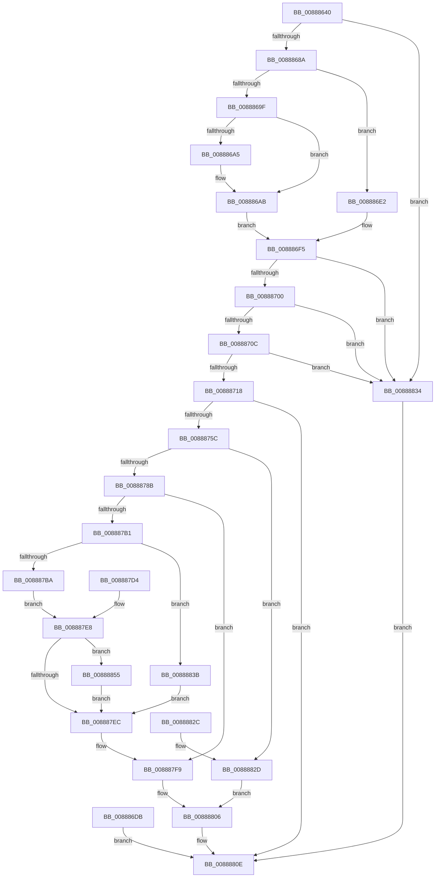

# NtAlpcCreateSectionView

- RVA: `0x00888640`–`0x0088885F` (길이 `543` bytes)
- VA: `0x0000000140888640`
- 실행 섹션: `PAGE`
- PDB 이름 있음: `예`; PDB Function 태그: `아니요`
- unwind 정보 RVA: `0x0007CDEC`
- 디코드: `131`개 명령, `543/543` bytes 표시
- 미해석 바이트: `0` (있으면 어셈블리에 `.byte`로 보존)

> 이 문서는 커널 이미지의 기계어와 PDB 기호를 분석해 생성했습니다. 4번과 5번은 함수 원형과 자료형을 바이너리 사용 방식에서 추정한 C 해석이며 원본 소스 복구 결과는 아닙니다.

## 1. Dependencies

- 직접 호출 지점: **9**; 고유 호출 대상: **8**
- 직접 호출자로 확인된 함수: **0**
- RIP 상대 이미지 참조: **2**

### Outgoing calls
- `0x008886A5` → [ExRaiseDatatypeMisalignment](../89/ExRaiseDatatypeMisalignment_function_00899FD0.md) (function, `0x00899FD0`)
- `0x0088874D` → [ObReferenceObjectByHandle](../86/ObReferenceObjectByHandle_function_00868DB0.md) (function, `0x00868DB0`)
- `0x00888775` → [AlpcReferenceBlobByHandle](AlpcReferenceBlobByHandle_function_00889F00.md) (function, `0x00889F00`)
- `0x008887A6` → [AlpcpCreateSectionView](AlpcpCreateSectionView_function_0088850C.md) (function, `0x0088850C`)
- `0x008887F4` → [AlpcpDereferenceBlobEx](AlpcpDereferenceBlobEx_function_0088AF00.md) (function, `0x0088AF00`)
- `0x00888801` → [AlpcpDereferenceBlobEx](AlpcpDereferenceBlobEx_function_0088AF00.md) (function, `0x0088AF00`)
- `0x00888809` → [ObfDereferenceObject](../../text/2F/ObfDereferenceObject_function_002F9350.md) (function, `0x002F9350`)
- `0x0088880E` → [KeLeaveCriticalRegion](../../text/25/KeLeaveCriticalRegion_function_0025D8B0.md) (function, `0x0025D8B0`)
- `0x00888858` → [AlpcpDeleteView](AlpcpDeleteView_function_0088A26C.md) (function, `0x0088A26C`)

### Direct callers
- 이 함수 시작 RVA로 연결되는 직접 call은 확인되지 않았습니다. 간접 호출은 완전히 역산할 수 없습니다.

### Static image references
- `0x00888728` → RVA `0x00FC6C18` (`ALMOSTRO`; read)
- `0x00888769` → RVA `0x000014A0` (`.rdata`; read)

## 2. Other-region calls and transfers

- 다른 실행 섹션으로 향하는 call: **2**
  - `0x00888809` → [ObfDereferenceObject](../../text/2F/ObfDereferenceObject_function_002F9350.md) (`PAGE` → `.text`)
  - `0x0088880E` → [KeLeaveCriticalRegion](../../text/25/KeLeaveCriticalRegion_function_0025D8B0.md) (`PAGE` → `.text`)
- 별도 외부 분기/꼬리 이동을 확인하지 못했습니다.

## 3. Assembly (complete function range)

```asm
00888640  4C 8B DC                        mov r11, rsp
00888643  49 89 5B 08                     mov qword ptr [r11 + 8], rbx
00888647  49 89 73 10                     mov qword ptr [r11 + 0x10], rsi
0088864B  41 55                           push r13
0088864D  41 56                           push r14
0088864F  41 57                           push r15
00888651  48 83 EC 60                     sub rsp, 0x60
00888655  4D 8B F0                        mov r14, r8
00888658  4C 8B D1                        mov r10, rcx
0088865B  33 C0                           xor eax, eax
0088865D  0F 57 C0                        xorps xmm0, xmm0
00888660  0F 11 44 24 40                  movups xmmword ptr [rsp + 0x40], xmm0
00888665  49 89 43 D8                     mov qword ptr [r11 - 0x28], rax
00888669  89 44 24 58                     mov dword ptr [rsp + 0x58], eax
0088866D  49 21 43 20                     and qword ptr [r11 + 0x20], rax
00888671  65 48 8B 04 25 88 01 00 00      mov rax, qword ptr gs:[0x188]
0088867A  66 FF 88 E4 01 00 00            dec word ptr [rax + 0x1e4]
00888681  90                              nop
00888682  85 D2                           test edx, edx
00888684  0F 85 AA 01 00 00               jne 0x140888834
0088868A  65 48 8B 04 25 88 01 00 00      mov rax, qword ptr gs:[0x188]
00888693  40 8A B0 32 02 00 00            mov sil, byte ptr [rax + 0x232]
0088869A  40 84 F6                        test sil, sil
0088869D  74 43                           je 0x1408886e2
0088869F  41 F6 C6 03                     test r14b, 3
008886A3  74 06                           je 0x1408886ab
008886A5  E8 26 19 01 00                  call 0x140899fd0
008886AA  CC                              int3
008886AB  48 B9 00 00 FF FF FF 7F 00 00   movabs rcx, 0x7fffffff0000
008886B5  4C 3B F1                        cmp r14, rcx
008886B8  49 0F 42 CE                     cmovb rcx, r14
008886BC  8A 01                           mov al, byte ptr [rcx]
008886BE  88 01                           mov byte ptr [rcx], al
008886C0  8A 41 1F                        mov al, byte ptr [rcx + 0x1f]
008886C3  88 41 1F                        mov byte ptr [rcx + 0x1f], al
008886C6  41 0F 10 00                     movups xmm0, xmmword ptr [r8]
008886CA  0F 11 44 24 40                  movups xmmword ptr [rsp + 0x40], xmm0
008886CF  41 0F 10 48 10                  movups xmm1, xmmword ptr [r8 + 0x10]
008886D4  0F 11 4C 24 50                  movups xmmword ptr [rsp + 0x50], xmm1
008886D9  EB 1A                           jmp 0x1408886f5
008886DB  8B D8                           mov ebx, eax
008886DD  E9 2C 01 00 00                  jmp 0x14088880e
008886E2  41 0F 10 00                     movups xmm0, xmmword ptr [r8]
008886E6  0F 11 44 24 40                  movups xmmword ptr [rsp + 0x40], xmm0
008886EB  41 0F 10 48 10                  movups xmm1, xmmword ptr [r8 + 0x10]
008886F0  0F 11 4C 24 50                  movups xmmword ptr [rsp + 0x50], xmm1
008886F5  83 7C 24 40 00                  cmp dword ptr [rsp + 0x40], 0
008886FA  0F 85 34 01 00 00               jne 0x140888834
00888700  48 83 7C 24 58 00               cmp qword ptr [rsp + 0x58], 0
00888706  0F 84 28 01 00 00               je 0x140888834
0088870C  48 83 7C 24 50 00               cmp qword ptr [rsp + 0x50], 0
00888712  0F 85 1C 01 00 00               jne 0x140888834
00888718  65 48 8B 04 25 88 01 00 00      mov rax, qword ptr gs:[0x188]
00888721  44 8A 88 32 02 00 00            mov r9b, byte ptr [rax + 0x232]
00888728  4C 8B 05 E9 E4 73 00            mov r8, qword ptr [rip + 0x73e4e9]
0088872F  48 83 64 24 30 00               and qword ptr [rsp + 0x30], 0
00888735  48 83 64 24 28 00               and qword ptr [rsp + 0x28], 0
0088873B  48 8D 44 24 30                  lea rax, [rsp + 0x30]
00888740  48 89 44 24 20                  mov qword ptr [rsp + 0x20], rax
00888745  BA 01 00 00 00                  mov edx, 1
0088874A  49 8B CA                        mov rcx, r10
0088874D  E8 5E 06 FE FF                  call 0x140868db0
00888752  8B D8                           mov ebx, eax
00888754  85 C0                           test eax, eax
00888756  0F 88 B2 00 00 00               js 0x14088880e
0088875C  4C 8B 6C 24 30                  mov r13, qword ptr [rsp + 0x30]
00888761  49 8B 4D 10                     mov rcx, qword ptr [r13 + 0x10]
00888765  48 83 C1 28                     add rcx, 0x28
00888769  4C 8D 05 30 8D 77 FF            lea r8, [rip - 0x8872d0]
00888770  48 8B 54 24 48                  mov rdx, qword ptr [rsp + 0x48]
00888775  E8 86 17 00 00                  call 0x140889f00
0088877A  4C 8B F8                        mov r15, rax
0088877D  48 89 44 24 38                  mov qword ptr [rsp + 0x38], rax
00888782  48 85 C0                        test rax, rax
00888785  0F 84 A2 00 00 00               je 0x14088882d
0088878B  48 8D 84 24 98 00 00 00         lea rax, [rsp + 0x98]
00888793  48 89 44 24 20                  mov qword ptr [rsp + 0x20], rax
00888798  4C 8B 4C 24 58                  mov r9, qword ptr [rsp + 0x58]
0088879D  45 33 C0                        xor r8d, r8d
008887A0  49 8B D5                        mov rdx, r13
008887A3  49 8B CF                        mov rcx, r15
008887A6  E8 61 FD FF FF                  call 0x14088850c
008887AB  8B D8                           mov ebx, eax
008887AD  85 C0                           test eax, eax
008887AF  78 48                           js 0x1408887f9
008887B1  40 84 F6                        test sil, sil
008887B4  0F 84 81 00 00 00               je 0x14088883b
008887BA  48 8B B4 24 98 00 00 00         mov rsi, qword ptr [rsp + 0x98]
008887C2  48 8B 4E 28                     mov rcx, qword ptr [rsi + 0x28]
008887C6  49 89 4E 10                     mov qword ptr [r14 + 0x10], rcx
008887CA  48 8B 46 30                     mov rax, qword ptr [rsi + 0x30]
008887CE  49 89 46 18                     mov qword ptr [r14 + 0x18], rax
008887D2  EB 14                           jmp 0x1408887e8
008887D4  8B D8                           mov ebx, eax
008887D6  4C 8B 7C 24 38                  mov r15, qword ptr [rsp + 0x38]
008887DB  48 8B B4 24 98 00 00 00         mov rsi, qword ptr [rsp + 0x98]
008887E3  4C 8B 6C 24 30                  mov r13, qword ptr [rsp + 0x30]
008887E8  85 DB                           test ebx, ebx
008887EA  78 69                           js 0x140888855
008887EC  BA 01 00 00 00                  mov edx, 1
008887F1  48 8B CE                        mov rcx, rsi
008887F4  E8 07 27 00 00                  call 0x14088af00
008887F9  BA 01 00 00 00                  mov edx, 1
008887FE  49 8B CF                        mov rcx, r15
00888801  E8 FA 26 00 00                  call 0x14088af00
00888806  49 8B CD                        mov rcx, r13
00888809  E8 42 0B A7 FF                  call 0x1402f9350
0088880E  E8 9D 50 9D FF                  call 0x14025d8b0
00888813  8B C3                           mov eax, ebx
00888815  4C 8D 5C 24 60                  lea r11, [rsp + 0x60]
0088881A  49 8B 5B 20                     mov rbx, qword ptr [r11 + 0x20]
0088881E  49 8B 73 28                     mov rsi, qword ptr [r11 + 0x28]
00888822  49 8B E3                        mov rsp, r11
00888825  41 5F                           pop r15
00888827  41 5E                           pop r14
00888829  41 5D                           pop r13
0088882B  C3                              ret
0088882C  CC                              int3
0088882D  BB 08 00 00 C0                  mov ebx, 0xc0000008
00888832  EB D2                           jmp 0x140888806
00888834  BB 0D 00 00 C0                  mov ebx, 0xc000000d
00888839  EB D3                           jmp 0x14088880e
0088883B  48 8B B4 24 98 00 00 00         mov rsi, qword ptr [rsp + 0x98]
00888843  48 8B 46 28                     mov rax, qword ptr [rsi + 0x28]
00888847  49 89 46 10                     mov qword ptr [r14 + 0x10], rax
0088884B  48 8B 46 30                     mov rax, qword ptr [rsi + 0x30]
0088884F  49 89 46 18                     mov qword ptr [r14 + 0x18], rax
00888853  EB 97                           jmp 0x1408887ec
00888855  48 8B CE                        mov rcx, rsi
00888858  E8 0F 1A 00 00                  call 0x14088a26c
0088885D  EB 8D                           jmp 0x1408887ec
```

## 4. C-style interpretation (structured pseudocode)

```c
__int64 __fastcall NtAlpcCreateSectionView(__int64 a1, int a2, __int64 a3)
{
    __int64 result;
    __int64 v_rsp;
    unsigned __int64 v_stack_m18;
    unsigned int v_stack_m20;
    unsigned __int64 v_stack_m28;
    unsigned __int64 v_stack_m30;
    unsigned __int64 v_stack_m38;
    unsigned __int64 v_stack_m40;
    unsigned __int64 v_stack_m48;
    unsigned __int64 v_stack_m50;
    unsigned __int64 v_stack_m58;
    unsigned __int64 v_stack_p20;
    unsigned __int64 v_stack_p38;

    *(unsigned __int64 *)(v_rsp + 8) = v_rbx;
    *(unsigned __int64 *)(v_rsp + 16) = v_rsi;
    v_rsp = (v_rsp) - (96);
    result = 0;
    v_stack_m38 = v_xmm0;
    *(unsigned __int64 *)(v_rsp - 40) = 0;
    v_stack_m20 = 0;
    if (a2 != 0) goto loc_00888834;
    if ((unsigned __int8)(*(unsigned __int8 *)(*(unsigned __int64 *)(gs_base + (0 + 392)) + 562)) == 0) goto loc_008886E2;
    result = *(unsigned __int64 *)(gs_base + (0 + 392));
    if ((((unsigned __int8)(a3)) & (3)) != 0) {
        result = ExRaiseDatatypeMisalignment(a1, a2, a3, a4);
    }
    if (a3 < a1) { a1 = a3; }
    *(unsigned __int8 *)(a1) = (unsigned __int8)(*(unsigned __int8 *)(a1));
    *(unsigned __int8 *)(a1 + 31) = (unsigned __int8)(*(unsigned __int8 *)(a1 + 31));
    v_stack_m38 = v_xmm0;
    v_stack_m28 = v_xmm1;
    goto loc_008886F5;
loc_008886E2:
    v_stack_m38 = v_xmm0;
    v_stack_m28 = v_xmm1;
loc_008886F5:
    if (v_stack_m38 != 0) goto loc_00888834;
    if (v_stack_m20 == 0) goto loc_00888834;
    if (v_stack_m28 != 0) goto loc_00888834;
    v_stack_m58 = v_stack_m48;
    result = ObReferenceObjectByHandle(a1, 1, *(unsigned __int64 *)(v_rip + 7595241), *(unsigned __int8 *)(*(unsigned __int64 *)(gs_base + (0 + 392)) + 562));
    if (sign_flag) goto loc_0088880E;
    a1 = (*(unsigned __int64 *)(v_stack_m48 + 16)) + (40);
    result = AlpcReferenceBlobByHandle(a1, v_stack_m30, v_rip - 8942288, *(unsigned __int8 *)(*(unsigned __int64 *)(gs_base + (0 + 392)) + 562));
    v_stack_m40 = result;
    if (result == 0) goto loc_0088882D;
    v_stack_m58 = v_stack_p20;
    a3 = 0;
    result = AlpcpCreateSectionView(result, v_stack_m48, a3, v_stack_m20);
    if (sign_flag) goto loc_008887F9;
    if ((unsigned __int8)(*(unsigned __int8 *)(*(unsigned __int64 *)(gs_base + (0 + 392)) + 562)) == 0) goto loc_0088883B;
    *(unsigned __int64 *)(a3 + 16) = *(unsigned __int64 *)(v_stack_p20 + 40);
    *(unsigned __int64 *)(a3 + 24) = *(unsigned __int64 *)(v_stack_p20 + 48);
    goto loc_008887E8;
loc_008887E8:
    if (sign_flag) goto loc_00888855;
loc_008887EC:
    result = AlpcpDereferenceBlobEx(v_stack_p20, 1, a3, v_stack_m20);
loc_008887F9:
    result = AlpcpDereferenceBlobEx(result, 1, a3, v_stack_m20);
loc_00888806:
    result = ObfDereferenceObject(v_stack_m48, 1, a3, v_stack_m20);
loc_0088880E:
    result = KeLeaveCriticalRegion(v_stack_m48, 1, a3, v_stack_m20);
    return (unsigned int)((unsigned int)((unsigned int)((unsigned int)(result))));
loc_0088882D:
    goto loc_00888806;
loc_00888834:
    goto loc_0088880E;
loc_0088883B:
    *(unsigned __int64 *)(a3 + 16) = *(unsigned __int64 *)(v_stack_p38 + 40);
    *(unsigned __int64 *)(a3 + 24) = *(unsigned __int64 *)(v_stack_p38 + 48);
    goto loc_008887EC;
loc_00888855:
    result = AlpcpDeleteView(v_stack_p38, 1, a3, v_stack_m20);
    goto loc_008887EC;
}
```

## 5. (Beta) C Style

```c
int64_t NtAlpcCreateSectionView(int64_t Arg1, int32_t Arg2, void *Arg3)
{
    uint8_t *arg3 = (uint8_t *)Arg3;

    int64_t result;
    int64_t local_rsp;
    uint64_t v_stack_m18;
    uint32_t v_stack_m20;
    uint64_t v_stack_m28;
    uint64_t v_stack_m30;
    uint64_t v_stack_m38;
    uint64_t v_stack_m40;
    uint64_t v_stack_m48;
    uint64_t v_stack_m50;
    uint64_t v_stack_m58;
    uint64_t v_stack_p20;
    uint64_t v_stack_p38;

    *(uint64_t *)(local_rsp + 0x8) = local_rbx;
    *(uint64_t *)(local_rsp + 0x10) = local_rsi;
    local_rsp = (local_rsp) - (96);
    result = 0;
    v_stack_m38 = v_xmm0;
    *(uint64_t *)(local_rsp - 0x28) = 0;
    v_stack_m20 = 0;
    if (Arg2 != 0) goto loc_00888834;
    if ((uint8_t)(*(uint8_t *)(*(uint64_t *)(gs_base + (0 + 0x188)) + 0x232)) == 0) goto loc_008886E2;
    result = *(uint64_t *)(gs_base + (0 + 0x188));
    if ((((uint8_t)(Arg3)) & (3)) != 0) {
        result = ExRaiseDatatypeMisalignment(Arg1, Arg2, Arg3, a4);
    }
    if (Arg3 < Arg1) { Arg1 = Arg3; }
    *(uint8_t *)(Arg1) = (uint8_t)(*(uint8_t *)(Arg1));
    *(uint8_t *)(Arg1 + 0x1F) = (uint8_t)(*(uint8_t *)(Arg1 + 0x1F));
    v_stack_m38 = v_xmm0;
    v_stack_m28 = v_xmm1;
    goto loc_008886F5;
loc_008886E2:
    v_stack_m38 = v_xmm0;
    v_stack_m28 = v_xmm1;
loc_008886F5:
    if (v_stack_m38 != 0) goto loc_00888834;
    if (v_stack_m20 == 0) goto loc_00888834;
    if (v_stack_m28 != 0) goto loc_00888834;
    v_stack_m58 = v_stack_m48;
    result = ObReferenceObjectByHandle(Arg1, 1, *(uint64_t *)(v_rip + 0x73E4E9), *(uint8_t *)(*(uint64_t *)(gs_base + (0 + 0x188)) + 0x232));
    if (sign_flag) goto loc_0088880E;
    Arg1 = (*(uint64_t *)(v_stack_m48 + 0x10)) + (40);
    result = AlpcReferenceBlobByHandle(Arg1, v_stack_m30, v_rip - 8942288, *(uint8_t *)(*(uint64_t *)(gs_base + (0 + 0x188)) + 0x232));
    v_stack_m40 = result;
    if (result == 0) goto loc_0088882D;
    v_stack_m58 = v_stack_p20;
    Arg3 = 0;
    result = AlpcpCreateSectionView(result, v_stack_m48, Arg3, v_stack_m20);
    if (sign_flag) goto loc_008887F9;
    if ((uint8_t)(*(uint8_t *)(*(uint64_t *)(gs_base + (0 + 0x188)) + 0x232)) == 0) goto loc_0088883B;
    *(uint64_t *)(arg3 + 0x10) = *(uint64_t *)(v_stack_p20 + 0x28);
    *(uint64_t *)(arg3 + 0x18) = *(uint64_t *)(v_stack_p20 + 0x30);
    goto loc_008887E8;
loc_008887E8:
    if (sign_flag) goto loc_00888855;
loc_008887EC:
    result = AlpcpDereferenceBlobEx(v_stack_p20, 1, Arg3, v_stack_m20);
loc_008887F9:
    result = AlpcpDereferenceBlobEx(result, 1, Arg3, v_stack_m20);
loc_00888806:
    result = ObfDereferenceObject(v_stack_m48, 1, Arg3, v_stack_m20);
loc_0088880E:
    result = KeLeaveCriticalRegion(v_stack_m48, 1, Arg3, v_stack_m20);
    return (uint32_t)((uint32_t)((uint32_t)((uint32_t)(result))));
loc_0088882D:
    goto loc_00888806;
loc_00888834:
    goto loc_0088880E;
loc_0088883B:
    *(uint64_t *)(arg3 + 0x10) = *(uint64_t *)(v_stack_p38 + 0x28);
    *(uint64_t *)(arg3 + 0x18) = *(uint64_t *)(v_stack_p38 + 0x30);
    goto loc_008887EC;
loc_00888855:
    result = AlpcpDeleteView(v_stack_p38, 1, Arg3, v_stack_m20);
    goto loc_008887EC;
}
```

### 관측된 메모리 오프셋

구조체 형식이 확인되지 않은 접근은 인자 기준의 오프셋으로만 기록했습니다.

| 기준 인자 | 오프셋 표현 | 폭 (bit) | 접근 |
|---|---:|---:|---|
| `Arg3` | `+ 0x0` | `128` | `R` |
| `Arg3` | `+ 0x10` | `128` | `R` |

## 6. Execution-region graph

[열기: 2D/3D 그래프와 함수 탐색 컨트롤 패널](../../../control-panel.html?section=page&rva=0x00888640&view=graph)

- 2D 그래프는 위에서 아래로 흐르고, 3D 그래프는 빈 공간을 드래그해 회전합니다. Shift+드래그는 이동, 휠은 확대·축소, 함수 노드 선택은 대상 보고서 이동입니다.

### Static fallback


