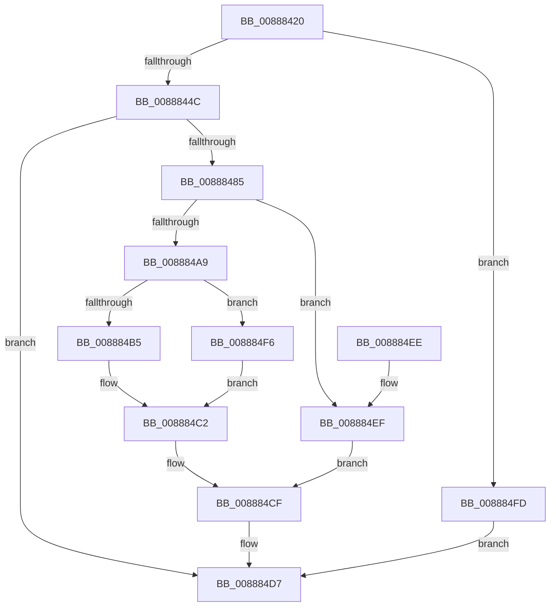

# NtAlpcDeletePortSection

- RVA: `0x00888420`–`0x00888504` (길이 `228` bytes)
- VA: `0x0000000140888420`
- 실행 섹션: `PAGE`
- PDB 이름 있음: `예`; PDB Function 태그: `아니요`
- unwind 정보 RVA: `0x0007CDB8`
- 디코드: `58`개 명령, `228/228` bytes 표시
- 미해석 바이트: `0` (있으면 어셈블리에 `.byte`로 보존)

> 이 문서는 커널 이미지의 기계어와 PDB 기호를 분석해 생성했습니다. 4번과 5번은 함수 원형과 자료형을 바이너리 사용 방식에서 추정한 C 해석이며 원본 소스 복구 결과는 아닙니다.

## 1. Dependencies

- 직접 호출 지점: **7**; 고유 호출 대상: **6**
- 직접 호출자로 확인된 함수: **0**
- RIP 상대 이미지 참조: **2**

### Outgoing calls
- `0x0088847A` → [ObReferenceObjectByHandle](../86/ObReferenceObjectByHandle_function_00868DB0.md) (function, `0x00868DB0`)
- `0x0088849C` → [AlpcReferenceBlobByHandle](AlpcReferenceBlobByHandle_function_00889F00.md) (function, `0x00889F00`)
- `0x008884AC` → [AlpcpDeleteBlob](AlpcpDeleteBlob_function_0088A11C.md) (function, `0x0088A11C`)
- `0x008884BD` → [AlpcpDereferenceBlobEx](AlpcpDereferenceBlobEx_function_0088AF00.md) (function, `0x0088AF00`)
- `0x008884CA` → [AlpcpDereferenceBlobEx](AlpcpDereferenceBlobEx_function_0088AF00.md) (function, `0x0088AF00`)
- `0x008884D2` → [ObfDereferenceObject](../../text/2F/ObfDereferenceObject_function_002F9350.md) (function, `0x002F9350`)
- `0x008884D7` → [KeLeaveCriticalRegion](../../text/25/KeLeaveCriticalRegion_function_0025D8B0.md) (function, `0x0025D8B0`)

### Direct callers
- 이 함수 시작 RVA로 연결되는 직접 call은 확인되지 않았습니다. 간접 호출은 완전히 역산할 수 없습니다.

### Static image references
- `0x0088845F` → RVA `0x00FC6C18` (`ALMOSTRO`; read)
- `0x0088848A` → RVA `0x000014A0` (`.rdata`; read)

## 2. Other-region calls and transfers

- 다른 실행 섹션으로 향하는 call: **2**
  - `0x008884D2` → [ObfDereferenceObject](../../text/2F/ObfDereferenceObject_function_002F9350.md) (`PAGE` → `.text`)
  - `0x008884D7` → [KeLeaveCriticalRegion](../../text/25/KeLeaveCriticalRegion_function_0025D8B0.md) (`PAGE` → `.text`)
- 별도 외부 분기/꼬리 이동을 확인하지 못했습니다.

## 3. Assembly (complete function range)

```asm
00888420  4C 8B DC                        mov r11, rsp
00888423  49 89 5B 08                     mov qword ptr [r11 + 8], rbx
00888427  49 89 73 10                     mov qword ptr [r11 + 0x10], rsi
0088842B  57                              push rdi
0088842C  48 83 EC 30                     sub rsp, 0x30
00888430  65 48 8B 04 25 88 01 00 00      mov rax, qword ptr gs:[0x188]
00888439  49 8B F8                        mov rdi, r8
0088843C  66 FF 88 E4 01 00 00            dec word ptr [rax + 0x1e4]
00888443  90                              nop
00888444  85 D2                           test edx, edx
00888446  0F 85 B1 00 00 00               jne 0x1408884fd
0088844C  65 48 8B 04 25 88 01 00 00      mov rax, qword ptr gs:[0x188]
00888455  BA 01 00 00 00                  mov edx, 1
0088845A  49 83 63 F0 00                  and qword ptr [r11 - 0x10], 0
0088845F  4C 8B 05 B2 E7 73 00            mov r8, qword ptr [rip + 0x73e7b2]
00888466  49 83 63 20 00                  and qword ptr [r11 + 0x20], 0
0088846B  44 8A 88 32 02 00 00            mov r9b, byte ptr [rax + 0x232]
00888472  49 8D 43 20                     lea rax, [r11 + 0x20]
00888476  49 89 43 E8                     mov qword ptr [r11 - 0x18], rax
0088847A  E8 31 09 FE FF                  call 0x140868db0
0088847F  8B D8                           mov ebx, eax
00888481  85 C0                           test eax, eax
00888483  78 52                           js 0x1408884d7
00888485  48 8B 74 24 58                  mov rsi, qword ptr [rsp + 0x58]
0088848A  4C 8D 05 0F 90 77 FF            lea r8, [rip - 0x886ff1]
00888491  48 8B D7                        mov rdx, rdi
00888494  48 8B 4E 10                     mov rcx, qword ptr [rsi + 0x10]
00888498  48 83 C1 28                     add rcx, 0x28
0088849C  E8 5F 1A 00 00                  call 0x140889f00
008884A1  48 8B F8                        mov rdi, rax
008884A4  48 85 C0                        test rax, rax
008884A7  74 46                           je 0x1408884ef
008884A9  48 8B C8                        mov rcx, rax
008884AC  E8 6B 1C 00 00                  call 0x14088a11c
008884B1  84 C0                           test al, al
008884B3  74 41                           je 0x1408884f6
008884B5  BA 01 00 00 00                  mov edx, 1
008884BA  48 8B CF                        mov rcx, rdi
008884BD  E8 3E 2A 00 00                  call 0x14088af00
008884C2  BA 01 00 00 00                  mov edx, 1
008884C7  48 8B CF                        mov rcx, rdi
008884CA  E8 31 2A 00 00                  call 0x14088af00
008884CF  48 8B CE                        mov rcx, rsi
008884D2  E8 79 0E A7 FF                  call 0x1402f9350
008884D7  E8 D4 53 9D FF                  call 0x14025d8b0
008884DC  48 8B 74 24 48                  mov rsi, qword ptr [rsp + 0x48]
008884E1  8B C3                           mov eax, ebx
008884E3  48 8B 5C 24 40                  mov rbx, qword ptr [rsp + 0x40]
008884E8  48 83 C4 30                     add rsp, 0x30
008884EC  5F                              pop rdi
008884ED  C3                              ret
008884EE  CC                              int3
008884EF  BB 08 00 00 C0                  mov ebx, 0xc0000008
008884F4  EB D9                           jmp 0x1408884cf
008884F6  BB 56 00 00 C0                  mov ebx, 0xc0000056
008884FB  EB C5                           jmp 0x1408884c2
008884FD  BB 0D 00 00 C0                  mov ebx, 0xc000000d
00888502  EB D3                           jmp 0x1408884d7
```

## 4. C-style interpretation (structured pseudocode)

```c
__int64 __fastcall NtAlpcDeletePortSection(__int64 a1, int a2, __int64 a3)
{
    __int64 result;
    __int64 v_rsp;
    unsigned __int64 v_stack_p10;
    unsigned __int64 v_stack_p20;
    unsigned __int64 v_stack_p8;

    *(unsigned __int64 *)(v_rsp + 8) = v_rbx;
    *(unsigned __int64 *)(v_rsp + 16) = v_rsi;
    v_rsp = (v_rsp) - (48);
    if (a2 != 0) goto loc_008884FD;
    *(unsigned __int64 *)(v_rsp - 24) = v_rsp + 32;
    result = ObReferenceObjectByHandle(a1, 1, *(unsigned __int64 *)(v_rip + 7595954), *(unsigned __int8 *)(*(unsigned __int64 *)(gs_base + (0 + 392)) + 562));
    if (sign_flag) goto loc_008884D7;
    a1 = (*(unsigned __int64 *)(v_stack_p20 + 16)) + (40);
    result = AlpcReferenceBlobByHandle(a1, a3, v_rip - 8941553, *(unsigned __int8 *)(*(unsigned __int64 *)(gs_base + (0 + 392)) + 562));
    if (result == 0) goto loc_008884EF;
    result = AlpcpDeleteBlob(result, a3, v_rip - 8941553, *(unsigned __int8 *)(*(unsigned __int64 *)(gs_base + (0 + 392)) + 562));
    if ((unsigned __int8)(result) == 0) goto loc_008884F6;
    result = AlpcpDereferenceBlobEx(result, 1, v_rip - 8941553, *(unsigned __int8 *)(*(unsigned __int64 *)(gs_base + (0 + 392)) + 562));
loc_008884C2:
    result = AlpcpDereferenceBlobEx(result, 1, v_rip - 8941553, *(unsigned __int8 *)(*(unsigned __int64 *)(gs_base + (0 + 392)) + 562));
loc_008884CF:
    result = ObfDereferenceObject(v_stack_p20, 1, v_rip - 8941553, *(unsigned __int8 *)(*(unsigned __int64 *)(gs_base + (0 + 392)) + 562));
loc_008884D7:
    result = KeLeaveCriticalRegion(v_stack_p20, 1, v_rip - 8941553, *(unsigned __int8 *)(*(unsigned __int64 *)(gs_base + (0 + 392)) + 562));
    v_rsp = (v_rsp) + (48);
    return (unsigned int)((unsigned int)((unsigned int)((unsigned int)(result))));
loc_008884EF:
    goto loc_008884CF;
loc_008884F6:
    goto loc_008884C2;
loc_008884FD:
    goto loc_008884D7;
}
```

## 5. (Beta) C Style

```c
int64_t NtAlpcDeletePortSection(int64_t Arg1, int32_t Arg2, int64_t Arg3)
{
    int64_t result;
    int64_t local_rsp;
    uint64_t v_stack_p10;
    uint64_t v_stack_p20;
    uint64_t v_stack_p8;

    *(uint64_t *)(local_rsp + 0x8) = local_rbx;
    *(uint64_t *)(local_rsp + 0x10) = local_rsi;
    local_rsp = (local_rsp) - (48);
    if (Arg2 != 0) goto loc_008884FD;
    *(uint64_t *)(local_rsp - 0x18) = local_rsp + 32;
    result = ObReferenceObjectByHandle(Arg1, 1, *(uint64_t *)(v_rip + 0x73E7B2), *(uint8_t *)(*(uint64_t *)(gs_base + (0 + 0x188)) + 0x232));
    if (sign_flag) goto loc_008884D7;
    Arg1 = (*(uint64_t *)(v_stack_p20 + 0x10)) + (40);
    result = AlpcReferenceBlobByHandle(Arg1, Arg3, v_rip - 8941553, *(uint8_t *)(*(uint64_t *)(gs_base + (0 + 0x188)) + 0x232));
    if (result == 0) goto loc_008884EF;
    result = AlpcpDeleteBlob(result, Arg3, v_rip - 8941553, *(uint8_t *)(*(uint64_t *)(gs_base + (0 + 0x188)) + 0x232));
    if ((uint8_t)(result) == 0) goto loc_008884F6;
    result = AlpcpDereferenceBlobEx(result, 1, v_rip - 8941553, *(uint8_t *)(*(uint64_t *)(gs_base + (0 + 0x188)) + 0x232));
loc_008884C2:
    result = AlpcpDereferenceBlobEx(result, 1, v_rip - 8941553, *(uint8_t *)(*(uint64_t *)(gs_base + (0 + 0x188)) + 0x232));
loc_008884CF:
    result = ObfDereferenceObject(v_stack_p20, 1, v_rip - 8941553, *(uint8_t *)(*(uint64_t *)(gs_base + (0 + 0x188)) + 0x232));
loc_008884D7:
    result = KeLeaveCriticalRegion(v_stack_p20, 1, v_rip - 8941553, *(uint8_t *)(*(uint64_t *)(gs_base + (0 + 0x188)) + 0x232));
    local_rsp = (local_rsp) + (48);
    return (uint32_t)((uint32_t)((uint32_t)((uint32_t)(result))));
loc_008884EF:
    goto loc_008884CF;
loc_008884F6:
    goto loc_008884C2;
loc_008884FD:
    goto loc_008884D7;
}
```

## 6. Execution-region graph

[열기: 2D/3D 그래프와 함수 탐색 컨트롤 패널](../../../control-panel.html?section=page&rva=0x00888420&view=graph)

- 2D 그래프는 위에서 아래로 흐르고, 3D 그래프는 빈 공간을 드래그해 회전합니다. Shift+드래그는 이동, 휠은 확대·축소, 함수 노드 선택은 대상 보고서 이동입니다.

### Static fallback


