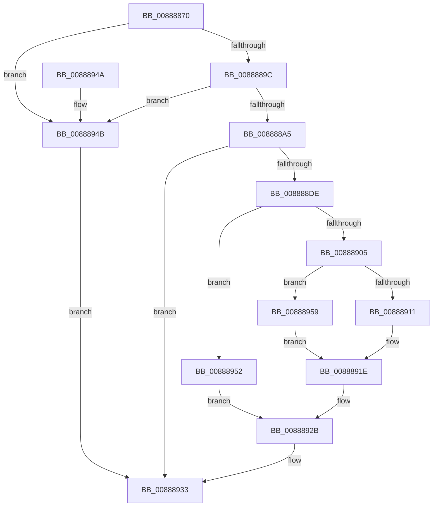

# NtAlpcDeleteResourceReserve

- RVA: `0x00888870`–`0x00888960` (길이 `240` bytes)
- VA: `0x0000000140888870`
- 실행 섹션: `PAGE`
- PDB 이름 있음: `예`; PDB Function 태그: `아니요`
- unwind 정보 RVA: `0x0007CDB8`
- 디코드: `61`개 명령, `240/240` bytes 표시
- 미해석 바이트: `0` (있으면 어셈블리에 `.byte`로 보존)

> 이 문서는 커널 이미지의 기계어와 PDB 기호를 분석해 생성했습니다. 4번과 5번은 함수 원형과 자료형을 바이너리 사용 방식에서 추정한 C 해석이며 원본 소스 복구 결과는 아닙니다.

## 1. Dependencies

- 직접 호출 지점: **7**; 고유 호출 대상: **6**
- 직접 호출자로 확인된 함수: **0**
- RIP 상대 이미지 참조: **2**

### Outgoing calls
- `0x008888D3` → [ObReferenceObjectByHandle](../86/ObReferenceObjectByHandle_function_00868DB0.md) (function, `0x00868DB0`)
- `0x008888F8` → [AlpcReferenceBlobByHandle](AlpcReferenceBlobByHandle_function_00889F00.md) (function, `0x00889F00`)
- `0x00888908` → [AlpcpDeleteBlob](AlpcpDeleteBlob_function_0088A11C.md) (function, `0x0088A11C`)
- `0x00888919` → [AlpcpDereferenceBlobEx](AlpcpDereferenceBlobEx_function_0088AF00.md) (function, `0x0088AF00`)
- `0x00888926` → [AlpcpDereferenceBlobEx](AlpcpDereferenceBlobEx_function_0088AF00.md) (function, `0x0088AF00`)
- `0x0088892E` → [ObfDereferenceObject](../../text/2F/ObfDereferenceObject_function_002F9350.md) (function, `0x002F9350`)
- `0x00888933` → [KeLeaveCriticalRegion](../../text/25/KeLeaveCriticalRegion_function_0025D8B0.md) (function, `0x0025D8B0`)

### Direct callers
- 이 함수 시작 RVA로 연결되는 직접 call은 확인되지 않았습니다. 간접 호출은 완전히 역산할 수 없습니다.

### Static image references
- `0x008888B8` → RVA `0x00FC6C18` (`ALMOSTRO`; read)
- `0x008888E3` → RVA `0x000014D8` (`.rdata`; read)

## 2. Other-region calls and transfers

- 다른 실행 섹션으로 향하는 call: **2**
  - `0x0088892E` → [ObfDereferenceObject](../../text/2F/ObfDereferenceObject_function_002F9350.md) (`PAGE` → `.text`)
  - `0x00888933` → [KeLeaveCriticalRegion](../../text/25/KeLeaveCriticalRegion_function_0025D8B0.md) (`PAGE` → `.text`)
- 별도 외부 분기/꼬리 이동을 확인하지 못했습니다.

## 3. Assembly (complete function range)

```asm
00888870  4C 8B DC                        mov r11, rsp
00888873  49 89 5B 08                     mov qword ptr [r11 + 8], rbx
00888877  49 89 73 10                     mov qword ptr [r11 + 0x10], rsi
0088887B  57                              push rdi
0088887C  48 83 EC 30                     sub rsp, 0x30
00888880  65 48 8B 04 25 88 01 00 00      mov rax, qword ptr gs:[0x188]
00888889  41 8B F8                        mov edi, r8d
0088888C  66 FF 88 E4 01 00 00            dec word ptr [rax + 0x1e4]
00888893  90                              nop
00888894  85 D2                           test edx, edx
00888896  0F 85 AF 00 00 00               jne 0x14088894b
0088889C  45 85 C0                        test r8d, r8d
0088889F  0F 89 A6 00 00 00               jns 0x14088894b
008888A5  65 48 8B 04 25 88 01 00 00      mov rax, qword ptr gs:[0x188]
008888AE  BA 01 00 00 00                  mov edx, 1
008888B3  49 83 63 F0 00                  and qword ptr [r11 - 0x10], 0
008888B8  4C 8B 05 59 E3 73 00            mov r8, qword ptr [rip + 0x73e359]
008888BF  49 83 63 20 00                  and qword ptr [r11 + 0x20], 0
008888C4  44 8A 88 32 02 00 00            mov r9b, byte ptr [rax + 0x232]
008888CB  49 8D 43 20                     lea rax, [r11 + 0x20]
008888CF  49 89 43 E8                     mov qword ptr [r11 - 0x18], rax
008888D3  E8 D8 04 FE FF                  call 0x140868db0
008888D8  8B D8                           mov ebx, eax
008888DA  85 C0                           test eax, eax
008888DC  78 55                           js 0x140888933
008888DE  48 8B 74 24 58                  mov rsi, qword ptr [rsp + 0x58]
008888E3  4C 8D 05 EE 8B 77 FF            lea r8, [rip - 0x887412]
008888EA  8B D7                           mov edx, edi
008888EC  0F BA F2 1F                     btr edx, 0x1f
008888F0  48 8B 4E 10                     mov rcx, qword ptr [rsi + 0x10]
008888F4  48 83 C1 28                     add rcx, 0x28
008888F8  E8 03 16 00 00                  call 0x140889f00
008888FD  48 8B F8                        mov rdi, rax
00888900  48 85 C0                        test rax, rax
00888903  74 4D                           je 0x140888952
00888905  48 8B C8                        mov rcx, rax
00888908  E8 0F 18 00 00                  call 0x14088a11c
0088890D  84 C0                           test al, al
0088890F  74 48                           je 0x140888959
00888911  BA 01 00 00 00                  mov edx, 1
00888916  48 8B CF                        mov rcx, rdi
00888919  E8 E2 25 00 00                  call 0x14088af00
0088891E  BA 01 00 00 00                  mov edx, 1
00888923  48 8B CF                        mov rcx, rdi
00888926  E8 D5 25 00 00                  call 0x14088af00
0088892B  48 8B CE                        mov rcx, rsi
0088892E  E8 1D 0A A7 FF                  call 0x1402f9350
00888933  E8 78 4F 9D FF                  call 0x14025d8b0
00888938  48 8B 74 24 48                  mov rsi, qword ptr [rsp + 0x48]
0088893D  8B C3                           mov eax, ebx
0088893F  48 8B 5C 24 40                  mov rbx, qword ptr [rsp + 0x40]
00888944  48 83 C4 30                     add rsp, 0x30
00888948  5F                              pop rdi
00888949  C3                              ret
0088894A  CC                              int3
0088894B  BB 0D 00 00 C0                  mov ebx, 0xc000000d
00888950  EB E1                           jmp 0x140888933
00888952  BB 08 00 00 C0                  mov ebx, 0xc0000008
00888957  EB D2                           jmp 0x14088892b
00888959  BB 56 00 00 C0                  mov ebx, 0xc0000056
0088895E  EB BE                           jmp 0x14088891e
```

## 4. C-style interpretation (structured pseudocode)

```c
__int64 __fastcall NtAlpcDeleteResourceReserve(__int64 a1, int a2, int a3)
{
    __int64 result;
    __int64 v_rsp;
    unsigned __int64 v_stack_p10;
    unsigned __int64 v_stack_p20;
    unsigned __int64 v_stack_p8;

    *(unsigned __int64 *)(v_rsp + 8) = v_rbx;
    *(unsigned __int64 *)(v_rsp + 16) = v_rsi;
    v_rsp = (v_rsp) - (48);
    if (a2 != 0) goto loc_0088894B;
    if (!sign_flag) goto loc_0088894B;
    *(unsigned __int64 *)(v_rsp - 24) = v_rsp + 32;
    result = ObReferenceObjectByHandle(a1, 1, *(unsigned __int64 *)(v_rip + 7594841), *(unsigned __int8 *)(*(unsigned __int64 *)(gs_base + (0 + 392)) + 562));
    if (sign_flag) goto loc_00888933;
    a1 = (*(unsigned __int64 *)(v_stack_p20 + 16)) + (40);
    result = AlpcReferenceBlobByHandle(a1, (unsigned int)((unsigned int)((unsigned int)(a3))), v_rip - 8942610, *(unsigned __int8 *)(*(unsigned __int64 *)(gs_base + (0 + 392)) + 562));
    if (result == 0) goto loc_00888952;
    result = AlpcpDeleteBlob(result, (unsigned int)((unsigned int)((unsigned int)(a3))), v_rip - 8942610, *(unsigned __int8 *)(*(unsigned __int64 *)(gs_base + (0 + 392)) + 562));
    if ((unsigned __int8)(result) == 0) goto loc_00888959;
    result = AlpcpDereferenceBlobEx(result, 1, v_rip - 8942610, *(unsigned __int8 *)(*(unsigned __int64 *)(gs_base + (0 + 392)) + 562));
loc_0088891E:
    result = AlpcpDereferenceBlobEx(result, 1, v_rip - 8942610, *(unsigned __int8 *)(*(unsigned __int64 *)(gs_base + (0 + 392)) + 562));
loc_0088892B:
    result = ObfDereferenceObject(v_stack_p20, 1, v_rip - 8942610, *(unsigned __int8 *)(*(unsigned __int64 *)(gs_base + (0 + 392)) + 562));
loc_00888933:
    result = KeLeaveCriticalRegion(v_stack_p20, 1, v_rip - 8942610, *(unsigned __int8 *)(*(unsigned __int64 *)(gs_base + (0 + 392)) + 562));
    v_rsp = (v_rsp) + (48);
    return (unsigned int)((unsigned int)((unsigned int)((unsigned int)(result))));
loc_0088894B:
    goto loc_00888933;
loc_00888952:
    goto loc_0088892B;
loc_00888959:
    goto loc_0088891E;
}
```

## 5. (Beta) C Style

```c
int64_t NtAlpcDeleteResourceReserve(int64_t Arg1, int32_t Arg2, int32_t Arg3)
{
    int64_t result;
    int64_t local_rsp;
    uint64_t v_stack_p10;
    uint64_t v_stack_p20;
    uint64_t v_stack_p8;

    *(uint64_t *)(local_rsp + 0x8) = local_rbx;
    *(uint64_t *)(local_rsp + 0x10) = local_rsi;
    local_rsp = (local_rsp) - (48);
    if (Arg2 != 0) goto loc_0088894B;
    if (!sign_flag) goto loc_0088894B;
    *(uint64_t *)(local_rsp - 0x18) = local_rsp + 32;
    result = ObReferenceObjectByHandle(Arg1, 1, *(uint64_t *)(v_rip + 0x73E359), *(uint8_t *)(*(uint64_t *)(gs_base + (0 + 0x188)) + 0x232));
    if (sign_flag) goto loc_00888933;
    Arg1 = (*(uint64_t *)(v_stack_p20 + 0x10)) + (40);
    result = AlpcReferenceBlobByHandle(Arg1, (uint32_t)((uint32_t)((uint32_t)(Arg3))), v_rip - 8942610, *(uint8_t *)(*(uint64_t *)(gs_base + (0 + 0x188)) + 0x232));
    if (result == 0) goto loc_00888952;
    result = AlpcpDeleteBlob(result, (uint32_t)((uint32_t)((uint32_t)(Arg3))), v_rip - 8942610, *(uint8_t *)(*(uint64_t *)(gs_base + (0 + 0x188)) + 0x232));
    if ((uint8_t)(result) == 0) goto loc_00888959;
    result = AlpcpDereferenceBlobEx(result, 1, v_rip - 8942610, *(uint8_t *)(*(uint64_t *)(gs_base + (0 + 0x188)) + 0x232));
loc_0088891E:
    result = AlpcpDereferenceBlobEx(result, 1, v_rip - 8942610, *(uint8_t *)(*(uint64_t *)(gs_base + (0 + 0x188)) + 0x232));
loc_0088892B:
    result = ObfDereferenceObject(v_stack_p20, 1, v_rip - 8942610, *(uint8_t *)(*(uint64_t *)(gs_base + (0 + 0x188)) + 0x232));
loc_00888933:
    result = KeLeaveCriticalRegion(v_stack_p20, 1, v_rip - 8942610, *(uint8_t *)(*(uint64_t *)(gs_base + (0 + 0x188)) + 0x232));
    local_rsp = (local_rsp) + (48);
    return (uint32_t)((uint32_t)((uint32_t)((uint32_t)(result))));
loc_0088894B:
    goto loc_00888933;
loc_00888952:
    goto loc_0088892B;
loc_00888959:
    goto loc_0088891E;
}
```

## 6. Execution-region graph

[열기: 2D/3D 그래프와 함수 탐색 컨트롤 패널](../../../control-panel.html?section=page&rva=0x00888870&view=graph)

- 2D 그래프는 위에서 아래로 흐르고, 3D 그래프는 빈 공간을 드래그해 회전합니다. Shift+드래그는 이동, 휠은 확대·축소, 함수 노드 선택은 대상 보고서 이동입니다.

### Static fallback


