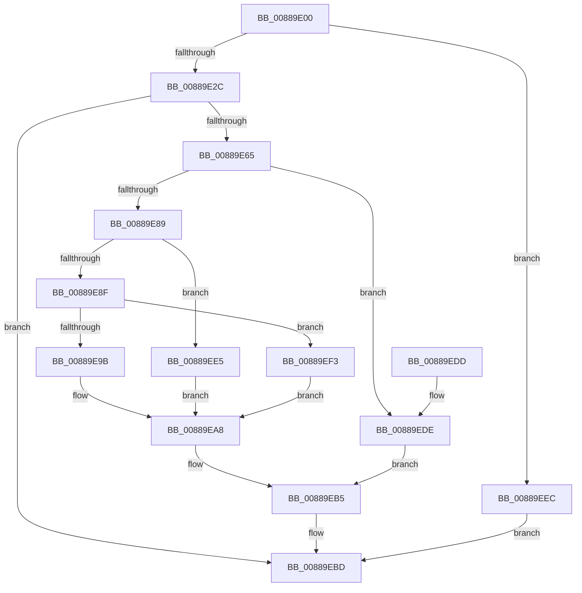

# NtAlpcDeleteSecurityContext

- RVA: `0x00889E00`–`0x00889EFA` (길이 `250` bytes)
- VA: `0x0000000140889E00`
- 실행 섹션: `PAGE`
- PDB 이름 있음: `예`; PDB Function 태그: `아니요`
- unwind 정보 RVA: `0x0007D004`
- 디코드: `63`개 명령, `250/250` bytes 표시
- 미해석 바이트: `0` (있으면 어셈블리에 `.byte`로 보존)

> 이 문서는 커널 이미지의 기계어와 PDB 기호를 분석해 생성했습니다. 4번과 5번은 함수 원형과 자료형을 바이너리 사용 방식에서 추정한 C 해석이며 원본 소스 복구 결과는 아닙니다.

## 1. Dependencies

- 직접 호출 지점: **7**; 고유 호출 대상: **6**
- 직접 호출자로 확인된 함수: **0**
- RIP 상대 이미지 참조: **2**

### Outgoing calls
- `0x00889E5A` → [ObReferenceObjectByHandle](../86/ObReferenceObjectByHandle_function_00868DB0.md) (function, `0x00868DB0`)
- `0x00889E7C` → [AlpcReferenceBlobByHandle](AlpcReferenceBlobByHandle_function_00889F00.md) (function, `0x00889F00`)
- `0x00889E92` → [AlpcpDeleteBlob](AlpcpDeleteBlob_function_0088A11C.md) (function, `0x0088A11C`)
- `0x00889EA3` → [AlpcpDereferenceBlobEx](AlpcpDereferenceBlobEx_function_0088AF00.md) (function, `0x0088AF00`)
- `0x00889EB0` → [AlpcpDereferenceBlobEx](AlpcpDereferenceBlobEx_function_0088AF00.md) (function, `0x0088AF00`)
- `0x00889EB8` → [ObfDereferenceObject](../../text/2F/ObfDereferenceObject_function_002F9350.md) (function, `0x002F9350`)
- `0x00889EC6` → [KeLeaveCriticalRegionThread](../../text/25/KeLeaveCriticalRegionThread_function_0025EFF0.md) (function, `0x0025EFF0`)

### Direct callers
- 이 함수 시작 RVA로 연결되는 직접 call은 확인되지 않았습니다. 간접 호출은 완전히 역산할 수 없습니다.

### Static image references
- `0x00889E3F` → RVA `0x00FC6C18` (`ALMOSTRO`; read)
- `0x00889E6A` → RVA `0x00001418` (`.rdata`; read)

## 2. Other-region calls and transfers

- 다른 실행 섹션으로 향하는 call: **2**
  - `0x00889EB8` → [ObfDereferenceObject](../../text/2F/ObfDereferenceObject_function_002F9350.md) (`PAGE` → `.text`)
  - `0x00889EC6` → [KeLeaveCriticalRegionThread](../../text/25/KeLeaveCriticalRegionThread_function_0025EFF0.md) (`PAGE` → `.text`)
- 별도 외부 분기/꼬리 이동을 확인하지 못했습니다.

## 3. Assembly (complete function range)

```asm
00889E00  4C 8B DC                        mov r11, rsp
00889E03  49 89 5B 08                     mov qword ptr [r11 + 8], rbx
00889E07  49 89 73 10                     mov qword ptr [r11 + 0x10], rsi
00889E0B  57                              push rdi
00889E0C  48 83 EC 30                     sub rsp, 0x30
00889E10  65 48 8B 04 25 88 01 00 00      mov rax, qword ptr gs:[0x188]
00889E19  49 8B F8                        mov rdi, r8
00889E1C  66 FF 88 E4 01 00 00            dec word ptr [rax + 0x1e4]
00889E23  90                              nop
00889E24  85 D2                           test edx, edx
00889E26  0F 85 C0 00 00 00               jne 0x140889eec
00889E2C  65 48 8B 04 25 88 01 00 00      mov rax, qword ptr gs:[0x188]
00889E35  BA 01 00 00 00                  mov edx, 1
00889E3A  49 83 63 F0 00                  and qword ptr [r11 - 0x10], 0
00889E3F  4C 8B 05 D2 CD 73 00            mov r8, qword ptr [rip + 0x73cdd2]
00889E46  49 83 63 20 00                  and qword ptr [r11 + 0x20], 0
00889E4B  44 8A 88 32 02 00 00            mov r9b, byte ptr [rax + 0x232]
00889E52  49 8D 43 20                     lea rax, [r11 + 0x20]
00889E56  49 89 43 E8                     mov qword ptr [r11 - 0x18], rax
00889E5A  E8 51 EF FD FF                  call 0x140868db0
00889E5F  8B D8                           mov ebx, eax
00889E61  85 C0                           test eax, eax
00889E63  78 58                           js 0x140889ebd
00889E65  48 8B 74 24 58                  mov rsi, qword ptr [rsp + 0x58]
00889E6A  4C 8D 05 A7 75 77 FF            lea r8, [rip - 0x888a59]
00889E71  48 8B D7                        mov rdx, rdi
00889E74  48 8B 4E 10                     mov rcx, qword ptr [rsi + 0x10]
00889E78  48 83 C1 28                     add rcx, 0x28
00889E7C  E8 7F 00 00 00                  call 0x140889f00
00889E81  48 8B F8                        mov rdi, rax
00889E84  48 85 C0                        test rax, rax
00889E87  74 55                           je 0x140889ede
00889E89  48 3B 70 18                     cmp rsi, qword ptr [rax + 0x18]
00889E8D  75 56                           jne 0x140889ee5
00889E8F  48 8B C8                        mov rcx, rax
00889E92  E8 85 02 00 00                  call 0x14088a11c
00889E97  84 C0                           test al, al
00889E99  74 58                           je 0x140889ef3
00889E9B  BA 01 00 00 00                  mov edx, 1
00889EA0  48 8B CF                        mov rcx, rdi
00889EA3  E8 58 10 00 00                  call 0x14088af00
00889EA8  BA 01 00 00 00                  mov edx, 1
00889EAD  48 8B CF                        mov rcx, rdi
00889EB0  E8 4B 10 00 00                  call 0x14088af00
00889EB5  48 8B CE                        mov rcx, rsi
00889EB8  E8 93 F4 A6 FF                  call 0x1402f9350
00889EBD  65 48 8B 0C 25 88 01 00 00      mov rcx, qword ptr gs:[0x188]
00889EC6  E8 25 51 9D FF                  call 0x14025eff0
00889ECB  48 8B 74 24 48                  mov rsi, qword ptr [rsp + 0x48]
00889ED0  8B C3                           mov eax, ebx
00889ED2  48 8B 5C 24 40                  mov rbx, qword ptr [rsp + 0x40]
00889ED7  48 83 C4 30                     add rsp, 0x30
00889EDB  5F                              pop rdi
00889EDC  C3                              ret
00889EDD  CC                              int3
00889EDE  BB 08 00 00 C0                  mov ebx, 0xc0000008
00889EE3  EB D0                           jmp 0x140889eb5
00889EE5  BB 22 00 00 C0                  mov ebx, 0xc0000022
00889EEA  EB BC                           jmp 0x140889ea8
00889EEC  BB 0D 00 00 C0                  mov ebx, 0xc000000d
00889EF1  EB CA                           jmp 0x140889ebd
00889EF3  BB 56 00 00 C0                  mov ebx, 0xc0000056
00889EF8  EB AE                           jmp 0x140889ea8
```

## 4. C-style interpretation (structured pseudocode)

```c
__int64 __fastcall NtAlpcDeleteSecurityContext(__int64 a1, int a2, __int64 a3)
{
    __int64 result;
    __int64 v_rsp;
    unsigned __int64 v_stack_p10;
    unsigned __int64 v_stack_p20;
    unsigned __int64 v_stack_p8;

    *(unsigned __int64 *)(v_rsp + 8) = v_rbx;
    *(unsigned __int64 *)(v_rsp + 16) = v_rsi;
    v_rsp = (v_rsp) - (48);
    if (a2 != 0) goto loc_00889EEC;
    *(unsigned __int64 *)(v_rsp - 24) = v_rsp + 32;
    result = ObReferenceObjectByHandle(a1, 1, *(unsigned __int64 *)(v_rip + 7589330), *(unsigned __int8 *)(*(unsigned __int64 *)(gs_base + (0 + 392)) + 562));
    if (sign_flag) goto loc_00889EBD;
    a1 = (*(unsigned __int64 *)(v_stack_p20 + 16)) + (40);
    result = AlpcReferenceBlobByHandle(a1, a3, v_rip - 8948313, *(unsigned __int8 *)(*(unsigned __int64 *)(gs_base + (0 + 392)) + 562));
    if (result == 0) goto loc_00889EDE;
    if (v_stack_p20 != (*(unsigned __int64 *)(result + 24))) goto loc_00889EE5;
    result = AlpcpDeleteBlob(result, a3, v_rip - 8948313, *(unsigned __int8 *)(*(unsigned __int64 *)(gs_base + (0 + 392)) + 562));
    if ((unsigned __int8)(result) == 0) goto loc_00889EF3;
    result = AlpcpDereferenceBlobEx(result, 1, v_rip - 8948313, *(unsigned __int8 *)(*(unsigned __int64 *)(gs_base + (0 + 392)) + 562));
loc_00889EA8:
    result = AlpcpDereferenceBlobEx(result, 1, v_rip - 8948313, *(unsigned __int8 *)(*(unsigned __int64 *)(gs_base + (0 + 392)) + 562));
loc_00889EB5:
    result = ObfDereferenceObject(v_stack_p20, 1, v_rip - 8948313, *(unsigned __int8 *)(*(unsigned __int64 *)(gs_base + (0 + 392)) + 562));
loc_00889EBD:
    result = KeLeaveCriticalRegionThread(*(unsigned __int64 *)(gs_base + (0 + 392)), 1, v_rip - 8948313, *(unsigned __int8 *)(*(unsigned __int64 *)(gs_base + (0 + 392)) + 562));
    v_rsp = (v_rsp) + (48);
    return (unsigned int)((unsigned int)((unsigned int)((unsigned int)(result))));
loc_00889EDE:
    goto loc_00889EB5;
loc_00889EE5:
    goto loc_00889EA8;
loc_00889EEC:
    goto loc_00889EBD;
loc_00889EF3:
    goto loc_00889EA8;
}
```

## 5. (Beta) C Style

```c
int64_t NtAlpcDeleteSecurityContext(int64_t Arg1, int32_t Arg2, int64_t Arg3)
{
    int64_t result;
    int64_t local_rsp;
    uint64_t v_stack_p10;
    uint64_t v_stack_p20;
    uint64_t v_stack_p8;

    *(uint64_t *)(local_rsp + 0x8) = local_rbx;
    *(uint64_t *)(local_rsp + 0x10) = local_rsi;
    local_rsp = (local_rsp) - (48);
    if (Arg2 != 0) goto loc_00889EEC;
    *(uint64_t *)(local_rsp - 0x18) = local_rsp + 32;
    result = ObReferenceObjectByHandle(Arg1, 1, *(uint64_t *)(v_rip + 0x73CDD2), *(uint8_t *)(*(uint64_t *)(gs_base + (0 + 0x188)) + 0x232));
    if (sign_flag) goto loc_00889EBD;
    Arg1 = (*(uint64_t *)(v_stack_p20 + 0x10)) + (40);
    result = AlpcReferenceBlobByHandle(Arg1, Arg3, v_rip - 8948313, *(uint8_t *)(*(uint64_t *)(gs_base + (0 + 0x188)) + 0x232));
    if (result == 0) goto loc_00889EDE;
    if (v_stack_p20 != (*(uint64_t *)(result + 0x18))) goto loc_00889EE5;
    result = AlpcpDeleteBlob(result, Arg3, v_rip - 8948313, *(uint8_t *)(*(uint64_t *)(gs_base + (0 + 0x188)) + 0x232));
    if ((uint8_t)(result) == 0) goto loc_00889EF3;
    result = AlpcpDereferenceBlobEx(result, 1, v_rip - 8948313, *(uint8_t *)(*(uint64_t *)(gs_base + (0 + 0x188)) + 0x232));
loc_00889EA8:
    result = AlpcpDereferenceBlobEx(result, 1, v_rip - 8948313, *(uint8_t *)(*(uint64_t *)(gs_base + (0 + 0x188)) + 0x232));
loc_00889EB5:
    result = ObfDereferenceObject(v_stack_p20, 1, v_rip - 8948313, *(uint8_t *)(*(uint64_t *)(gs_base + (0 + 0x188)) + 0x232));
loc_00889EBD:
    result = KeLeaveCriticalRegionThread(*(uint64_t *)(gs_base + (0 + 0x188)), 1, v_rip - 8948313, *(uint8_t *)(*(uint64_t *)(gs_base + (0 + 0x188)) + 0x232));
    local_rsp = (local_rsp) + (48);
    return (uint32_t)((uint32_t)((uint32_t)((uint32_t)(result))));
loc_00889EDE:
    goto loc_00889EB5;
loc_00889EE5:
    goto loc_00889EA8;
loc_00889EEC:
    goto loc_00889EBD;
loc_00889EF3:
    goto loc_00889EA8;
}
```

## 6. Execution-region graph

[열기: 2D/3D 그래프와 함수 탐색 컨트롤 패널](../../../control-panel.html?section=page&rva=0x00889E00&view=graph)

- 2D 그래프는 위에서 아래로 흐르고, 3D 그래프는 빈 공간을 드래그해 회전합니다. Shift+드래그는 이동, 휠은 확대·축소, 함수 노드 선택은 대상 보고서 이동입니다.

### Static fallback


