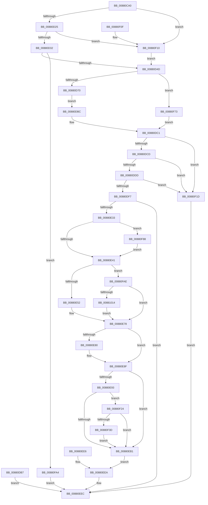

# NtProtectVirtualMemory

- RVA: `0x00880CA0`–`0x0088103E` (길이 `926` bytes)
- VA: `0x0000000140880CA0`
- 실행 섹션: `PAGE`
- PDB 이름 있음: `예`; PDB Function 태그: `아니요`
- unwind 정보 RVA: `0x0007C534`
- 디코드: `211`개 명령, `926/926` bytes 표시
- 미해석 바이트: `0` (있으면 어셈블리에 `.byte`로 보존)

> 이 문서는 커널 이미지의 기계어와 PDB 기호를 분석해 생성했습니다. 4번과 5번은 함수 원형과 자료형을 바이너리 사용 방식에서 추정한 C 해석이며 원본 소스 복구 결과는 아닙니다.

## 1. Dependencies

- 직접 호출 지점: **12**; 고유 호출 대상: **11**
- 직접 호출자로 확인된 함수: **0**
- RIP 상대 이미지 참조: **2**

### Outgoing calls
- `0x00880D3B` → [MiMakeProtectionMask](../../text/32/MiMakeProtectionMask_function_00329480.md) (function, `0x00329480`)
- `0x00880E26` → [ObpReferenceObjectByHandleWithTag](../86/ObpReferenceObjectByHandleWithTag_function_00869650.md) (function, `0x00869650`)
- `0x00880E71` → [MmProtectVirtualMemory](MmProtectVirtualMemory_function_00881050.md) (function, `0x00881050`)
- `0x00880E8A` → [KiUnstackDetachProcess](../../text/21/KiUnstackDetachProcess_function_00217D30.md) (function, `0x00217D30`)
- `0x00880EA1` → [MiMakeProtectionMask](../../text/32/MiMakeProtectionMask_function_00329480.md) (function, `0x00329480`)
- `0x00880EB9` → [ObfDereferenceObjectWithTag](../../text/2F/ObfDereferenceObjectWithTag_function_002F78E0.md) (function, `0x002F78E0`)
- `0x00880EF7` → [_security_check_cookie](../../text/6A/_security_check_cookie_function_006AC640.md) (function, `0x006AC640`)
- `0x00880F30` → [PsIsProcessLoggingEnabled](../../text/41/PsIsProcessLoggingEnabled_function_0041AF00.md) (function, `0x0041AF00`)
- `0x00880F69` → [EtwTiLogProtectExecVm](EtwTiLogProtectExecVm_function_00881A48.md) (function, `0x00881A48`)
- `0x00880F95` → [KiStackAttachProcess](../../text/21/KiStackAttachProcess_function_00216820.md) (function, `0x00216820`)
- `0x00880FBC` → [memset](../../text/6C/memset_function_006C6C40.md) (function, `0x006C6C40`)
- `0x00881005` → [VslpEnterIumSecureMode](../../text/23/VslpEnterIumSecureMode_function_00235E50.md) (function, `0x00235E50`)

### Direct callers
- 이 함수 시작 RVA로 연결되는 직접 call은 확인되지 않았습니다. 간접 호출은 완전히 역산할 수 없습니다.

### Static image references
- `0x00880CB3` → RVA `0x00E0A740` (`.data`; read)
- `0x00880DF7` → RVA `0x00FC6A98` (`ALMOSTRO`; read)

## 2. Other-region calls and transfers

- 다른 실행 섹션으로 향하는 call: **9**
  - `0x00880D3B` → [MiMakeProtectionMask](../../text/32/MiMakeProtectionMask_function_00329480.md) (`PAGE` → `.text`)
  - `0x00880E8A` → [KiUnstackDetachProcess](../../text/21/KiUnstackDetachProcess_function_00217D30.md) (`PAGE` → `.text`)
  - `0x00880EA1` → [MiMakeProtectionMask](../../text/32/MiMakeProtectionMask_function_00329480.md) (`PAGE` → `.text`)
  - `0x00880EB9` → [ObfDereferenceObjectWithTag](../../text/2F/ObfDereferenceObjectWithTag_function_002F78E0.md) (`PAGE` → `.text`)
  - `0x00880EF7` → [_security_check_cookie](../../text/6A/_security_check_cookie_function_006AC640.md) (`PAGE` → `.text`)
  - `0x00880F30` → [PsIsProcessLoggingEnabled](../../text/41/PsIsProcessLoggingEnabled_function_0041AF00.md) (`PAGE` → `.text`)
  - `0x00880F95` → [KiStackAttachProcess](../../text/21/KiStackAttachProcess_function_00216820.md) (`PAGE` → `.text`)
  - `0x00880FBC` → [memset](../../text/6C/memset_function_006C6C40.md) (`PAGE` → `.text`)
  - `0x00881005` → [VslpEnterIumSecureMode](../../text/23/VslpEnterIumSecureMode_function_00235E50.md) (`PAGE` → `.text`)
- 별도 외부 분기/꼬리 이동을 확인하지 못했습니다.

## 3. Assembly (complete function range)

```asm
00880CA0  40 53                           push rbx
00880CA2  56                              push rsi
00880CA3  57                              push rdi
00880CA4  41 54                           push r12
00880CA6  41 55                           push r13
00880CA8  41 56                           push r14
00880CAA  41 57                           push r15
00880CAC  48 81 EC 30 01 00 00            sub rsp, 0x130
00880CB3  48 8B 05 86 9A 58 00            mov rax, qword ptr [rip + 0x589a86]
00880CBA  48 33 C4                        xor rax, rsp
00880CBD  48 89 84 24 20 01 00 00         mov qword ptr [rsp + 0x120], rax
00880CC5  45 8B E9                        mov r13d, r9d
00880CC8  4D 8B C8                        mov r9, r8
00880CCB  4C 89 44 24 68                  mov qword ptr [rsp + 0x68], r8
00880CD0  4C 8B C2                        mov r8, rdx
00880CD3  48 89 54 24 70                  mov qword ptr [rsp + 0x70], rdx
00880CD8  4C 8B D9                        mov r11, rcx
00880CDB  4C 8B 94 24 90 01 00 00         mov r10, qword ptr [rsp + 0x190]
00880CE3  4C 89 54 24 78                  mov qword ptr [rsp + 0x78], r10
00880CE8  0F 57 C0                        xorps xmm0, xmm0
00880CEB  0F 11 84 24 80 00 00 00         movups xmmword ptr [rsp + 0x80], xmm0
00880CF3  0F 11 84 24 90 00 00 00         movups xmmword ptr [rsp + 0x90], xmm0
00880CFB  0F 11 84 24 A0 00 00 00         movups xmmword ptr [rsp + 0xa0], xmm0
00880D03  33 DB                           xor ebx, ebx
00880D05  48 89 5C 24 60                  mov qword ptr [rsp + 0x60], rbx
00880D0A  48 89 5C 24 50                  mov qword ptr [rsp + 0x50], rbx
00880D0F  48 89 5C 24 48                  mov qword ptr [rsp + 0x48], rbx
00880D14  89 5C 24 44                     mov dword ptr [rsp + 0x44], ebx
00880D18  41 81 FD 00 00 00 80            cmp r13d, 0x80000000
00880D1F  0F 84 EB 01 00 00               je 0x140880f10
00880D25  41 81 FD 00 00 00 10            cmp r13d, 0x10000000
00880D2C  0F 84 DE 01 00 00               je 0x140880f10
00880D32  41 8B CD                        mov ecx, r13d
00880D35  81 E1 FF 07 F8 0F               and ecx, 0xff807ff
00880D3B  E8 40 87 AA FF                  call 0x140329480
00880D40  89 44 24 58                     mov dword ptr [rsp + 0x58], eax
00880D44  83 F8 FF                        cmp eax, -1
00880D47  0F 84 57 02 00 00               je 0x140880fa4
00880D4D  65 48 8B 04 25 88 01 00 00      mov rax, qword ptr gs:[0x188]
00880D56  4C 8B A0 B8 00 00 00            mov r12, qword ptr [rax + 0xb8]
00880D5D  0F B6 90 32 02 00 00            movzx edx, byte ptr [rax + 0x232]
00880D64  88 54 24 40                     mov byte ptr [rsp + 0x40], dl
00880D68  84 D2                           test dl, dl
00880D6A  0F 84 03 02 00 00               je 0x140880f73
00880D70  48 BA 00 00 FF FF FF 7F 00 00   movabs rdx, 0x7fffffff0000
00880D7A  48 8B CA                        mov rcx, rdx
00880D7D  4C 3B C2                        cmp r8, rdx
00880D80  49 0F 42 C8                     cmovb rcx, r8
00880D84  48 8B 01                        mov rax, qword ptr [rcx]
00880D87  48 89 01                        mov qword ptr [rcx], rax
00880D8A  48 8B CA                        mov rcx, rdx
00880D8D  4C 3B CA                        cmp r9, rdx
00880D90  49 0F 42 C9                     cmovb rcx, r9
00880D94  48 8B 01                        mov rax, qword ptr [rcx]
00880D97  48 89 01                        mov qword ptr [rcx], rax
00880D9A  4C 3B D2                        cmp r10, rdx
00880D9D  49 0F 42 D2                     cmovb rdx, r10
00880DA1  8B 02                           mov eax, dword ptr [rdx]
00880DA3  89 02                           mov dword ptr [rdx], eax
00880DA5  49 8B 08                        mov rcx, qword ptr [r8]
00880DA8  48 89 4C 24 50                  mov qword ptr [rsp + 0x50], rcx
00880DAD  4D 8B 31                        mov r14, qword ptr [r9]
00880DB0  4C 89 74 24 48                  mov qword ptr [rsp + 0x48], r14
00880DB5  EB 05                           jmp 0x140880dbc
00880DB7  E9 30 01 00 00                  jmp 0x140880eec
00880DBC  0F B6 54 24 40                  movzx edx, byte ptr [rsp + 0x40]
00880DC1  4C 8B F9                        mov r15, rcx
00880DC4  4D 85 F6                        test r14, r14
00880DC7  0F 84 50 01 00 00               je 0x140880f1d
00880DCD  49 8D 46 FF                     lea rax, [r14 - 1]
00880DD1  48 03 C1                        add rax, rcx
00880DD4  48 3B C1                        cmp rax, rcx
00880DD7  0F 82 40 01 00 00               jb 0x140880f1d
00880DDD  48 8D 41 FF                     lea rax, [rcx - 1]
00880DE1  49 03 C6                        add rax, r14
00880DE4  48 B9 FF FF FE FF FF 7F 00 00   movabs rcx, 0x7ffffffeffff
00880DEE  48 3B C1                        cmp rax, rcx
00880DF1  0F 87 26 01 00 00               ja 0x140880f1d
00880DF7  4C 8B 05 9A 5C 74 00            mov r8, qword ptr [rip + 0x745c9a]
00880DFE  48 89 5C 24 38                  mov qword ptr [rsp + 0x38], rbx
00880E03  48 89 5C 24 30                  mov qword ptr [rsp + 0x30], rbx
00880E08  48 8D 44 24 60                  lea rax, [rsp + 0x60]
00880E0D  48 89 44 24 28                  mov qword ptr [rsp + 0x28], rax
00880E12  C7 44 24 20 4D 6D 50 76         mov dword ptr [rsp + 0x20], 0x76506d4d
00880E1A  44 0F B6 CA                     movzx r9d, dl
00880E1E  BA 08 00 00 00                  mov edx, 8
00880E23  49 8B CB                        mov rcx, r11
00880E26  E8 25 88 FE FF                  call 0x140869650
00880E2B  85 C0                           test eax, eax
00880E2D  0F 88 B9 00 00 00               js 0x140880eec
00880E33  48 8B 7C 24 60                  mov rdi, qword ptr [rsp + 0x60]
00880E38  4C 3B E7                        cmp r12, rdi
00880E3B  0F 85 47 01 00 00               jne 0x140880f88
00880E41  48 8B B7 70 01 00 00            mov rsi, qword ptr [rdi + 0x170]
00880E48  40 F6 C6 01                     test sil, 1
00880E4C  0F 85 5C 01 00 00               jne 0x140880fae
00880E52  48 8D 44 24 44                  lea rax, [rsp + 0x44]
00880E57  48 89 44 24 28                  mov qword ptr [rsp + 0x28], rax
00880E5C  44 89 6C 24 20                  mov dword ptr [rsp + 0x20], r13d
00880E61  4C 8D 4C 24 48                  lea r9, [rsp + 0x48]
00880E66  4C 8D 44 24 50                  lea r8, [rsp + 0x50]
00880E6B  48 8B D7                        mov rdx, rdi
00880E6E  49 8B CC                        mov rcx, r12
00880E71  E8 DA 01 00 00                  call 0x140881050
00880E76  8B F0                           mov esi, eax
00880E78  89 74 24 60                     mov dword ptr [rsp + 0x60], esi
00880E7C  85 DB                           test ebx, ebx
00880E7E  74 0F                           je 0x140880e8f
00880E80  33 D2                           xor edx, edx
00880E82  48 8D 8C 24 80 00 00 00         lea rcx, [rsp + 0x80]
00880E8A  E8 A1 6E 99 FF                  call 0x140217d30
00880E8F  85 F6                           test esi, esi
00880E91  78 1E                           js 0x140880eb1
00880E93  44 8B 5C 24 44                  mov r11d, dword ptr [rsp + 0x44]
00880E98  41 8B CB                        mov ecx, r11d
00880E9B  81 E1 FF 07 F8 FF               and ecx, 0xfff807ff
00880EA1  E8 DA 85 AA FF                  call 0x140329480
00880EA6  8B 4C 24 58                     mov ecx, dword ptr [rsp + 0x58]
00880EAA  0B C8                           or ecx, eax
00880EAC  F6 C1 02                        test cl, 2
00880EAF  75 73                           jne 0x140880f24
00880EB1  BA 4D 6D 50 76                  mov edx, 0x76506d4d
00880EB6  48 8B CF                        mov rcx, rdi
00880EB9  E8 22 6A A7 FF                  call 0x1402f78e0
00880EBE  90                              nop
00880EBF  48 8B 44 24 48                  mov rax, qword ptr [rsp + 0x48]
00880EC4  48 8B 4C 24 68                  mov rcx, qword ptr [rsp + 0x68]
00880EC9  48 89 01                        mov qword ptr [rcx], rax
00880ECC  48 8B 44 24 50                  mov rax, qword ptr [rsp + 0x50]
00880ED1  48 8B 4C 24 70                  mov rcx, qword ptr [rsp + 0x70]
00880ED6  48 89 01                        mov qword ptr [rcx], rax
00880ED9  8B 44 24 44                     mov eax, dword ptr [rsp + 0x44]
00880EDD  48 8B 4C 24 78                  mov rcx, qword ptr [rsp + 0x78]
00880EE2  89 01                           mov dword ptr [rcx], eax
00880EE4  EB 04                           jmp 0x140880eea
00880EE6  8B 74 24 60                     mov esi, dword ptr [rsp + 0x60]
00880EEA  8B C6                           mov eax, esi
00880EEC  48 8B 8C 24 20 01 00 00         mov rcx, qword ptr [rsp + 0x120]
00880EF4  48 33 CC                        xor rcx, rsp
00880EF7  E8 44 B7 E2 FF                  call 0x1406ac640
00880EFC  48 81 C4 30 01 00 00            add rsp, 0x130
00880F03  41 5F                           pop r15
00880F05  41 5E                           pop r14
00880F07  41 5D                           pop r13
00880F09  41 5C                           pop r12
00880F0B  5F                              pop rdi
00880F0C  5E                              pop rsi
00880F0D  5B                              pop rbx
00880F0E  C3                              ret
00880F0F  CC                              int3
00880F10  C7 44 24 58 18 00 00 00         mov dword ptr [rsp + 0x58], 0x18
00880F18  E9 30 FE FF FF                  jmp 0x140880d4d
00880F1D  B8 0D 00 00 C0                  mov eax, 0xc000000d
00880F22  EB C8                           jmp 0x140880eec
00880F24  41 B8 08 00 00 00               mov r8d, 8
00880F2A  48 8B D7                        mov rdx, rdi
00880F2D  49 8B CC                        mov rcx, r12
00880F30  E8 CB 9F B9 FF                  call 0x14041af00
00880F35  85 C0                           test eax, eax
00880F37  0F 84 74 FF FF FF               je 0x140880eb1
00880F3D  44 89 5C 24 38                  mov dword ptr [rsp + 0x38], r11d
00880F42  44 89 6C 24 30                  mov dword ptr [rsp + 0x30], r13d
00880F47  48 8B 44 24 48                  mov rax, qword ptr [rsp + 0x48]
00880F4C  48 89 44 24 28                  mov qword ptr [rsp + 0x28], rax
00880F51  48 8B 44 24 50                  mov rax, qword ptr [rsp + 0x50]
00880F56  48 89 44 24 20                  mov qword ptr [rsp + 0x20], rax
00880F5B  4D 8B CE                        mov r9, r14
00880F5E  4D 8B C7                        mov r8, r15
00880F61  0F B6 54 24 40                  movzx edx, byte ptr [rsp + 0x40]
00880F66  48 8B CF                        mov rcx, rdi
00880F69  E8 DA 0A 00 00                  call 0x140881a48
00880F6E  E9 3E FF FF FF                  jmp 0x140880eb1
00880F73  4D 8B 31                        mov r14, qword ptr [r9]
00880F76  4C 89 74 24 48                  mov qword ptr [rsp + 0x48], r14
00880F7B  49 8B 08                        mov rcx, qword ptr [r8]
00880F7E  48 89 4C 24 50                  mov qword ptr [rsp + 0x50], rcx
00880F83  E9 39 FE FF FF                  jmp 0x140880dc1
00880F88  4C 8D 84 24 80 00 00 00         lea r8, [rsp + 0x80]
00880F90  33 D2                           xor edx, edx
00880F92  48 8B CF                        mov rcx, rdi
00880F95  E8 86 58 99 FF                  call 0x140216820
00880F9A  BB 01 00 00 00                  mov ebx, 1
00880F9F  E9 9D FE FF FF                  jmp 0x140880e41
00880FA4  B8 45 00 00 C0                  mov eax, 0xc0000045
00880FA9  E9 3E FF FF FF                  jmp 0x140880eec
00880FAE  33 D2                           xor edx, edx
00880FB0  44 8D 42 68                     lea r8d, [rdx + 0x68]
00880FB4  48 8D 8C 24 B0 00 00 00         lea rcx, [rsp + 0xb0]
00880FBC  E8 7F 5C E4 FF                  call 0x1406c6c40
00880FC1  48 89 B4 24 B8 00 00 00         mov qword ptr [rsp + 0xb8], rsi
00880FC9  4C 89 A4 24 C0 00 00 00         mov qword ptr [rsp + 0xc0], r12
00880FD1  48 8B 44 24 50                  mov rax, qword ptr [rsp + 0x50]
00880FD6  48 89 84 24 C8 00 00 00         mov qword ptr [rsp + 0xc8], rax
00880FDE  48 8B 44 24 48                  mov rax, qword ptr [rsp + 0x48]
00880FE3  48 89 84 24 D0 00 00 00         mov qword ptr [rsp + 0xd0], rax
00880FEB  4C 89 AC 24 D8 00 00 00         mov qword ptr [rsp + 0xd8], r13
00880FF3  BA 28 00 00 00                  mov edx, 0x28
00880FF8  4C 8D 8C 24 B0 00 00 00         lea r9, [rsp + 0xb0]
00881000  45 33 C0                        xor r8d, r8d
00881003  B1 02                           mov cl, 2
00881005  E8 46 4E 9B FF                  call 0x140235e50
0088100A  8B F0                           mov esi, eax
0088100C  85 C0                           test eax, eax
0088100E  0F 88 64 FE FF FF               js 0x140880e78
00881014  48 8B 84 24 C8 00 00 00         mov rax, qword ptr [rsp + 0xc8]
0088101C  48 89 44 24 50                  mov qword ptr [rsp + 0x50], rax
00881021  48 8B 84 24 D0 00 00 00         mov rax, qword ptr [rsp + 0xd0]
00881029  48 89 44 24 48                  mov qword ptr [rsp + 0x48], rax
0088102E  8B 84 24 D8 00 00 00            mov eax, dword ptr [rsp + 0xd8]
00881035  89 44 24 44                     mov dword ptr [rsp + 0x44], eax
00881039  E9 3A FE FF FF                  jmp 0x140880e78
```

## 4. C-style interpretation (structured pseudocode)

```c
__int64 __fastcall NtProtectVirtualMemory(__int64 a1, __int64 a2, __int64 a3, int a4, __int64 a5)
{
    __int64 result;
    __int64 v_rbx;
    __int64 v_rsp;
    unsigned __int64 v_stack_m100;
    unsigned __int64 v_stack_m108;
    unsigned int v_stack_m110;
    unsigned __int64 v_stack_m118;
    unsigned __int64 v_stack_m120;
    unsigned int v_stack_m124;
    unsigned __int8 v_stack_m128;
    unsigned __int64 v_stack_m130;
    unsigned __int64 v_stack_m138;
    unsigned __int64 v_stack_m140;
    unsigned int v_stack_m148;
    unsigned __int64 v_stack_m48;
    unsigned __int64 v_stack_mC8;
    unsigned __int64 v_stack_mD8;
    unsigned __int64 v_stack_mE8;
    unsigned __int64 v_stack_mF0;
    unsigned __int64 v_stack_mF8;
    unsigned __int64 v_stack_p20;
    unsigned __int64 v_stack_p28;
    unsigned int v_stack_p30;
    unsigned int v_stack_p38;
    unsigned __int8 v_stack_p40;
    unsigned int v_stack_p44;
    unsigned __int64 v_stack_p48;
    unsigned __int64 v_stack_p50;
    unsigned int v_stack_p58;
    unsigned __int64 v_stack_p80;
    unsigned __int64 v_stack_pB0;
    unsigned __int64 v_stack_pB8;
    unsigned __int64 v_stack_pC0;
    unsigned __int64 v_stack_pC8;
    unsigned __int64 v_stack_pD0;
    unsigned __int64 v_stack_pD8;

    v_rsp = (v_rsp) - (304);
    result = (*(unsigned __int64 *)(v_rip + 5806726)) ^ (v_rsp);
    v_stack_m48 = result;
    v_stack_m100 = a3;
    v_stack_mF8 = a2;
    v_stack_mF0 = a5;
    v_stack_mE8 = v_xmm0;
    v_stack_mD8 = v_xmm0;
    v_stack_mC8 = v_xmm0;
    v_rbx = 0;
    v_stack_m108 = 0;
    v_stack_m118 = 0;
    v_stack_m120 = 0;
    v_stack_m124 = 0;
    if (((unsigned int)((unsigned int)(a4))) == 0x80000000ULL) goto loc_00880F10;
    if (((unsigned int)((unsigned int)(a4))) == 0x10000000ULL) goto loc_00880F10;
    a1 = (unsigned int)(((unsigned int)((unsigned int)((unsigned int)(a4)))) & (0xFF807FFULL));
    result = MiMakeProtectionMask(a1, a2, a2, a3);
    v_stack_m110 = (unsigned int)(result);
    if (((unsigned int)(result)) == -1) goto loc_00880FA4;
loc_00880D4D:
    v_stack_m128 = (unsigned __int8)(*(unsigned __int8 *)(*(unsigned __int64 *)(gs_base + (0 + 392)) + 562));
    if ((unsigned __int8)(*(unsigned __int8 *)(*(unsigned __int64 *)(gs_base + (0 + 392)) + 562)) == 0) goto loc_00880F73;
    a1 = *(unsigned __int8 *)(*(unsigned __int64 *)(gs_base + (0 + 392)) + 562);
    if (a2 < (*(unsigned __int8 *)(*(unsigned __int64 *)(gs_base + (0 + 392)) + 562))) { a1 = a2; }
    *(unsigned __int64 *)(a1) = *(unsigned __int64 *)(a1);
    a1 = *(unsigned __int8 *)(*(unsigned __int64 *)(gs_base + (0 + 392)) + 562);
    if (a3 < (*(unsigned __int8 *)(*(unsigned __int64 *)(gs_base + (0 + 392)) + 562))) { a1 = a3; }
    *(unsigned __int64 *)(a1) = *(unsigned __int64 *)(a1);
    a2 = *(unsigned __int8 *)(*(unsigned __int64 *)(gs_base + (0 + 392)) + 562);
    if (a5 < (*(unsigned __int8 *)(*(unsigned __int64 *)(gs_base + (0 + 392)) + 562))) { a2 = a5; }
    *(unsigned int *)(a2) = (unsigned int)((unsigned int)(*(unsigned int *)(a2)));
    v_stack_m118 = *(unsigned __int64 *)(a2);
    v_stack_m120 = *(unsigned __int64 *)(a3);
    goto loc_00880DBC;
loc_00880DBC:
loc_00880DC1:
    if (*(unsigned __int64 *)(a3) == 0) goto loc_00880F1D;
    result = (*(unsigned __int64 *)(a3) - 1) + (*(unsigned __int64 *)(a2));
    if (result < (*(unsigned __int64 *)(a2))) goto loc_00880F1D;
    result = (*(unsigned __int64 *)(a2) - 1) + (*(unsigned __int64 *)(a3));
    if (result > (*(unsigned __int64 *)(a2))) goto loc_00880F1D;
    v_stack_m130 = 0;
    v_stack_m138 = 0;
    v_stack_m140 = v_stack_m108;
    v_stack_m148 = 0x76506D4DULL;
    result = ObpReferenceObjectByHandleWithTag(a1, 8, *(unsigned __int64 *)(v_rip + 7625882), (unsigned __int8)(v_stack_m128));
    if (sign_flag) goto loc_00880EEC;
    if ((*(unsigned __int64 *)(*(unsigned __int64 *)(gs_base + (0 + 392)) + 184)) != v_stack_m108) goto loc_00880F88;
loc_00880E41:
    if ((((unsigned __int8)(*(unsigned __int64 *)(v_stack_m108 + 368))) & (1)) != 0) goto loc_00880FAE;
    v_stack_m140 = v_stack_m124;
    v_stack_m148 = (unsigned int)((unsigned int)(a4));
    result = MmProtectVirtualMemory(*(unsigned __int64 *)(*(unsigned __int64 *)(gs_base + (0 + 392)) + 184), v_stack_m108, v_stack_m118, v_stack_m120);
loc_00880E78:
    v_stack_m108 = (unsigned int)((unsigned int)((unsigned int)(result)));
    if (0 != 0) {
        a2 = 0;
        a1 = v_stack_mE8;
        result = KiUnstackDetachProcess(a1, a2, v_stack_m118, v_stack_m120);
    }
    if (sign_flag) goto loc_00880EB1;
    a1 = (unsigned int)(((unsigned int)((unsigned int)((unsigned int)(v_stack_m124)))) & (0xFFF807FFULL));
    result = MiMakeProtectionMask(a1, a2, v_stack_m118, v_stack_m120);
    a1 = (unsigned int)(((unsigned int)(v_stack_m110)) | ((unsigned int)(result)));
    if ((((unsigned __int8)(a1)) & (2)) != 0) goto loc_00880F24;
loc_00880EB1:
    result = ObfDereferenceObjectWithTag(v_stack_m108, (unsigned int)(0x76506D4DULL), v_stack_m118, v_stack_m120);
    *(unsigned __int64 *)(v_stack_m100) = v_stack_m120;
    *(unsigned __int64 *)(v_stack_mF8) = v_stack_m118;
    *(unsigned int *)(v_stack_mF0) = (unsigned int)((unsigned int)(v_stack_m124));
    goto loc_00880EEA;
loc_00880EEA:
loc_00880EEC:
    a1 = (v_stack_m48) ^ (v_rsp);
    result = _security_check_cookie(a1, (unsigned int)(0x76506D4DULL), v_stack_m118, v_stack_m120);
    v_rsp = (v_rsp) + (304);
    return result;
loc_00880F10:
    v_stack_p58 = 24;
    goto loc_00880D4D;
loc_00880F1D:
    goto loc_00880EEC;
loc_00880F24:
    result = PsIsProcessLoggingEnabled(*(unsigned __int64 *)(*(unsigned __int64 *)(gs_base + (0 + 392)) + 184), v_stack_m108, 8, v_stack_m120);
    if ((unsigned int)(result) == 0) goto loc_00880EB1;
    v_stack_p38 = (unsigned int)((unsigned int)(v_stack_m124));
    v_stack_p30 = (unsigned int)((unsigned int)(a4));
    v_stack_p28 = v_stack_p48;
    v_stack_p20 = v_stack_p50;
    result = EtwTiLogProtectExecVm(v_stack_m108, v_stack_p40, *(unsigned __int64 *)(a2), *(unsigned __int64 *)(a3));
    goto loc_00880EB1;
loc_00880F73:
    v_stack_p48 = *(unsigned __int64 *)(*(unsigned __int64 *)(a3));
    v_stack_p50 = *(unsigned __int64 *)(*(unsigned __int64 *)(a2));
    goto loc_00880DC1;
loc_00880F88:
    a2 = 0;
    result = KiStackAttachProcess(v_stack_m108, a2, v_stack_p80, *(unsigned __int64 *)(a3));
    goto loc_00880E41;
loc_00880FA4:
    goto loc_00880EEC;
loc_00880FAE:
    a2 = 0;
    result = memset(v_stack_pB0, a2, a2 + 104, *(unsigned __int64 *)(a3));
    v_stack_pB8 = (unsigned int)((unsigned int)(result));
    v_stack_pC0 = *(unsigned __int64 *)(*(unsigned __int64 *)(gs_base + (0 + 392)) + 184);
    v_stack_pC8 = v_stack_p50;
    v_stack_pD0 = v_stack_p48;
    v_stack_pD8 = (unsigned int)(a4);
    a3 = 0;
    result = VslpEnterIumSecureMode(2, 40, a3, v_stack_pB0);
    if (sign_flag) goto loc_00880E78;
    v_stack_p50 = v_stack_pC8;
    v_stack_p48 = v_stack_pD0;
    v_stack_p44 = (unsigned int)((unsigned int)(v_stack_pD8));
    goto loc_00880E78;
}
```

## 5. (Beta) C Style

```c
int64_t NtProtectVirtualMemory(int64_t Arg1, int64_t Arg2, int64_t Arg3, int32_t Arg4, int64_t Arg5)
{
    int64_t result;
    int64_t local_rbx;
    int64_t local_rsp;
    uint64_t v_stack_m100;
    uint64_t v_stack_m108;
    uint32_t v_stack_m110;
    uint64_t v_stack_m118;
    uint64_t v_stack_m120;
    uint32_t v_stack_m124;
    uint8_t v_stack_m128;
    uint64_t v_stack_m130;
    uint64_t v_stack_m138;
    uint64_t v_stack_m140;
    uint32_t v_stack_m148;
    uint64_t v_stack_m48;
    uint64_t v_stack_mC8;
    uint64_t v_stack_mD8;
    uint64_t v_stack_mE8;
    uint64_t v_stack_mF0;
    uint64_t v_stack_mF8;
    uint64_t v_stack_p20;
    uint64_t v_stack_p28;
    uint32_t v_stack_p30;
    uint32_t v_stack_p38;
    uint8_t v_stack_p40;
    uint32_t v_stack_p44;
    uint64_t v_stack_p48;
    uint64_t v_stack_p50;
    uint32_t v_stack_p58;
    uint64_t v_stack_p80;
    uint64_t v_stack_pB0;
    uint64_t v_stack_pB8;
    uint64_t v_stack_pC0;
    uint64_t v_stack_pC8;
    uint64_t v_stack_pD0;
    uint64_t v_stack_pD8;

    local_rsp = (local_rsp) - (304);
    result = (*(uint64_t *)(v_rip + 0x589A86)) ^ (local_rsp);
    v_stack_m48 = result;
    v_stack_m100 = Arg3;
    v_stack_mF8 = Arg2;
    v_stack_mF0 = Arg5;
    v_stack_mE8 = v_xmm0;
    v_stack_mD8 = v_xmm0;
    v_stack_mC8 = v_xmm0;
    local_rbx = 0;
    v_stack_m108 = 0;
    v_stack_m118 = 0;
    v_stack_m120 = 0;
    v_stack_m124 = 0;
    if (((uint32_t)((uint32_t)(Arg4))) == 0x80000000ULL) goto loc_00880F10;
    if (((uint32_t)((uint32_t)(Arg4))) == 0x10000000ULL) goto loc_00880F10;
    Arg1 = (uint32_t)(((uint32_t)((uint32_t)((uint32_t)(Arg4)))) & (0xFF807FFULL));
    result = MiMakeProtectionMask(Arg1, Arg2, Arg2, Arg3);
    v_stack_m110 = (uint32_t)(result);
    if (((uint32_t)(result)) == -1) goto loc_00880FA4;
loc_00880D4D:
    v_stack_m128 = (uint8_t)(*(uint8_t *)(*(uint64_t *)(gs_base + (0 + 0x188)) + 0x232));
    if ((uint8_t)(*(uint8_t *)(*(uint64_t *)(gs_base + (0 + 0x188)) + 0x232)) == 0) goto loc_00880F73;
    Arg1 = *(uint8_t *)(*(uint64_t *)(gs_base + (0 + 0x188)) + 0x232);
    if (Arg2 < (*(uint8_t *)(*(uint64_t *)(gs_base + (0 + 0x188)) + 0x232))) { Arg1 = Arg2; }
    *(uint64_t *)(Arg1) = *(uint64_t *)(Arg1);
    Arg1 = *(uint8_t *)(*(uint64_t *)(gs_base + (0 + 0x188)) + 0x232);
    if (Arg3 < (*(uint8_t *)(*(uint64_t *)(gs_base + (0 + 0x188)) + 0x232))) { Arg1 = Arg3; }
    *(uint64_t *)(Arg1) = *(uint64_t *)(Arg1);
    Arg2 = *(uint8_t *)(*(uint64_t *)(gs_base + (0 + 0x188)) + 0x232);
    if (Arg5 < (*(uint8_t *)(*(uint64_t *)(gs_base + (0 + 0x188)) + 0x232))) { Arg2 = Arg5; }
    *(uint32_t *)(Arg2) = (uint32_t)((uint32_t)(*(uint32_t *)(Arg2)));
    v_stack_m118 = *(uint64_t *)(Arg2);
    v_stack_m120 = *(uint64_t *)(Arg3);
    goto loc_00880DBC;
loc_00880DBC:
loc_00880DC1:
    if (*(uint64_t *)(Arg3) == 0) goto loc_00880F1D;
    result = (*(uint64_t *)(Arg3) - 1) + (*(uint64_t *)(Arg2));
    if (result < (*(uint64_t *)(Arg2))) goto loc_00880F1D;
    result = (*(uint64_t *)(Arg2) - 1) + (*(uint64_t *)(Arg3));
    if (result > (*(uint64_t *)(Arg2))) goto loc_00880F1D;
    v_stack_m130 = 0;
    v_stack_m138 = 0;
    v_stack_m140 = v_stack_m108;
    v_stack_m148 = 0x76506D4DULL;
    result = ObpReferenceObjectByHandleWithTag(Arg1, 8, *(uint64_t *)(v_rip + 0x745C9A), (uint8_t)(v_stack_m128));
    if (sign_flag) goto loc_00880EEC;
    if ((*(uint64_t *)(*(uint64_t *)(gs_base + (0 + 0x188)) + 0xB8)) != v_stack_m108) goto loc_00880F88;
loc_00880E41:
    if ((((uint8_t)(*(uint64_t *)(v_stack_m108 + 0x170))) & (1)) != 0) goto loc_00880FAE;
    v_stack_m140 = v_stack_m124;
    v_stack_m148 = (uint32_t)((uint32_t)(Arg4));
    result = MmProtectVirtualMemory(*(uint64_t *)(*(uint64_t *)(gs_base + (0 + 0x188)) + 0xB8), v_stack_m108, v_stack_m118, v_stack_m120);
loc_00880E78:
    v_stack_m108 = (uint32_t)((uint32_t)((uint32_t)(result)));
    if (0 != 0) {
        Arg2 = 0;
        Arg1 = v_stack_mE8;
        result = KiUnstackDetachProcess(Arg1, Arg2, v_stack_m118, v_stack_m120);
    }
    if (sign_flag) goto loc_00880EB1;
    Arg1 = (uint32_t)(((uint32_t)((uint32_t)((uint32_t)(v_stack_m124)))) & (0xFFF807FFULL));
    result = MiMakeProtectionMask(Arg1, Arg2, v_stack_m118, v_stack_m120);
    Arg1 = (uint32_t)(((uint32_t)(v_stack_m110)) | ((uint32_t)(result)));
    if ((((uint8_t)(Arg1)) & (2)) != 0) goto loc_00880F24;
loc_00880EB1:
    result = ObfDereferenceObjectWithTag(v_stack_m108, (uint32_t)(0x76506D4DULL), v_stack_m118, v_stack_m120);
    *(uint64_t *)(v_stack_m100) = v_stack_m120;
    *(uint64_t *)(v_stack_mF8) = v_stack_m118;
    *(uint32_t *)(v_stack_mF0) = (uint32_t)((uint32_t)(v_stack_m124));
    goto loc_00880EEA;
loc_00880EEA:
loc_00880EEC:
    Arg1 = (v_stack_m48) ^ (local_rsp);
    result = _security_check_cookie(Arg1, (uint32_t)(0x76506D4DULL), v_stack_m118, v_stack_m120);
    local_rsp = (local_rsp) + (304);
    return result;
loc_00880F10:
    v_stack_p58 = 24;
    goto loc_00880D4D;
loc_00880F1D:
    goto loc_00880EEC;
loc_00880F24:
    result = PsIsProcessLoggingEnabled(*(uint64_t *)(*(uint64_t *)(gs_base + (0 + 0x188)) + 0xB8), v_stack_m108, 8, v_stack_m120);
    if ((uint32_t)(result) == 0) goto loc_00880EB1;
    v_stack_p38 = (uint32_t)((uint32_t)(v_stack_m124));
    v_stack_p30 = (uint32_t)((uint32_t)(Arg4));
    v_stack_p28 = v_stack_p48;
    v_stack_p20 = v_stack_p50;
    result = EtwTiLogProtectExecVm(v_stack_m108, v_stack_p40, *(uint64_t *)(Arg2), *(uint64_t *)(Arg3));
    goto loc_00880EB1;
loc_00880F73:
    v_stack_p48 = *(uint64_t *)(*(uint64_t *)(Arg3));
    v_stack_p50 = *(uint64_t *)(*(uint64_t *)(Arg2));
    goto loc_00880DC1;
loc_00880F88:
    Arg2 = 0;
    result = KiStackAttachProcess(v_stack_m108, Arg2, v_stack_p80, *(uint64_t *)(Arg3));
    goto loc_00880E41;
loc_00880FA4:
    goto loc_00880EEC;
loc_00880FAE:
    Arg2 = 0;
    result = memset(v_stack_pB0, Arg2, Arg2 + 104, *(uint64_t *)(Arg3));
    v_stack_pB8 = (uint32_t)((uint32_t)(result));
    v_stack_pC0 = *(uint64_t *)(*(uint64_t *)(gs_base + (0 + 0x188)) + 0xB8);
    v_stack_pC8 = v_stack_p50;
    v_stack_pD0 = v_stack_p48;
    v_stack_pD8 = (uint32_t)(Arg4);
    Arg3 = 0;
    result = VslpEnterIumSecureMode(2, 40, Arg3, v_stack_pB0);
    if (sign_flag) goto loc_00880E78;
    v_stack_p50 = v_stack_pC8;
    v_stack_p48 = v_stack_pD0;
    v_stack_p44 = (uint32_t)((uint32_t)(v_stack_pD8));
    goto loc_00880E78;
}
```

## 6. Execution-region graph

[열기: 2D/3D 그래프와 함수 탐색 컨트롤 패널](../../../control-panel.html?section=page&rva=0x00880CA0&view=graph)

- 2D 그래프는 위에서 아래로 흐르고, 3D 그래프는 빈 공간을 드래그해 회전합니다. Shift+드래그는 이동, 휠은 확대·축소, 함수 노드 선택은 대상 보고서 이동입니다.

### Static fallback


