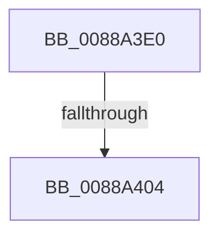

# NtUnmapViewOfSectionEx

- RVA: `0x0088A3E0`–`0x0088A40D` (길이 `45` bytes)
- VA: `0x000000014088A3E0`
- 실행 섹션: `PAGE`
- PDB 이름 있음: `예`; PDB Function 태그: `아니요`
- unwind 정보 RVA: `0x0007D0D4`
- 디코드: `10`개 명령, `45/45` bytes 표시
- 미해석 바이트: `0` (있으면 어셈블리에 `.byte`로 보존)

> 이 문서는 커널 이미지의 기계어와 PDB 기호를 분석해 생성했습니다. 4번과 5번은 함수 원형과 자료형을 바이너리 사용 방식에서 추정한 C 해석이며 원본 소스 복구 결과는 아닙니다.

## 1. Dependencies

- 직접 호출 지점: **0**; 고유 호출 대상: **0**
- 직접 호출자로 확인된 함수: **0**
- RIP 상대 이미지 참조: **0**

### Outgoing calls
- 직접 디코드된 call 명령이 없습니다.

### Direct callers
- 이 함수 시작 RVA로 연결되는 직접 call은 확인되지 않았습니다. 간접 호출은 완전히 역산할 수 없습니다.

### Static image references
- 디코드된 RIP-relative 메모리 참조가 없습니다.

## 2. Other-region calls and transfers

- 다른 실행 섹션으로 향하는 call: **0**
- call이 아닌 외부 분기/꼬리 이동: **1**
  - `0x0088A3FE` → [sub_0088A4A2 + 0x1](Unknown_function_0088A4A2.md) (`tail-transfer`)

## 3. Assembly (complete function range)

```asm
0088A3E0  48 89 74 24 10                  mov qword ptr [rsp + 0x10], rsi
0088A3E5  57                              push rdi
0088A3E6  48 83 EC 40                     sub rsp, 0x40
0088A3EA  48 8B F2                        mov rsi, rdx
0088A3ED  41 8B F8                        mov edi, r8d
0088A3F0  33 D2                           xor edx, edx
0088A3F2  48 89 54 24 68                  mov qword ptr [rsp + 0x68], rdx
0088A3F7  41 F7 C0 FC FF FF FF            test r8d, 0xfffffffc
0088A3FE  0F 85 9F 00 00 00               jne 0x14088a4a3
0088A404  65 48 8B 04 25 88 01 00 00      mov rax, qword ptr gs:[0x188]
```

## 4. C-style interpretation (structured pseudocode)

```c
__int64 __fastcall NtUnmapViewOfSectionEx(__int64 a1, __int64 a2, int a3)
{
    __int64 v_rsp;
    unsigned __int64 v_stack_p10;
    unsigned __int64 v_stack_p20;

    v_stack_p10 = v_rsi;
    v_rsp = (v_rsp) - (64);
    a2 = 0;
    v_stack_p20 = 0;
    return *(unsigned __int64 *)(gs_base + (0 + 392));
}
```

## 5. (Beta) C Style

```c
int64_t NtUnmapViewOfSectionEx(int64_t Arg1, int64_t Arg2, int32_t Arg3)
{
    int64_t local_rsp;
    uint64_t v_stack_p10;
    uint64_t v_stack_p20;

    v_stack_p10 = local_rsi;
    local_rsp = (local_rsp) - (64);
    Arg2 = 0;
    v_stack_p20 = 0;
    return *(uint64_t *)(gs_base + (0 + 0x188));
}
```

## 6. Execution-region graph

[열기: 2D/3D 그래프와 함수 탐색 컨트롤 패널](../../../control-panel.html?section=page&rva=0x0088A3E0&view=graph)

- 2D 그래프는 위에서 아래로 흐르고, 3D 그래프는 빈 공간을 드래그해 회전합니다. Shift+드래그는 이동, 휠은 확대·축소, 함수 노드 선택은 대상 보고서 이동입니다.

### Static fallback


