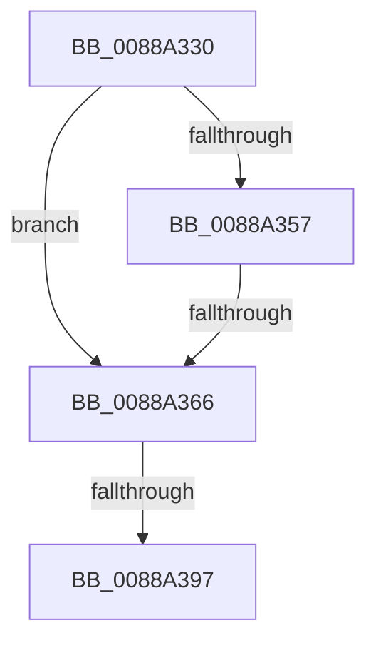

# NtUnmapViewOfSection

- RVA: `0x0088A330`–`0x0088A3A2` (길이 `114` bytes)
- VA: `0x000000014088A330`
- 실행 섹션: `PAGE`
- PDB 이름 있음: `예`; PDB Function 태그: `아니요`
- unwind 정보 RVA: `0x0007D0A4`
- 디코드: `25`개 명령, `114/114` bytes 표시
- 미해석 바이트: `0` (있으면 어셈블리에 `.byte`로 보존)

> 이 문서는 커널 이미지의 기계어와 PDB 기호를 분석해 생성했습니다. 4번과 5번은 함수 원형과 자료형을 바이너리 사용 방식에서 추정한 C 해석이며 원본 소스 복구 결과는 아닙니다.

## 1. Dependencies

- 직접 호출 지점: **1**; 고유 호출 대상: **1**
- 직접 호출자로 확인된 함수: **0**
- RIP 상대 이미지 참조: **1**

### Outgoing calls
- `0x0088A38E` → [ObpReferenceObjectByHandleWithTag](../86/ObpReferenceObjectByHandleWithTag_function_00869650.md) (function, `0x00869650`)

### Direct callers
- 이 함수 시작 RVA로 연결되는 직접 call은 확인되지 않았습니다. 간접 호출은 완전히 역산할 수 없습니다.

### Static image references
- `0x0088A366` → RVA `0x00FC6A98` (`ALMOSTRO`; read)

## 2. Other-region calls and transfers

- 다른 실행 섹션으로 향하는 call: **0**
- call이 아닌 외부 분기/꼬리 이동: **2**
  - `0x0088A364` → [sub_0088A3C7 + 0x7](Unknown_function_0088A3C7.md) (`tail-transfer`)
  - `0x0088A395` → [sub_0088A3C7](Unknown_function_0088A3C7.md) (`tail-transfer`)

## 3. Assembly (complete function range)

```asm
0088A330  40 53                           push rbx
0088A332  48 83 EC 40                     sub rsp, 0x40
0088A336  65 4C 8B 0C 25 88 01 00 00      mov r9, qword ptr gs:[0x188]
0088A33F  48 8B DA                        mov rbx, rdx
0088A342  33 D2                           xor edx, edx
0088A344  48 89 54 24 60                  mov qword ptr [rsp + 0x60], rdx
0088A349  45 0F B6 89 32 02 00 00         movzx r9d, byte ptr [r9 + 0x232]
0088A351  41 80 F9 01                     cmp r9b, 1
0088A355  75 0F                           jne 0x14088a366
0088A357  48 B8 FF FF FE FF FF 7F 00 00   movabs rax, 0x7ffffffeffff
0088A361  48 3B D8                        cmp rbx, rax
0088A364  77 68                           ja 0x14088a3ce
0088A366  4C 8B 05 2B C7 73 00            mov r8, qword ptr [rip + 0x73c72b]
0088A36D  48 8D 44 24 60                  lea rax, [rsp + 0x60]
0088A372  48 89 54 24 38                  mov qword ptr [rsp + 0x38], rdx
0088A377  48 89 54 24 30                  mov qword ptr [rsp + 0x30], rdx
0088A37C  BA 08 00 00 00                  mov edx, 8
0088A381  48 89 44 24 28                  mov qword ptr [rsp + 0x28], rax
0088A386  C7 44 24 20 4D 6D 56 77         mov dword ptr [rsp + 0x20], 0x77566d4d
0088A38E  E8 BD F2 FD FF                  call 0x140869650
0088A393  85 C0                           test eax, eax
0088A395  78 30                           js 0x14088a3c7
0088A397  48 8B 4C 24 60                  mov rcx, qword ptr [rsp + 0x60]
0088A39C  45 33 C9                        xor r9d, r9d
0088A39F  45 33 C0                        xor r8d, r8d
```

## 4. C-style interpretation (structured pseudocode)

```c
__int64 __fastcall NtUnmapViewOfSection(__int64 a1, __int64 a2)
{
    __int64 result;
    __int64 v_rsp;
    unsigned __int64 v_stack_m10;
    unsigned __int64 v_stack_m18;
    unsigned __int64 v_stack_m20;
    unsigned int v_stack_m28;
    unsigned __int64 v_stack_p18;

    v_rsp = (v_rsp) - (64);
    a2 = 0;
    v_stack_p18 = 0;
    if (((unsigned __int8)(*(unsigned __int8 *)(*(unsigned __int64 *)(gs_base + (0 + 392)) + 562))) != 1) goto loc_0088A366;
loc_0088A366:
    v_stack_m10 = 0;
    v_stack_m18 = 0;
    v_stack_m20 = v_stack_p18;
    v_stack_m28 = 0x77566D4DULL;
    result = ObpReferenceObjectByHandleWithTag(a1, 8, *(unsigned __int64 *)(v_rip + 7587627), *(unsigned __int8 *)(*(unsigned __int64 *)(gs_base + (0 + 392)) + 562));
    a4 = 0;
    a3 = 0;
    return result;
}
```

## 5. (Beta) C Style

```c
int64_t NtUnmapViewOfSection(int64_t Arg1, int64_t Arg2)
{
    int64_t result;
    int64_t local_rsp;
    uint64_t v_stack_m10;
    uint64_t v_stack_m18;
    uint64_t v_stack_m20;
    uint32_t v_stack_m28;
    uint64_t v_stack_p18;

    local_rsp = (local_rsp) - (64);
    Arg2 = 0;
    v_stack_p18 = 0;
    if (((uint8_t)(*(uint8_t *)(*(uint64_t *)(gs_base + (0 + 0x188)) + 0x232))) != 1) goto loc_0088A366;
loc_0088A366:
    v_stack_m10 = 0;
    v_stack_m18 = 0;
    v_stack_m20 = v_stack_p18;
    v_stack_m28 = 0x77566D4DULL;
    result = ObpReferenceObjectByHandleWithTag(Arg1, 8, *(uint64_t *)(v_rip + 0x73C72B), *(uint8_t *)(*(uint64_t *)(gs_base + (0 + 0x188)) + 0x232));
    a4 = 0;
    a3 = 0;
    return result;
}
```

## 6. Execution-region graph

[열기: 2D/3D 그래프와 함수 탐색 컨트롤 패널](../../../control-panel.html?section=page&rva=0x0088A330&view=graph)

- 2D 그래프는 위에서 아래로 흐르고, 3D 그래프는 빈 공간을 드래그해 회전합니다. Shift+드래그는 이동, 휠은 확대·축소, 함수 노드 선택은 대상 보고서 이동입니다.

### Static fallback


