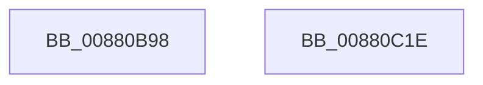

# PerfInfoLogVirtualFree

- RVA: `0x00880B98`–`0x00880C1F` (길이 `135` bytes)
- VA: `0x0000000140880B98`
- 실행 섹션: `PAGE`
- PDB 이름 있음: `예`; PDB Function 태그: `아니요`
- unwind 정보 RVA: `0x0007C514`
- 디코드: `31`개 명령, `135/135` bytes 표시
- 미해석 바이트: `0` (있으면 어셈블리에 `.byte`로 보존)

> 이 문서는 커널 이미지의 기계어와 PDB 기호를 분석해 생성했습니다. 4번과 5번은 함수 원형과 자료형을 바이너리 사용 방식에서 추정한 C 해석이며 원본 소스 복구 결과는 아닙니다.

## 1. Dependencies

- 직접 호출 지점: **3**; 고유 호출 대상: **3**
- 직접 호출자로 확인된 함수: **3**
- RIP 상대 이미지 참조: **1**

### Outgoing calls
- `0x00880BDE` → [PsGetProcessServerSilo](../../text/44/PsGetProcessServerSilo_function_0044BEE0.md) (function, `0x0044BEE0`)
- `0x00880C06` → [EtwTraceSiloKernelEvent](../../text/22/EtwTraceSiloKernelEvent_function_002242A0.md) (function, `0x002242A0`)
- `0x00880C13` → [_security_check_cookie](../../text/6A/_security_check_cookie_function_006AC640.md) (function, `0x006AC640`)

### Direct callers
- [MiFreeVadRange](../../text/2A/MiFreeVadRange_function_002A77AC.md) at `0x002A7998`
- [MiFreeVirtualMemory](MiFreeVirtualMemory_function_00880268.md) at `0x00880588`
- [MiPreparePlaceholderVadReplacement](../A7/MiPreparePlaceholderVadReplacement_function_00A7E998.md) at `0x00A7EA41`

### Static image references
- `0x00880BA0` → RVA `0x00E0A740` (`.data`; read)

## 2. Other-region calls and transfers

- 다른 실행 섹션으로 향하는 call: **3**
  - `0x00880BDE` → [PsGetProcessServerSilo](../../text/44/PsGetProcessServerSilo_function_0044BEE0.md) (`PAGE` → `.text`)
  - `0x00880C06` → [EtwTraceSiloKernelEvent](../../text/22/EtwTraceSiloKernelEvent_function_002242A0.md) (`PAGE` → `.text`)
  - `0x00880C13` → [_security_check_cookie](../../text/6A/_security_check_cookie_function_006AC640.md) (`PAGE` → `.text`)
- 별도 외부 분기/꼬리 이동을 확인하지 못했습니다.

## 3. Assembly (complete function range)

```asm
00880B98  4C 8B DC                        mov r11, rsp
00880B9B  53                              push rbx
00880B9C  48 83 EC 60                     sub rsp, 0x60
00880BA0  48 8B 05 99 9B 58 00            mov rax, qword ptr [rip + 0x589b99]
00880BA7  48 33 C4                        xor rax, rsp
00880BAA  48 89 44 24 58                  mov qword ptr [rsp + 0x58], rax
00880BAF  41 8B 80 D0 01 00 00            mov eax, dword ptr [r8 + 0x1d0]
00880BB6  49 89 4B C8                     mov qword ptr [r11 - 0x38], rcx
00880BBA  49 8B C8                        mov rcx, r8
00880BBD  49 89 53 D0                     mov qword ptr [r11 - 0x30], rdx
00880BC1  89 44 24 40                     mov dword ptr [rsp + 0x40], eax
00880BC5  49 8D 43 C8                     lea rax, [r11 - 0x38]
00880BC9  49 89 43 E0                     mov qword ptr [r11 - 0x20], rax
00880BCD  83 64 24 54 00                  and dword ptr [rsp + 0x54], 0
00880BD2  C7 44 24 50 18 00 00 00         mov dword ptr [rsp + 0x50], 0x18
00880BDA  45 89 4B DC                     mov dword ptr [r11 - 0x24], r9d
00880BDE  E8 FD B2 BC FF                  call 0x14044bee0
00880BE3  48 8B C8                        mov rcx, rax
00880BE6  C7 44 24 28 02 19 60 00         mov dword ptr [rsp + 0x28], 0x601902
00880BEE  41 B9 00 80 00 20               mov r9d, 0x20008000
00880BF4  66 C7 44 24 20 63 02            mov word ptr [rsp + 0x20], 0x263
00880BFB  41 B8 01 00 00 00               mov r8d, 1
00880C01  48 8D 54 24 48                  lea rdx, [rsp + 0x48]
00880C06  E8 95 36 9A FF                  call 0x1402242a0
00880C0B  48 8B 4C 24 58                  mov rcx, qword ptr [rsp + 0x58]
00880C10  48 33 CC                        xor rcx, rsp
00880C13  E8 28 BA E2 FF                  call 0x1406ac640
00880C18  48 83 C4 60                     add rsp, 0x60
00880C1C  5B                              pop rbx
00880C1D  C3                              ret
00880C1E  CC                              int3
```

## 4. C-style interpretation (structured pseudocode)

```c
__int64 __fastcall PerfInfoLogVirtualFree(__int64 a1, __int64 a2, __int64 a3, int a4)
{
    __int64 result;
    __int64 v_rsp;
    unsigned __int64 v_stack_m10;
    unsigned int v_stack_m14;
    unsigned int v_stack_m18;
    unsigned __int64 v_stack_m20;
    unsigned int v_stack_m28;
    unsigned int v_stack_m40;
    unsigned __int16 v_stack_m48;

    v_rsp = (v_rsp) - (96);
    result = (*(unsigned __int64 *)(v_rip + 5807001)) ^ (v_rsp);
    v_stack_m10 = result;
    *(unsigned __int64 *)(v_rsp - 56) = a1;
    *(unsigned __int64 *)(v_rsp - 48) = a2;
    v_stack_m28 = (unsigned int)((unsigned int)(*(unsigned int *)(a3 + 464)));
    *(unsigned __int64 *)(v_rsp - 32) = v_rsp - 56;
    v_stack_m18 = 24;
    *(unsigned int *)(v_rsp - 36) = a4;
    result = PsGetProcessServerSilo(a3, a2, a3, a4);
    v_stack_m40 = 0x601902ULL;
    v_stack_m48 = 611;
    result = EtwTraceSiloKernelEvent(result, v_stack_m20, 1, (unsigned int)(0x20008000ULL));
    a1 = (v_stack_m10) ^ (v_rsp);
    result = _security_check_cookie(a1, v_stack_m20, 1, (unsigned int)(0x20008000ULL));
    v_rsp = (v_rsp) + (96);
    return result;
}
```

## 5. (Beta) C Style

```c
int64_t PerfInfoLogVirtualFree(int64_t Arg1, int64_t Arg2, void *Arg3, int32_t Arg4)
{
    uint8_t *arg3 = (uint8_t *)Arg3;

    int64_t result;
    int64_t local_rsp;
    uint64_t v_stack_m10;
    uint32_t v_stack_m14;
    uint32_t v_stack_m18;
    uint64_t v_stack_m20;
    uint32_t v_stack_m28;
    uint32_t v_stack_m40;
    uint16_t v_stack_m48;

    local_rsp = (local_rsp) - (96);
    result = (*(uint64_t *)(v_rip + 0x589B99)) ^ (local_rsp);
    v_stack_m10 = result;
    *(uint64_t *)(local_rsp - 0x38) = Arg1;
    *(uint64_t *)(local_rsp - 0x30) = Arg2;
    v_stack_m28 = (uint32_t)((uint32_t)(*(uint32_t *)(arg3 + 0x1D0)));
    *(uint64_t *)(local_rsp - 0x20) = local_rsp - 56;
    v_stack_m18 = 24;
    *(uint32_t *)(local_rsp - 0x24) = Arg4;
    result = PsGetProcessServerSilo(Arg3, Arg2, Arg3, Arg4);
    v_stack_m40 = 0x601902ULL;
    v_stack_m48 = 611;
    result = EtwTraceSiloKernelEvent(result, v_stack_m20, 1, (uint32_t)(0x20008000ULL));
    Arg1 = (v_stack_m10) ^ (local_rsp);
    result = _security_check_cookie(Arg1, v_stack_m20, 1, (uint32_t)(0x20008000ULL));
    local_rsp = (local_rsp) + (96);
    return result;
}
```

### 관측된 메모리 오프셋

구조체 형식이 확인되지 않은 접근은 인자 기준의 오프셋으로만 기록했습니다.

| 기준 인자 | 오프셋 표현 | 폭 (bit) | 접근 |
|---|---:|---:|---|
| `Arg3` | `+ 0x1D0` | `32` | `R` |

## 6. Execution-region graph

[열기: 2D/3D 그래프와 함수 탐색 컨트롤 패널](../../../control-panel.html?section=page&rva=0x00880B98&view=graph)

- 2D 그래프는 위에서 아래로 흐르고, 3D 그래프는 빈 공간을 드래그해 회전합니다. Shift+드래그는 이동, 휠은 확대·축소, 함수 노드 선택은 대상 보고서 이동입니다.

### Static fallback


