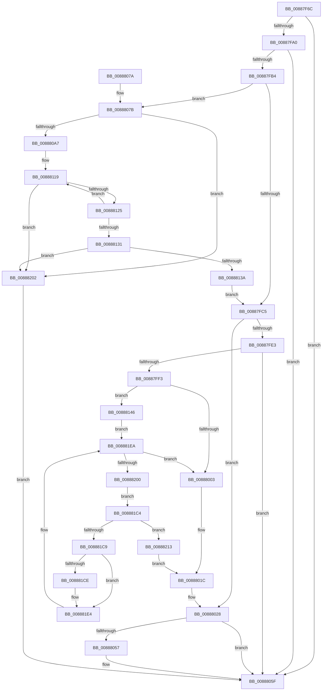

# PfCheckDeprioritizeFile

- RVA: `0x00887F6C`–`0x0088821F` (길이 `691` bytes)
- VA: `0x0000000140887F6C`
- 실행 섹션: `PAGE`
- PDB 이름 있음: `예`; PDB Function 태그: `아니요`
- unwind 정보 RVA: `0x0007CD80`
- 디코드: `174`개 명령, `691/691` bytes 표시
- 미해석 바이트: `0` (있으면 어셈블리에 `.byte`로 보존)

> 이 문서는 커널 이미지의 기계어와 PDB 기호를 분석해 생성했습니다. 4번과 5번은 함수 원형과 자료형을 바이너리 사용 방식에서 추정한 C 해석이며 원본 소스 복구 결과는 아닙니다.

## 1. Dependencies

- 직접 호출 지점: **8**; 고유 호출 대상: **5**
- 직접 호출자로 확인된 함수: **3**
- RIP 상대 이미지 참조: **12**

### Outgoing calls
- `0x00887FA7` → [PfLockSharedTryAcquire](../../text/3F/PfLockSharedTryAcquire_function_003FC0D0.md) (function, `0x003FC0D0`)
- `0x00887FD5` → [PfLockSharedRelease](../../text/48/PfLockSharedRelease_function_0048DF24.md) (function, `0x0048DF24`)
- `0x00887FEA` → [PfLockSharedTryAcquire](../../text/3F/PfLockSharedTryAcquire_function_003FC0D0.md) (function, `0x003FC0D0`)
- `0x00888023` → [PfLockSharedRelease](../../text/48/PfLockSharedRelease_function_0048DF24.md) (function, `0x0048DF24`)
- `0x00888030` → [PfpPartitionReferenceParentSafeByProcess](../../text/42/PfpPartitionReferenceParentSafeByProcess_function_0042B080.md) (function, `0x0042B080`)
- `0x0088804D` → [PfpRpLogDeprioEvent](../../text/48/PfpRpLogDeprioEvent_function_0048D1C4.md) (function, `0x0048D1C4`)
- `0x0088805A` → [PfpPartitionDereferenceParent](../../text/34/PfpPartitionDereferenceParent_function_00341CDC.md) (function, `0x00341CDC`)
- `0x00888209` → [PfLockSharedRelease](../../text/48/PfLockSharedRelease_function_0048DF24.md) (function, `0x0048DF24`)

### Direct callers
- [MiDeprioritizeVad](../../text/42/MiDeprioritizeVad_function_0042AAB4.md) at `0x0042AB75`
- [MiUnmapVad](MiUnmapVad_function_00889280.md) at `0x0088934F`
- [sub_009E96D3](../9E/Unknown_function_009E96D3.md) at `0x009E973B`

### Static image references
- `0x00887FA0` → RVA `0x00E67178` (`.data`; read)
- `0x00887FB4` → RVA `0x00E67158` (`.data`; read)
- `0x00887FDA` → RVA `0x00E67198` (`.data`; read)
- `0x00887FE3` → RVA `0x00E671A0` (`.data`; read)
- `0x00887FF3` → RVA `0x00E6718C` (`.data`; read)
- `0x00888015` → RVA `0x00E671D8` (`.data`; write)
- `0x0088807B` → RVA `0x00E6714C` (`.data`; read)
- `0x0088810E` → RVA `0x00E67150` (`.data`; read)
- `0x0088813A` → RVA `0x00E67158` (`.data`; write)
- `0x00888146` → RVA `0x00E67188` (`.data`; read)
- `0x0088814D` → RVA `0x00E67180` (`.data`; read)
- `0x00888213` → RVA `0x00E67198` (`.data`; write)

## 2. Other-region calls and transfers

- 다른 실행 섹션으로 향하는 call: **8**
  - `0x00887FA7` → [PfLockSharedTryAcquire](../../text/3F/PfLockSharedTryAcquire_function_003FC0D0.md) (`PAGE` → `.text`)
  - `0x00887FD5` → [PfLockSharedRelease](../../text/48/PfLockSharedRelease_function_0048DF24.md) (`PAGE` → `.text`)
  - `0x00887FEA` → [PfLockSharedTryAcquire](../../text/3F/PfLockSharedTryAcquire_function_003FC0D0.md) (`PAGE` → `.text`)
  - `0x00888023` → [PfLockSharedRelease](../../text/48/PfLockSharedRelease_function_0048DF24.md) (`PAGE` → `.text`)
  - `0x00888030` → [PfpPartitionReferenceParentSafeByProcess](../../text/42/PfpPartitionReferenceParentSafeByProcess_function_0042B080.md) (`PAGE` → `.text`)
  - `0x0088804D` → [PfpRpLogDeprioEvent](../../text/48/PfpRpLogDeprioEvent_function_0048D1C4.md) (`PAGE` → `.text`)
  - `0x0088805A` → [PfpPartitionDereferenceParent](../../text/34/PfpPartitionDereferenceParent_function_00341CDC.md) (`PAGE` → `.text`)
  - `0x00888209` → [PfLockSharedRelease](../../text/48/PfLockSharedRelease_function_0048DF24.md) (`PAGE` → `.text`)
- 별도 외부 분기/꼬리 이동을 확인하지 못했습니다.

## 3. Assembly (complete function range)

```asm
00887F6C  48 8B C4                        mov rax, rsp
00887F6F  48 89 58 08                     mov qword ptr [rax + 8], rbx
00887F73  48 89 68 10                     mov qword ptr [rax + 0x10], rbp
00887F77  48 89 70 20                     mov qword ptr [rax + 0x20], rsi
00887F7B  57                              push rdi
00887F7C  41 56                           push r14
00887F7E  41 57                           push r15
00887F80  48 83 EC 30                     sub rsp, 0x30
00887F84  48 83 60 D8 00                  and qword ptr [rax - 0x28], 0
00887F89  33 F6                           xor esi, esi
00887F8B  49 8B E9                        mov rbp, r9
00887F8E  49 8B F8                        mov rdi, r8
00887F91  44 8B F2                        mov r14d, edx
00887F94  4C 8B F9                        mov r15, rcx
00887F97  4D 85 C0                        test r8, r8
00887F9A  0F 84 BF 00 00 00               je 0x14088805f
00887FA0  48 8D 0D D1 F1 5D 00            lea rcx, [rip + 0x5df1d1]
00887FA7  E8 24 41 B7 FF                  call 0x1403fc0d0
00887FAC  85 C0                           test eax, eax
00887FAE  0F 84 AB 00 00 00               je 0x14088805f
00887FB4  48 8B 0D 9D F1 5D 00            mov rcx, qword ptr [rip + 0x5df19d]
00887FBB  48 3B 79 08                     cmp rdi, qword ptr [rcx + 8]
00887FBF  0F 85 B6 00 00 00               jne 0x14088807b
00887FC5  48 8B 59 10                     mov rbx, qword ptr [rcx + 0x10]
00887FC9  48 8D 0D A8 F1 5D 00            lea rcx, [rip + 0x5df1a8]
00887FD0  48 89 5C 24 60                  mov qword ptr [rsp + 0x60], rbx
00887FD5  E8 4A 5F C0 FF                  call 0x14048df24
00887FDA  48 39 1D B7 F1 5D 00            cmp qword ptr [rip + 0x5df1b7], rbx
00887FE1  74 45                           je 0x140888028
00887FE3  48 8D 0D B6 F1 5D 00            lea rcx, [rip + 0x5df1b6]
00887FEA  E8 E1 40 B7 FF                  call 0x1403fc0d0
00887FEF  85 C0                           test eax, eax
00887FF1  74 6C                           je 0x14088805f
00887FF3  44 8B 05 92 F1 5D 00            mov r8d, dword ptr [rip + 0x5df192]
00887FFA  45 85 C0                        test r8d, r8d
00887FFD  0F 85 43 01 00 00               jne 0x140888146
00888003  48 B8 20 03 00 00 80 F7 FF FF   movabs rax, 0xfffff78000000320
0088800D  BE 01 00 00 00                  mov esi, 1
00888012  48 8B 00                        mov rax, qword ptr [rax]
00888015  48 89 05 BC F1 5D 00            mov qword ptr [rip + 0x5df1bc], rax
0088801C  48 8D 0D 7D F1 5D 00            lea rcx, [rip + 0x5df17d]
00888023  E8 FC 5E C0 FF                  call 0x14048df24
00888028  49 8B D7                        mov rdx, r15
0088802B  48 8D 4C 24 20                  lea rcx, [rsp + 0x20]
00888030  E8 4B 30 BA FF                  call 0x14042b080
00888035  8B CE                           mov ecx, esi
00888037  45 8B C6                        mov r8d, r14d
0088803A  F7 D9                           neg ecx
0088803C  48 8B D7                        mov rdx, rdi
0088803F  48 8B 4C 24 20                  mov rcx, qword ptr [rsp + 0x20]
00888044  48 8B D8                        mov rbx, rax
00888047  4D 1B C9                        sbb r9, r9
0088804A  4C 23 CD                        and r9, rbp
0088804D  E8 72 51 C0 FF                  call 0x14048d1c4
00888052  48 85 DB                        test rbx, rbx
00888055  74 08                           je 0x14088805f
00888057  48 8B CB                        mov rcx, rbx
0088805A  E8 7D 9C AB FF                  call 0x140341cdc
0088805F  48 8B 5C 24 50                  mov rbx, qword ptr [rsp + 0x50]
00888064  8B C6                           mov eax, esi
00888066  48 8B 74 24 68                  mov rsi, qword ptr [rsp + 0x68]
0088806B  48 8B 6C 24 58                  mov rbp, qword ptr [rsp + 0x58]
00888070  48 83 C4 30                     add rsp, 0x30
00888074  41 5F                           pop r15
00888076  41 5E                           pop r14
00888078  5F                              pop rdi
00888079  C3                              ret
0088807A  CC                              int3
0088807B  44 8B 0D CA F0 5D 00            mov r9d, dword ptr [rip + 0x5df0ca]
00888082  49 83 CB FF                     or r11, 0xffffffffffffffff
00888086  41 8B C9                        mov ecx, r9d
00888089  41 C1 E9 05                     shr r9d, 5
0088808D  83 E1 1F                        and ecx, 0x1f
00888090  49 D3 E3                        shl r11, cl
00888093  4D 8B D3                        mov r10, r11
00888096  4C 23 D7                        and r10, rdi
00888099  4C 89 54 24 60                  mov qword ptr [rsp + 0x60], r10
0088809E  45 85 C9                        test r9d, r9d
008880A1  0F 84 5B 01 00 00               je 0x140888202
008880A7  41 0F B6 C2                     movzx eax, r10b
008880AB  48 05 CB 5D B1 00               add rax, 0xb15dcb
008880B1  48 6B C8 25                     imul rcx, rax, 0x25
008880B5  0F B6 44 24 61                  movzx eax, byte ptr [rsp + 0x61]
008880BA  48 03 C8                        add rcx, rax
008880BD  0F B6 44 24 62                  movzx eax, byte ptr [rsp + 0x62]
008880C2  48 6B D1 25                     imul rdx, rcx, 0x25
008880C6  48 03 D0                        add rdx, rax
008880C9  0F B6 44 24 63                  movzx eax, byte ptr [rsp + 0x63]
008880CE  48 6B CA 25                     imul rcx, rdx, 0x25
008880D2  48 03 C8                        add rcx, rax
008880D5  0F B6 44 24 64                  movzx eax, byte ptr [rsp + 0x64]
008880DA  48 6B D1 25                     imul rdx, rcx, 0x25
008880DE  48 03 D0                        add rdx, rax
008880E1  0F B6 44 24 65                  movzx eax, byte ptr [rsp + 0x65]
008880E6  48 6B CA 25                     imul rcx, rdx, 0x25
008880EA  48 03 C8                        add rcx, rax
008880ED  0F B6 44 24 66                  movzx eax, byte ptr [rsp + 0x66]
008880F2  48 6B D1 25                     imul rdx, rcx, 0x25
008880F6  41 8D 49 FF                     lea ecx, [r9 - 1]
008880FA  48 03 D0                        add rdx, rax
008880FD  0F B6 44 24 67                  movzx eax, byte ptr [rsp + 0x67]
00888102  4C 6B C2 25                     imul r8, rdx, 0x25
00888106  49 03 C0                        add rax, r8
00888109  8B C0                           mov eax, eax
0088810B  48 23 C8                        and rcx, rax
0088810E  48 8B 05 3B F0 5D 00            mov rax, qword ptr [rip + 0x5df03b]
00888115  48 8D 0C C8                     lea rcx, [rax + rcx*8]
00888119  48 8B 09                        mov rcx, qword ptr [rcx]
0088811C  F6 C1 01                        test cl, 1
0088811F  0F 85 DD 00 00 00               jne 0x140888202
00888125  48 8B 41 08                     mov rax, qword ptr [rcx + 8]
00888129  49 23 C3                        and rax, r11
0088812C  4C 3B D0                        cmp r10, rax
0088812F  75 E8                           jne 0x140888119
00888131  48 85 C9                        test rcx, rcx
00888134  0F 84 C8 00 00 00               je 0x140888202
0088813A  48 89 0D 17 F0 5D 00            mov qword ptr [rip + 0x5df017], rcx
00888141  E9 7F FE FF FF                  jmp 0x140887fc5
00888146  44 8B 0D 3B F0 5D 00            mov r9d, dword ptr [rip + 0x5df03b]
0088814D  4C 8B 15 2C F0 5D 00            mov r10, qword ptr [rip + 0x5df02c]
00888154  0F B6 C3                        movzx eax, bl
00888157  48 05 CB 5D B1 00               add rax, 0xb15dcb
0088815D  48 6B C8 25                     imul rcx, rax, 0x25
00888161  0F B6 44 24 61                  movzx eax, byte ptr [rsp + 0x61]
00888166  48 03 C8                        add rcx, rax
00888169  0F B6 44 24 62                  movzx eax, byte ptr [rsp + 0x62]
0088816E  48 6B D1 25                     imul rdx, rcx, 0x25
00888172  48 03 D0                        add rdx, rax
00888175  0F B6 44 24 63                  movzx eax, byte ptr [rsp + 0x63]
0088817A  48 6B CA 25                     imul rcx, rdx, 0x25
0088817E  48 03 C8                        add rcx, rax
00888181  0F B6 44 24 64                  movzx eax, byte ptr [rsp + 0x64]
00888186  48 6B D1 25                     imul rdx, rcx, 0x25
0088818A  48 03 D0                        add rdx, rax
0088818D  0F B6 44 24 65                  movzx eax, byte ptr [rsp + 0x65]
00888192  48 6B CA 25                     imul rcx, rdx, 0x25
00888196  48 03 C8                        add rcx, rax
00888199  0F B6 44 24 66                  movzx eax, byte ptr [rsp + 0x66]
0088819E  48 6B D1 25                     imul rdx, rcx, 0x25
008881A2  48 03 D0                        add rdx, rax
008881A5  0F B6 44 24 67                  movzx eax, byte ptr [rsp + 0x67]
008881AA  48 6B CA 25                     imul rcx, rdx, 0x25
008881AE  48 03 C8                        add rcx, rax
008881B1  41 8D 40 FF                     lea eax, [r8 - 1]
008881B5  8B D0                           mov edx, eax
008881B7  44 8B D8                        mov r11d, eax
008881BA  8B C1                           mov eax, ecx
008881BC  48 23 D0                        and rdx, rax
008881BF  45 33 C0                        xor r8d, r8d
008881C2  EB 26                           jmp 0x1408881ea
008881C4  48 3B CB                        cmp rcx, rbx
008881C7  74 4A                           je 0x140888213
008881C9  4D 85 C0                        test r8, r8
008881CC  75 16                           jne 0x1408881e4
008881CE  B9 B1 79 37 9E                  mov ecx, 0x9e3779b1
008881D3  48 8B C3                        mov rax, rbx
008881D6  48 0F AF C1                     imul rax, rcx
008881DA  A8 01                           test al, 1
008881DC  4C 8D 40 01                     lea r8, [rax + 1]
008881E0  4C 0F 45 C0                     cmovne r8, rax
008881E4  49 03 D0                        add rdx, r8
008881E7  49 23 D3                        and rdx, r11
008881EA  41 8B C9                        mov ecx, r9d
008881ED  48 8B C2                        mov rax, rdx
008881F0  48 D3 E0                        shl rax, cl
008881F3  4A 8B 0C 10                     mov rcx, qword ptr [rax + r10]
008881F7  48 85 C9                        test rcx, rcx
008881FA  0F 84 03 FE FF FF               je 0x140888003
00888200  EB C2                           jmp 0x1408881c4
00888202  48 8D 0D 6F EF 5D 00            lea rcx, [rip + 0x5def6f]
00888209  E8 16 5D C0 FF                  call 0x14048df24
0088820E  E9 4C FE FF FF                  jmp 0x14088805f
00888213  48 89 1D 7E EF 5D 00            mov qword ptr [rip + 0x5def7e], rbx
0088821A  E9 FD FD FF FF                  jmp 0x14088801c
```

## 4. C-style interpretation (structured pseudocode)

```c
__int64 __fastcall PfCheckDeprioritizeFile(__int64 a1, int a2, __int64 a3, __int64 a4)
{
    __int64 result;
    __int64 v_r10;
    __int64 v_r11;
    __int64 v_rsi;
    __int64 v_rsp;
    unsigned __int64 v_stack_m28;
    unsigned __int64 v_stack_p10;
    unsigned __int64 v_stack_p18;
    unsigned __int64 v_stack_p20;
    unsigned __int64 v_stack_p60;
    unsigned __int8 v_stack_p61;
    unsigned __int8 v_stack_p62;
    unsigned __int8 v_stack_p63;
    unsigned __int8 v_stack_p64;
    unsigned __int8 v_stack_p65;
    unsigned __int8 v_stack_p66;
    unsigned __int8 v_stack_p67;
    unsigned __int64 v_stack_p8;

    *(unsigned __int64 *)(v_rsp + 8) = v_rbx;
    *(unsigned __int64 *)(v_rsp + 16) = v_rbp;
    *(unsigned __int64 *)(v_rsp + 32) = v_rsi;
    v_rsp = (v_rsp) - (48);
    v_rsi = 0;
    if (a3 == 0) goto loc_0088805F;
    result = PfLockSharedTryAcquire(v_rip + 6156753, a2, a3, a4);
    if ((unsigned int)(result) == 0) goto loc_0088805F;
    if (a3 != (*(unsigned __int64 *)(*(unsigned __int64 *)(v_rip + 6156701) + 8))) goto loc_0088807B;
loc_00887FC5:
    v_stack_p18 = *(unsigned __int64 *)(*(unsigned __int64 *)(v_rip + 6156701) + 16);
    result = PfLockSharedRelease(v_rip + 6156712, a2, a3, a4);
    if ((*(unsigned __int64 *)(v_rip + 6156727)) == (*(unsigned __int64 *)(*(unsigned __int64 *)(v_rip + 6156701) + 16))) goto loc_00888028;
    result = PfLockSharedTryAcquire(v_rip + 6156726, a2, a3, a4);
    if ((unsigned int)(result) == 0) goto loc_0088805F;
    if ((unsigned int)((unsigned int)(*(unsigned int *)(v_rip + 6156690))) != 0) goto loc_00888146;
loc_00888003:
    *(unsigned __int64 *)(v_rip + 6156732) = *(unsigned __int64 *)(result);
loc_0088801C:
    result = PfLockSharedRelease(v_rip + 6156669, a2, (unsigned int)(*(unsigned int *)(v_rip + 6156690)), a4);
loc_00888028:
    result = PfpPartitionReferenceParentSafeByProcess(v_stack_m28, a1, (unsigned int)(*(unsigned int *)(v_rip + 6156690)), a4);
    a1 = (unsigned int)(-(1));
    a4 = (a4) & (a4);
    result = PfpRpLogDeprioEvent(v_stack_m28, a3, (unsigned int)((unsigned int)((unsigned int)(a2))), a4);
    if (result != 0) {
        a1 = result;
        result = PfpPartitionDereferenceParent(a1, a3, (unsigned int)((unsigned int)((unsigned int)(a2))), a4);
    }
    v_rsp = (v_rsp) + (48);
    return 1;
loc_0088807B:
    v_r11 = (v_r11) | (-1);
    a4 = (unsigned int)(((unsigned int)(*(unsigned int *)(v_rip + 6156490))) >> (5));
    a1 = (unsigned int)(((unsigned int)((unsigned int)((unsigned int)(*(unsigned int *)(v_rip + 6156490))))) & (31));
    v_r11 = (v_r11) << ((unsigned __int8)(a1));
    v_r10 = (v_r11) & (a3);
    v_stack_p60 = v_r10;
    if ((unsigned int)(a4) == 0) goto loc_00888202;
    result = ((unsigned __int8)(v_r10)) + (0xB15DCBULL);
    a1 = (a1) * (result);
    a1 = (a1) + (v_stack_p61);
    a2 = (a3) * (a1);
    a2 = (a2) + (v_stack_p62);
    a1 = (a1) * (a2);
    a1 = (a1) + (v_stack_p63);
    a2 = (a2) * (a1);
    a2 = (a2) + (v_stack_p64);
    a1 = (a1) * (a2);
    a1 = (a1) + (v_stack_p65);
    a2 = (a2) * (a1);
    a2 = (a2) + (v_stack_p66);
    a3 = ((unsigned int)((unsigned int)((unsigned int)(a2)))) * (a2);
    result = (v_stack_p67) + (a3);
    a1 = (a4 - 1) & ((unsigned int)((unsigned int)(result)));
loc_00888119:
    if ((((unsigned __int8)(*(unsigned __int64 *)(*(unsigned __int64 *)(v_rip + 6156347) + a1 * 8))) & (1)) != 0) goto loc_00888202;
    result = (*(unsigned __int64 *)(*(unsigned __int64 *)(*(unsigned __int64 *)(v_rip + 6156347) + a1 * 8) + 8)) & (v_r11);
    if (v_r10 != result) goto loc_00888119;
    if (*(unsigned __int64 *)(*(unsigned __int64 *)(v_rip + 6156347) + a1 * 8) == 0) goto loc_00888202;
    *(unsigned __int64 *)(v_rip + 6156311) = *(unsigned __int64 *)(*(unsigned __int64 *)(v_rip + 6156347) + a1 * 8);
    goto loc_00887FC5;
loc_00888146:
    result = ((unsigned __int8)(v_stack_p8)) + (0xB15DCBULL);
    a1 = (*(unsigned __int64 *)(*(unsigned __int64 *)(v_rip + 6156347) + a1 * 8)) * (result);
    a1 = (a1) + (v_stack_p61);
    a2 = (a2) * (a1);
    a2 = (a2) + (v_stack_p62);
    a1 = (a1) * (a2);
    a1 = (a1) + (v_stack_p63);
    a2 = (a2) * (a1);
    a2 = (a2) + (v_stack_p64);
    a1 = (a1) * (a2);
    a1 = (a1) + (v_stack_p65);
    a2 = (a2) * (a1);
    a2 = (a2) + (v_stack_p66);
    a1 = (a1) * (a2);
    a1 = (a1) + (v_stack_p67);
    a2 = ((unsigned int)((unsigned int)(a3 - 1))) & ((unsigned int)((unsigned int)(a1)));
    a3 = 0;
    goto loc_008881EA;
loc_008881C4:
    if (a1 == v_stack_p8) goto loc_00888213;
    result = (unsigned int)((unsigned int)(a1));
    if (0 == 0) {
        a1 = 0x9E3779B1ULL;
        result = v_stack_p8;
        result = (result) * (a1);
        a3 = result + 1;
        if ((((unsigned __int8)(result)) & (1)) != 0) { a3 = result; }
    }
    a2 = (a2) + (a3);
    a2 = (a2) & ((unsigned int)((unsigned int)(a3 - 1)));
loc_008881EA:
    result = (a2) << ((unsigned __int8)((unsigned int)((unsigned int)((unsigned int)(*(unsigned int *)(v_rip + 6156347))))));
    if (*(unsigned __int64 *)(result + *(unsigned __int64 *)(v_rip + 6156332) * 1) == 0) goto loc_00888003;
    goto loc_008881C4;
loc_00888202:
    result = PfLockSharedRelease(v_rip + 6156143, a2, a3, (unsigned int)(*(unsigned int *)(v_rip + 6156347)));
    goto loc_0088805F;
loc_00888213:
    *(unsigned __int64 *)(v_rip + 6156158) = v_stack_p8;
    goto loc_0088801C;
}
```

## 5. (Beta) C Style

```c
int64_t PfCheckDeprioritizeFile(int64_t Arg1, int32_t Arg2, int64_t Arg3, int64_t Arg4)
{
    int64_t result;
    int64_t local_r10;
    int64_t local_r11;
    int64_t local_rsi;
    int64_t local_rsp;
    uint64_t v_stack_m28;
    uint64_t v_stack_p10;
    uint64_t v_stack_p18;
    uint64_t v_stack_p20;
    uint64_t v_stack_p60;
    uint8_t v_stack_p61;
    uint8_t v_stack_p62;
    uint8_t v_stack_p63;
    uint8_t v_stack_p64;
    uint8_t v_stack_p65;
    uint8_t v_stack_p66;
    uint8_t v_stack_p67;
    uint64_t v_stack_p8;

    *(uint64_t *)(local_rsp + 0x8) = local_rbx;
    *(uint64_t *)(local_rsp + 0x10) = local_rbp;
    *(uint64_t *)(local_rsp + 0x20) = local_rsi;
    local_rsp = (local_rsp) - (48);
    local_rsi = 0;
    if (Arg3 == 0) goto loc_0088805F;
    result = PfLockSharedTryAcquire(v_rip + 6156753, Arg2, Arg3, Arg4);
    if ((uint32_t)(result) == 0) goto loc_0088805F;
    if (Arg3 != (*(uint64_t *)(*(uint64_t *)(v_rip + 0x5DF19D) + 0x8))) goto loc_0088807B;
loc_00887FC5:
    v_stack_p18 = *(uint64_t *)(*(uint64_t *)(v_rip + 0x5DF19D) + 0x10);
    result = PfLockSharedRelease(v_rip + 6156712, Arg2, Arg3, Arg4);
    if ((*(uint64_t *)(v_rip + 0x5DF1B7)) == (*(uint64_t *)(*(uint64_t *)(v_rip + 0x5DF19D) + 0x10))) goto loc_00888028;
    result = PfLockSharedTryAcquire(v_rip + 6156726, Arg2, Arg3, Arg4);
    if ((uint32_t)(result) == 0) goto loc_0088805F;
    if ((uint32_t)((uint32_t)(*(uint32_t *)(v_rip + 0x5DF192))) != 0) goto loc_00888146;
loc_00888003:
    *(uint64_t *)(v_rip + 0x5DF1BC) = *(uint64_t *)(result);
loc_0088801C:
    result = PfLockSharedRelease(v_rip + 6156669, Arg2, (uint32_t)(*(uint32_t *)(v_rip + 0x5DF192)), Arg4);
loc_00888028:
    result = PfpPartitionReferenceParentSafeByProcess(v_stack_m28, Arg1, (uint32_t)(*(uint32_t *)(v_rip + 0x5DF192)), Arg4);
    Arg1 = (uint32_t)(-(1));
    Arg4 = (Arg4) & (Arg4);
    result = PfpRpLogDeprioEvent(v_stack_m28, Arg3, (uint32_t)((uint32_t)((uint32_t)(Arg2))), Arg4);
    if (result != 0) {
        Arg1 = result;
        result = PfpPartitionDereferenceParent(Arg1, Arg3, (uint32_t)((uint32_t)((uint32_t)(Arg2))), Arg4);
    }
    local_rsp = (local_rsp) + (48);
    return 1;
loc_0088807B:
    local_r11 = (local_r11) | (-1);
    Arg4 = (uint32_t)(((uint32_t)(*(uint32_t *)(v_rip + 0x5DF0CA))) >> (5));
    Arg1 = (uint32_t)(((uint32_t)((uint32_t)((uint32_t)(*(uint32_t *)(v_rip + 0x5DF0CA))))) & (31));
    local_r11 = (local_r11) << ((uint8_t)(Arg1));
    local_r10 = (local_r11) & (Arg3);
    v_stack_p60 = local_r10;
    if ((uint32_t)(Arg4) == 0) goto loc_00888202;
    result = ((uint8_t)(local_r10)) + (0xB15DCBULL);
    Arg1 = (Arg1) * (result);
    Arg1 = (Arg1) + (v_stack_p61);
    Arg2 = (Arg3) * (Arg1);
    Arg2 = (Arg2) + (v_stack_p62);
    Arg1 = (Arg1) * (Arg2);
    Arg1 = (Arg1) + (v_stack_p63);
    Arg2 = (Arg2) * (Arg1);
    Arg2 = (Arg2) + (v_stack_p64);
    Arg1 = (Arg1) * (Arg2);
    Arg1 = (Arg1) + (v_stack_p65);
    Arg2 = (Arg2) * (Arg1);
    Arg2 = (Arg2) + (v_stack_p66);
    Arg3 = ((uint32_t)((uint32_t)((uint32_t)(Arg2)))) * (Arg2);
    result = (v_stack_p67) + (Arg3);
    Arg1 = (Arg4 - 1) & ((uint32_t)((uint32_t)(result)));
loc_00888119:
    if ((((uint8_t)(*(uint64_t *)(*(uint64_t *)(v_rip + 0x5DF03B) + Arg1 * 8))) & (1)) != 0) goto loc_00888202;
    result = (*(uint64_t *)(*(uint64_t *)(*(uint64_t *)(v_rip + 0x5DF03B) + Arg1 * 8) + 0x8)) & (local_r11);
    if (local_r10 != result) goto loc_00888119;
    if (*(uint64_t *)(*(uint64_t *)(v_rip + 0x5DF03B) + Arg1 * 8) == 0) goto loc_00888202;
    *(uint64_t *)(v_rip + 0x5DF017) = *(uint64_t *)(*(uint64_t *)(v_rip + 0x5DF03B) + Arg1 * 8);
    goto loc_00887FC5;
loc_00888146:
    result = ((uint8_t)(v_stack_p8)) + (0xB15DCBULL);
    Arg1 = (*(uint64_t *)(*(uint64_t *)(v_rip + 0x5DF03B) + Arg1 * 8)) * (result);
    Arg1 = (Arg1) + (v_stack_p61);
    Arg2 = (Arg2) * (Arg1);
    Arg2 = (Arg2) + (v_stack_p62);
    Arg1 = (Arg1) * (Arg2);
    Arg1 = (Arg1) + (v_stack_p63);
    Arg2 = (Arg2) * (Arg1);
    Arg2 = (Arg2) + (v_stack_p64);
    Arg1 = (Arg1) * (Arg2);
    Arg1 = (Arg1) + (v_stack_p65);
    Arg2 = (Arg2) * (Arg1);
    Arg2 = (Arg2) + (v_stack_p66);
    Arg1 = (Arg1) * (Arg2);
    Arg1 = (Arg1) + (v_stack_p67);
    Arg2 = ((uint32_t)((uint32_t)(Arg3 - 1))) & ((uint32_t)((uint32_t)(Arg1)));
    Arg3 = 0;
    goto loc_008881EA;
loc_008881C4:
    if (Arg1 == v_stack_p8) goto loc_00888213;
    result = (uint32_t)((uint32_t)(Arg1));
    if (0 == 0) {
        Arg1 = 0x9E3779B1ULL;
        result = v_stack_p8;
        result = (result) * (Arg1);
        Arg3 = result + 1;
        if ((((uint8_t)(result)) & (1)) != 0) { Arg3 = result; }
    }
    Arg2 = (Arg2) + (Arg3);
    Arg2 = (Arg2) & ((uint32_t)((uint32_t)(Arg3 - 1)));
loc_008881EA:
    result = (Arg2) << ((uint8_t)((uint32_t)((uint32_t)((uint32_t)(*(uint32_t *)(v_rip + 0x5DF03B))))));
    if (*(uint64_t *)(result + *(uint64_t *)(v_rip + 0x5DF02C) * 1) == 0) goto loc_00888003;
    goto loc_008881C4;
loc_00888202:
    result = PfLockSharedRelease(v_rip + 6156143, Arg2, Arg3, (uint32_t)(*(uint32_t *)(v_rip + 0x5DF03B)));
    goto loc_0088805F;
loc_00888213:
    *(uint64_t *)(v_rip + 0x5DEF7E) = v_stack_p8;
    goto loc_0088801C;
}
```

## 6. Execution-region graph

[열기: 2D/3D 그래프와 함수 탐색 컨트롤 패널](../../../control-panel.html?section=page&rva=0x00887F6C&view=graph)

- 2D 그래프는 위에서 아래로 흐르고, 3D 그래프는 빈 공간을 드래그해 회전합니다. Shift+드래그는 이동, 휠은 확대·축소, 함수 노드 선택은 대상 보고서 이동입니다.

### Static fallback


