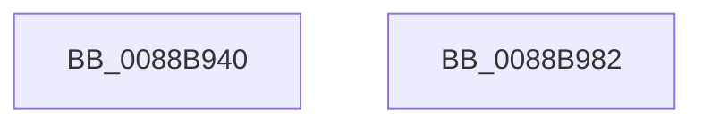

# PsReleaseProcessWakeCounter

- RVA: `0x0088B940`–`0x0088B983` (길이 `67` bytes)
- VA: `0x000000014088B940`
- 실행 섹션: `PAGE`
- PDB 이름 있음: `예`; PDB Function 태그: `아니요`
- unwind 정보 RVA: `0x00063458`
- 디코드: `18`개 명령, `67/67` bytes 표시
- 미해석 바이트: `0` (있으면 어셈블리에 `.byte`로 보존)

> 이 문서는 커널 이미지의 기계어와 PDB 기호를 분석해 생성했습니다. 4번과 5번은 함수 원형과 자료형을 바이너리 사용 방식에서 추정한 C 해석이며 원본 소스 복구 결과는 아닙니다.

## 1. Dependencies

- 직접 호출 지점: **1**; 고유 호출 대상: **1**
- 직접 호출자로 확인된 함수: **8**
- RIP 상대 이미지 참조: **0**

### Outgoing calls
- `0x0088B978` → [PspChargeProcessWakeCounter](PspChargeProcessWakeCounter_function_0088D2A0.md) (function, `0x0088D2A0`)

### Direct callers
- [AlpcpCancelMessage](../89/AlpcpCancelMessage_function_00894120.md) at `0x00894390`
- [AlpcpCancelMessage](../89/AlpcpCancelMessage_function_00894120.md) at `0x008943AE`
- [PopPowerRequestDelete](../91/PopPowerRequestDelete_function_00913030.md) at `0x009130C4`
- [EtwpReleaseQueueEntry](../9F/EtwpReleaseQueueEntry_function_009FED48.md) at `0x009FEDA0`
- [PopPowerRequestSpecialRequestSet](../A2/PopPowerRequestSpecialRequestSet_function_00A21B4C.md) at `0x00A21C34`
- [PopPowerRequestSpecialRequestClear](../A2/PopPowerRequestSpecialRequestClear_function_00A21C6C.md) at `0x00A21D21`
- [AlpcpAcceptConnectPort](../A3/AlpcpAcceptConnectPort_function_00A34290.md) at `0x00A34BE1`
- [AlpcpAcceptConnectPort](../A3/AlpcpAcceptConnectPort_function_00A34290.md) at `0x00A34C00`
- [PspCloseActivityReference](../AB/PspCloseActivityReference_function_00AB6DE0.md) at `0x00AB6DF8`
- [sub_00B22892](../B2/Unknown_function_00B22892.md) at `0x00B22B23`
- [sub_00B22892](../B2/Unknown_function_00B22892.md) at `0x00B22B42`

### Static image references
- 디코드된 RIP-relative 메모리 참조가 없습니다.

## 2. Other-region calls and transfers

- 다른 실행 섹션으로 향하는 call: **0**
- 별도 외부 분기/꼬리 이동을 확인하지 못했습니다.

## 3. Assembly (complete function range)

```asm
0088B940  48 83 EC 48                     sub rsp, 0x48
0088B944  45 33 D2                        xor r10d, r10d
0088B947  8B C1                           mov eax, ecx
0088B949  83 E0 07                        and eax, 7
0088B94C  4C 89 54 24 30                  mov qword ptr [rsp + 0x30], r10
0088B951  83 F8 07                        cmp eax, 7
0088B954  C6 44 24 28 01                  mov byte ptr [rsp + 0x28], 1
0088B959  4C 8B CA                        mov r9, rdx
0088B95C  C7 44 24 20 FF FF FF FF         mov dword ptr [rsp + 0x20], 0xffffffff
0088B964  45 8B C2                        mov r8d, r10d
0088B967  BA 02 00 00 00                  mov edx, 2
0088B96C  44 0F 45 C0                     cmovne r8d, eax
0088B970  41 0F 45 D2                     cmovne edx, r10d
0088B974  48 83 E1 F8                     and rcx, 0xfffffffffffffff8
0088B978  E8 23 19 00 00                  call 0x14088d2a0
0088B97D  48 83 C4 48                     add rsp, 0x48
0088B981  C3                              ret
0088B982  CC                              int3
```

## 4. C-style interpretation (structured pseudocode)

```c
__int64 __fastcall PsReleaseProcessWakeCounter(__int64 a1, __int64 a2)
{
    __int64 result;
    __int64 v_r10;
    __int64 v_rsp;
    unsigned __int64 v_stack_m18;
    unsigned __int8 v_stack_m20;
    unsigned int v_stack_m28;

    v_rsp = (v_rsp) - (72);
    v_r10 = 0;
    result = (unsigned int)(((unsigned int)((unsigned int)(a1))) & (7));
    v_stack_m18 = 0;
    v_stack_m20 = 1;
    v_stack_m28 = 0xFFFFFFFFULL;
    a3 = 0;
    if (((unsigned int)(result)) != 7) { a3 = (unsigned int)(result); }
    a2 = 2;
    if (((unsigned int)(result)) != 7) { a2 = 0; }
    a1 = (a1) & (-8);
    result = PspChargeProcessWakeCounter(a1, a2, a3, a2);
    v_rsp = (v_rsp) + (72);
    return result;
}
```

## 5. (Beta) C Style

```c
int64_t PsReleaseProcessWakeCounter(int64_t Arg1, int64_t Arg2)
{
    int64_t result;
    int64_t local_r10;
    int64_t local_rsp;
    uint64_t v_stack_m18;
    uint8_t v_stack_m20;
    uint32_t v_stack_m28;

    local_rsp = (local_rsp) - (72);
    local_r10 = 0;
    result = (uint32_t)(((uint32_t)((uint32_t)(Arg1))) & (7));
    v_stack_m18 = 0;
    v_stack_m20 = 1;
    v_stack_m28 = 0xFFFFFFFFULL;
    a3 = 0;
    if (((uint32_t)(result)) != 7) { a3 = (uint32_t)(result); }
    Arg2 = 2;
    if (((uint32_t)(result)) != 7) { Arg2 = 0; }
    Arg1 = (Arg1) & (-8);
    result = PspChargeProcessWakeCounter(Arg1, Arg2, a3, Arg2);
    local_rsp = (local_rsp) + (72);
    return result;
}
```

## 6. Execution-region graph

[열기: 2D/3D 그래프와 함수 탐색 컨트롤 패널](../../../control-panel.html?section=page&rva=0x0088B940&view=graph)

- 2D 그래프는 위에서 아래로 흐르고, 3D 그래프는 빈 공간을 드래그해 회전합니다. Shift+드래그는 이동, 휠은 확대·축소, 함수 노드 선택은 대상 보고서 이동입니다.

### Static fallback


