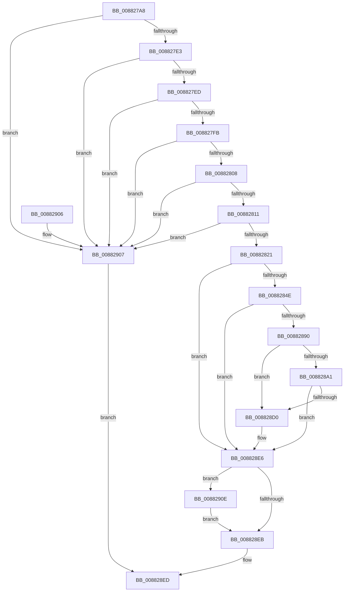

# PspReserveAndCommitUserShadowStack

- RVA: `0x008827A8`–`0x0088293D` (길이 `405` bytes)
- VA: `0x00000001408827A8`
- 실행 섹션: `PAGE`
- PDB 이름 있음: `예`; PDB Function 태그: `아니요`
- unwind 정보 RVA: `0x0007C6D8`
- 디코드: `106`개 명령, `405/405` bytes 표시
- 미해석 바이트: `0` (있으면 어셈블리에 `.byte`로 보존)

> 이 문서는 커널 이미지의 기계어와 PDB 기호를 분석해 생성했습니다. 4번과 5번은 함수 원형과 자료형을 바이너리 사용 방식에서 추정한 C 해석이며 원본 소스 복구 결과는 아닙니다.

## 1. Dependencies

- 직접 호출 지점: **4**; 고유 호출 대상: **3**
- 직접 호출자로 확인된 함수: **2**
- RIP 상대 이미지 참조: **0**

### Outgoing calls
- `0x0088283B` → [MmAllocateUserStack](MmAllocateUserStack_function_00882B30.md) (function, `0x00882B30`)
- `0x00882885` → [ZwAllocateVirtualMemory](../../text/6A/ZwAllocateVirtualMemory_function_006AD3D0.md) (function, `0x006AD3D0`)
- `0x008828C5` → [ZwAllocateVirtualMemory](../../text/6A/ZwAllocateVirtualMemory_function_006AD3D0.md) (function, `0x006AD3D0`)
- `0x00882936` → [MmFreeVirtualMemory](../87/MmFreeVirtualMemory_function_0087FED0.md) (function, `0x0087FED0`)

### Direct callers
- [PspSetupUserFiberShadowStack](PspSetupUserFiberShadowStack_function_008824F0.md) at `0x00882512`
- [PspSetupUserShadowStack](PspSetupUserShadowStack_function_008825D4.md) at `0x008826CA`

### Static image references
- 디코드된 RIP-relative 메모리 참조가 없습니다.

## 2. Other-region calls and transfers

- 다른 실행 섹션으로 향하는 call: **2**
  - `0x00882885` → [ZwAllocateVirtualMemory](../../text/6A/ZwAllocateVirtualMemory_function_006AD3D0.md) (`PAGE` → `.text`)
  - `0x008828C5` → [ZwAllocateVirtualMemory](../../text/6A/ZwAllocateVirtualMemory_function_006AD3D0.md) (`PAGE` → `.text`)
- 별도 외부 분기/꼬리 이동을 확인하지 못했습니다.

## 3. Assembly (complete function range)

```asm
008827A8  48 89 5C 24 10                  mov qword ptr [rsp + 0x10], rbx
008827AD  48 89 74 24 18                  mov qword ptr [rsp + 0x18], rsi
008827B2  48 89 4C 24 08                  mov qword ptr [rsp + 8], rcx
008827B7  55                              push rbp
008827B8  57                              push rdi
008827B9  41 55                           push r13
008827BB  41 56                           push r14
008827BD  41 57                           push r15
008827BF  48 8B EC                        mov rbp, rsp
008827C2  48 83 EC 50                     sub rsp, 0x50
008827C6  48 83 65 E8 00                  and qword ptr [rbp - 0x18], 0
008827CB  4D 8B F9                        mov r15, r9
008827CE  48 83 65 E0 00                  and qword ptr [rbp - 0x20], 0
008827D3  48 8B FA                        mov rdi, rdx
008827D6  48 81 F9 00 30 00 00            cmp rcx, 0x3000
008827DD  0F 82 24 01 00 00               jb 0x140882907
008827E3  41 83 F8 40                     cmp r8d, 0x40
008827E7  0F 87 1A 01 00 00               ja 0x140882907
008827ED  B8 FF 0F 00 00                  mov eax, 0xfff
008827F2  48 85 C8                        test rax, rcx
008827F5  0F 85 0C 01 00 00               jne 0x140882907
008827FB  44 8D 68 01                     lea r13d, [rax + 1]
008827FF  49 3B D5                        cmp rdx, r13
00882802  0F 82 FF 00 00 00               jb 0x140882907
00882808  48 85 D0                        test rax, rdx
0088280B  0F 85 F6 00 00 00               jne 0x140882907
00882811  48 8D 81 00 E0 FF FF            lea rax, [rcx - 0x2000]
00882818  48 3B D0                        cmp rdx, rax
0088281B  0F 87 E6 00 00 00               ja 0x140882907
00882821  48 83 65 F0 00                  and qword ptr [rbp - 0x10], 0
00882826  48 8D 4D F0                     lea rcx, [rbp - 0x10]
0088282A  45 8B C8                        mov r9d, r8d
0088282D  C7 44 24 20 01 00 00 00         mov dword ptr [rsp + 0x20], 1
00882835  4C 8D 45 30                     lea r8, [rbp + 0x30]
00882839  33 D2                           xor edx, edx
0088283B  E8 F0 02 00 00                  call 0x140882b30
00882840  48 8B 5D F0                     mov rbx, qword ptr [rbp - 0x10]
00882844  8B F0                           mov esi, eax
00882846  85 C0                           test eax, eax
00882848  0F 88 98 00 00 00               js 0x1408828e6
0088284E  4C 8B 75 30                     mov r14, qword ptr [rbp + 0x30]
00882852  4C 8D 4D E8                     lea r9, [rbp - 0x18]
00882856  48 8B C3                        mov rax, rbx
00882859  C7 44 24 28 02 00 00 00         mov dword ptr [rsp + 0x28], 2
00882861  48 2B C7                        sub rax, rdi
00882864  48 89 7D E8                     mov qword ptr [rbp - 0x18], rdi
00882868  48 05 00 F0 FF FF               add rax, -0x1000
0088286E  44 89 6C 24 20                  mov dword ptr [rsp + 0x20], r13d
00882873  49 03 C6                        add rax, r14
00882876  48 8D 55 E0                     lea rdx, [rbp - 0x20]
0088287A  45 33 C0                        xor r8d, r8d
0088287D  48 89 45 E0                     mov qword ptr [rbp - 0x20], rax
00882881  48 83 C9 FF                     or rcx, 0xffffffffffffffff
00882885  E8 46 AB E2 FF                  call 0x1406ad3d0
0088288A  8B F0                           mov esi, eax
0088288C  85 C0                           test eax, eax
0088288E  78 56                           js 0x1408828e6
00882890  49 8B C6                        mov rax, r14
00882893  48 2B C7                        sub rax, rdi
00882896  48 2D 00 20 00 00               sub rax, 0x2000
0088289C  49 3B C5                        cmp rax, r13
0088289F  72 2F                           jb 0x1408828d0
008828A1  4C 29 6D E0                     sub qword ptr [rbp - 0x20], r13
008828A5  4C 8D 4D E8                     lea r9, [rbp - 0x18]
008828A9  C7 44 24 28 02 01 00 00         mov dword ptr [rsp + 0x28], 0x102
008828B1  48 8D 55 E0                     lea rdx, [rbp - 0x20]
008828B5  45 33 C0                        xor r8d, r8d
008828B8  44 89 6C 24 20                  mov dword ptr [rsp + 0x20], r13d
008828BD  48 83 C9 FF                     or rcx, 0xffffffffffffffff
008828C1  4C 89 6D E8                     mov qword ptr [rbp - 0x18], r13
008828C5  E8 06 AB E2 FF                  call 0x1406ad3d0
008828CA  8B F0                           mov esi, eax
008828CC  85 C0                           test eax, eax
008828CE  78 16                           js 0x1408828e6
008828D0  48 8B 45 50                     mov rax, qword ptr [rbp + 0x50]
008828D4  49 8D 8E 00 F0 FF FF            lea rcx, [r14 - 0x1000]
008828DB  48 03 CB                        add rcx, rbx
008828DE  48 89 08                        mov qword ptr [rax], rcx
008828E1  49 89 1F                        mov qword ptr [r15], rbx
008828E4  33 DB                           xor ebx, ebx
008828E6  48 85 DB                        test rbx, rbx
008828E9  75 23                           jne 0x14088290e
008828EB  8B C6                           mov eax, esi
008828ED  4C 8D 5C 24 50                  lea r11, [rsp + 0x50]
008828F2  49 8B 5B 38                     mov rbx, qword ptr [r11 + 0x38]
008828F6  49 8B 73 40                     mov rsi, qword ptr [r11 + 0x40]
008828FA  49 8B E3                        mov rsp, r11
008828FD  41 5F                           pop r15
008828FF  41 5E                           pop r14
00882901  41 5D                           pop r13
00882903  5F                              pop rdi
00882904  5D                              pop rbp
00882905  C3                              ret
00882906  CC                              int3
00882907  B8 0D 00 00 C0                  mov eax, 0xc000000d
0088290C  EB DF                           jmp 0x1408828ed
0088290E  48 83 65 F0 00                  and qword ptr [rbp - 0x10], 0
00882913  4C 8D 45 F0                     lea r8, [rbp - 0x10]
00882917  C7 44 24 28 00 00 00 40         mov dword ptr [rsp + 0x28], 0x40000000
0088291F  48 8D 55 F8                     lea rdx, [rbp - 8]
00882923  41 B9 00 80 00 00               mov r9d, 0x8000
00882929  C6 44 24 20 00                  mov byte ptr [rsp + 0x20], 0
0088292E  48 83 C9 FF                     or rcx, 0xffffffffffffffff
00882932  48 89 5D F8                     mov qword ptr [rbp - 8], rbx
00882936  E8 95 D5 FF FF                  call 0x14087fed0
0088293B  EB AE                           jmp 0x1408828eb
```

## 4. C-style interpretation (structured pseudocode)

```c
__int64 __fastcall PspReserveAndCommitUserShadowStack(__int64 a1, __int64 a2, int a3, __int64 a4, __int64 a5)
{
    __int64 result;
    __int64 v_rbx;
    __int64 v_rsp;
    unsigned __int64 v_stack_m28;
    unsigned __int64 v_stack_m30;
    unsigned __int64 v_stack_m38;
    unsigned __int64 v_stack_m40;
    unsigned __int64 v_stack_m48;
    unsigned int v_stack_m50;
    unsigned int v_stack_m58;
    unsigned __int64 v_stack_p10;
    unsigned __int64 v_stack_p18;
    unsigned __int64 v_stack_p8;

    v_stack_p10 = v_rbx;
    v_stack_p18 = v_rsi;
    v_stack_p8 = a1;
    v_rsp = (v_rsp) - (80);
    if (a1 < 0x3000ULL) goto loc_00882907;
    if (a3 > 64) goto loc_00882907;
    if ((((unsigned int)(0xFFFULL)) & (a1)) != 0) goto loc_00882907;
    if (a2 < ((unsigned int)(0xFFFULL) + 1)) goto loc_00882907;
    if ((((unsigned int)(0xFFFULL)) & (a2)) != 0) goto loc_00882907;
    if (a2 > (a1 - 8192)) goto loc_00882907;
    v_stack_m58 = 1;
    a2 = 0;
    result = MmAllocateUserStack(v_stack_m38, a2, v_stack_p8, (unsigned int)(a3));
    if (sign_flag) goto loc_008828E6;
    v_stack_m50 = 2;
    result = (v_stack_m38) - (0);
    v_stack_m40 = 0;
    result = (result) + (0xFFFFFFFFFFFFF000ULL);
    v_stack_m58 = (unsigned int)((unsigned int)(0xFFFULL) + 1);
    result = (result) + (v_stack_p8);
    a3 = 0;
    v_stack_m48 = result;
    a1 = (v_stack_m38) | (-1);
    result = ZwAllocateVirtualMemory(a1, v_stack_m48, a3, v_stack_m40);
    if (sign_flag) goto loc_008828E6;
    result = (v_stack_p8) - (0);
    result = (result) - (0x2000ULL);
    if (result < ((unsigned int)(0xFFFULL) + 1)) goto loc_008828D0;
    v_stack_m50 = 258;
    a3 = 0;
    v_stack_m58 = (unsigned int)((unsigned int)(0xFFFULL) + 1);
    a1 = (a1) | (-1);
    v_stack_m40 = (unsigned int)(0xFFFULL) + 1;
    result = ZwAllocateVirtualMemory(a1, v_stack_m48, a3, v_stack_m40);
    v_rbx = v_stack_m38;
    if (!(sign_flag)) {
        result = a5;
        a1 = v_stack_p8 - 4096;
        a1 = (a1) + (v_stack_m38);
        *(unsigned __int64 *)(result) = a1;
        *(unsigned __int64 *)(a4) = v_stack_m38;
        v_rbx = 0;
    }
    if (0 != 0) goto loc_0088290E;
loc_008828EB:
loc_008828ED:
    return (unsigned int)((unsigned int)((unsigned int)((unsigned int)(result))));
loc_00882907:
    goto loc_008828ED;
loc_0088290E:
    v_stack_m28 = 0x40000000ULL;
    v_stack_m30 = 0;
    a1 = (a1) | (-1);
    v_stack_m30 = *(unsigned __int64 *)(v_stack_m28 + 56);
    result = MmFreeVirtualMemory(a1, v_stack_m30, v_stack_m38, (unsigned int)(0x8000ULL));
    goto loc_008828EB;
}
```

## 5. (Beta) C Style

```c
int64_t PspReserveAndCommitUserShadowStack(int64_t Arg1, int64_t Arg2, int32_t Arg3, void *Arg4, void *Arg5)
{
    uint8_t *arg4 = (uint8_t *)Arg4;
    uint8_t *arg5 = (uint8_t *)Arg5;

    int64_t result;
    int64_t local_rbx;
    int64_t local_rsp;
    uint64_t v_stack_m28;
    uint64_t v_stack_m30;
    uint64_t v_stack_m38;
    uint64_t v_stack_m40;
    uint64_t v_stack_m48;
    uint32_t v_stack_m50;
    uint32_t v_stack_m58;
    uint64_t v_stack_p10;
    uint64_t v_stack_p18;
    uint64_t v_stack_p8;

    v_stack_p10 = local_rbx;
    v_stack_p18 = local_rsi;
    v_stack_p8 = Arg1;
    local_rsp = (local_rsp) - (80);
    if (Arg1 < 0x3000ULL) goto loc_00882907;
    if (Arg3 > 64) goto loc_00882907;
    if ((((uint32_t)(0xFFFULL)) & (Arg1)) != 0) goto loc_00882907;
    if (Arg2 < ((uint32_t)(0xFFFULL) + 1)) goto loc_00882907;
    if ((((uint32_t)(0xFFFULL)) & (Arg2)) != 0) goto loc_00882907;
    if (Arg2 > (Arg1 - 8192)) goto loc_00882907;
    v_stack_m58 = 1;
    Arg2 = 0;
    result = MmAllocateUserStack(v_stack_m38, Arg2, v_stack_p8, (uint32_t)(Arg3));
    if (sign_flag) goto loc_008828E6;
    v_stack_m50 = 2;
    result = (v_stack_m38) - (0);
    v_stack_m40 = 0;
    result = (result) + (0xFFFFFFFFFFFFF000ULL);
    v_stack_m58 = (uint32_t)((uint32_t)(0xFFFULL) + 1);
    result = (result) + (v_stack_p8);
    Arg3 = 0;
    v_stack_m48 = result;
    Arg1 = (v_stack_m38) | (-1);
    result = ZwAllocateVirtualMemory(Arg1, v_stack_m48, Arg3, v_stack_m40);
    if (sign_flag) goto loc_008828E6;
    result = (v_stack_p8) - (0);
    result = (result) - (0x2000ULL);
    if (result < ((uint32_t)(0xFFFULL) + 1)) goto loc_008828D0;
    v_stack_m50 = 258;
    Arg3 = 0;
    v_stack_m58 = (uint32_t)((uint32_t)(0xFFFULL) + 1);
    Arg1 = (Arg1) | (-1);
    v_stack_m40 = (uint32_t)(0xFFFULL) + 1;
    result = ZwAllocateVirtualMemory(Arg1, v_stack_m48, Arg3, v_stack_m40);
    local_rbx = v_stack_m38;
    if (!(sign_flag)) {
        result = Arg5;
        Arg1 = v_stack_p8 - 4096;
        Arg1 = (Arg1) + (v_stack_m38);
        *(uint64_t *)(result) = Arg1;
        *(uint64_t *)(arg4) = v_stack_m38;
        local_rbx = 0;
    }
    if (0 != 0) goto loc_0088290E;
loc_008828EB:
loc_008828ED:
    return (uint32_t)((uint32_t)((uint32_t)((uint32_t)(result))));
loc_00882907:
    goto loc_008828ED;
loc_0088290E:
    v_stack_m28 = 0x40000000ULL;
    v_stack_m30 = 0;
    Arg1 = (Arg1) | (-1);
    v_stack_m30 = *(uint64_t *)(v_stack_m28 + 0x38);
    result = MmFreeVirtualMemory(Arg1, v_stack_m30, v_stack_m38, (uint32_t)(0x8000ULL));
    goto loc_008828EB;
}
```

### 관측된 메모리 오프셋

구조체 형식이 확인되지 않은 접근은 인자 기준의 오프셋으로만 기록했습니다.

| 기준 인자 | 오프셋 표현 | 폭 (bit) | 접근 |
|---|---:|---:|---|
| `Arg4` | `+ 0x0` | `64` | `W` |
| `Arg5` | `+ 0x0` | `64` | `W` |

## 6. Execution-region graph

[열기: 2D/3D 그래프와 함수 탐색 컨트롤 패널](../../../control-panel.html?section=page&rva=0x008827A8&view=graph)

- 2D 그래프는 위에서 아래로 흐르고, 3D 그래프는 빈 공간을 드래그해 회전합니다. Shift+드래그는 이동, 휠은 확대·축소, 함수 노드 선택은 대상 보고서 이동입니다.

### Static fallback


