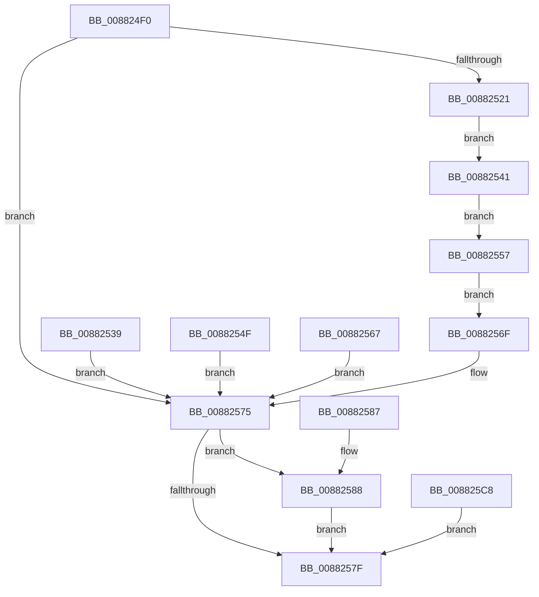

# PspSetupUserFiberShadowStack

- RVA: `0x008824F0`–`0x008825CE` (길이 `222` bytes)
- VA: `0x00000001408824F0`
- 실행 섹션: `PAGE`
- PDB 이름 있음: `예`; PDB Function 태그: `아니요`
- unwind 정보 RVA: `0x0007C664`
- 디코드: `60`개 명령, `222/222` bytes 표시
- 미해석 바이트: `0` (있으면 어셈블리에 `.byte`로 보존)

> 이 문서는 커널 이미지의 기계어와 PDB 기호를 분석해 생성했습니다. 4번과 5번은 함수 원형과 자료형을 바이너리 사용 방식에서 추정한 C 해석이며 원본 소스 복구 결과는 아닙니다.

## 1. Dependencies

- 직접 호출 지점: **2**; 고유 호출 대상: **2**
- 직접 호출자로 확인된 함수: **1**
- RIP 상대 이미지 참조: **1**

### Outgoing calls
- `0x00882512` → [PspReserveAndCommitUserShadowStack](PspReserveAndCommitUserShadowStack_function_008827A8.md) (function, `0x008827A8`)
- `0x008825B4` → [MmFreeVirtualMemory](../87/MmFreeVirtualMemory_function_0087FED0.md) (function, `0x0087FED0`)

### Direct callers
- [NtSetInformationProcess](../AE/NtSetInformationProcess_function_00AE5370.md) at `0x00AE77D5`

### Static image references
- `0x0088252A` → RVA `0x00FC7488` (`ALMOSTRO`; read)

## 2. Other-region calls and transfers

- 다른 실행 섹션으로 향하는 call: **0**
- 별도 외부 분기/꼬리 이동을 확인하지 못했습니다.

## 3. Assembly (complete function range)

```asm
008824F0  4C 8B DC                        mov r11, rsp
008824F3  4D 89 4B 20                     mov qword ptr [r11 + 0x20], r9
008824F7  53                              push rbx
008824F8  48 83 EC 50                     sub rsp, 0x50
008824FC  49 83 63 E8 00                  and qword ptr [r11 - 0x18], 0
00882501  49 83 63 E0 00                  and qword ptr [r11 - 0x20], 0
00882506  49 8D 43 E8                     lea rax, [r11 - 0x18]
0088250A  49 89 43 C8                     mov qword ptr [r11 - 0x38], rax
0088250E  4D 8D 4B E0                     lea r9, [r11 - 0x20]
00882512  E8 91 02 00 00                  call 0x1408827a8
00882517  8B D8                           mov ebx, eax
00882519  89 44 24 30                     mov dword ptr [rsp + 0x30], eax
0088251D  85 C0                           test eax, eax
0088251F  78 54                           js 0x140882575
00882521  48 8B 4C 24 40                  mov rcx, qword ptr [rsp + 0x40]
00882526  48 83 C1 F8                     add rcx, -8
0088252A  48 8B 05 57 4F 74 00            mov rax, qword ptr [rip + 0x744f57]
00882531  66 48 0F 38 F5 01               wrussq qword ptr [rcx], rax
00882537  EB 08                           jmp 0x140882541
00882539  8B D8                           mov ebx, eax
0088253B  89 44 24 30                     mov dword ptr [rsp + 0x30], eax
0088253F  EB 34                           jmp 0x140882575
00882541  48 8D 51 F8                     lea rdx, [rcx - 8]
00882545  48 8B 44 24 78                  mov rax, qword ptr [rsp + 0x78]
0088254A  48 89 10                        mov qword ptr [rax], rdx
0088254D  EB 08                           jmp 0x140882557
0088254F  8B D8                           mov ebx, eax
00882551  89 44 24 30                     mov dword ptr [rsp + 0x30], eax
00882555  EB 1E                           jmp 0x140882575
00882557  48 83 E1 FD                     and rcx, 0xfffffffffffffffd
0088255B  48 83 C9 01                     or rcx, 1
0088255F  66 48 0F 38 F5 0A               wrussq qword ptr [rdx], rcx
00882565  EB 08                           jmp 0x14088256f
00882567  8B D8                           mov ebx, eax
00882569  89 44 24 30                     mov dword ptr [rsp + 0x30], eax
0088256D  EB 06                           jmp 0x140882575
0088256F  48 83 64 24 38 00               and qword ptr [rsp + 0x38], 0
00882575  48 8B 44 24 38                  mov rax, qword ptr [rsp + 0x38]
0088257A  48 85 C0                        test rax, rax
0088257D  75 09                           jne 0x140882588
0088257F  8B C3                           mov eax, ebx
00882581  48 83 C4 50                     add rsp, 0x50
00882585  5B                              pop rbx
00882586  C3                              ret
00882587  CC                              int3
00882588  48 89 44 24 38                  mov qword ptr [rsp + 0x38], rax
0088258D  48 83 64 24 40 00               and qword ptr [rsp + 0x40], 0
00882593  C7 44 24 28 00 00 00 40         mov dword ptr [rsp + 0x28], 0x40000000
0088259B  C6 44 24 20 00                  mov byte ptr [rsp + 0x20], 0
008825A0  41 B9 00 80 00 00               mov r9d, 0x8000
008825A6  4C 8D 44 24 40                  lea r8, [rsp + 0x40]
008825AB  48 8D 54 24 38                  lea rdx, [rsp + 0x38]
008825B0  48 83 C9 FF                     or rcx, 0xffffffffffffffff
008825B4  E8 17 D9 FF FF                  call 0x14087fed0
008825B9  90                              nop
008825BA  48 8B 44 24 78                  mov rax, qword ptr [rsp + 0x78]
008825BF  48 C7 00 00 00 00 00            mov qword ptr [rax], 0
008825C6  EB B7                           jmp 0x14088257f
008825C8  8B 5C 24 30                     mov ebx, dword ptr [rsp + 0x30]
008825CC  EB B1                           jmp 0x14088257f
```

## 4. C-style interpretation (structured pseudocode)

```c
__int64 __fastcall PspSetupUserFiberShadowStack(__int64 a1, __int64 a2, __int64 a3, __int64 a4)
{
    __int64 result;
    __int64 v_rsp;
    unsigned __int64 v_stack_m18;
    unsigned __int64 v_stack_m20;
    unsigned int v_stack_m28;
    unsigned __int64 v_stack_p20;
    unsigned int v_stack_p28;
    unsigned int v_stack_p30;
    unsigned __int64 v_stack_p38;
    unsigned __int64 v_stack_p40;
    unsigned __int64 v_stack_p78;

    *(unsigned __int64 *)(v_rsp + 32) = a4;
    v_rsp = (v_rsp) - (80);
    *(unsigned __int64 *)(v_rsp - 56) = v_rsp - 24;
    result = PspReserveAndCommitUserShadowStack(a1, a2, a3, v_rsp - 32);
    v_stack_m28 = (unsigned int)(result);
    if (sign_flag) goto loc_00882575;
    a1 = (v_stack_m18) + (-8);
    goto loc_00882541;
loc_00882541:
    *(unsigned __int64 *)(v_stack_p20) = a1 - 8;
    goto loc_00882557;
loc_00882557:
    a1 = (a1) & (-3);
    a1 = (a1) | (1);
    goto loc_0088256F;
loc_0088256F:
loc_00882575:
    if (v_stack_m20 != 0) goto loc_00882588;
loc_0088257F:
    v_rsp = (v_rsp) + (80);
    return (unsigned int)((unsigned int)((unsigned int)((unsigned int)(result))));
loc_00882588:
    v_stack_p38 = (unsigned int)((unsigned int)((unsigned int)((unsigned int)(result))));
    v_stack_p28 = 0x40000000ULL;
    v_stack_p20 = 0;
    a1 = (a1) | (-1);
    result = MmFreeVirtualMemory(a1, v_stack_p38, v_stack_p40, (unsigned int)(0x8000ULL));
    *(unsigned __int64 *)(v_stack_p78) = 0;
    goto loc_0088257F;
}
```

## 5. (Beta) C Style

```c
int64_t PspSetupUserFiberShadowStack(int64_t Arg1, int64_t Arg2, int64_t Arg3, int64_t Arg4)
{
    int64_t result;
    int64_t local_rsp;
    uint64_t v_stack_m18;
    uint64_t v_stack_m20;
    uint32_t v_stack_m28;
    uint64_t v_stack_p20;
    uint32_t v_stack_p28;
    uint32_t v_stack_p30;
    uint64_t v_stack_p38;
    uint64_t v_stack_p40;
    uint64_t v_stack_p78;

    *(uint64_t *)(local_rsp + 0x20) = Arg4;
    local_rsp = (local_rsp) - (80);
    *(uint64_t *)(local_rsp - 0x38) = local_rsp - 24;
    result = PspReserveAndCommitUserShadowStack(Arg1, Arg2, Arg3, local_rsp - 32);
    v_stack_m28 = (uint32_t)(result);
    if (sign_flag) goto loc_00882575;
    Arg1 = (v_stack_m18) + (-8);
    goto loc_00882541;
loc_00882541:
    *(uint64_t *)(v_stack_p20) = Arg1 - 8;
    goto loc_00882557;
loc_00882557:
    Arg1 = (Arg1) & (-3);
    Arg1 = (Arg1) | (1);
    goto loc_0088256F;
loc_0088256F:
loc_00882575:
    if (v_stack_m20 != 0) goto loc_00882588;
loc_0088257F:
    local_rsp = (local_rsp) + (80);
    return (uint32_t)((uint32_t)((uint32_t)((uint32_t)(result))));
loc_00882588:
    v_stack_p38 = (uint32_t)((uint32_t)((uint32_t)((uint32_t)(result))));
    v_stack_p28 = 0x40000000ULL;
    v_stack_p20 = 0;
    Arg1 = (Arg1) | (-1);
    result = MmFreeVirtualMemory(Arg1, v_stack_p38, v_stack_p40, (uint32_t)(0x8000ULL));
    *(uint64_t *)(v_stack_p78) = 0;
    goto loc_0088257F;
}
```

## 6. Execution-region graph

[열기: 2D/3D 그래프와 함수 탐색 컨트롤 패널](../../../control-panel.html?section=page&rva=0x008824F0&view=graph)

- 2D 그래프는 위에서 아래로 흐르고, 3D 그래프는 빈 공간을 드래그해 회전합니다. Shift+드래그는 이동, 휠은 확대·축소, 함수 노드 선택은 대상 보고서 이동입니다.

### Static fallback


