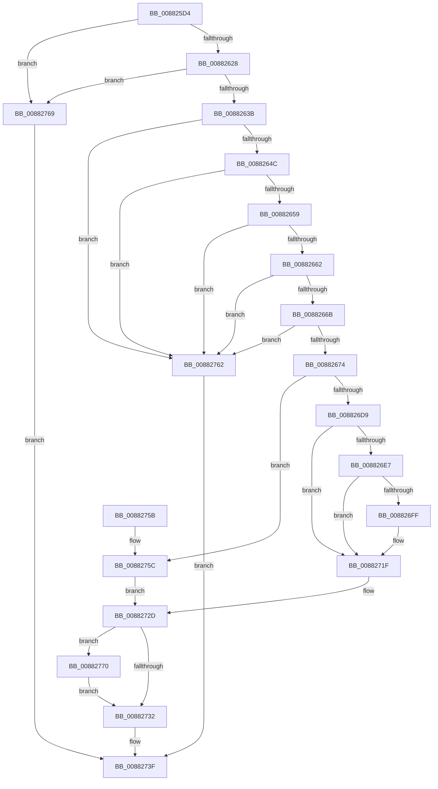

# PspSetupUserShadowStack

- RVA: `0x008825D4`–`0x0088279F` (길이 `459` bytes)
- VA: `0x00000001408825D4`
- 실행 섹션: `PAGE`
- PDB 이름 있음: `예`; PDB Function 태그: `아니요`
- unwind 정보 RVA: `0x0007C6B8`
- 디코드: `120`개 명령, `459/459` bytes 표시
- 미해석 바이트: `0` (있으면 어셈블리에 `.byte`로 보존)

> 이 문서는 커널 이미지의 기계어와 PDB 기호를 분석해 생성했습니다. 4번과 5번은 함수 원형과 자료형을 바이너리 사용 방식에서 추정한 C 해석이며 원본 소스 복구 결과는 아닙니다.

## 1. Dependencies

- 직접 호출 지점: **6**; 고유 호출 대상: **6**
- 직접 호출자로 확인된 함수: **1**
- RIP 상대 이미지 참조: **1**

### Outgoing calls
- `0x008826A9` → [KiStackAttachProcess](../../text/21/KiStackAttachProcess_function_00216820.md) (function, `0x00216820`)
- `0x008826CA` → [PspReserveAndCommitUserShadowStack](PspReserveAndCommitUserShadowStack_function_008827A8.md) (function, `0x008827A8`)
- `0x008826F5` → [RtlLocateExtendedFeature](../../text/3D/RtlLocateExtendedFeature_function_003D72A0.md) (function, `0x003D72A0`)
- `0x00882738` → [KiUnstackDetachProcess](../../text/21/KiUnstackDetachProcess_function_00217D30.md) (function, `0x00217D30`)
- `0x00882746` → [_security_check_cookie](../../text/6A/_security_check_cookie_function_006AC640.md) (function, `0x006AC640`)
- `0x00882798` → [MmFreeVirtualMemory](../87/MmFreeVirtualMemory_function_0087FED0.md) (function, `0x0087FED0`)

### Direct callers
- [PspAllocateThread](../9E/PspAllocateThread_function_009EF72C.md) at `0x009F028C`

### Static image references
- `0x008825E9` → RVA `0x00E0A740` (`.data`; read)

## 2. Other-region calls and transfers

- 다른 실행 섹션으로 향하는 call: **4**
  - `0x008826A9` → [KiStackAttachProcess](../../text/21/KiStackAttachProcess_function_00216820.md) (`PAGE` → `.text`)
  - `0x008826F5` → [RtlLocateExtendedFeature](../../text/3D/RtlLocateExtendedFeature_function_003D72A0.md) (`PAGE` → `.text`)
  - `0x00882738` → [KiUnstackDetachProcess](../../text/21/KiUnstackDetachProcess_function_00217D30.md) (`PAGE` → `.text`)
  - `0x00882746` → [_security_check_cookie](../../text/6A/_security_check_cookie_function_006AC640.md) (`PAGE` → `.text`)
- 별도 외부 분기/꼬리 이동을 확인하지 못했습니다.

## 3. Assembly (complete function range)

```asm
008825D4  40 55                           push rbp
008825D6  53                              push rbx
008825D7  56                              push rsi
008825D8  57                              push rdi
008825D9  41 56                           push r14
008825DB  41 57                           push r15
008825DD  48 8D 6C 24 D9                  lea rbp, [rsp - 0x27]
008825E2  48 81 EC 88 00 00 00            sub rsp, 0x88
008825E9  48 8B 05 50 81 58 00            mov rax, qword ptr [rip + 0x588150]
008825F0  48 33 C4                        xor rax, rsp
008825F3  48 89 45 0F                     mov qword ptr [rbp + 0xf], rax
008825F7  48 83 65 D7 00                  and qword ptr [rbp - 0x29], 0
008825FC  0F 57 C0                        xorps xmm0, xmm0
008825FF  49 8B 40 20                     mov rax, qword ptr [r8 + 0x20]
00882603  4D 8B F9                        mov r15, r9
00882606  4C 8B C9                        mov r9, rcx
00882609  4D 8B F0                        mov r14, r8
0088260C  49 8B 48 10                     mov rcx, qword ptr [r8 + 0x10]
00882610  48 8B F2                        mov rsi, rdx
00882613  0F 11 45 DF                     movups xmmword ptr [rbp - 0x21], xmm0
00882617  0F 11 45 EF                     movups xmmword ptr [rbp - 0x11], xmm0
0088261B  0F 11 45 FF                     movups xmmword ptr [rbp - 1], xmm0
0088261F  48 3B C8                        cmp rcx, rax
00882622  0F 82 41 01 00 00               jb 0x140882769
00882628  4C 8B C1                        mov r8, rcx
0088262B  4C 2B C0                        sub r8, rax
0088262E  49 8B 46 18                     mov rax, qword ptr [r14 + 0x18]
00882632  48 3B C8                        cmp rcx, rax
00882635  0F 82 2E 01 00 00               jb 0x140882769
0088263B  48 2B C8                        sub rcx, rax
0088263E  B8 00 10 00 00                  mov eax, 0x1000
00882643  4C 3B C0                        cmp r8, rax
00882646  0F 82 16 01 00 00               jb 0x140882762
0088264C  44 8D 50 FF                     lea r10d, [rax - 1]
00882650  4D 85 C2                        test r10, r8
00882653  0F 85 09 01 00 00               jne 0x140882762
00882659  48 3B C8                        cmp rcx, rax
0088265C  0F 82 00 01 00 00               jb 0x140882762
00882662  49 85 CA                        test r10, rcx
00882665  0F 85 F7 00 00 00               jne 0x140882762
0088266B  49 3B C8                        cmp rcx, r8
0088266E  0F 87 EE 00 00 00               ja 0x140882762
00882674  48 B8 CD CC CC CC CC CC CC CC   movabs rax, 0xcccccccccccccccd
0088267E  48 F7 E1                        mul rcx
00882681  49 8B C9                        mov rcx, r9
00882684  48 8B FA                        mov rdi, rdx
00882687  48 C1 EF 02                     shr rdi, 2
0088268B  49 03 FA                        add rdi, r10
0088268E  48 81 E7 00 F0 FF FF            and rdi, 0xfffffffffffff000
00882695  48 8D 9F 00 20 00 00            lea rbx, [rdi + 0x2000]
0088269C  4C 3B C3                        cmp r8, rbx
0088269F  49 0F 43 D8                     cmovae rbx, r8
008826A3  4C 8D 45 DF                     lea r8, [rbp - 0x21]
008826A7  33 D2                           xor edx, edx
008826A9  E8 72 41 99 FF                  call 0x140216820
008826AE  44 8B 45 7F                     mov r8d, dword ptr [rbp + 0x7f]
008826B2  48 8D 45 D7                     lea rax, [rbp - 0x29]
008826B6  48 83 65 CF 00                  and qword ptr [rbp - 0x31], 0
008826BB  4C 8D 4D CF                     lea r9, [rbp - 0x31]
008826BF  48 8B D7                        mov rdx, rdi
008826C2  48 89 44 24 20                  mov qword ptr [rsp + 0x20], rax
008826C7  48 8B CB                        mov rcx, rbx
008826CA  E8 D9 00 00 00                  call 0x1408827a8
008826CF  8B D8                           mov ebx, eax
008826D1  85 C0                           test eax, eax
008826D3  0F 88 83 00 00 00               js 0x14088275c
008826D9  8B 4E 30                        mov ecx, dword ptr [rsi + 0x30]
008826DC  B8 40 00 10 00                  mov eax, 0x100040
008826E1  23 C8                           and ecx, eax
008826E3  3B C8                           cmp ecx, eax
008826E5  75 38                           jne 0x14088271f
008826E7  45 33 C0                        xor r8d, r8d
008826EA  48 8D 8E D0 04 00 00            lea rcx, [rsi + 0x4d0]
008826F1  41 8D 50 0B                     lea edx, [r8 + 0xb]
008826F5  E8 A6 4B B5 FF                  call 0x1403d72a0
008826FA  48 85 C0                        test rax, rax
008826FD  74 20                           je 0x14088271f
008826FF  48 63 8E E0 04 00 00            movsxd rcx, dword ptr [rsi + 0x4e0]
00882706  48 0F BA AC 31 D0 04 00 00 0B   bts qword ptr [rcx + rsi + 0x4d0], 0xb
00882710  48 8B 4D D7                     mov rcx, qword ptr [rbp - 0x29]
00882714  48 89 48 08                     mov qword ptr [rax + 8], rcx
00882718  48 C7 00 01 00 00 00            mov qword ptr [rax], 1
0088271F  48 8B 45 CF                     mov rax, qword ptr [rbp - 0x31]
00882723  49 89 46 40                     mov qword ptr [r14 + 0x40], rax
00882727  41 80 0F 08                     or byte ptr [r15], 8
0088272B  33 C0                           xor eax, eax
0088272D  48 85 C0                        test rax, rax
00882730  75 3E                           jne 0x140882770
00882732  33 D2                           xor edx, edx
00882734  48 8D 4D DF                     lea rcx, [rbp - 0x21]
00882738  E8 F3 55 99 FF                  call 0x140217d30
0088273D  8B C3                           mov eax, ebx
0088273F  48 8B 4D 0F                     mov rcx, qword ptr [rbp + 0xf]
00882743  48 33 CC                        xor rcx, rsp
00882746  E8 F5 9E E2 FF                  call 0x1406ac640
0088274B  48 81 C4 88 00 00 00            add rsp, 0x88
00882752  41 5F                           pop r15
00882754  41 5E                           pop r14
00882756  5F                              pop rdi
00882757  5E                              pop rsi
00882758  5B                              pop rbx
00882759  5D                              pop rbp
0088275A  C3                              ret
0088275B  CC                              int3
0088275C  48 8B 45 CF                     mov rax, qword ptr [rbp - 0x31]
00882760  EB CB                           jmp 0x14088272d
00882762  B8 0D 00 00 C0                  mov eax, 0xc000000d
00882767  EB D6                           jmp 0x14088273f
00882769  B8 95 00 00 C0                  mov eax, 0xc0000095
0088276E  EB CF                           jmp 0x14088273f
00882770  48 83 65 D7 00                  and qword ptr [rbp - 0x29], 0
00882775  4C 8D 45 D7                     lea r8, [rbp - 0x29]
00882779  C7 44 24 28 00 00 00 40         mov dword ptr [rsp + 0x28], 0x40000000
00882781  48 8D 55 CF                     lea rdx, [rbp - 0x31]
00882785  41 B9 00 80 00 00               mov r9d, 0x8000
0088278B  C6 44 24 20 00                  mov byte ptr [rsp + 0x20], 0
00882790  48 83 C9 FF                     or rcx, 0xffffffffffffffff
00882794  48 89 45 CF                     mov qword ptr [rbp - 0x31], rax
00882798  E8 33 D7 FF FF                  call 0x14087fed0
0088279D  EB 93                           jmp 0x140882732
```

## 4. C-style interpretation (structured pseudocode)

```c
__int64 __fastcall PspSetupUserShadowStack(__int64 a1, __int64 a2, __int64 a3, __int64 a4, unsigned int a5)
{
    __int64 result;
    __int64 v_rbx;
    __int64 v_rdi;
    __int64 v_rsp;
    unsigned __int64 v_stack_m48;
    unsigned __int64 v_stack_m57;
    unsigned __int64 v_stack_m58;
    unsigned __int64 v_stack_m68;
    unsigned __int64 v_stack_m78;
    unsigned __int64 v_stack_m80;
    unsigned __int64 v_stack_m88;
    unsigned __int64 v_stack_m98;
    unsigned __int8 v_stack_p20;
    unsigned int v_stack_p28;

    v_rsp = (v_rsp) - (136);
    result = (*(unsigned __int64 *)(v_rip + 5800272)) ^ (v_rsp);
    v_stack_m48 = result;
    v_stack_m78 = v_xmm0;
    v_stack_m68 = v_xmm0;
    v_stack_m58 = v_xmm0;
    if ((*(unsigned __int64 *)(a3 + 16)) < (*(unsigned __int64 *)(a3 + 32))) goto loc_00882769;
    a3 = (*(unsigned __int64 *)(a3 + 16)) - (*(unsigned __int64 *)(a3 + 32));
    if ((*(unsigned __int64 *)(a3 + 16)) < (*(unsigned __int64 *)(a3 + 24))) goto loc_00882769;
    a1 = (*(unsigned __int64 *)(a3 + 16)) - (*(unsigned __int64 *)(a3 + 24));
    if (a3 < ((unsigned int)(0x1000ULL))) goto loc_00882762;
    if ((((unsigned int)(0x1000ULL) - 1) & (a3)) != 0) goto loc_00882762;
    if (a1 < ((unsigned int)(0x1000ULL))) goto loc_00882762;
    if ((((unsigned int)(0x1000ULL) - 1) & (a1)) != 0) goto loc_00882762;
    if (a1 > a3) goto loc_00882762;
    v_rdi = (a2) >> (2);
    v_rdi = (v_rdi) + ((unsigned int)(0x1000ULL) - 1);
    v_rdi = (v_rdi) & (0xFFFFFFFFFFFFF000ULL);
    v_rbx = v_rdi + 8192;
    if (a3 >= (v_rdi + 8192)) { v_rbx = a3; }
    a2 = 0;
    result = KiStackAttachProcess(a1, a2, v_stack_m78, a1);
    v_stack_m98 = v_stack_m80;
    result = PspReserveAndCommitUserShadowStack(v_rbx, v_rdi, (unsigned int)(a5), v_stack_m88);
    if (sign_flag) goto loc_0088275C;
    a1 = (unsigned int)(((unsigned int)(*(unsigned int *)(a2 + 48))) & ((unsigned int)((unsigned int)(0x100040ULL))));
    if (((unsigned int)(a1)) != ((unsigned int)((unsigned int)(0x100040ULL)))) goto loc_0088271F;
    a3 = 0;
    result = RtlLocateExtendedFeature(a2 + 1232, a3 + 11, a3, v_stack_m88);
    if (result != 0) {
        a1 = (int)(*(unsigned int *)(a2 + 1248));
        a1 = v_stack_m80;
        *(unsigned __int64 *)(result + 8) = a1;
        *(unsigned __int64 *)(result) = 1;
    }
    *(unsigned __int64 *)(a3 + 64) = v_stack_m88;
    result = 0;
loc_0088272D:
    if (0 != 0) goto loc_00882770;
loc_00882732:
    a2 = 0;
    result = KiUnstackDetachProcess(v_stack_m78, a2, a3, v_stack_m88);
loc_0088273F:
    a1 = (v_stack_m48) ^ (v_rsp);
    result = _security_check_cookie(a1, a2, a3, v_stack_m88);
    v_rsp = (v_rsp) + (136);
    return result;
loc_0088275C:
    goto loc_0088272D;
loc_00882762:
    goto loc_0088273F;
loc_00882769:
    goto loc_0088273F;
loc_00882770:
    v_stack_p28 = 0x40000000ULL;
    v_stack_p20 = 0;
    a1 = (a1) | (-1);
    v_stack_m88 = (unsigned int)(0xC0000095ULL);
    result = MmFreeVirtualMemory(a1, v_stack_m88, v_stack_m80, (unsigned int)(0x8000ULL));
    goto loc_00882732;
}
```

## 5. (Beta) C Style

```c
int64_t PspSetupUserShadowStack(int64_t Arg1, void *Arg2, void *Arg3, void *Arg4, uint32_t Arg5)
{
    uint8_t *arg2 = (uint8_t *)Arg2;
    uint8_t *arg3 = (uint8_t *)Arg3;
    uint8_t *arg4 = (uint8_t *)Arg4;

    int64_t result;
    int64_t local_rbx;
    int64_t local_rdi;
    int64_t local_rsp;
    uint64_t v_stack_m48;
    uint64_t v_stack_m57;
    uint64_t v_stack_m58;
    uint64_t v_stack_m68;
    uint64_t v_stack_m78;
    uint64_t v_stack_m80;
    uint64_t v_stack_m88;
    uint64_t v_stack_m98;
    uint8_t v_stack_p20;
    uint32_t v_stack_p28;

    local_rsp = (local_rsp) - (136);
    result = (*(uint64_t *)(v_rip + 0x588150)) ^ (local_rsp);
    v_stack_m48 = result;
    v_stack_m78 = v_xmm0;
    v_stack_m68 = v_xmm0;
    v_stack_m58 = v_xmm0;
    if ((*(uint64_t *)(arg3 + 0x10)) < (*(uint64_t *)(arg3 + 0x20))) goto loc_00882769;
    Arg3 = (*(uint64_t *)(arg3 + 0x10)) - (*(uint64_t *)(arg3 + 0x20));
    if ((*(uint64_t *)(arg3 + 0x10)) < (*(uint64_t *)(arg3 + 0x18))) goto loc_00882769;
    Arg1 = (*(uint64_t *)(arg3 + 0x10)) - (*(uint64_t *)(arg3 + 0x18));
    if (Arg3 < ((uint32_t)(0x1000ULL))) goto loc_00882762;
    if ((((uint32_t)(0x1000ULL) - 1) & (Arg3)) != 0) goto loc_00882762;
    if (Arg1 < ((uint32_t)(0x1000ULL))) goto loc_00882762;
    if ((((uint32_t)(0x1000ULL) - 1) & (Arg1)) != 0) goto loc_00882762;
    if (Arg1 > Arg3) goto loc_00882762;
    local_rdi = (Arg2) >> (2);
    local_rdi = (local_rdi) + ((uint32_t)(0x1000ULL) - 1);
    local_rdi = (local_rdi) & (0xFFFFFFFFFFFFF000ULL);
    local_rbx = local_rdi + 8192;
    if (Arg3 >= (local_rdi + 8192)) { local_rbx = Arg3; }
    Arg2 = 0;
    result = KiStackAttachProcess(Arg1, Arg2, v_stack_m78, Arg1);
    v_stack_m98 = v_stack_m80;
    result = PspReserveAndCommitUserShadowStack(local_rbx, local_rdi, (uint32_t)(Arg5), v_stack_m88);
    if (sign_flag) goto loc_0088275C;
    Arg1 = (uint32_t)(((uint32_t)(*(uint32_t *)(arg2 + 0x30))) & ((uint32_t)((uint32_t)(0x100040ULL))));
    if (((uint32_t)(Arg1)) != ((uint32_t)((uint32_t)(0x100040ULL)))) goto loc_0088271F;
    Arg3 = 0;
    result = RtlLocateExtendedFeature(Arg2 + 1232, Arg3 + 11, Arg3, v_stack_m88);
    if (result != 0) {
        Arg1 = (int32_t)(*(uint32_t *)(arg2 + 0x4E0));
        Arg1 = v_stack_m80;
        *(uint64_t *)(result + 0x8) = Arg1;
        *(uint64_t *)(result) = 1;
    }
    *(uint64_t *)(arg3 + 0x40) = v_stack_m88;
    result = 0;
loc_0088272D:
    if (0 != 0) goto loc_00882770;
loc_00882732:
    Arg2 = 0;
    result = KiUnstackDetachProcess(v_stack_m78, Arg2, Arg3, v_stack_m88);
loc_0088273F:
    Arg1 = (v_stack_m48) ^ (local_rsp);
    result = _security_check_cookie(Arg1, Arg2, Arg3, v_stack_m88);
    local_rsp = (local_rsp) + (136);
    return result;
loc_0088275C:
    goto loc_0088272D;
loc_00882762:
    goto loc_0088273F;
loc_00882769:
    goto loc_0088273F;
loc_00882770:
    v_stack_p28 = 0x40000000ULL;
    v_stack_p20 = 0;
    Arg1 = (Arg1) | (-1);
    v_stack_m88 = (uint32_t)(0xC0000095ULL);
    result = MmFreeVirtualMemory(Arg1, v_stack_m88, v_stack_m80, (uint32_t)(0x8000ULL));
    goto loc_00882732;
}
```

### 관측된 메모리 오프셋

구조체 형식이 확인되지 않은 접근은 인자 기준의 오프셋으로만 기록했습니다.

| 기준 인자 | 오프셋 표현 | 폭 (bit) | 접근 |
|---|---:|---:|---|
| `Arg2` | `+ 0x30` | `32` | `R` |
| `Arg2` | `+ 0x4D0` | `64` | `R` |
| `Arg2` | `+ 0x4E0` | `32` | `R` |
| `Arg3` | `+ 0x10` | `64` | `R` |
| `Arg3` | `+ 0x18` | `64` | `R` |
| `Arg3` | `+ 0x20` | `64` | `R` |
| `Arg3` | `+ 0x40` | `64` | `W` |
| `Arg4` | `+ 0x0` | `8` | `R/W` |

## 6. Execution-region graph

[열기: 2D/3D 그래프와 함수 탐색 컨트롤 패널](../../../control-panel.html?section=page&rva=0x008825D4&view=graph)

- 2D 그래프는 위에서 아래로 흐르고, 3D 그래프는 빈 공간을 드래그해 회전합니다. Shift+드래그는 이동, 휠은 확대·축소, 함수 노드 선택은 대상 보고서 이동입니다.

### Static fallback


