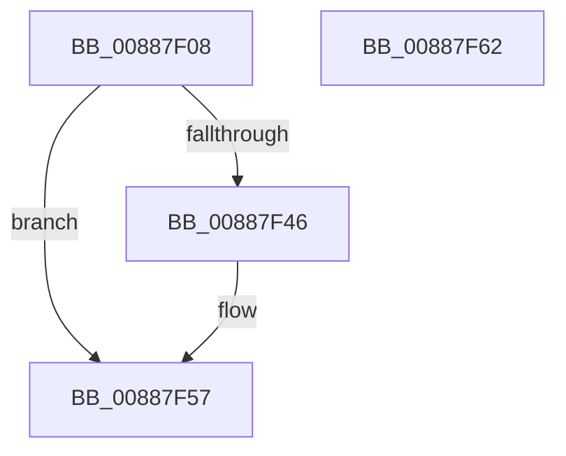

# RtlpFreeHandleForAtom

- RVA: `0x00887F08`–`0x00887F63` (길이 `91` bytes)
- VA: `0x0000000140887F08`
- 실행 섹션: `PAGE`
- PDB 이름 있음: `예`; PDB Function 태그: `아니요`
- unwind 정보 RVA: `0x0005CF00`
- 디코드: `24`개 명령, `91/91` bytes 표시
- 미해석 바이트: `0` (있으면 어셈블리에 `.byte`로 보존)

> 이 문서는 커널 이미지의 기계어와 PDB 기호를 분석해 생성했습니다. 4번과 5번은 함수 원형과 자료형을 바이너리 사용 방식에서 추정한 C 해석이며 원본 소스 복구 결과는 아닙니다.

## 1. Dependencies

- 직접 호출 지점: **3**; 고유 호출 대상: **3**
- 직접 호출자로 확인된 함수: **2**
- RIP 상대 이미지 참조: **0**

### Outgoing calls
- `0x00887F3C` → [ExMapHandleToPointer](../86/ExMapHandleToPointer_function_00868B60.md) (function, `0x00868B60`)
- `0x00887F52` → [ExDestroyHandle](ExDestroyHandle_function_00889430.md) (function, `0x00889430`)
- `0x00887F57` → [KeLeaveCriticalRegion](../../text/25/KeLeaveCriticalRegion_function_0025D8B0.md) (function, `0x0025D8B0`)

### Direct callers
- [RtlpFreeAllAtom](../../text/47/RtlpFreeAllAtom_function_00479244.md) at `0x004792B2`
- [RtlEmptyAtomTable](../78/RtlEmptyAtomTable_function_0078E1B0.md) at `0x0078E21A`

### Static image references
- 디코드된 RIP-relative 메모리 참조가 없습니다.

## 2. Other-region calls and transfers

- 다른 실행 섹션으로 향하는 call: **1**
  - `0x00887F57` → [KeLeaveCriticalRegion](../../text/25/KeLeaveCriticalRegion_function_0025D8B0.md) (`PAGE` → `.text`)
- 별도 외부 분기/꼬리 이동을 확인하지 못했습니다.

## 3. Assembly (complete function range)

```asm
00887F08  40 53                           push rbx
00887F0A  48 83 EC 20                     sub rsp, 0x20
00887F0E  0F B7 42 08                     movzx eax, word ptr [rdx + 8]
00887F12  48 8B D9                        mov rbx, rcx
00887F15  48 83 64 24 30 00               and qword ptr [rsp + 0x30], 0
00887F1B  C1 E0 02                        shl eax, 2
00887F1E  89 44 24 30                     mov dword ptr [rsp + 0x30], eax
00887F22  65 48 8B 04 25 88 01 00 00      mov rax, qword ptr gs:[0x188]
00887F2B  48 8B 54 24 30                  mov rdx, qword ptr [rsp + 0x30]
00887F30  66 FF 88 E4 01 00 00            dec word ptr [rax + 0x1e4]
00887F37  90                              nop
00887F38  48 8B 49 10                     mov rcx, qword ptr [rcx + 0x10]
00887F3C  E8 1F 0C FE FF                  call 0x140868b60
00887F41  48 85 C0                        test rax, rax
00887F44  74 11                           je 0x140887f57
00887F46  48 8B 54 24 30                  mov rdx, qword ptr [rsp + 0x30]
00887F4B  4C 8B C0                        mov r8, rax
00887F4E  48 8B 4B 10                     mov rcx, qword ptr [rbx + 0x10]
00887F52  E8 D9 14 00 00                  call 0x140889430
00887F57  E8 54 59 9D FF                  call 0x14025d8b0
00887F5C  48 83 C4 20                     add rsp, 0x20
00887F60  5B                              pop rbx
00887F61  C3                              ret
00887F62  CC                              int3
```

## 4. C-style interpretation (structured pseudocode)

```c
__int64 __fastcall RtlpFreeHandleForAtom(__int64 a1, __int64 a2)
{
    __int64 result;
    __int64 v_rsp;
    unsigned __int64 v_stack_p8;

    v_rsp = (v_rsp) - (32);
    result = (unsigned int)((*(unsigned __int16 *)(a2 + 8)) << (2));
    v_stack_p8 = (unsigned int)(result);
    result = ExMapHandleToPointer(*(unsigned __int64 *)(a1 + 16), v_stack_p8, a3, a4);
    if (result != 0) {
        a2 = v_stack_p8;
        a3 = result;
        a1 = *(unsigned __int64 *)(a1 + 16);
        result = ExDestroyHandle(a1, a2, a3, a4);
    }
    result = KeLeaveCriticalRegion(a1, a2, a3, a4);
    v_rsp = (v_rsp) + (32);
    return result;
}
```

## 5. (Beta) C Style

```c
int64_t RtlpFreeHandleForAtom(void *Arg1, void *Arg2)
{
    uint8_t *arg1 = (uint8_t *)Arg1;
    uint8_t *arg2 = (uint8_t *)Arg2;

    int64_t result;
    int64_t local_rsp;
    uint64_t v_stack_p8;

    local_rsp = (local_rsp) - (32);
    result = (uint32_t)((*(uint16_t *)(arg2 + 0x8)) << (2));
    v_stack_p8 = (uint32_t)(result);
    result = ExMapHandleToPointer(*(uint64_t *)(arg1 + 0x10), v_stack_p8, a3, a4);
    if (result != 0) {
        Arg2 = v_stack_p8;
        a3 = result;
        Arg1 = *(uint64_t *)(arg1 + 0x10);
        result = ExDestroyHandle(Arg1, Arg2, a3, a4);
    }
    result = KeLeaveCriticalRegion(Arg1, Arg2, a3, a4);
    local_rsp = (local_rsp) + (32);
    return result;
}
```

### 관측된 메모리 오프셋

구조체 형식이 확인되지 않은 접근은 인자 기준의 오프셋으로만 기록했습니다.

| 기준 인자 | 오프셋 표현 | 폭 (bit) | 접근 |
|---|---:|---:|---|
| `Arg1` | `+ 0x10` | `64` | `R` |
| `Arg2` | `+ 0x8` | `16` | `R` |

## 6. Execution-region graph

[열기: 2D/3D 그래프와 함수 탐색 컨트롤 패널](../../../control-panel.html?section=page&rva=0x00887F08&view=graph)

- 2D 그래프는 위에서 아래로 흐르고, 3D 그래프는 빈 공간을 드래그해 회전합니다. Shift+드래그는 이동, 휠은 확대·축소, 함수 노드 선택은 대상 보고서 이동입니다.

### Static fallback


