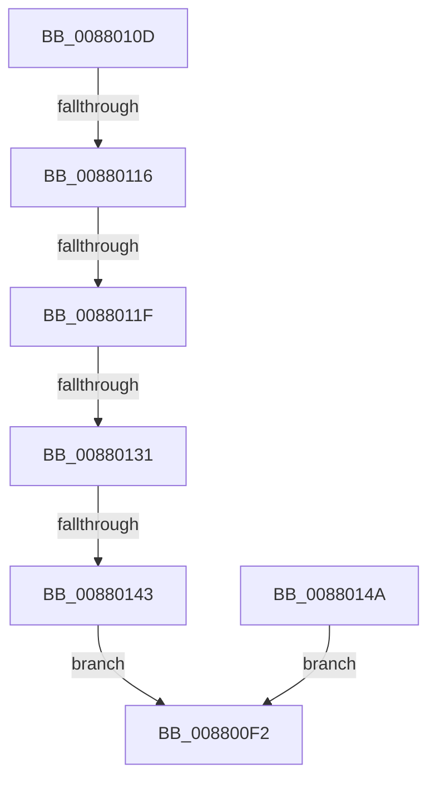

# sub_008800F2

- RVA: `0x008800F2`–`0x00880151` (길이 `95` bytes)
- VA: `0x00000001408800F2`
- 실행 섹션: `PAGE`
- PDB 이름 있음: `아니요`; PDB Function 태그: `아니요`
- unwind 정보 RVA: `0x0007C3FC`
- 디코드: `27`개 명령, `95/95` bytes 표시
- 미해석 바이트: `0` (있으면 어셈블리에 `.byte`로 보존)

> 이 문서는 커널 이미지의 기계어와 PDB 기호를 분석해 생성했습니다. 4번과 5번은 함수 원형과 자료형을 바이너리 사용 방식에서 추정한 C 해석이며 원본 소스 복구 결과는 아닙니다.

## 1. Dependencies

- 직접 호출 지점: **1**; 고유 호출 대상: **1**
- 직접 호출자로 확인된 함수: **0**
- RIP 상대 이미지 참조: **0**

### Outgoing calls
- `0x008800F9` → [_security_check_cookie](../../text/6A/_security_check_cookie_function_006AC640.md) (function, `0x006AC640`)

### Direct callers
- 이 함수 시작 RVA로 연결되는 직접 call은 확인되지 않았습니다. 간접 호출은 완전히 역산할 수 없습니다.

### Static image references
- 디코드된 RIP-relative 메모리 참조가 없습니다.

## 2. Other-region calls and transfers

- 다른 실행 섹션으로 향하는 call: **1**
  - `0x008800F9` → [_security_check_cookie](../../text/6A/_security_check_cookie_function_006AC640.md) (`PAGE` → `.text`)
- call이 아닌 외부 분기/꼬리 이동: **4**
  - `0x00880114` → [sub_0088016C](Unknown_function_0088016C.md) (`tail-transfer`)
  - `0x00880119` → [sub_0088023C](Unknown_function_0088023C.md) (`tail-transfer`)
  - `0x0088012B` → [sub_0088023C](Unknown_function_0088023C.md) (`tail-transfer`)
  - `0x0088013D` → [sub_0087FFB4](../87/Unknown_function_0087FFB4.md) (`tail-transfer`)

## 3. Assembly (complete function range)

```asm
008800F2  48 8B 4D 07                     mov rcx, qword ptr [rbp + 7]
008800F6  48 33 CC                        xor rcx, rsp
008800F9  E8 42 C5 E2 FF                  call 0x1406ac640
008800FE  48 81 C4 00 01 00 00            add rsp, 0x100
00880105  41 5E                           pop r14
00880107  41 5C                           pop r12
00880109  5F                              pop rdi
0088010A  5E                              pop rsi
0088010B  5D                              pop rbp
0088010C  C3                              ret
0088010D  CC                              int3
0088010E  81 FE 00 80 00 00               cmp esi, 0x8000
00880114  75 56                           jne 0x14088016c
00880116  4D 85 F6                        test r14, r14
00880119  0F 84 1D 01 00 00               je 0x14088023c
0088011F  49 8B C6                        mov rax, r14
00880122  48 25 00 F0 FF FF               and rax, 0xfffffffffffff000
00880128  4C 3B F0                        cmp r14, rax
0088012B  0F 85 0B 01 00 00               jne 0x14088023c
00880131  48 8B C7                        mov rax, rdi
00880134  48 25 00 F0 FF FF               and rax, 0xfffffffffffff000
0088013A  48 3B F8                        cmp rdi, rax
0088013D  0F 84 71 FE FF FF               je 0x14087ffb4
00880143  B8 F0 00 00 C0                  mov eax, 0xc00000f0
00880148  EB A8                           jmp 0x1408800f2
0088014A  B8 0D 00 00 C0                  mov eax, 0xc000000d
0088014F  EB A1                           jmp 0x1408800f2
```

## 4. C-style interpretation (structured pseudocode)

```c
__int64 __fastcall sub_008800F2(void)
{
    __int64 result;
    __int64 v_rsp;

    a1 = (*(unsigned __int64 *)(v_rbp + 7)) ^ (v_rsp);
    result = _security_check_cookie(a1, a2, a3, a4);
    v_rsp = (v_rsp) + (256);
    return result;
}
```

## 5. (Beta) C Style

```c
void sub_008800F2(void)
{
    int64_t result;
    int64_t local_rsp;

    a1 = (*(uint64_t *)(local_rbp + 0x7)) ^ (local_rsp);
    result = _security_check_cookie(a1, a2, a3, a4);
    local_rsp = (local_rsp) + (256);
    return result;
}
```

## 6. Execution-region graph

[열기: 2D/3D 그래프와 함수 탐색 컨트롤 패널](../../../control-panel.html?section=page&rva=0x008800F2&view=graph)

- 2D 그래프는 위에서 아래로 흐르고, 3D 그래프는 빈 공간을 드래그해 회전합니다. Shift+드래그는 이동, 휠은 확대·축소, 함수 노드 선택은 대상 보고서 이동입니다.

### Static fallback


