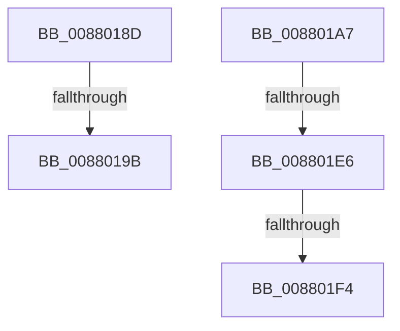

# sub_0088018D

- RVA: `0x0088018D`–`0x0088020A` (길이 `125` bytes)
- VA: `0x000000014088018D`
- 실행 섹션: `PAGE`
- PDB 이름 있음: `아니요`; PDB Function 태그: `아니요`
- unwind 정보 RVA: `0x0007C43C`
- 디코드: `25`개 명령, `125/125` bytes 표시
- 미해석 바이트: `0` (있으면 어셈블리에 `.byte`로 보존)

> 이 문서는 커널 이미지의 기계어와 PDB 기호를 분석해 생성했습니다. 4번과 5번은 함수 원형과 자료형을 바이너리 사용 방식에서 추정한 C 해석이며 원본 소스 복구 결과는 아닙니다.

## 1. Dependencies

- 직접 호출 지점: **2**; 고유 호출 대상: **2**
- 직접 호출자로 확인된 함수: **0**
- RIP 상대 이미지 참조: **1**

### Outgoing calls
- `0x008801D6` → [ObpReferenceObjectByHandleWithTag](../86/ObpReferenceObjectByHandleWithTag_function_00869650.md) (function, `0x00869650`)
- `0x00880200` → [KeStackAttachProcess](../../text/21/KeStackAttachProcess_function_00216800.md) (function, `0x00216800`)

### Direct callers
- 이 함수 시작 RVA로 연결되는 직접 call은 확인되지 않았습니다. 간접 호출은 완전히 역산할 수 없습니다.

### Static image references
- `0x008801B0` → RVA `0x00FC6A98` (`ALMOSTRO`; read)

## 2. Other-region calls and transfers

- 다른 실행 섹션으로 향하는 call: **1**
  - `0x00880200` → [KeStackAttachProcess](../../text/21/KeStackAttachProcess_function_00216800.md) (`PAGE` → `.text`)
- call이 아닌 외부 분기/꼬리 이동: **5**
  - `0x00880195` → [sub_00880223](Unknown_function_00880223.md) (`tail-transfer`)
  - `0x008801A2` → [sub_0087FFB4 + 0xEA](../87/Unknown_function_0087FFB4.md) (`tail-transfer`)
  - `0x008801E0` → [sub_0087FFB4 + 0x126](../87/Unknown_function_0087FFB4.md) (`tail-transfer`)
  - `0x008801EE` → [sub_0087FFB4 + 0x49](../87/Unknown_function_0087FFB4.md) (`tail-transfer`)
  - `0x00880205` → [sub_0087FFB4 + 0x49](../87/Unknown_function_0087FFB4.md) (`tail-transfer`)

## 3. Assembly (complete function range)

```asm
0088018D  49 83 BD 40 06 00 00 00         cmp qword ptr [r13 + 0x640], 0
00880195  0F 85 88 00 00 00               jne 0x140880223
0088019B  C7 45 87 F2 00 00 C0            mov dword ptr [rbp - 0x79], 0xc00000f2
008801A2  E9 F7 FE FF FF                  jmp 0x14088009e
008801A7  44 0F B6 4D 77                  movzx r9d, byte ptr [rbp + 0x77]
008801AC  48 8D 45 8F                     lea rax, [rbp - 0x71]
008801B0  4C 8B 05 E1 68 74 00            mov r8, qword ptr [rip + 0x7468e1]
008801B7  BA 08 00 00 00                  mov edx, 8
008801BC  4C 89 5C 24 38                  mov qword ptr [rsp + 0x38], r11
008801C1  49 8B CA                        mov rcx, r10
008801C4  4C 89 5C 24 30                  mov qword ptr [rsp + 0x30], r11
008801C9  48 89 44 24 28                  mov qword ptr [rsp + 0x28], rax
008801CE  C7 44 24 20 4D 6D 56 6D         mov dword ptr [rsp + 0x20], 0x6d566d4d
008801D6  E8 75 94 FE FF                  call 0x140869650
008801DB  89 45 87                        mov dword ptr [rbp - 0x79], eax
008801DE  85 C0                           test eax, eax
008801E0  0F 88 F4 FE FF FF               js 0x1408800da
008801E6  4C 8B 6D 8F                     mov r13, qword ptr [rbp - 0x71]
008801EA  4C 39 6D B7                     cmp qword ptr [rbp - 0x49], r13
008801EE  0F 84 09 FE FF FF               je 0x14087fffd
008801F4  48 8D 55 D7                     lea rdx, [rbp - 0x29]
008801F8  49 8B CD                        mov rcx, r13
008801FB  BB 01 00 00 00                  mov ebx, 1
00880200  E8 FB 65 99 FF                  call 0x140216800
00880205  E9 F3 FD FF FF                  jmp 0x14087fffd
```

## 4. C-style interpretation (structured pseudocode)

```c
__int64 __fastcall sub_0088018D(void)
{
    unsigned int v_stack_p20;
    unsigned __int64 v_stack_p28;
    unsigned __int64 v_stack_p30;
    unsigned __int64 v_stack_p38;

    *(unsigned int *)(v_rbp - 121) = 0xC00000F2ULL;
}
```

## 5. (Beta) C Style

```c
void sub_0088018D(void)
{
    uint32_t v_stack_p20;
    uint64_t v_stack_p28;
    uint64_t v_stack_p30;
    uint64_t v_stack_p38;

    *(uint32_t *)(local_rbp - 0x79) = 0xC00000F2ULL;
}
```

## 6. Execution-region graph

[열기: 2D/3D 그래프와 함수 탐색 컨트롤 패널](../../../control-panel.html?section=page&rva=0x0088018D&view=graph)

- 2D 그래프는 위에서 아래로 흐르고, 3D 그래프는 빈 공간을 드래그해 회전합니다. Shift+드래그는 이동, 휠은 확대·축소, 함수 노드 선택은 대상 보고서 이동입니다.

### Static fallback


