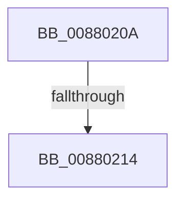

# sub_0088020A

- RVA: `0x0088020A`–`0x00880223` (길이 `25` bytes)
- VA: `0x000000014088020A`
- 실행 섹션: `PAGE`
- PDB 이름 있음: `아니요`; PDB Function 태그: `아니요`
- unwind 정보 RVA: `0x0007C458`
- 디코드: `5`개 명령, `25/25` bytes 표시
- 미해석 바이트: `0` (있으면 어셈블리에 `.byte`로 보존)

> 이 문서는 커널 이미지의 기계어와 PDB 기호를 분석해 생성했습니다. 4번과 5번은 함수 원형과 자료형을 바이너리 사용 방식에서 추정한 C 해석이며 원본 소스 복구 결과는 아닙니다.

## 1. Dependencies

- 직접 호출 지점: **0**; 고유 호출 대상: **0**
- 직접 호출자로 확인된 함수: **0**
- RIP 상대 이미지 참조: **0**

### Outgoing calls
- 직접 디코드된 call 명령이 없습니다.

### Direct callers
- 이 함수 시작 RVA로 연결되는 직접 call은 확인되지 않았습니다. 간접 호출은 완전히 역산할 수 없습니다.

### Static image references
- 디코드된 RIP-relative 메모리 참조가 없습니다.

## 2. Other-region calls and transfers

- 다른 실행 섹션으로 향하는 call: **0**
- call이 아닌 외부 분기/꼬리 이동: **2**
  - `0x0088020E` → [sub_008800F2 + 0x58](Unknown_function_008800F2.md) (`tail-transfer`)
  - `0x0088021E` → [MmFreeVirtualMemory + 0xD9](../87/MmFreeVirtualMemory_function_0087FED0.md) (`tail-transfer`)

## 3. Assembly (complete function range)

```asm
0088020A  40 F6 C6 02                     test sil, 2
0088020E  0F 85 36 FF FF FF               jne 0x14088014a
00880214  41 81 CC 00 00 00 0C            or r12d, 0xc000000
0088021B  83 E6 FE                        and esi, 0xfffffffe
0088021E  E9 86 FD FF FF                  jmp 0x14087ffa9
```

## 4. C-style interpretation (structured pseudocode)

```c
void __fastcall sub_0088020A(void)
{
    __int64 v_r12;
    __int64 v_rsi;

    v_r12 = (unsigned int)((v_r12) | (0xC000000ULL));
    v_rsi = (unsigned int)((v_rsi) & (0xFFFFFFFEULL));
}
```

## 5. (Beta) C Style

```c
void sub_0088020A(void)
{
    int64_t local_r12;
    int64_t local_rsi;

    local_r12 = (uint32_t)((local_r12) | (0xC000000ULL));
    local_rsi = (uint32_t)((local_rsi) & (0xFFFFFFFEULL));
}
```

## 6. Execution-region graph

[열기: 2D/3D 그래프와 함수 탐색 컨트롤 패널](../../../control-panel.html?section=page&rva=0x0088020A&view=graph)

- 2D 그래프는 위에서 아래로 흐르고, 3D 그래프는 빈 공간을 드래그해 회전합니다. Shift+드래그는 이동, 휠은 확대·축소, 함수 노드 선택은 대상 보고서 이동입니다.

### Static fallback


