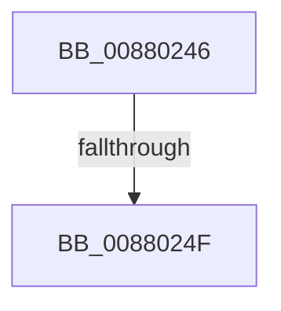

# sub_00880246

- RVA: `0x00880246`–`0x00880261` (길이 `27` bytes)
- VA: `0x0000000140880246`
- 실행 섹션: `PAGE`
- PDB 이름 있음: `아니요`; PDB Function 태그: `아니요`
- unwind 정보 RVA: `0x0007C494`
- 디코드: `7`개 명령, `27/27` bytes 표시
- 미해석 바이트: `0` (있으면 어셈블리에 `.byte`로 보존)

> 이 문서는 커널 이미지의 기계어와 PDB 기호를 분석해 생성했습니다. 4번과 5번은 함수 원형과 자료형을 바이너리 사용 방식에서 추정한 C 해석이며 원본 소스 복구 결과는 아닙니다.

## 1. Dependencies

- 직접 호출 지점: **1**; 고유 호출 대상: **1**
- 직접 호출자로 확인된 함수: **0**
- RIP 상대 이미지 참조: **0**

### Outgoing calls
- `0x00880256` → [DbgkUnMapViewOfSection](../A3/DbgkUnMapViewOfSection_function_00A3B18C.md) (function, `0x00A3B18C`)

### Direct callers
- 이 함수 시작 RVA로 연결되는 직접 call은 확인되지 않았습니다. 간접 호출은 완전히 역산할 수 없습니다.

### Static image references
- 디코드된 RIP-relative 메모리 참조가 없습니다.

## 2. Other-region calls and transfers

- 다른 실행 섹션으로 향하는 call: **0**
- call이 아닌 외부 분기/꼬리 이동: **2**
  - `0x00880249` → [sub_00B18C5E](../B1/Unknown_function_00B18C5E.md) (`tail-transfer`)
  - `0x0088025C` → [sub_00B18C5E](../B1/Unknown_function_00B18C5E.md) (`tail-transfer`)

## 3. Assembly (complete function range)

```asm
00880246  4D 85 ED                        test r13, r13
00880249  0F 84 0F 8A 29 00               je 0x140b18c5e
0088024F  48 8B 53 10                     mov rdx, qword ptr [rbx + 0x10]
00880253  49 8B CD                        mov rcx, r13
00880256  E8 31 AF 1B 00                  call 0x140a3b18c
0088025B  90                              nop
0088025C  E9 FD 89 29 00                  jmp 0x140b18c5e
```

## 4. C-style interpretation (structured pseudocode)

```c
__int64 __fastcall sub_00880246(void)
{
    __int64 result;

    result = DbgkUnMapViewOfSection(v_r13, *(unsigned __int64 *)(v_rbx + 16), a3, a4);
}
```

## 5. (Beta) C Style

```c
void sub_00880246(void)
{
    int64_t result;

    result = DbgkUnMapViewOfSection(local_r13, *(uint64_t *)(local_rbx + 0x10), a3, a4);
}
```

## 6. Execution-region graph

[열기: 2D/3D 그래프와 함수 탐색 컨트롤 패널](../../../control-panel.html?section=page&rva=0x00880246&view=graph)

- 2D 그래프는 위에서 아래로 흐르고, 3D 그래프는 빈 공간을 드래그해 회전합니다. Shift+드래그는 이동, 휠은 확대·축소, 함수 노드 선택은 대상 보고서 이동입니다.

### Static fallback


