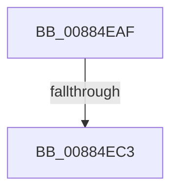

# sub_00884EAF

- RVA: `0x00884EAF`–`0x00884EE1` (길이 `50` bytes)
- VA: `0x0000000140884EAF`
- 실행 섹션: `PAGE`
- PDB 이름 있음: `아니요`; PDB Function 태그: `아니요`
- unwind 정보 RVA: `0x0007C8A8`
- 디코드: `8`개 명령, `50/50` bytes 표시
- 미해석 바이트: `0` (있으면 어셈블리에 `.byte`로 보존)

> 이 문서는 커널 이미지의 기계어와 PDB 기호를 분석해 생성했습니다. 4번과 5번은 함수 원형과 자료형을 바이너리 사용 방식에서 추정한 C 해석이며 원본 소스 복구 결과는 아닙니다.

## 1. Dependencies

- 직접 호출 지점: **0**; 고유 호출 대상: **0**
- 직접 호출자로 확인된 함수: **0**
- RIP 상대 이미지 참조: **0**

### Outgoing calls
- 직접 디코드된 call 명령이 없습니다.

### Direct callers
- 이 함수 시작 RVA로 연결되는 직접 call은 확인되지 않았습니다. 간접 호출은 완전히 역산할 수 없습니다.

### Static image references
- 디코드된 RIP-relative 메모리 참조가 없습니다.

## 2. Other-region calls and transfers

- 다른 실행 섹션으로 향하는 call: **0**
- call이 아닌 외부 분기/꼬리 이동: **1**
  - `0x00884EBD` → [sub_008859C8](Unknown_function_008859C8.md) (`tail-transfer`)

## 3. Assembly (complete function range)

```asm
00884EAF  4C 89 AC 24 28 01 00 00         mov qword ptr [rsp + 0x128], r13
00884EB7  48 3D 00 00 20 00               cmp rax, 0x200000
00884EBD  0F 83 05 0B 00 00               jae 0x1408859c8
00884EC3  65 48 8B 04 25 88 01 00 00      mov rax, qword ptr gs:[0x188]
00884ECC  49 8B CF                        mov rcx, r15
00884ECF  48 89 44 24 50                  mov qword ptr [rsp + 0x50], rax
00884ED4  48 8B 87 10 04 00 00            mov rax, qword ptr [rdi + 0x410]
00884EDB  48 05 00 03 00 00               add rax, 0x300
```

## 4. C-style interpretation (structured pseudocode)

```c
__int64 __fastcall sub_00884EAF(void)
{
    __int64 result;
    unsigned __int64 v_stack_p128;
    unsigned __int64 v_stack_p50;

    v_stack_p128 = v_r13;
    v_stack_p50 = *(unsigned __int64 *)(gs_base + (0 + 392));
    result = (*(unsigned __int64 *)(v_rdi + 1040)) + (768);
    return result;
}
```

## 5. (Beta) C Style

```c
void sub_00884EAF(void)
{
    int64_t result;
    uint64_t v_stack_p128;
    uint64_t v_stack_p50;

    v_stack_p128 = local_r13;
    v_stack_p50 = *(uint64_t *)(gs_base + (0 + 0x188));
    result = (*(uint64_t *)(local_rdi + 0x410)) + (768);
    return result;
}
```

## 6. Execution-region graph

[열기: 2D/3D 그래프와 함수 탐색 컨트롤 패널](../../../control-panel.html?section=page&rva=0x00884EAF&view=graph)

- 2D 그래프는 위에서 아래로 흐르고, 3D 그래프는 빈 공간을 드래그해 회전합니다. Shift+드래그는 이동, 휠은 확대·축소, 함수 노드 선택은 대상 보고서 이동입니다.

### Static fallback


