# sub_00884EE1

- RVA: `0x00884EE1`–`0x00885348` (길이 `1,127` bytes)
- VA: `0x0000000140884EE1`
- 실행 섹션: `PAGE`
- PDB 이름 있음: `아니요`; PDB Function 태그: `아니요`
- unwind 정보 RVA: `0x0007C8BC`
- 디코드: `263`개 명령, `1,127/1,127` bytes 표시
- 미해석 바이트: `0` (있으면 어셈블리에 `.byte`로 보존)

> 이 문서는 커널 이미지의 기계어와 PDB 기호를 분석해 생성했습니다. 4번과 5번은 함수 원형과 자료형을 바이너리 사용 방식에서 추정한 C 해석이며 원본 소스 복구 결과는 아닙니다.

## 1. Dependencies

- 직접 호출 지점: **18**; 고유 호출 대상: **18**
- 직접 호출자로 확인된 함수: **0**
- RIP 상대 이미지 참조: **1**

### Outgoing calls
- `0x00884F06` → [MiCheckPurgeAndUpMapCount](../../text/41/MiCheckPurgeAndUpMapCount_function_004186B0.md) (function, `0x004186B0`)
- `0x00884F23` → [MiGetControlAreaPtes](../../text/24/MiGetControlAreaPtes_function_0024DB10.md) (function, `0x0024DB10`)
- `0x00884F4F` → [MiLocateSubsectionNode](../../text/2B/MiLocateSubsectionNode_function_002BBEE0.md) (function, `0x002BBEE0`)
- `0x00884F97` → [MiAddViewsForSection](../../text/32/MiAddViewsForSection_function_00324990.md) (function, `0x00324990`)
- `0x00884FF2` → [MiAllocatePool](../../text/35/MiAllocatePool_function_0035B540.md) (function, `0x0035B540`)
- `0x0088508F` → [MiReferenceFileObjectForMap](MiReferenceFileObjectForMap_function_00885C00.md) (function, `0x00885C00`)
- `0x008850B0` → [LOCK_ADDRESS_SPACE](../../text/2A/LOCK_ADDRESS_SPACE_function_002A4944.md) (function, `0x002A4944`)
- `0x00885116` → [MiSelectUserAddress](MiSelectUserAddress_function_00885C40.md) (function, `0x00885C40`)
- `0x0088515C` → [MiUpdateVadStartVpn](../../text/45/MiUpdateVadStartVpn_function_00450ED4.md) (function, `0x00450ED4`)
- `0x008851A1` → [MiComputeContiguousSubsectionPte](../../text/44/MiComputeContiguousSubsectionPte_function_00444E10.md) (function, `0x00444E10`)
- `0x008851E6` → [MiWriteVadFlags2](../../text/41/MiWriteVadFlags2_function_0041C020.md) (function, `0x0041C020`)
- `0x008851FF` → [MiInsertSharedCommitNode](MiInsertSharedCommitNode_function_00887210.md) (function, `0x00887210`)
- `0x0088522C` → [MiInsertVadCharges](MiInsertVadCharges_function_00886AA8.md) (function, `0x00886AA8`)
- `0x0088526A` → [MiLockVad](../../text/29/MiLockVad_function_00295810.md) (function, `0x00295810`)
- `0x0088527C` → [MiInsertVad](../../text/26/MiInsertVad_function_00265540.md) (function, `0x00265540`)
- `0x008852A9` → [MiAdvanceVadHint](MiAdvanceVadHint_function_00886C40.md) (function, `0x00886C40`)
- `0x0088531E` → [MiUnlockVad](../../text/2A/MiUnlockVad_function_002A59C8.md) (function, `0x002A59C8`)
- `0x00885329` → [UNLOCK_ADDRESS_SPACE](../../text/2A/UNLOCK_ADDRESS_SPACE_function_002A4844.md) (function, `0x002A4844`)

### Direct callers
- 이 함수 시작 RVA로 연결되는 직접 call은 확인되지 않았습니다. 간접 호출은 완전히 역산할 수 없습니다.

### Static image references
- `0x008852C9` → RVA `0x00FC6B00` (`ALMOSTRO`; read)

## 2. Other-region calls and transfers

- 다른 실행 섹션으로 향하는 call: **13**
  - `0x00884F06` → [MiCheckPurgeAndUpMapCount](../../text/41/MiCheckPurgeAndUpMapCount_function_004186B0.md) (`PAGE` → `.text`)
  - `0x00884F23` → [MiGetControlAreaPtes](../../text/24/MiGetControlAreaPtes_function_0024DB10.md) (`PAGE` → `.text`)
  - `0x00884F4F` → [MiLocateSubsectionNode](../../text/2B/MiLocateSubsectionNode_function_002BBEE0.md) (`PAGE` → `.text`)
  - `0x00884F97` → [MiAddViewsForSection](../../text/32/MiAddViewsForSection_function_00324990.md) (`PAGE` → `.text`)
  - `0x00884FF2` → [MiAllocatePool](../../text/35/MiAllocatePool_function_0035B540.md) (`PAGE` → `.text`)
  - `0x008850B0` → [LOCK_ADDRESS_SPACE](../../text/2A/LOCK_ADDRESS_SPACE_function_002A4944.md) (`PAGE` → `.text`)
  - `0x0088515C` → [MiUpdateVadStartVpn](../../text/45/MiUpdateVadStartVpn_function_00450ED4.md) (`PAGE` → `.text`)
  - `0x008851A1` → [MiComputeContiguousSubsectionPte](../../text/44/MiComputeContiguousSubsectionPte_function_00444E10.md) (`PAGE` → `.text`)
  - `0x008851E6` → [MiWriteVadFlags2](../../text/41/MiWriteVadFlags2_function_0041C020.md) (`PAGE` → `.text`)
  - `0x0088526A` → [MiLockVad](../../text/29/MiLockVad_function_00295810.md) (`PAGE` → `.text`)
  - `0x0088527C` → [MiInsertVad](../../text/26/MiInsertVad_function_00265540.md) (`PAGE` → `.text`)
  - `0x0088531E` → [MiUnlockVad](../../text/2A/MiUnlockVad_function_002A59C8.md) (`PAGE` → `.text`)
  - `0x00885329` → [UNLOCK_ADDRESS_SPACE](../../text/2A/UNLOCK_ADDRESS_SPACE_function_002A4844.md) (`PAGE` → `.text`)
- call이 아닌 외부 분기/꼬리 이동: **27**
  - `0x00884F30` → [sub_008857C1 + 0x128](Unknown_function_008857C1.md) (`tail-transfer`)
  - `0x00884F3C` → [sub_0088535F](Unknown_function_0088535F.md) (`tail-transfer`)
  - `0x00884FA4` → [sub_00885634 + 0x28](Unknown_function_00885634.md) (`tail-transfer`)
  - `0x00884FC6` → [sub_00885634 + 0x30](Unknown_function_00885634.md) (`tail-transfer`)
  - `0x00884FFD` → [sub_00885AED](Unknown_function_00885AED.md) (`tail-transfer`)
  - `0x0088505A` → [sub_00885634 + 0xB8](Unknown_function_00885634.md) (`tail-transfer`)
  - `0x00885082` → [sub_008857C1 + 0x13E](Unknown_function_008857C1.md) (`tail-transfer`)
  - `0x008850A2` → [sub_008859DF](Unknown_function_008859DF.md) (`tail-transfer`)
  - `0x008850BD` → [sub_00885634 + 0x60](Unknown_function_00885634.md) (`tail-transfer`)
  - `0x008850C8` → [sub_00885634 + 0xE1](Unknown_function_00885634.md) (`tail-transfer`)
  - `0x008850D1` → [sub_008857C1 + 0x1A3](Unknown_function_008857C1.md) (`tail-transfer`)
  - `0x00885123` → [sub_00885AED + 0x63](Unknown_function_00885AED.md) (`tail-transfer`)
  - `0x0088517E` → [sub_008857C1](Unknown_function_008857C1.md) (`tail-transfer`)
  - `0x0088518F` → [sub_00885634 + 0x81](Unknown_function_00885634.md) (`tail-transfer`)
  - `0x008851B1` → [sub_0088535F + 0x1C5](Unknown_function_0088535F.md) (`tail-transfer`)
  - `0x008851C5` → [sub_0088535F + 0x1C5](Unknown_function_0088535F.md) (`tail-transfer`)
  - `0x008851D8` → [sub_00885634 + 0xCB](Unknown_function_00885634.md) (`tail-transfer`)
  - `0x0088520C` → [sub_0088535F + 0xE5](Unknown_function_0088535F.md) (`tail-transfer`)
  - `0x00885220` → [sub_0088535F + 0xC5](Unknown_function_0088535F.md) (`tail-transfer`)
  - `0x00885239` → [sub_0088535F + 0xE5](Unknown_function_0088535F.md) (`tail-transfer`)
  - `0x0088524B` → [sub_00885AED + 0x76](Unknown_function_00885AED.md) (`tail-transfer`)
  - `0x00885259` → [sub_008857C1 + 0xD6](Unknown_function_008857C1.md) (`tail-transfer`)
  - `0x008852C3` → [sub_0088535F + 0xB6](Unknown_function_0088535F.md) (`tail-transfer`)
  - `0x008852EC` → [sub_0088535F + 0x193](Unknown_function_0088535F.md) (`tail-transfer`)
  - `0x008852FD` → [sub_0088535F + 0x4E](Unknown_function_0088535F.md) (`tail-transfer`)
  - `0x00885307` → [sub_0088535F + 0x4E](Unknown_function_0088535F.md) (`tail-transfer`)
  - `0x00885312` → [sub_00885AED + 0x8B](Unknown_function_00885AED.md) (`tail-transfer`)

## 3. Assembly (complete function range)

```asm
00884EE1  4C 89 A4 24 60 01 00 00         mov qword ptr [rsp + 0x160], r12
00884EE9  4C 89 B4 24 20 01 00 00         mov qword ptr [rsp + 0x120], r14
00884EF1  4D 8B F1                        mov r14, r9
00884EF4  48 89 45 A8                     mov qword ptr [rbp - 0x58], rax
00884EF8  4C 89 4C 24 70                  mov qword ptr [rsp + 0x70], r9
00884EFD  4C 89 4C 24 58                  mov qword ptr [rsp + 0x58], r9
00884F02  44 89 4D 80                     mov dword ptr [rbp - 0x80], r9d
00884F06  E8 A5 37 B9 FF                  call 0x1404186b0
00884F0B  48 8B 0B                        mov rcx, qword ptr [rbx]
00884F0E  4C 8B 6E 18                     mov r13, qword ptr [rsi + 0x18]
00884F12  4C 8B E1                        mov r12, rcx
00884F15  4C 03 E9                        add r13, rcx
00884F18  49 C1 EC 0C                     shr r12, 0xc
00884F1C  49 8B CF                        mov rcx, r15
00884F1F  49 C1 ED 0C                     shr r13, 0xc
00884F23  E8 E8 8B 9C FF                  call 0x14024db10
00884F28  48 89 44 24 78                  mov qword ptr [rsp + 0x78], rax
00884F2D  4C 3B E0                        cmp r12, rax
00884F30  0F 83 B3 09 00 00               jae 0x1408858e9
00884F36  32 DB                           xor bl, bl
00884F38  4D 39 77 40                     cmp qword ptr [r15 + 0x40], r14
00884F3C  0F 84 1D 04 00 00               je 0x14088535f
00884F42  48 8B 55 78                     mov rdx, qword ptr [rbp + 0x78]
00884F46  45 33 C0                        xor r8d, r8d
00884F49  49 8B CF                        mov rcx, r15
00884F4C  48 8B 12                        mov rdx, qword ptr [rdx]
00884F4F  E8 8C 6F A3 FF                  call 0x1402bbee0
00884F54  4C 8B C0                        mov r8, rax
00884F57  48 89 44 24 60                  mov qword ptr [rsp + 0x60], rax
00884F5C  BA 01 00 00 00                  mov edx, 1
00884F61  41 8B 48 20                     mov ecx, dword ptr [r8 + 0x20]
00884F65  41 8B 40 24                     mov eax, dword ptr [r8 + 0x24]
00884F69  81 E1 C0 FF 00 00               and ecx, 0xffc0
00884F6F  48 C1 E1 1A                     shl rcx, 0x1a
00884F73  41 B8 08 00 00 00               mov r8d, 8
00884F79  48 0B C8                        or rcx, rax
00884F7C  4C 2B E9                        sub r13, rcx
00884F7F  4C 2B E1                        sub r12, rcx
00884F82  84 DB                           test bl, bl
00884F84  48 8B 5C 24 60                  mov rbx, qword ptr [rsp + 0x60]
00884F89  48 8B CB                        mov rcx, rbx
00884F8C  4C 0F 45 EA                     cmovne r13, rdx
00884F90  49 8B D5                        mov rdx, r13
00884F93  4C 89 6D C0                     mov qword ptr [rbp - 0x40], r13
00884F97  E8 F4 F9 A9 FF                  call 0x140324990
00884F9C  89 45 68                        mov dword ptr [rbp + 0x68], eax
00884F9F  44 8B E8                        mov r13d, eax
00884FA2  85 C0                           test eax, eax
00884FA4  0F 88 B2 06 00 00               js 0x14088565c
00884FAA  48 8B 43 08                     mov rax, qword ptr [rbx + 8]
00884FAE  4A 8D 04 E0                     lea rax, [rax + r12*8]
00884FB2  48 89 45 B8                     mov qword ptr [rbp - 0x48], rax
00884FB6  4D 39 77 40                     cmp qword ptr [r15 + 0x40], r14
00884FBA  75 10                           jne 0x140884fcc
00884FBC  48 8B 95 98 00 00 00            mov rdx, qword ptr [rbp + 0x98]
00884FC3  48 85 D2                        test rdx, rdx
00884FC6  0F 85 98 06 00 00               jne 0x140885664
00884FCC  4C 8B AD 80 00 00 00            mov r13, qword ptr [rbp + 0x80]
00884FD3  BA 88 00 00 00                  mov edx, 0x88
00884FD8  41 B8 56 61 64 20               mov r8d, 0x20646156
00884FDE  4C 89 75 C8                     mov qword ptr [rbp - 0x38], r14
00884FE2  4D 8B 6D 18                     mov r13, qword ptr [r13 + 0x18]
00884FE6  8D 4A B8                        lea ecx, [rdx - 0x48]
00884FE9  49 C1 E5 0C                     shl r13, 0xc
00884FED  4C 89 6C 24 78                  mov qword ptr [rsp + 0x78], r13
00884FF2  E8 49 65 AD FF                  call 0x14035b540
00884FF7  4C 8B F0                        mov r14, rax
00884FFA  48 85 C0                        test rax, rax
00884FFD  0F 84 EA 0A 00 00               je 0x140885aed
00885003  8B 8D 90 00 00 00               mov ecx, dword ptr [rbp + 0x90]
00885009  48 C7 40 10 FE FF FF FF         mov qword ptr [rax + 0x10], 0xfffffffffffffffe
00885011  48 8B 45 B8                     mov rax, qword ptr [rbp - 0x48]
00885015  49 89 46 50                     mov qword ptr [r14 + 0x50], rax
00885019  B8 04 00 00 00                  mov eax, 4
0088501E  49 89 5E 48                     mov qword ptr [r14 + 0x48], rbx
00885022  33 DB                           xor ebx, ebx
00885024  83 BD 88 00 00 00 01            cmp dword ptr [rbp + 0x88], 1
0088502B  0F 44 D8                        cmove ebx, eax
0088502E  41 8B 46 30                     mov eax, dword ptr [r14 + 0x30]
00885032  C1 E1 07                        shl ecx, 7
00885035  33 C8                           xor ecx, eax
00885037  81 E1 80 0F 00 00               and ecx, 0xf80
0088503D  33 C8                           xor ecx, eax
0088503F  41 89 4E 30                     mov dword ptr [r14 + 0x30], ecx
00885043  8B 46 34                        mov eax, dword ptr [rsi + 0x34]
00885046  C1 E0 0C                        shl eax, 0xc
00885049  33 C1                           xor eax, ecx
0088504B  25 00 F0 07 00                  and eax, 0x7f000
00885050  33 C1                           xor eax, ecx
00885052  41 89 46 30                     mov dword ptr [r14 + 0x30], eax
00885056  83 7E 34 00                     cmp dword ptr [rsi + 0x34], 0
0088505A  0F 85 8C 06 00 00               jne 0x1408856ec
00885060  49 83 7F 40 00                  cmp qword ptr [r15 + 0x40], 0
00885065  74 0C                           je 0x140885073
00885067  F7 46 28 00 20 00 20            test dword ptr [rsi + 0x28], 0x20002000
0088506E  75 03                           jne 0x140885073
00885070  83 CB 02                        or ebx, 2
00885073  49 C7 46 28 00 00 00 00         mov qword ptr [r14 + 0x28], 0
0088507B  F7 46 40 00 00 00 04            test dword ptr [rsi + 0x40], 0x4000000
00885082  0F 85 77 08 00 00               jne 0x1408858ff
00885088  48 8B 8D 80 00 00 00            mov rcx, qword ptr [rbp + 0x80]
0088508F  E8 6C 0B 00 00                  call 0x140885c00
00885094  49 89 86 80 00 00 00            mov qword ptr [r14 + 0x80], rax
0088509B  F7 46 28 00 00 00 20            test dword ptr [rsi + 0x28], 0x20000000
008850A2  0F 85 37 09 00 00               jne 0x1408859df
008850A8  48 8B 4C 24 50                  mov rcx, qword ptr [rsp + 0x50]
008850AD  48 8B D7                        mov rdx, rdi
008850B0  E8 8F F8 A1 FF                  call 0x1402a4944
008850B5  8B 87 F4 01 00 00               mov eax, dword ptr [rdi + 0x1f4]
008850BB  A8 20                           test al, 0x20
008850BD  0F 85 D1 05 00 00               jne 0x140885694
008850C3  8B 46 3C                        mov eax, dword ptr [rsi + 0x3c]
008850C6  A8 01                           test al, 1
008850C8  0F 85 47 06 00 00               jne 0x140885715
008850CE  4D 85 ED                        test r13, r13
008850D1  0F 85 8D 08 00 00               jne 0x140885964
008850D7  4C 8B 4E 18                     mov r9, qword ptr [rsi + 0x18]
008850DB  48 8D 44 24 68                  lea rax, [rsp + 0x68]
008850E0  4C 8B 46 08                     mov r8, qword ptr [rsi + 8]
008850E4  33 C9                           xor ecx, ecx
008850E6  48 8B 16                        mov rdx, qword ptr [rsi]
008850E9  48 89 44 24 48                  mov qword ptr [rsp + 0x48], rax
008850EE  48 8D 45 C8                     lea rax, [rbp - 0x38]
008850F2  48 89 44 24 40                  mov qword ptr [rsp + 0x40], rax
008850F7  8B 85 90 00 00 00               mov eax, dword ptr [rbp + 0x90]
008850FD  89 4C 24 38                     mov dword ptr [rsp + 0x38], ecx
00885101  89 44 24 30                     mov dword ptr [rsp + 0x30], eax
00885105  48 8B 46 10                     mov rax, qword ptr [rsi + 0x10]
00885109  48 89 4C 24 28                  mov qword ptr [rsp + 0x28], rcx
0088510E  8B 4E 28                        mov ecx, dword ptr [rsi + 0x28]
00885111  48 89 44 24 20                  mov qword ptr [rsp + 0x20], rax
00885116  E8 25 0B 00 00                  call 0x140885c40
0088511B  89 45 68                        mov dword ptr [rbp + 0x68], eax
0088511E  44 8B E8                        mov r13d, eax
00885121  85 C0                           test eax, eax
00885123  0F 88 27 0A 00 00               js 0x140885b50
00885129  4C 8B 6C 24 68                  mov r13, qword ptr [rsp + 0x68]
0088512E  4C 89 6D 90                     mov qword ptr [rbp - 0x70], r13
00885132  4D 8D 55 FF                     lea r10, [r13 - 1]
00885136  4C 03 56 18                     add r10, qword ptr [rsi + 0x18]
0088513A  4C 89 55 98                     mov qword ptr [rbp - 0x68], r10
0088513E  4C 8B 4D 98                     mov r9, qword ptr [rbp - 0x68]
00885142  4D 8B D5                        mov r10, r13
00885145  49 C1 EA 0C                     shr r10, 0xc
00885149  49 8B CE                        mov rcx, r14
0088514C  49 C1 E9 0C                     shr r9, 0xc
00885150  49 8B D2                        mov rdx, r10
00885153  4C 89 54 24 78                  mov qword ptr [rsp + 0x78], r10
00885158  4C 89 4D D0                     mov qword ptr [rbp - 0x30], r9
0088515C  E8 73 BD BC FF                  call 0x140450ed4
00885161  49 8B C1                        mov rax, r9
00885164  45 89 4E 1C                     mov dword ptr [r14 + 0x1c], r9d
00885168  48 C1 E8 20                     shr rax, 0x20
0088516C  48 C7 C7 FF FF FF FF            mov rdi, 0xffffffffffffffff
00885173  41 88 46 21                     mov byte ptr [r14 + 0x21], al
00885177  F7 46 28 00 20 00 00            test dword ptr [rsi + 0x28], 0x2000
0088517E  0F 85 3D 06 00 00               jne 0x1408857c1
00885184  8B 85 90 00 00 00               mov eax, dword ptr [rbp + 0x90]
0088518A  83 E0 05                        and eax, 5
0088518D  3C 05                           cmp al, 5
0088518F  0F 84 20 05 00 00               je 0x1408856b5
00885195  48 8B 4C 24 60                  mov rcx, qword ptr [rsp + 0x60]
0088519A  4D 2B E2                        sub r12, r10
0088519D  4B 8D 14 21                     lea rdx, [r9 + r12]
008851A1  E8 6A FC BB FF                  call 0x140444e10
008851A6  49 89 46 58                     mov qword ptr [r14 + 0x58], rax
008851AA  F7 46 28 00 00 40 00            test dword ptr [rsi + 0x28], 0x400000
008851B1  0F 85 6D 03 00 00               jne 0x140885524
008851B7  48 8B 85 80 00 00 00            mov rax, qword ptr [rbp + 0x80]
008851BE  F7 40 38 00 40 00 00            test dword ptr [rax + 0x38], 0x4000
008851C5  0F 85 59 03 00 00               jne 0x140885524
008851CB  41 BC 01 00 00 00               mov r12d, 1
008851D1  F7 46 28 00 00 00 20            test dword ptr [rsi + 0x28], 0x20000000
008851D8  0F 85 21 05 00 00               jne 0x1408856ff
008851DE  45 8B C4                        mov r8d, r12d
008851E1  8B D3                           mov edx, ebx
008851E3  49 8B CE                        mov rcx, r14
008851E6  E8 35 6E B9 FF                  call 0x14041c020
008851EB  49 83 7F 40 00                  cmp qword ptr [r15 + 0x40], 0
008851F0  4C 8B 65 88                     mov r12, qword ptr [rbp - 0x78]
008851F4  75 23                           jne 0x140885219
008851F6  45 33 C0                        xor r8d, r8d
008851F9  49 8B D4                        mov rdx, r12
008851FC  49 8B CF                        mov rcx, r15
008851FF  E8 0C 20 00 00                  call 0x140887210
00885204  89 45 68                        mov dword ptr [rbp + 0x68], eax
00885207  44 8B E8                        mov r13d, eax
0088520A  85 C0                           test eax, eax
0088520C  0F 88 32 02 00 00               js 0x140885444
00885212  C7 45 80 01 00 00 00            mov dword ptr [rbp - 0x80], 1
00885219  4C 8B 45 B0                     mov r8, qword ptr [rbp - 0x50]
0088521D  4D 85 C0                        test r8, r8
00885220  0F 85 FE 01 00 00               jne 0x140885424
00885226  49 8B D4                        mov rdx, r12
00885229  49 8B CE                        mov rcx, r14
0088522C  E8 77 18 00 00                  call 0x140886aa8
00885231  89 45 68                        mov dword ptr [rbp + 0x68], eax
00885234  44 8B E8                        mov r13d, eax
00885237  85 C0                           test eax, eax
00885239  0F 88 05 02 00 00               js 0x140885444
0088523F  49 83 7F 40 00                  cmp qword ptr [r15 + 0x40], 0
00885244  75 0B                           jne 0x140885251
00885246  41 83 7F 38 00                  cmp dword ptr [r15 + 0x38], 0
0088524B  0F 8C 12 09 00 00               jl 0x140885b63
00885251  48 8B 44 24 70                  mov rax, qword ptr [rsp + 0x70]
00885256  48 85 C0                        test rax, rax
00885259  0F 85 38 06 00 00               jne 0x140885897
0088525F  4C 8B 6C 24 50                  mov r13, qword ptr [rsp + 0x50]
00885264  49 8B D6                        mov rdx, r14
00885267  49 8B CD                        mov rcx, r13
0088526A  E8 A1 05 A1 FF                  call 0x140295810
0088526F  48 8B 5D 90                     mov rbx, qword ptr [rbp - 0x70]
00885273  45 33 C0                        xor r8d, r8d
00885276  49 8B D4                        mov rdx, r12
00885279  49 8B CE                        mov rcx, r14
0088527C  E8 BF 02 9E FF                  call 0x140265540
00885281  49 83 7F 40 00                  cmp qword ptr [r15 + 0x40], 0
00885286  75 0F                           jne 0x140885297
00885288  48 8B 45 A0                     mov rax, qword ptr [rbp - 0x60]
0088528C  48 83 78 38 00                  cmp qword ptr [rax + 0x38], 0
00885291  75 04                           jne 0x140885297
00885293  48 89 58 38                     mov qword ptr [rax + 0x38], rbx
00885297  4C 8B 45 C8                     mov r8, qword ptr [rbp - 0x38]
0088529B  4D 85 C0                        test r8, r8
0088529E  74 0E                           je 0x1408852ae
008852A0  48 8B 55 D0                     mov rdx, qword ptr [rbp - 0x30]
008852A4  48 8B 4C 24 78                  mov rcx, qword ptr [rsp + 0x78]
008852A9  E8 92 19 00 00                  call 0x140886c40
008852AE  8B 85 90 00 00 00               mov eax, dword ptr [rbp + 0x90]
008852B4  83 C0 FC                        add eax, -4
008852B7  A9 FD FF FF FF                  test eax, 0xfffffffd
008852BC  75 0B                           jne 0x1408852c9
008852BE  49 83 7F 40 00                  cmp qword ptr [r15 + 0x40], 0
008852C3  0F 85 4C 01 00 00               jne 0x140885415
008852C9  F7 05 2D 18 74 00 00 80 00 00   test dword ptr [rip + 0x74182d], 0x8000
008852D3  74 1D                           je 0x1408852f2
008852D5  41 8B 46 30                     mov eax, dword ptr [r14 + 0x30]
008852D9  0F 57 C0                        xorps xmm0, xmm0
008852DC  24 70                           and al, 0x70
008852DE  0F 11 45 E8                     movups xmmword ptr [rbp - 0x18], xmm0
008852E2  0F 11 45 F8                     movups xmmword ptr [rbp - 8], xmm0
008852E6  0F 11 45 08                     movups xmmword ptr [rbp + 8], xmm0
008852EA  3C 10                           cmp al, 0x10
008852EC  0F 85 00 02 00 00               jne 0x1408854f2
008852F2  45 33 FF                        xor r15d, r15d
008852F5  44 89 7D 68                     mov dword ptr [rbp + 0x68], r15d
008852F9  44 39 7E 78                     cmp dword ptr [rsi + 0x78], r15d
008852FD  0F 85 AA 00 00 00               jne 0x1408853ad
00885303  4C 39 7E 48                     cmp qword ptr [rsi + 0x48], r15
00885307  0F 85 A0 00 00 00               jne 0x1408853ad
0088530D  4C 39 7C 24 70                  cmp qword ptr [rsp + 0x70], r15
00885312  0F 85 60 08 00 00               jne 0x140885b78
00885318  49 8B D6                        mov rdx, r14
0088531B  49 8B CD                        mov rcx, r13
0088531E  E8 A5 06 A2 FF                  call 0x1402a59c8
00885323  49 8B D4                        mov rdx, r12
00885326  49 8B CD                        mov rcx, r13
00885329  E8 16 F5 A1 FF                  call 0x1402a4844
0088532E  48 8B 45 70                     mov rax, qword ptr [rbp + 0x70]
00885332  48 89 18                        mov qword ptr [rax], rbx
00885335  41 8B C7                        mov eax, r15d
00885338  4C 8B A4 24 60 01 00 00         mov r12, qword ptr [rsp + 0x160]
00885340  4C 8B B4 24 20 01 00 00         mov r14, qword ptr [rsp + 0x120]
```

## 4. C-style interpretation (structured pseudocode)

```c
__int64 __fastcall sub_00884EE1(__int64 a1, __int64 a2, int a3, __int64 a4, __int64 a5, __int64 a6, __int64 a7, __int64 a8, __int64 a9, __int64 a10, __int64 a11, __int64 a12, __int64 a13, __int64 a14, __int64 a15, __int64 a16, __int64 a17, __int64 a18, __int64 a19, __int64 a20, __int64 a21, __int64 a22, __int64 a23, __int64 a24, __int64 a25, __int64 a26, __int64 a27, __int64 a28, __int64 a29, __int64 a30, __int64 a31, __int64 a32, __int64 a33, __int64 a34, __int64 a35, __int64 a36, __int64 a37, __int64 a38, __int64 a39, __int64 a40, __int64 a41, __int64 a42, __int64 a43, __int64 a44)
{
    __int64 result;
    __int64 v_r10;
    __int64 v_r12;
    __int64 v_r13;
    __int64 v_r15;
    __int64 v_rbx;
    unsigned __int64 v_stack_p120;
    unsigned __int64 v_stack_p160;
    unsigned __int64 v_stack_p20;
    unsigned __int64 v_stack_p28;
    unsigned int v_stack_p30;
    unsigned int v_stack_p38;
    unsigned __int64 v_stack_p40;
    unsigned __int64 v_stack_p48;
    unsigned __int64 v_stack_p58;
    unsigned __int64 v_stack_p60;
    unsigned __int64 v_stack_p70;
    unsigned __int64 v_stack_p78;

    v_stack_p160 = v_r12;
    v_stack_p120 = v_r14;
    *(unsigned __int64 *)(v_rbp - 88) = result;
    v_stack_p70 = a4;
    v_stack_p58 = a4;
    *(unsigned int *)(v_rbp - 128) = (unsigned int)(a4);
    result = MiCheckPurgeAndUpMapCount(a1, a2, a3, a4);
    v_r13 = (*(unsigned __int64 *)(v_rsi + 24)) + (*(unsigned __int64 *)(v_rbx));
    v_r12 = (*(unsigned __int64 *)(v_rbx)) >> (12);
    v_r13 = (v_r13) >> (12);
    result = MiGetControlAreaPtes(v_r15, a2, a3, a4);
    v_stack_p78 = result;
    v_rbx = 0;
    a3 = 0;
    result = MiLocateSubsectionNode(v_r15, *(unsigned __int64 *)(*(unsigned __int64 *)(v_rbp + 120)), a3, a4);
    v_stack_p60 = result;
    a1 = (unsigned int)(((unsigned int)(*(unsigned int *)(result + 32))) & (0xFFC0ULL));
    a1 = (a1) << (26);
    a1 = (a1) | ((unsigned int)(*(unsigned int *)(result + 36)));
    v_r13 = (v_r13) - (a1);
    v_r12 = (v_r12) - (a1);
    if (0 != 0) { v_r13 = 1; }
    *(unsigned __int64 *)(v_rbp - 64) = v_r13;
    result = MiAddViewsForSection(a12, v_r13, 8, a4);
    *(unsigned int *)(v_rbp + 104) = (unsigned int)(result);
    *(unsigned __int64 *)(v_rbp - 72) = *(unsigned __int64 *)(a12 + 8) + v_r12 * 8;
    if ((*(unsigned __int64 *)(v_r15 + 64)) != a4) goto loc_00884FCC;
loc_00884FCC:
    *(unsigned __int64 *)(v_rbp - 56) = a4;
    v_r13 = (*(unsigned __int64 *)(*(unsigned __int64 *)(v_rbp + 128) + 24)) << (12);
    v_stack_p78 = v_r13;
    result = MiAllocatePool(136 - 72, 136, (unsigned int)(0x20646156ULL), a4);
    *(unsigned __int64 *)(result + 16) = -2;
    *(unsigned __int64 *)(result + 80) = *(unsigned __int64 *)(v_rbp - 72);
    *(unsigned __int64 *)(result + 72) = a12;
    v_rbx = 0;
    if ((*(unsigned int *)(v_rbp + 136)) == 1) { v_rbx = 4; }
    a1 = (unsigned int)(((unsigned int)(*(unsigned int *)(v_rbp + 144))) << (7));
    a1 = (unsigned int)((a1) ^ ((unsigned int)((unsigned int)(*(unsigned int *)(result + 48)))));
    a1 = (unsigned int)((a1) & (0xF80ULL));
    a1 = (unsigned int)((a1) ^ ((unsigned int)((unsigned int)(*(unsigned int *)(result + 48)))));
    *(unsigned int *)(result + 48) = (unsigned int)(a1);
    result = (unsigned int)(((unsigned int)(*(unsigned int *)(v_rsi + 52))) << (12));
    result = (unsigned int)((result) ^ ((unsigned int)(a1)));
    result = (unsigned int)((result) & (0x7F000ULL));
    result = (unsigned int)((result) ^ ((unsigned int)(a1)));
    *(unsigned int *)(result + 48) = (unsigned int)(result);
    if ((*(unsigned __int64 *)(v_r15 + 64)) == 0) goto loc_00885073;
    if (((*(unsigned int *)(v_rsi + 40)) & (0x20002000ULL)) == 0) {
        v_rbx = (unsigned int)((v_rbx) | (2));
    }
    *(unsigned __int64 *)(result + 40) = 0;
    result = MiReferenceFileObjectForMap(*(unsigned __int64 *)(v_rbp + 128), 136, (unsigned int)(0x20646156ULL), a4);
    *(unsigned __int64 *)(result + 128) = result;
    result = LOCK_ADDRESS_SPACE(a10, v_rdi, (unsigned int)(0x20646156ULL), a4);
    a1 = 0;
    v_stack_p48 = a13;
    v_stack_p40 = v_rbp - 56;
    v_stack_p38 = 0;
    v_stack_p30 = (unsigned int)((unsigned int)(*(unsigned int *)(v_rbp + 144)));
    v_stack_p28 = 0;
    v_stack_p20 = *(unsigned __int64 *)(v_rsi + 16);
    result = MiSelectUserAddress((unsigned int)(*(unsigned int *)(v_rsi + 40)), *(unsigned __int64 *)(v_rsi), *(unsigned __int64 *)(v_rsi + 8), *(unsigned __int64 *)(v_rsi + 24));
    *(unsigned int *)(v_rbp + 104) = (unsigned int)(result);
    *(unsigned __int64 *)(v_rbp - 112) = a13;
    v_r10 = (a13 - 1) + (*(unsigned __int64 *)(v_rsi + 24));
    *(unsigned __int64 *)(v_rbp - 104) = v_r10;
    v_r10 = (a13) >> (12);
    a4 = (*(unsigned __int64 *)(v_rbp - 104)) >> (12);
    v_stack_p78 = v_r10;
    *(unsigned __int64 *)(v_rbp - 48) = a4;
    result = MiUpdateVadStartVpn(result, v_r10, *(unsigned __int64 *)(v_rsi + 8), a4);
    *(unsigned int *)(result + 28) = (unsigned int)(a4);
    result = (a4) >> (32);
    *(unsigned __int8 *)(result + 33) = (unsigned __int8)(result);
    result = (unsigned int)(((unsigned int)(*(unsigned int *)(v_rbp + 144))) & (5));
    v_r12 = (v_r12) - (v_r10);
    result = MiComputeContiguousSubsectionPte(a12, a4 + v_r12 * 1, *(unsigned __int64 *)(v_rsi + 8), a4);
    *(unsigned __int64 *)(result + 88) = result;
    result = MiWriteVadFlags2(result, (unsigned int)((unsigned int)(v_rbx)), 1, a4);
    if ((*(unsigned __int64 *)(v_r15 + 64)) != 0) goto loc_00885219;
    a3 = 0;
    result = MiInsertSharedCommitNode(v_r15, *(unsigned __int64 *)(v_rbp - 120), a3, a4);
    *(unsigned int *)(v_rbp + 104) = (unsigned int)(result);
    *(unsigned int *)(v_rbp - 128) = 1;
loc_00885219:
    result = MiInsertVadCharges(result, *(unsigned __int64 *)(v_rbp - 120), *(unsigned __int64 *)(v_rbp - 80), a4);
    *(unsigned int *)(v_rbp + 104) = (unsigned int)(result);
    if ((*(unsigned __int64 *)(v_r15 + 64)) != 0) goto loc_00885251;
loc_00885251:
    result = MiLockVad(a10, result, *(unsigned __int64 *)(v_rbp - 80), a4);
    a3 = 0;
    result = MiInsertVad(result, *(unsigned __int64 *)(v_rbp - 120), a3, a4);
    if ((*(unsigned __int64 *)(v_r15 + 64)) != 0) goto loc_00885297;
    if ((*(unsigned __int64 *)(*(unsigned __int64 *)(v_rbp - 96) + 56)) == 0) {
        *(unsigned __int64 *)(*(unsigned __int64 *)(v_rbp - 96) + 56) = *(unsigned __int64 *)(v_rbp - 112);
    }
    result = *(unsigned __int64 *)(v_rbp - 96);
    if (*(unsigned __int64 *)(v_rbp - 56) != 0) {
        a2 = *(unsigned __int64 *)(v_rbp - 48);
        a1 = a15;
        result = MiAdvanceVadHint(a1, a2, *(unsigned __int64 *)(v_rbp - 56), a4);
    }
    result = (unsigned int)(((unsigned int)(*(unsigned int *)(v_rbp + 144))) + (-4));
    if ((((unsigned int)(result)) & (0xFFFFFFFDULL)) != 0) goto loc_008852C9;
loc_008852C9:
    if (((*(unsigned int *)(v_rip + 7608365)) & (0x8000ULL)) == 0) goto loc_008852F2;
    result = (unsigned __int8)(((unsigned int)(*(unsigned int *)(result + 48))) & (112));
    *(unsigned __int64 *)(v_rbp - 24) = v_xmm0;
    *(unsigned __int64 *)(v_rbp - 8) = v_xmm0;
    *(unsigned __int64 *)(v_rbp + 8) = v_xmm0;
loc_008852F2:
    v_r15 = 0;
    *(unsigned int *)(v_rbp + 104) = 0;
    result = MiUnlockVad(a10, result, *(unsigned __int64 *)(v_rbp - 56), a4);
    result = UNLOCK_ADDRESS_SPACE(a10, *(unsigned __int64 *)(v_rbp - 120), *(unsigned __int64 *)(v_rbp - 56), a4);
    *(unsigned __int64 *)(*(unsigned __int64 *)(v_rbp + 112)) = *(unsigned __int64 *)(v_rbp - 112);
    return 0;
}
```

## 5. (Beta) C Style

```c
int64_t sub_00884EE1(int64_t Arg1, int64_t Arg2, int32_t Arg3, int64_t Arg4, uint64_t Arg5, uint64_t Arg6, uint64_t Arg7, uint64_t Arg8, uint64_t Arg9, int64_t Arg10, uint64_t Arg11, void *Arg12, void *Arg13, int64_t Arg14, int64_t Arg15, uint64_t Arg16, uint64_t Arg17, uint64_t Arg18, uint64_t Arg19, uint64_t Arg20, uint64_t Arg21, uint64_t Arg22, uint64_t Arg23, uint64_t Arg24, uint64_t Arg25, uint64_t Arg26, uint64_t Arg27, uint64_t Arg28, uint64_t Arg29, uint64_t Arg30, uint64_t Arg31, uint64_t Arg32, uint64_t Arg33, uint64_t Arg34, uint64_t Arg35, int64_t Arg36, uint64_t Arg37, uint64_t Arg38, uint64_t Arg39, uint64_t Arg40, uint64_t Arg41, uint64_t Arg42, uint64_t Arg43, int64_t Arg44)
{
    uint8_t *arg12 = (uint8_t *)Arg12;
    uint8_t *arg13 = (uint8_t *)Arg13;

    int64_t result;
    int64_t local_r10;
    int64_t local_r12;
    int64_t local_r13;
    int64_t local_r15;
    int64_t local_rbx;
    uint64_t v_stack_p120;
    uint64_t v_stack_p160;
    uint64_t v_stack_p20;
    uint64_t v_stack_p28;
    uint32_t v_stack_p30;
    uint32_t v_stack_p38;
    uint64_t v_stack_p40;
    uint64_t v_stack_p48;
    uint64_t v_stack_p58;
    uint64_t v_stack_p60;
    uint64_t v_stack_p70;
    uint64_t v_stack_p78;

    v_stack_p160 = local_r12;
    v_stack_p120 = local_r14;
    *(uint64_t *)(local_rbp - 0x58) = result;
    v_stack_p70 = Arg4;
    v_stack_p58 = Arg4;
    *(uint32_t *)(local_rbp - 0x80) = (uint32_t)(Arg4);
    result = MiCheckPurgeAndUpMapCount(Arg1, Arg2, Arg3, Arg4);
    local_r13 = (*(uint64_t *)(local_rsi + 0x18)) + (*(uint64_t *)(local_rbx));
    local_r12 = (*(uint64_t *)(local_rbx)) >> (12);
    local_r13 = (local_r13) >> (12);
    result = MiGetControlAreaPtes(local_r15, Arg2, Arg3, Arg4);
    v_stack_p78 = result;
    local_rbx = 0;
    Arg3 = 0;
    result = MiLocateSubsectionNode(local_r15, *(uint64_t *)(*(uint64_t *)(local_rbp + 0x78)), Arg3, Arg4);
    v_stack_p60 = result;
    Arg1 = (uint32_t)(((uint32_t)(*(uint32_t *)(result + 0x20))) & (0xFFC0ULL));
    Arg1 = (Arg1) << (26);
    Arg1 = (Arg1) | ((uint32_t)(*(uint32_t *)(result + 0x24)));
    local_r13 = (local_r13) - (Arg1);
    local_r12 = (local_r12) - (Arg1);
    if (0 != 0) { local_r13 = 1; }
    *(uint64_t *)(local_rbp - 0x40) = local_r13;
    result = MiAddViewsForSection(Arg12, local_r13, 8, Arg4);
    *(uint32_t *)(local_rbp + 0x68) = (uint32_t)(result);
    *(uint64_t *)(local_rbp - 0x48) = *(uint64_t *)(arg12 + 0x8) + local_r12 * 8;
    if ((*(uint64_t *)(local_r15 + 0x40)) != Arg4) goto loc_00884FCC;
loc_00884FCC:
    *(uint64_t *)(local_rbp - 0x38) = Arg4;
    local_r13 = (*(uint64_t *)(*(uint64_t *)(local_rbp + 0x80) + 0x18)) << (12);
    v_stack_p78 = local_r13;
    result = MiAllocatePool(136 - 72, 136, (uint32_t)(0x20646156ULL), Arg4);
    *(uint64_t *)(result + 0x10) = -2;
    *(uint64_t *)(result + 0x50) = *(uint64_t *)(local_rbp - 0x48);
    *(void **)(result + 0x48) = Arg12;
    local_rbx = 0;
    if ((*(uint32_t *)(local_rbp + 0x88)) == 1) { local_rbx = 4; }
    Arg1 = (uint32_t)(((uint32_t)(*(uint32_t *)(local_rbp + 0x90))) << (7));
    Arg1 = (uint32_t)((Arg1) ^ ((uint32_t)((uint32_t)(*(uint32_t *)(result + 0x30)))));
    Arg1 = (uint32_t)((Arg1) & (0xF80ULL));
    Arg1 = (uint32_t)((Arg1) ^ ((uint32_t)((uint32_t)(*(uint32_t *)(result + 0x30)))));
    *(uint32_t *)(result + 0x30) = (uint32_t)(Arg1);
    result = (uint32_t)(((uint32_t)(*(uint32_t *)(local_rsi + 0x34))) << (12));
    result = (uint32_t)((result) ^ ((uint32_t)(Arg1)));
    result = (uint32_t)((result) & (0x7F000ULL));
    result = (uint32_t)((result) ^ ((uint32_t)(Arg1)));
    *(uint32_t *)(result + 0x30) = (uint32_t)(result);
    if ((*(uint64_t *)(local_r15 + 0x40)) == 0) goto loc_00885073;
    if (((*(uint32_t *)(local_rsi + 0x28)) & (0x20002000ULL)) == 0) {
        local_rbx = (uint32_t)((local_rbx) | (2));
    }
    *(uint64_t *)(result + 0x28) = 0;
    result = MiReferenceFileObjectForMap(*(uint64_t *)(local_rbp + 0x80), 136, (uint32_t)(0x20646156ULL), Arg4);
    *(uint64_t *)(result + 0x80) = result;
    result = LOCK_ADDRESS_SPACE(Arg10, local_rdi, (uint32_t)(0x20646156ULL), Arg4);
    Arg1 = 0;
    v_stack_p48 = Arg13;
    v_stack_p40 = local_rbp - 56;
    v_stack_p38 = 0;
    v_stack_p30 = (uint32_t)((uint32_t)(*(uint32_t *)(local_rbp + 0x90)));
    v_stack_p28 = 0;
    v_stack_p20 = *(uint64_t *)(local_rsi + 0x10);
    result = MiSelectUserAddress((uint32_t)(*(uint32_t *)(local_rsi + 0x28)), *(uint64_t *)(local_rsi), *(uint64_t *)(local_rsi + 0x8), *(uint64_t *)(local_rsi + 0x18));
    *(uint32_t *)(local_rbp + 0x68) = (uint32_t)(result);
    *(void **)(local_rbp - 0x70) = Arg13;
    local_r10 = (Arg13 - 1) + (*(uint64_t *)(local_rsi + 0x18));
    *(uint64_t *)(local_rbp - 0x68) = local_r10;
    local_r10 = (Arg13) >> (12);
    Arg4 = (*(uint64_t *)(local_rbp - 0x68)) >> (12);
    v_stack_p78 = local_r10;
    *(uint64_t *)(local_rbp - 0x30) = Arg4;
    result = MiUpdateVadStartVpn(result, local_r10, *(uint64_t *)(local_rsi + 0x8), Arg4);
    *(uint32_t *)(result + 0x1C) = (uint32_t)(Arg4);
    result = (Arg4) >> (32);
    *(uint8_t *)(result + 0x21) = (uint8_t)(result);
    result = (uint32_t)(((uint32_t)(*(uint32_t *)(local_rbp + 0x90))) & (5));
    local_r12 = (local_r12) - (local_r10);
    result = MiComputeContiguousSubsectionPte(Arg12, Arg4 + local_r12 * 1, *(uint64_t *)(local_rsi + 0x8), Arg4);
    *(uint64_t *)(result + 0x58) = result;
    result = MiWriteVadFlags2(result, (uint32_t)((uint32_t)(local_rbx)), 1, Arg4);
    if ((*(uint64_t *)(local_r15 + 0x40)) != 0) goto loc_00885219;
    Arg3 = 0;
    result = MiInsertSharedCommitNode(local_r15, *(uint64_t *)(local_rbp - 0x78), Arg3, Arg4);
    *(uint32_t *)(local_rbp + 0x68) = (uint32_t)(result);
    *(uint32_t *)(local_rbp - 0x80) = 1;
loc_00885219:
    result = MiInsertVadCharges(result, *(uint64_t *)(local_rbp - 0x78), *(uint64_t *)(local_rbp - 0x50), Arg4);
    *(uint32_t *)(local_rbp + 0x68) = (uint32_t)(result);
    if ((*(uint64_t *)(local_r15 + 0x40)) != 0) goto loc_00885251;
loc_00885251:
    result = MiLockVad(Arg10, result, *(uint64_t *)(local_rbp - 0x50), Arg4);
    Arg3 = 0;
    result = MiInsertVad(result, *(uint64_t *)(local_rbp - 0x78), Arg3, Arg4);
    if ((*(uint64_t *)(local_r15 + 0x40)) != 0) goto loc_00885297;
    if ((*(uint64_t *)(*(uint64_t *)(local_rbp - 0x60) + 0x38)) == 0) {
        *(uint64_t *)(*(uint64_t *)(local_rbp - 0x60) + 0x38) = *(uint64_t *)(local_rbp - 0x70);
    }
    result = *(uint64_t *)(local_rbp - 0x60);
    if (*(uint64_t *)(local_rbp - 0x38) != 0) {
        Arg2 = *(uint64_t *)(local_rbp - 0x30);
        Arg1 = Arg15;
        result = MiAdvanceVadHint(Arg1, Arg2, *(uint64_t *)(local_rbp - 0x38), Arg4);
    }
    result = (uint32_t)(((uint32_t)(*(uint32_t *)(local_rbp + 0x90))) + (-4));
    if ((((uint32_t)(result)) & (0xFFFFFFFDULL)) != 0) goto loc_008852C9;
loc_008852C9:
    if (((*(uint32_t *)(v_rip + 0x74182D)) & (0x8000ULL)) == 0) goto loc_008852F2;
    result = (uint8_t)(((uint32_t)(*(uint32_t *)(result + 0x30))) & (112));
    *(uint64_t *)(local_rbp - 0x18) = v_xmm0;
    *(uint64_t *)(local_rbp - 0x8) = v_xmm0;
    *(uint64_t *)(local_rbp + 0x8) = v_xmm0;
loc_008852F2:
    local_r15 = 0;
    *(uint32_t *)(local_rbp + 0x68) = 0;
    result = MiUnlockVad(Arg10, result, *(uint64_t *)(local_rbp - 0x38), Arg4);
    result = UNLOCK_ADDRESS_SPACE(Arg10, *(uint64_t *)(local_rbp - 0x78), *(uint64_t *)(local_rbp - 0x38), Arg4);
    *(uint64_t *)(*(uint64_t *)(local_rbp + 0x70)) = *(uint64_t *)(local_rbp - 0x70);
    return 0;
}
```

### 관측된 메모리 오프셋

구조체 형식이 확인되지 않은 접근은 인자 기준의 오프셋으로만 기록했습니다.

| 기준 인자 | 오프셋 표현 | 폭 (bit) | 접근 |
|---|---:|---:|---|
| `Arg12` | `+ 0x8` | `64` | `R` |
| `Arg13` | `- 0x1` | `64` | `R` |

## 6. Execution-region graph

[열기: 2D/3D 그래프와 함수 탐색 컨트롤 패널](../../../control-panel.html?section=page&rva=0x00884EE1&view=graph)

- 2D 그래프는 위에서 아래로 흐르고, 3D 그래프는 빈 공간을 드래그해 회전합니다. Shift+드래그는 이동, 휠은 확대·축소, 함수 노드 선택은 대상 보고서 이동입니다.

### Static fallback

```mermaid
flowchart TD
  bb_00884EE1[BB_00884EE1]
  bb_00884F36[BB_00884F36]
  bb_00884F42[BB_00884F42]
  bb_00884FAA[BB_00884FAA]
  bb_00884FBC[BB_00884FBC]
  bb_00884FCC[BB_00884FCC]
  bb_00885003[BB_00885003]
  bb_00885060[BB_00885060]
  bb_00885067[BB_00885067]
  bb_00885070[BB_00885070]
  bb_00885073[BB_00885073]
  bb_00885088[BB_00885088]
  bb_008850A8[BB_008850A8]
  bb_008850C3[BB_008850C3]
  bb_008850CE[BB_008850CE]
  bb_008850D7[BB_008850D7]
  bb_00885129[BB_00885129]
  bb_00885184[BB_00885184]
  bb_00885195[BB_00885195]
  bb_008851B7[BB_008851B7]
  bb_008851CB[BB_008851CB]
  bb_008851DE[BB_008851DE]
  bb_008851F6[BB_008851F6]
  bb_00885212[BB_00885212]
  bb_00885219[BB_00885219]
  bb_00885226[BB_00885226]
  bb_0088523F[BB_0088523F]
  bb_00885246[BB_00885246]
  bb_00885251[BB_00885251]
  bb_0088525F[BB_0088525F]
  bb_00885288[BB_00885288]
  bb_00885293[BB_00885293]
  bb_00885297[BB_00885297]
  bb_008852A0[BB_008852A0]
  bb_008852AE[BB_008852AE]
  bb_008852BE[BB_008852BE]
  bb_008852C9[BB_008852C9]
  bb_008852D5[BB_008852D5]
  bb_008852F2[BB_008852F2]
  bb_00885303[BB_00885303]
  bb_0088530D[BB_0088530D]
  bb_00885318[BB_00885318]
  bb_00884EE1 -->|fallthrough| bb_00884F36
  bb_00884F36 -->|fallthrough| bb_00884F42
  bb_00884F42 -->|fallthrough| bb_00884FAA
  bb_00884FAA -->|branch| bb_00884FCC
  bb_00884FAA -->|fallthrough| bb_00884FBC
  bb_00884FBC -->|fallthrough| bb_00884FCC
  bb_00884FCC -->|fallthrough| bb_00885003
  bb_00885003 -->|fallthrough| bb_00885060
  bb_00885060 -->|branch| bb_00885073
  bb_00885060 -->|fallthrough| bb_00885067
  bb_00885067 -->|branch| bb_00885073
  bb_00885067 -->|fallthrough| bb_00885070
  bb_00885070 -->|flow| bb_00885073
  bb_00885073 -->|fallthrough| bb_00885088
  bb_00885088 -->|fallthrough| bb_008850A8
  bb_008850A8 -->|fallthrough| bb_008850C3
  bb_008850C3 -->|fallthrough| bb_008850CE
  bb_008850CE -->|fallthrough| bb_008850D7
  bb_008850D7 -->|fallthrough| bb_00885129
  bb_00885129 -->|fallthrough| bb_00885184
  bb_00885184 -->|fallthrough| bb_00885195
  bb_00885195 -->|fallthrough| bb_008851B7
  bb_008851B7 -->|fallthrough| bb_008851CB
  bb_008851CB -->|fallthrough| bb_008851DE
  bb_008851DE -->|branch| bb_00885219
  bb_008851DE -->|fallthrough| bb_008851F6
  bb_008851F6 -->|fallthrough| bb_00885212
  bb_00885212 -->|flow| bb_00885219
  bb_00885219 -->|fallthrough| bb_00885226
  bb_00885226 -->|fallthrough| bb_0088523F
  bb_0088523F -->|branch| bb_00885251
  bb_0088523F -->|fallthrough| bb_00885246
  bb_00885246 -->|fallthrough| bb_00885251
  bb_00885251 -->|fallthrough| bb_0088525F
  bb_0088525F -->|branch| bb_00885297
  bb_0088525F -->|fallthrough| bb_00885288
  bb_00885288 -->|branch| bb_00885297
  bb_00885288 -->|fallthrough| bb_00885293
  bb_00885293 -->|flow| bb_00885297
  bb_00885297 -->|branch| bb_008852AE
  bb_00885297 -->|fallthrough| bb_008852A0
  bb_008852A0 -->|flow| bb_008852AE
  bb_008852AE -->|branch| bb_008852C9
  bb_008852AE -->|fallthrough| bb_008852BE
  bb_008852BE -->|fallthrough| bb_008852C9
  bb_008852C9 -->|branch| bb_008852F2
  bb_008852C9 -->|fallthrough| bb_008852D5
  bb_008852D5 -->|fallthrough| bb_008852F2
  bb_008852F2 -->|fallthrough| bb_00885303
  bb_00885303 -->|fallthrough| bb_0088530D
  bb_0088530D -->|fallthrough| bb_00885318
```


