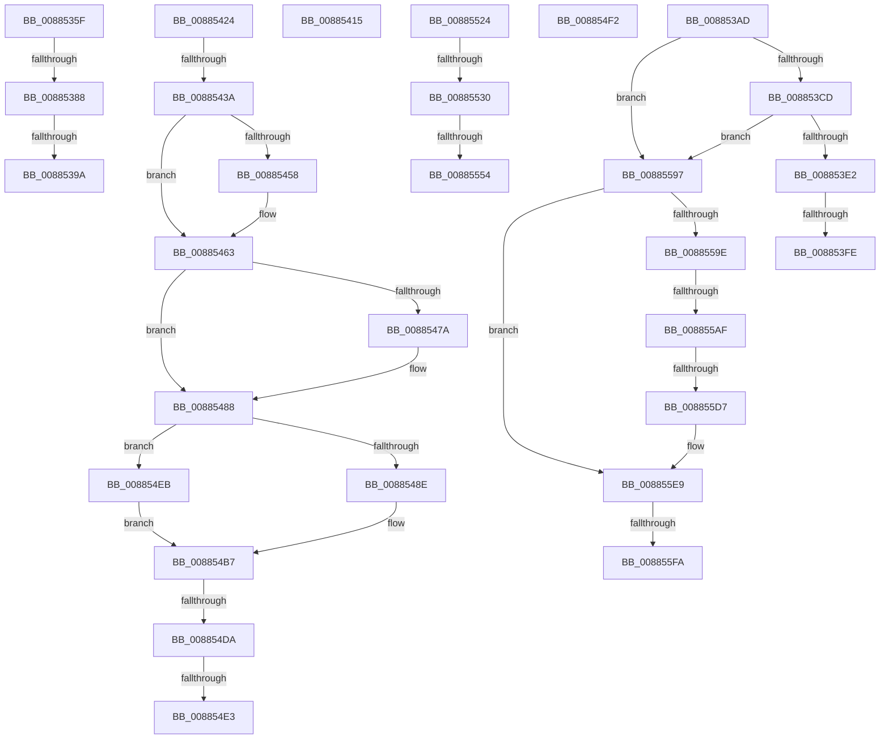

# sub_0088535F

- RVA: `0x0088535F`–`0x00885604` (길이 `677` bytes)
- VA: `0x000000014088535F`
- 실행 섹션: `PAGE`
- PDB 이름 있음: `아니요`; PDB Function 태그: `아니요`
- unwind 정보 RVA: `0x0007C8F8`
- 디코드: `159`개 명령, `677/677` bytes 표시
- 미해석 바이트: `0` (있으면 어셈블리에 `.byte`로 보존)

> 이 문서는 커널 이미지의 기계어와 PDB 기호를 분석해 생성했습니다. 4번과 5번은 함수 원형과 자료형을 바이너리 사용 방식에서 추정한 C 해석이며 원본 소스 복구 결과는 아닙니다.

## 1. Dependencies

- 직접 호출 지점: **21**; 고유 호출 대상: **20**
- 직접 호출자로 확인된 함수: **0**
- RIP 상대 이미지 참조: **1**

### Outgoing calls
- `0x0088536E` → [MiLocatePagefileSubsection](../../text/36/MiLocatePagefileSubsection_function_00367AC0.md) (function, `0x00367AC0`)
- `0x008853B3` → [UNLOCK_ADDRESS_SPACE](../../text/2A/UNLOCK_ADDRESS_SPACE_function_002A4844.md) (function, `0x002A4844`)
- `0x008853BB` → [MiReferenceVad](../../text/29/MiReferenceVad_function_00295890.md) (function, `0x00295890`)
- `0x008853D2` → [MiCommitVadMetadataBits](../8D/MiCommitVadMetadataBits_function_008D1A00.md) (function, `0x008D1A00`)
- `0x008853F0` → [MiUnmapVad](MiUnmapVad_function_00889280.md) (function, `0x00889280`)
- `0x0088540B` → [MiFinishPlaceholderVadReplacement](../A8/MiFinishPlaceholderVadReplacement_function_00A87630.md) (function, `0x00A87630`)
- `0x0088542D` → [MiChargeSegmentCommit](../8C/MiChargeSegmentCommit_function_008CEDE4.md) (function, `0x008CEDE4`)
- `0x0088545E` → [MiUnlockVad](../../text/2A/MiUnlockVad_function_002A59C8.md) (function, `0x002A59C8`)
- `0x0088546F` → [UNLOCK_ADDRESS_SPACE](../../text/2A/UNLOCK_ADDRESS_SPACE_function_002A4844.md) (function, `0x002A4844`)
- `0x00885483` → [MiRemoveSharedCommitNode](MiRemoveSharedCommitNode_function_008889A0.md) (function, `0x008889A0`)
- `0x008854A2` → [MiLocateSubsectionNode](../../text/2B/MiLocateSubsectionNode_function_002BBEE0.md) (function, `0x002BBEE0`)
- `0x008854B2` → [MiDecrementLargeSubsections](../../text/4D/MiDecrementLargeSubsections_function_004D2BE0.md) (function, `0x004D2BE0`)
- `0x008854C4` → [MiRemoveViewsFromSectionWithPfn](../../text/29/MiRemoveViewsFromSectionWithPfn_function_002986D4.md) (function, `0x002986D4`)
- `0x008854CC` → [MiDereferenceControlArea](../../text/47/MiDereferenceControlArea_function_00479A20.md) (function, `0x00479A20`)
- `0x008854F9` → [MiFillMapFileInfo](../97/MiFillMapFileInfo_function_0097E15C.md) (function, `0x0097E15C`)
- `0x0088551A` → [MiLogPerfMemoryEvent](../../text/23/MiLogPerfMemoryEvent_function_002369C8.md) (function, `0x002369C8`)
- `0x0088553E` → [MiAllocatePool](../../text/35/MiAllocatePool_function_0035B540.md) (function, `0x0035B540`)
- `0x0088557F` → [MiInsertVadEvent](../../text/43/MiInsertVadEvent_function_00430E74.md) (function, `0x00430E74`)
- `0x0088558D` → [MiSetVadFlags](../../text/43/MiSetVadFlags_function_004311FC.md) (function, `0x004311FC`)
- `0x008855CA` → [MiSecureVad](../9F/MiSecureVad_function_009F5788.md) (function, `0x009F5788`)
- `0x008855FA` → [MiUnlockAndDereferenceVad](../../text/31/MiUnlockAndDereferenceVad_function_00316E60.md) (function, `0x00316E60`)

### Direct callers
- 이 함수 시작 RVA로 연결되는 직접 call은 확인되지 않았습니다. 간접 호출은 완전히 역산할 수 없습니다.

### Static image references
- `0x008855DF` → RVA `0x00E2DB80` (`.data`; read)

## 2. Other-region calls and transfers

- 다른 실행 섹션으로 향하는 call: **14**
  - `0x0088536E` → [MiLocatePagefileSubsection](../../text/36/MiLocatePagefileSubsection_function_00367AC0.md) (`PAGE` → `.text`)
  - `0x008853B3` → [UNLOCK_ADDRESS_SPACE](../../text/2A/UNLOCK_ADDRESS_SPACE_function_002A4844.md) (`PAGE` → `.text`)
  - `0x008853BB` → [MiReferenceVad](../../text/29/MiReferenceVad_function_00295890.md) (`PAGE` → `.text`)
  - `0x0088545E` → [MiUnlockVad](../../text/2A/MiUnlockVad_function_002A59C8.md) (`PAGE` → `.text`)
  - `0x0088546F` → [UNLOCK_ADDRESS_SPACE](../../text/2A/UNLOCK_ADDRESS_SPACE_function_002A4844.md) (`PAGE` → `.text`)
  - `0x008854A2` → [MiLocateSubsectionNode](../../text/2B/MiLocateSubsectionNode_function_002BBEE0.md) (`PAGE` → `.text`)
  - `0x008854B2` → [MiDecrementLargeSubsections](../../text/4D/MiDecrementLargeSubsections_function_004D2BE0.md) (`PAGE` → `.text`)
  - `0x008854C4` → [MiRemoveViewsFromSectionWithPfn](../../text/29/MiRemoveViewsFromSectionWithPfn_function_002986D4.md) (`PAGE` → `.text`)
  - `0x008854CC` → [MiDereferenceControlArea](../../text/47/MiDereferenceControlArea_function_00479A20.md) (`PAGE` → `.text`)
  - `0x0088551A` → [MiLogPerfMemoryEvent](../../text/23/MiLogPerfMemoryEvent_function_002369C8.md) (`PAGE` → `.text`)
  - `0x0088553E` → [MiAllocatePool](../../text/35/MiAllocatePool_function_0035B540.md) (`PAGE` → `.text`)
  - `0x0088557F` → [MiInsertVadEvent](../../text/43/MiInsertVadEvent_function_00430E74.md) (`PAGE` → `.text`)
  - `0x0088558D` → [MiSetVadFlags](../../text/43/MiSetVadFlags_function_004311FC.md) (`PAGE` → `.text`)
  - `0x008855FA` → [MiUnlockAndDereferenceVad](../../text/31/MiUnlockAndDereferenceVad_function_00316E60.md) (`PAGE` → `.text`)
- call이 아닌 외부 분기/꼬리 이동: **18**
  - `0x00885382` → [sub_00884EE1 + 0x7B](Unknown_function_00884EE1.md) (`tail-transfer`)
  - `0x00885394` → [sub_00884EE1 + 0x80](Unknown_function_00884EE1.md) (`tail-transfer`)
  - `0x008853A8` → [sub_00884EE1 + 0x80](Unknown_function_00884EE1.md) (`tail-transfer`)
  - `0x008853F8` → [sub_00884EE1 + 0x454](Unknown_function_00884EE1.md) (`tail-transfer`)
  - `0x00885410` → [sub_00884EE1 + 0x454](Unknown_function_00884EE1.md) (`tail-transfer`)
  - `0x0088541F` → [sub_00884EE1 + 0x3E8](Unknown_function_00884EE1.md) (`tail-transfer`)
  - `0x00885434` → [sub_00884EE1 + 0x345](Unknown_function_00884EE1.md) (`tail-transfer`)
  - `0x008854D4` → [sub_008859DF + 0xA2](Unknown_function_008859DF.md) (`tail-transfer`)
  - `0x008854DD` → [sub_00885AED + 0xF1](Unknown_function_00885AED.md) (`tail-transfer`)
  - `0x008854E6` → [sub_00884EE1 + 0x457](Unknown_function_00884EE1.md) (`tail-transfer`)
  - `0x0088551F` → [sub_00884EE1 + 0x411](Unknown_function_00884EE1.md) (`tail-transfer`)
  - `0x0088552A` → [sub_00885634](Unknown_function_00885634.md) (`tail-transfer`)
  - `0x0088554E` → [sub_00885634 + 0x11](Unknown_function_00885634.md) (`tail-transfer`)
  - `0x00885592` → [sub_00884EE1 + 0x2F0](Unknown_function_00884EE1.md) (`tail-transfer`)
  - `0x008855A9` → [sub_00885AED + 0xAE](Unknown_function_00885AED.md) (`tail-transfer`)
  - `0x008855D1` → [sub_00885AED + 0xCA](Unknown_function_00885AED.md) (`tail-transfer`)
  - `0x008855F4` → [sub_00885634 + 0x156](Unknown_function_00885634.md) (`tail-transfer`)
  - `0x008855FF` → [sub_00884EE1 + 0x44D](Unknown_function_00884EE1.md) (`tail-transfer`)

## 3. Assembly (complete function range)

```asm
0088535F  49 8D 8F 80 00 00 00            lea rcx, [r15 + 0x80]
00885366  4C 89 65 E0                     mov qword ptr [rbp - 0x20], r12
0088536A  48 8D 55 E0                     lea rdx, [rbp - 0x20]
0088536E  E8 4D 27 AE FF                  call 0x140367ac0
00885373  4C 8B C0                        mov r8, rax
00885376  48 89 44 24 60                  mov qword ptr [rsp + 0x60], rax
0088537B  4C 39 B5 98 00 00 00            cmp qword ptr [rbp + 0x98], r14
00885382  0F 85 D4 FB FF FF               jne 0x140884f5c
00885388  83 BD 90 00 00 00 18            cmp dword ptr [rbp + 0x90], 0x18
0088538F  BA 01 00 00 00                  mov edx, 1
00885394  0F 85 C7 FB FF FF               jne 0x140884f61
0088539A  41 F7 47 38 00 10 00 00         test dword ptr [r15 + 0x38], 0x1000
008853A2  0F B6 DB                        movzx ebx, bl
008853A5  0F 45 DA                        cmovne ebx, edx
008853A8  E9 B4 FB FF FF                  jmp 0x140884f61
008853AD  49 8B D4                        mov rdx, r12
008853B0  49 8B CD                        mov rcx, r13
008853B3  E8 8C F4 A1 FF                  call 0x1402a4844
008853B8  49 8B CE                        mov rcx, r14
008853BB  E8 D0 04 A1 FF                  call 0x140295890
008853C0  44 8B 46 78                     mov r8d, dword ptr [rsi + 0x78]
008853C4  45 85 C0                        test r8d, r8d
008853C7  0F 84 CA 01 00 00               je 0x140885597
008853CD  33 D2                           xor edx, edx
008853CF  49 8B CE                        mov rcx, r14
008853D2  E8 29 C6 04 00                  call 0x1408d1a00
008853D7  44 8B F8                        mov r15d, eax
008853DA  85 C0                           test eax, eax
008853DC  0F 89 B5 01 00 00               jns 0x140885597
008853E2  48 8B 5C 24 70                  mov rbx, qword ptr [rsp + 0x70]
008853E7  45 33 C0                        xor r8d, r8d
008853EA  48 8B D3                        mov rdx, rbx
008853ED  49 8B CE                        mov rcx, r14
008853F0  E8 8B 3E 00 00                  call 0x140889280
008853F5  48 85 DB                        test rbx, rbx
008853F8  0F 84 37 FF FF FF               je 0x140885335
008853FE  48 8B 55 A8                     mov rdx, qword ptr [rbp - 0x58]
00885402  41 B8 01 00 00 00               mov r8d, 1
00885408  48 8B CB                        mov rcx, rbx
0088540B  E8 20 22 20 00                  call 0x140a87630
00885410  E9 20 FF FF FF                  jmp 0x140885335
00885415  F0 41 FF 47 5C                  lock inc dword ptr [r15 + 0x5c]
0088541A  48 8B 5C 24 68                  mov rbx, qword ptr [rsp + 0x68]
0088541F  E9 A5 FE FF FF                  jmp 0x1408852c9
00885424  48 8B 55 B8                     mov rdx, qword ptr [rbp - 0x48]
00885428  48 8B 4C 24 60                  mov rcx, qword ptr [rsp + 0x60]
0088542D  E8 B2 99 04 00                  call 0x1408cede4
00885432  85 C0                           test eax, eax
00885434  0F 85 EC FD FF FF               jne 0x140885226
0088543A  41 BD 2D 01 00 C0               mov r13d, 0xc000012d
00885440  44 89 6D 68                     mov dword ptr [rbp + 0x68], r13d
00885444  48 8B 5C 24 50                  mov rbx, qword ptr [rsp + 0x50]
00885449  4C 8B 64 24 58                  mov r12, qword ptr [rsp + 0x58]
0088544E  48 8B 44 24 70                  mov rax, qword ptr [rsp + 0x70]
00885453  48 85 C0                        test rax, rax
00885456  74 0B                           je 0x140885463
00885458  48 8B D0                        mov rdx, rax
0088545B  48 8B CB                        mov rcx, rbx
0088545E  E8 65 05 A2 FF                  call 0x1402a59c8
00885463  48 8B 7D 88                     mov rdi, qword ptr [rbp - 0x78]
00885467  48 8B 4C 24 50                  mov rcx, qword ptr [rsp + 0x50]
0088546C  48 8B D7                        mov rdx, rdi
0088546F  E8 D0 F3 A1 FF                  call 0x1402a4844
00885474  83 7D 80 00                     cmp dword ptr [rbp - 0x80], 0
00885478  74 0E                           je 0x140885488
0088547A  45 33 C0                        xor r8d, r8d
0088547D  48 8B D7                        mov rdx, rdi
00885480  49 8B CF                        mov rcx, r15
00885483  E8 18 35 00 00                  call 0x1408889a0
00885488  83 7D 84 00                     cmp dword ptr [rbp - 0x7c], 0
0088548C  74 5D                           je 0x1408854eb
0088548E  48 8B 45 78                     mov rax, qword ptr [rbp + 0x78]
00885492  45 33 C0                        xor r8d, r8d
00885495  49 8B CF                        mov rcx, r15
00885498  48 8B 10                        mov rdx, qword ptr [rax]
0088549B  48 FF CA                        dec rdx
0088549E  48 03 56 20                     add rdx, qword ptr [rsi + 0x20]
008854A2  E8 39 6A A3 FF                  call 0x1402bbee0
008854A7  48 8B 5C 24 60                  mov rbx, qword ptr [rsp + 0x60]
008854AC  48 8B D0                        mov rdx, rax
008854AF  48 8B CB                        mov rcx, rbx
008854B2  E8 29 D7 C4 FF                  call 0x1404d2be0
008854B7  48 8B 55 C0                     mov rdx, qword ptr [rbp - 0x40]
008854BB  41 B8 08 00 00 00               mov r8d, 8
008854C1  48 8B CB                        mov rcx, rbx
008854C4  E8 0B 32 A1 FF                  call 0x1402986d4
008854C9  49 8B CF                        mov rcx, r15
008854CC  E8 4F 45 BF FF                  call 0x140479a20
008854D1  4D 85 F6                        test r14, r14
008854D4  0F 85 A7 05 00 00               jne 0x140885a81
008854DA  4D 85 E4                        test r12, r12
008854DD  0F 85 FB 06 00 00               jne 0x140885bde
008854E3  41 8B C5                        mov eax, r13d
008854E6  E9 4D FE FF FF                  jmp 0x140885338
008854EB  48 8B 5C 24 60                  mov rbx, qword ptr [rsp + 0x60]
008854F0  EB C5                           jmp 0x1408854b7
008854F2  48 8D 55 E8                     lea rdx, [rbp - 0x18]
008854F6  49 8B CE                        mov rcx, r14
008854F9  E8 5E 8C 0F 00                  call 0x14097e15c
008854FE  B9 25 04 00 00                  mov ecx, 0x425
00885503  C7 44 24 20 03 19 50 00         mov dword ptr [rsp + 0x20], 0x501903
0088550B  41 B9 2C 00 00 00               mov r9d, 0x2c
00885511  4C 8D 45 E8                     lea r8, [rbp - 0x18]
00885515  BA 00 80 00 00                  mov edx, 0x8000
0088551A  E8 A9 14 9B FF                  call 0x1402369c8
0088551F  E9 CE FD FF FF                  jmp 0x1408852f2
00885524  41 8B 46 30                     mov eax, dword ptr [r14 + 0x30]
00885528  A8 08                           test al, 8
0088552A  0F 85 04 01 00 00               jne 0x140885634
00885530  BA 58 00 00 00                  mov edx, 0x58
00885535  41 B8 4D 6D 53 65               mov r8d, 0x65536d4d
0088553B  8D 4A E8                        lea ecx, [rdx - 0x18]
0088553E  E8 FD 5F AD FF                  call 0x14035b540
00885543  48 89 44 24 58                  mov qword ptr [rsp + 0x58], rax
00885548  48 8B C8                        mov rcx, rax
0088554B  48 85 C0                        test rax, rax
0088554E  0F 84 F1 00 00 00               je 0x140885645
00885554  4C 89 68 08                     mov qword ptr [rax + 8], r13
00885558  48 8B D1                        mov rdx, rcx
0088555B  C7 40 50 02 00 00 00            mov dword ptr [rax + 0x50], 2
00885562  41 BC 01 00 00 00               mov r12d, 1
00885568  48 8B 45 98                     mov rax, qword ptr [rbp - 0x68]
0088556C  45 8B C4                        mov r8d, r12d
0088556F  48 89 41 10                     mov qword ptr [rcx + 0x10], rax
00885573  41 8B C5                        mov eax, r13d
00885576  83 C8 04                        or eax, 4
00885579  89 41 08                        mov dword ptr [rcx + 8], eax
0088557C  49 8B CE                        mov rcx, r14
0088557F  E8 F0 B8 BA FF                  call 0x140430e74
00885584  45 8B C4                        mov r8d, r12d
00885587  41 8B D4                        mov edx, r12d
0088558A  49 8B CE                        mov rcx, r14
0088558D  E8 6A BC BA FF                  call 0x1404311fc
00885592  E9 3A FC FF FF                  jmp 0x1408851d1
00885597  48 83 7E 48 00                  cmp qword ptr [rsi + 0x48], 0
0088559C  74 4B                           je 0x1408855e9
0088559E  44 8B 4E 44                     mov r9d, dword ptr [rsi + 0x44]
008855A2  41 8D 41 FF                     lea eax, [r9 - 1]
008855A6  83 F8 01                        cmp eax, 1
008855A9  0F 87 EC 05 00 00               ja 0x140885b9b
008855AF  4C 8B 46 18                     mov r8, qword ptr [rsi + 0x18]
008855B3  48 8D 45 D8                     lea rax, [rbp - 0x28]
008855B7  48 89 44 24 28                  mov qword ptr [rsp + 0x28], rax
008855BC  48 8B D3                        mov rdx, rbx
008855BF  49 8B CE                        mov rcx, r14
008855C2  C7 44 24 20 00 00 00 00         mov dword ptr [rsp + 0x20], 0
008855CA  E8 B9 01 17 00                  call 0x1409f5788
008855CF  85 C0                           test eax, eax
008855D1  0F 88 E0 05 00 00               js 0x140885bb7
008855D7  48 8B 46 48                     mov rax, qword ptr [rsi + 0x48]
008855DB  4C 33 65 D8                     xor r12, qword ptr [rbp - 0x28]
008855DF  4C 33 25 9A 85 5A 00            xor r12, qword ptr [rip + 0x5a859a]
008855E6  4C 89 20                        mov qword ptr [rax], r12
008855E9  48 8B 7C 24 70                  mov rdi, qword ptr [rsp + 0x70]
008855EE  49 8B CE                        mov rcx, r14
008855F1  48 85 FF                        test rdi, rdi
008855F4  0F 85 90 01 00 00               jne 0x14088578a
008855FA  E8 61 18 A9 FF                  call 0x140316e60
008855FF  E9 2A FD FF FF                  jmp 0x14088532e
```

## 4. C-style interpretation (structured pseudocode)

```c
__int64 __fastcall sub_0088535F(void)
{
    __int64 result;
    __int64 v_rbx;
    unsigned int v_stack_p20;
    unsigned __int64 v_stack_p28;
    unsigned __int64 v_stack_p50;
    unsigned __int64 v_stack_p58;
    unsigned __int64 v_stack_p60;
    unsigned __int64 v_stack_p68;
    unsigned __int64 v_stack_p70;

    *(unsigned __int64 *)(v_rbp - 32) = v_r12;
    result = MiLocatePagefileSubsection(v_r15 + 128, v_rbp - 32, a3, a4);
    v_stack_p60 = result;
    v_rbx = (unsigned __int8)(v_rbx);
    if (((*(unsigned int *)(v_r15 + 56)) & (0x1000ULL)) != 0) { v_rbx = 1; }
}
```

## 5. (Beta) C Style

```c
void sub_0088535F(void)
{
    int64_t result;
    int64_t local_rbx;
    uint32_t v_stack_p20;
    uint64_t v_stack_p28;
    uint64_t v_stack_p50;
    uint64_t v_stack_p58;
    uint64_t v_stack_p60;
    uint64_t v_stack_p68;
    uint64_t v_stack_p70;

    *(uint64_t *)(local_rbp - 0x20) = local_r12;
    result = MiLocatePagefileSubsection(local_r15 + 128, local_rbp - 32, a3, a4);
    v_stack_p60 = result;
    local_rbx = (uint8_t)(local_rbx);
    if (((*(uint32_t *)(local_r15 + 0x38)) & (0x1000ULL)) != 0) { local_rbx = 1; }
}
```

## 6. Execution-region graph

[열기: 2D/3D 그래프와 함수 탐색 컨트롤 패널](../../../control-panel.html?section=page&rva=0x0088535F&view=graph)

- 2D 그래프는 위에서 아래로 흐르고, 3D 그래프는 빈 공간을 드래그해 회전합니다. Shift+드래그는 이동, 휠은 확대·축소, 함수 노드 선택은 대상 보고서 이동입니다.

### Static fallback


