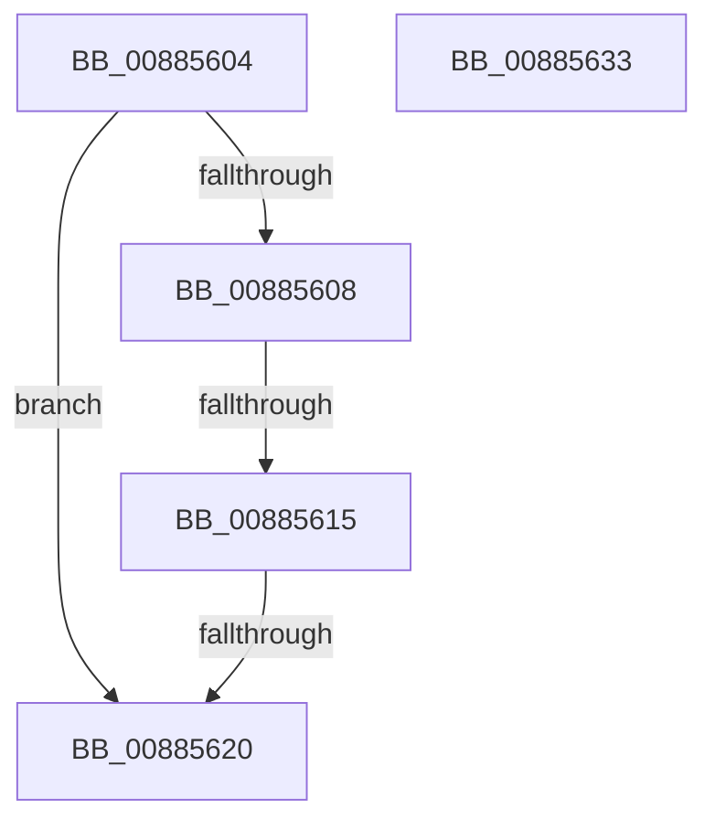

# sub_00885604

- RVA: `0x00885604`–`0x00885634` (길이 `48` bytes)
- VA: `0x0000000140885604`
- 실행 섹션: `PAGE`
- PDB 이름 있음: `아니요`; PDB Function 태그: `아니요`
- unwind 정보 RVA: `0x0007C914`
- 디코드: `16`개 명령, `48/48` bytes 표시
- 미해석 바이트: `0` (있으면 어셈블리에 `.byte`로 보존)

> 이 문서는 커널 이미지의 기계어와 PDB 기호를 분석해 생성했습니다. 4번과 5번은 함수 원형과 자료형을 바이너리 사용 방식에서 추정한 C 해석이며 원본 소스 복구 결과는 아닙니다.

## 1. Dependencies

- 직접 호출 지점: **0**; 고유 호출 대상: **0**
- 직접 호출자로 확인된 함수: **0**
- RIP 상대 이미지 참조: **0**

### Outgoing calls
- 직접 디코드된 call 명령이 없습니다.

### Direct callers
- 이 함수 시작 RVA로 연결되는 직접 call은 확인되지 않았습니다. 간접 호출은 완전히 역산할 수 없습니다.

### Static image references
- 디코드된 RIP-relative 메모리 참조가 없습니다.

## 2. Other-region calls and transfers

- 다른 실행 섹션으로 향하는 call: **0**
- call이 아닌 외부 분기/꼬리 이동: **2**
  - `0x0088560F` → [MiMapViewOfDataSection + 0x8B](MiMapViewOfDataSection_function_00884E20.md) (`tail-transfer`)
  - `0x0088561A` → [MiMapViewOfDataSection + 0x8B](MiMapViewOfDataSection_function_00884E20.md) (`tail-transfer`)

## 3. Assembly (complete function range)

```asm
00885604  85 D2                           test edx, edx
00885606  75 18                           jne 0x140885620
00885608  4C 39 8F 40 06 00 00            cmp qword ptr [rdi + 0x640], r9
0088560F  0F 85 96 F8 FF FF               jne 0x140884eab
00885615  8B 46 3C                        mov eax, dword ptr [rsi + 0x3c]
00885618  A8 01                           test al, 1
0088561A  0F 85 8B F8 FF FF               jne 0x140884eab
00885620  B8 0D 00 00 C0                  mov eax, 0xc000000d
00885625  48 81 C4 30 01 00 00            add rsp, 0x130
0088562C  41 5F                           pop r15
0088562E  5F                              pop rdi
0088562F  5E                              pop rsi
00885630  5B                              pop rbx
00885631  5D                              pop rbp
00885632  C3                              ret
00885633  CC                              int3
```

## 4. C-style interpretation (structured pseudocode)

```c
__int64 __fastcall sub_00885604(__int64 a1, int a2, __int64 a3, __int64 a4)
{
    __int64 v_rsp;

    if (a2 != 0) goto loc_00885620;
loc_00885620:
    v_rsp = (v_rsp) + (304);
    return (unsigned int)(0xC000000DULL);
}
```

## 5. (Beta) C Style

```c
int64_t sub_00885604(int64_t Arg1, int32_t Arg2, int64_t Arg3, int64_t Arg4)
{
    int64_t local_rsp;

    if (Arg2 != 0) goto loc_00885620;
loc_00885620:
    local_rsp = (local_rsp) + (304);
    return (uint32_t)(0xC000000DULL);
}
```

## 6. Execution-region graph

[열기: 2D/3D 그래프와 함수 탐색 컨트롤 패널](../../../control-panel.html?section=page&rva=0x00885604&view=graph)

- 2D 그래프는 위에서 아래로 흐르고, 3D 그래프는 빈 공간을 드래그해 회전합니다. Shift+드래그는 이동, 휠은 확대·축소, 함수 노드 선택은 대상 보고서 이동입니다.

### Static fallback


